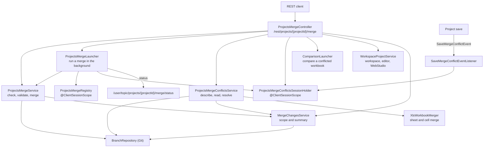
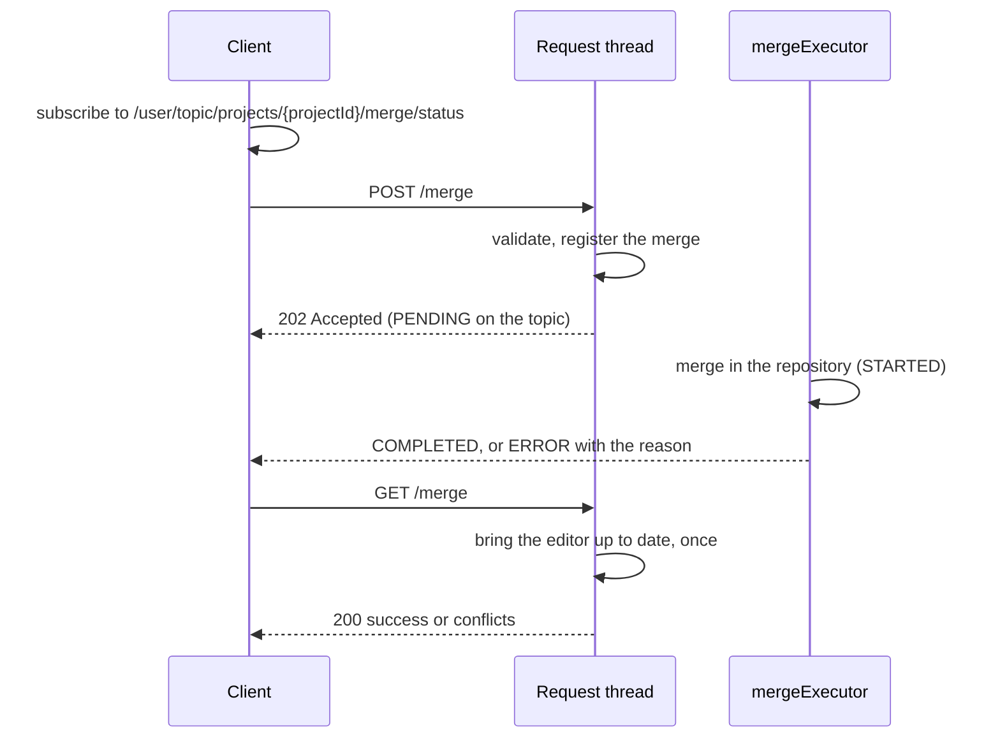

# Projects Merge API - Architecture Design

**Status**: BETA — the design behind [Projects Merge API](projects-merge-api.md)

The API merges the Git branches of a project, keeps the conflicts of a merge or of a project save for the client, and
resolves them. This page describes the components, the flows, and the rules that keep the editor consistent.

## Components

All the code is in `STUDIO/studio-backend`.

- **`ProjectsMergeController`** (`org.openl.studio.projects.rest.controller`) — the endpoints. It pauses the compilation of
  an opened project for the length of a resolution, and brings the workspace and the editor to the state after it.
- **`ProjectsMergeService`** (`org.openl.studio.projects.service.merge`) — checks where the branches stand, refuses a
  merge that must not be performed, and merges.
- **`MergeChangesService`** — tells which projects and files a merge brings into the target branch: before the merge
  for the check, and once it is committed for the result and the resolution.
- **`ProjectsMergeLauncher`** — validates a merge and runs it on the `mergeExecutor` pool, apart from the request that
  starts it, reports its progress on the WebSocket, and brings the editor up to date once the merge has ended.
- **`ProjectsMergeRegistry`** — keeps the merge a client started last (`StartedMerge`): the merge itself and the
  editor state it found.
- **`ProjectsMergeConflictsService`** — describes a conflict (revisions, file availability, default message), groups the
  conflicted files by project, reads one version of a file, and resolves. A resolved merge is summed up by
  `MergeChangesService`, as a merge without conflicts is.
- **`ProjectsMergeConflictsSessionHolder`** — keeps the unresolved conflict of one client.
- **`SaveMergeConflictEventListener`** — stores the conflict that a project save found in the same holder.
- **`ComparisonLauncher`** (`org.openl.studio.compare.service`) — starts the comparison of two versions of a
  conflicted workbook: their version against yours, or the base version against either, which shows what that side
  changed; the comparison is read through the Compare API.
- **`XlsWorkbookMerger`** (`org.openl.rules.xls.merge`) — merges two versions of a workbook against their base, sheet
  by sheet. A sheet both versions changed goes to **`XlsSheetMerger`**, which merges it cell by cell, the value, the
  style and the comment of a cell each on its own, unless the changes overlap. When that fails, for instance because
  **`XlsSheetShifts`** tells that a version moved the content of the sheet, **`XlsTableMerger`** merges the sheet
  table by table instead: **`XlsSheetTables`** splits each version into tables and pairs them by their headers,
  **`LineAlignment`** aligns the rows or the columns of a table changed in both versions with the base version, and
  **`XlsFormulaReferences`** keeps the sheet a conflict when a formula or a defined name refers to content that moves.
- **Models** (`org.openl.studio.projects.model.merge`) — the records of the requests and the responses.

## Check and Merge

`POST /merge/check` and `POST /merge` run the same validation, in the same order:

1. **State** — the project is in the design repository and not only in the workspace, the repository supports
   branches and has a branch besides the current one, and the project has no unsaved changes. Otherwise `409` with
   `project.merge.invalid.state.message`.
2. **Permission** — the user has the write, delete, or create permission on some artefact of the project. Otherwise
   `403`.
3. **Branches** — `otherBranch` is not the current branch, and it exists. Otherwise `409`.
4. **Bypass** — for a protected target branch, `force=true` and the bypass eligibility (the Manager role while
   `security.allow-bypass-protected-branches` is `true`). Otherwise `409` or `403`.
5. **Lock** — the project is not locked on the target branch. Otherwise `409`.
6. **Changes** — the target does not hold every change of the source yet. Otherwise `409`.

`check` reports the result as `CheckMergeResult` and never refuses for steps 4 to 6: `blockedBy` carries the protected
branch and the lock, and `status` says `up-to-date` for step 6. `merge` runs all six, and then merges:

- **`receive`** merges `otherBranch` into the current branch. **`send`** merges the current branch into `otherBranch`.
  The target of the merge is the branch that changes.
- The Git repository merges the source into the target with the user as the author, and the service waits up to
  30 seconds until the project index publishes the target branch. The merge is committed by then, so an index that
  is late is logged and the merge stays a `success`: a failure would have the user merge again what is already
  merged (EPBDS-16541). A resolution waits for the index the same way.
- A conflict in Git gives a `MergeConflictInfo` with the details of the conflict. Otherwise the merge is `success`.

## What a Merge Brings In

A branch holds every project of the repository, so a merge changes whole branches: a Sync asked for one project also
takes in, or sends out, the changes of every other project the source branch changed. The check and the result tell
it, so the user sees what the merge takes in before it starts and what it changed once it is committed.

- **Before the merge** — `BranchRepository.getMergeScope(source, target)` walks three trees at once — the commit the
  branches parted at, the source and the target — and compares no content: a file the source changed since then
  that the target does not hold as the source does is a change of the merge, and one the target changed too is changed
  in both. A file both branches made alike changes nothing. The walk enters only the folders the source changed. Of
  several commits the branches parted at, as a criss-cross history has, the first is taken. A tree walk costs about
  the same however large the files are, so a mergeable check answers without a noticeable delay. It tells which files
  may conflict, not how they merge: that is known only once the merge has run.
- **After the merge** — `BranchRepository.merge` answers with a `MergeOutcome`: the revision of the target branch
  before the merge, the merge commit, the files the merge commit changes against the revision before, and the
  workbooks the merge combined by itself with the sheets taken from each branch. The commit message keeps listing
  them under `Automatically resolved conflicts`. The files are listed before the merge is published, so a failure to
  list them undoes the merge rather than reporting a published one as failed. A resolution commits through the same
  `merge`, which combines no workbook by itself then: the resolution adds the workbooks its conflict merged
  automatically (`MergeConflictDetails.mergedWorkbooks`), so it answers the same way. The descriptors a resolution
  declares modules in again are written in a commit of their own after the merge, on the branch it merged into: the
  summary lists them as well, and its revision after the merge is the commit that wrote them, as their save answers
  it. A descriptor declaring every module already is not written again, and descriptors whose save answers no commit
  are left out of the summary.
- **Projects** — `MergeChangesService` puts each file under the project whose folder holds it, reading which projects
  each branch holds from the project index (`DesignTimeRepository.getBranchProjects`), which answers for the
  repository rather than for what the user may read. A project is added or deleted as a whole when one side holds it
  and the other does not: the source and the target branch before the merge, or the target branch before and after
  it. The projects of the target branch are taken when the merge is committed — before it, and after it once the index
  has published the branch — so what the branch receives later does not change the summary. Only the projects holding
  a changed file are kept (`MergeChangesService.changesOf`). Files outside any project form a group of their own.
- **Access rights** — the projects of a scope or a summary are asked one question for all
  (`RepositoryAclService.filterGranted`). A project the user may not read is counted, never named. A file outside any
  project is shown only when the user may read it, each file under its own rights, as the repository asks when the
  file is read: a project the index does not know yet falls there, and its files stay hidden from a user who may not
  read them.
- **Paths** — every file is told by its path from the root of the repository, as a conflict names it, whatever folder
  mapping the design repository applies.
- **When** — the summary is made when the result is read, in the request of the client, not on the thread of the merge:
  the access rights are asked for the client that reads it.
- **Failures** — what a merge brings in is told beside the merge, never in its place (`MergeChangesService`). A scope
  that cannot be read leaves the check without it, and the dialog says so instead of listing projects. What a committed
  merge changed is told only once the project index has published the merge, since the index tells the projects of the
  branch after it; an index that cannot be read before the merge or is late after it, or a failure to read the
  changes, leaves the merge a `success` without a summary (EPBDS-16541), and the dialog confirms the merge with a
  notification instead.

## Merge in the Background

A merge of a large project parses three versions of every conflicted workbook and takes minutes, longer than a reverse
proxy waits for an answer (EPBDS-16469). `POST /merge` therefore answers `202` once the merge is validated and runs it
on the `mergeExecutor` pool, which runs two merges at once and queues the rest: each merge holds its workbooks in
memory.

- **One merge of a client at a time.** `ProjectsMergeRegistry` keeps the merge a client started last. Another merge is
  refused with `409` (`project.merge.running.message`) while it runs: it would change the project the running merge
  changes. An ended merge stays until the next one starts, or until the conflicts it left are resolved or cancelled
  (`ProjectsMergeLauncher.forget`), so its result can be read again: kept longer, it would report conflicts nobody has
  any more and hold what comparing the conflicted workbooks found. Two starts of one client never run at once: a start
  holds the lock of the client (`ProjectsMergeRegistry.startLock()`) from its checks until it has taken its merge, so
  the merge it replaces has ended and reached the editor.
- **The project is read-only for the client while it is merged.** `MergeInProgressInterceptor` refuses every request
  with a `projectId` path variable but a read (`GET`, `HEAD`, `OPTIONS`) with `409` `project.merge.running.message`
  while a merge of that project by the client runs. An edit, a save, a branch switch or a close would be dropped by the
  reopen at the end of the merge, or would take the merge onto a branch it was not validated for. A request that changes
  nothing though it is no `GET` — a compilation, a run of tests or tables, a trace, a comparison, a search — is a read
  too: its endpoint carries `@ChangesNothing`, so a page reloaded during a merge still compiles and shows the project.
  The endpoints of `ProjectsMergeController` stay open, and find an ended merge brought to the editor all the same. The
  project is resolved only while a merge of the client runs. Other clients, other users included, work on as before; the
  merge still merges the branch it was validated with (`StartedMerge.currentBranch`).
- **A merge that runs is no error** (EPBDS-16636). The same merge asked for again while it runs — the same project,
  branch and mode — answers `202` and is the merge already running. It is not validated again: the running merge may
  have committed already, which leaves nothing to merge. `GET /merge` answers `202` while it runs and never `409`. Two
  such requests running alongside take one merge: the second one waits until the first has taken it, and finds it
  running.
- **The background works in the repository only.** The merge is handed the user workspace taken while the request
  answered, and an opened project stays open and compiled in the editor meanwhile: a client that reloads the page in
  the middle of a merge keeps a working editor. `POST /merge` does not wait for the compilation either: the editor
  model is the one of `WebStudio`, read when the merge ends. The editor state belongs to the requests of the client:
  `WebStudio.reset()` publishes `WorkspaceResetEvent` to `@ClientSessionScope` listeners, which no thread outside a
  request finds.
- **A merge that waited for a thread asks again what other users can change.** When it starts, a target branch where
  another user has taken up the project, or that holds the other branch already, refuses it with
  `project.merge.branch.locked.message` or `project.branch.merge.not.mergeable.message`, reported as `ERROR`, and
  `GET /merge` answers `409` with the reason.
- **A merge that ends is completed before it is announced**, so a client that reads the result on `COMPLETED` finds it.
  A failure no handler takes, out of memory for one, still ends the merge as failed and reports `ERROR`: a merge that
  never ended would refuse every later merge of the client. A status the socket cannot send is logged and changes
  nothing in the merge: its result is read from `GET /merge` all the same.

## Cancelling a Merge

`DELETE /merge/conflicts` cancels a running merge as well as the conflicts a merge has left. A merge waiting for a
thread ends at once and never runs. A running merge is stopped by interrupting its thread:

- **The repository stops at a step that has published nothing.** `GitRepository.merge` waits for the lock of the
  repository interruptibly — behind another long merge — and asks `Thread.isInterrupted()` before each conflicted
  workbook it compares and merges, a workbook of a large project takes seconds, and before it pushes. Up to the push
  the merge is local. An interrupted merge throws `InterruptedIOException`, and the repository resets the branch to
  the commit the merge started from, as it does for every failed merge, so a long merge stops within seconds and
  leaves the branches as it found them. A comparison of a workbook that an interrupt cuts off is a stopped merge, not
  a conflict.
- **The reset is not cut off.** JGit writes the work tree through channels an interrupt closes, so `resetToCommit`
  clears the interrupt status for the reset and sets it again afterwards.
- **An interrupt is never swallowed.** Whoever catches an `InterruptedException` sets the status again, and the
  repository leaves it set. The launcher tells a cancelled merge from a failed one by it: a failure while the thread
  is interrupted ends the merge as `cancelled`, reported as `INTERRUPTED`, when the interrupt caused it — an
  `InterruptedIOException` other than a network timeout, a `ClosedByInterruptException` or an `InterruptedException`
  among its causes. Any other failure stays a failure, logged and reported as `ERROR`. The status stays set when the
  merge returns; the pool clears it before it gives the thread other work.
- **The interrupt reaches this merge only.** `StartedMerge.Execution` knows the thread running the merge and lets it
  go when the merge ends, so a cancel that comes later does not interrupt the work the pool gives the thread next.
- **A merge that has started to publish finishes.** A push cut off half way may have reached the remote repository
  already, while the merge would be reset locally and reported as cancelled. So `GitRepository.merge` announces the push
  through `MergePublishing`, on the thread of the merge, before its last check of the interrupt, and
  `StartedMerge.Execution` no longer interrupts the merge from then on: a cancel that came before still stops it, as the
  merge is local up to then. Its result is `success`, whatever the cancel asked for, and it still waits for the project
  index: `ProjectIndex.awaitBranchUninterruptibly` waits on through an interrupt and sets the status again afterwards.

## Merge in the Editor

A merge is made in the repository, so a closed project is merged as well as an opened one. Only an opened project has
the editor state to keep consistent. `ProjectsMergeLauncher`:

1. brings the merge that ended before to the editor, refuses unresolved conflicts, and validates the merge before it
   touches the editor;
2. merges in the background, while the editor keeps the project open, compiled and read-only for the client;
3. brings the editor up to date in the first request of the client about the project that finds the merge ended —
   `MergeInProgressInterceptor` does it before every such request, and `GET /merge` and `POST /merge` before they read
   the merge (`settleFinished`):
    - on `success`, reads the project again from the workspace, which builds its projects anew on a refresh, pauses
      the compilation of the project (`WebStudioWorkspaceRelatedDependencyManager.pause()`), so it does not read a
      project being closed (EPBDS-12353), closes the project, refreshes the workspace, and opens the project again on
      its branch (a project that the merge deleted stays closed, and a project that the merge renamed is found by its
      path), then resets `WebStudio` and the module info. The reset drops the paused dependency manager; a failure on
      the way resumes it. A project with changes of its own, or switched to another branch meanwhile — by another
      client of the user, which shares the workspace — is left as it is: closing it would drop those changes;
    - on `conflicts`, stores the `MergeConflictInfo` in the session holder;
    - after a failure or a cancel, leaves the editor as it is: the merge changed nothing.

Requests that find the merge ended while another one brings the editor up to date wait until it is done
(`StartedMerge.settleOnce`), so none of them goes on with a project that is being opened again.
`DELETE /merge/conflicts` brings an ended merge to the editor before it looks for its conflicts: a merge that ended
after the request was let in keeps them only then.

A failure to bring the editor up to date is logged, not raised: it belongs to no request that happened to find the
merge ended, and the result of the merge stays what it is.

## Conflict Storage

`ProjectsMergeConflictsSessionHolder` is a `@ClientSessionScope` bean: it lives as long as the client, whether a browser
session or the state kept for a credential (see [Client Sessions](../architecture/client-sessions.md)).

- It keeps **one** conflict, with the `ProjectIdModel` of the project. A conflict that is stored for another project
  replaces it.
- The reads are by project: asking for another project than the stored one finds nothing, so a client sees
  `404 Not Found` with `project.merge.result.not.found.message`.
- `check` and `merge` refuse with `409` while the conflict of the project is stored.
- A conflict ends when it is resolved, when `DELETE /merge/conflicts` cancels it, or with the client.
- The holder stores two kinds of conflict. A **merge conflict** has the branches (`mergeBranchFrom`,
  `mergeBranchTo`, `currentBranch`). A **save conflict** has none: the project save found that another user changed
  the project, and `PATCH /rest/projects/{projectId}` answers `409` with `project.save.merge.conflict.message`.
  In a save conflict `OURS` is the version being saved and `THEIRS` is the version that another user saved first.

## Resolution

`POST /merge/conflicts/resolve` takes the resolution of each conflicted file:

1. **Validation** — each file is in the conflict, no file is named twice, and a `CUSTOM` resolution has a non-empty
   uploaded file. An uploaded Excel or ZIP file is read to see that it is complete.
2. **Versions** — `BASE`, `OURS`, and `THEIRS` are read from the commits of the conflict, not from the working tree. A
   version that does not hold the file deletes the file.
3. **Workbooks** — a conflicted Excel file whose changes do not overlap is merged by `XlsWorkbookMerger` without a
   decision: a sheet changed in one branch only is taken from it, a sheet changed in both is merged table by table, row
   by row and cell by cell. The same merge completes a `POST /merge` and a project save without a conflict when every
   conflicted file is such a workbook. Such files are not listed in the request or in `resolvedFiles`.
4. **Commit** — for a merge conflict the repository completes the merge with the resolved files and the message of the
   request. For a save conflict the project is saved with them. Without a message the service builds one: the commit of
   the other branch, the conflicted files, and the workbooks resolved automatically.
5. **Project descriptor** — a resolved workbook whose module the `rules.xml` of one side declares and the `rules.xml` of
   the branch does not is declared again in a second commit with the same message.
6. **Editor** — the controller clears the stored conflict, refreshes the workspace, and opens the project again if it was
   opened, as after a merge.

A refused resolution leaves the stored conflict as it was, so the client can send the request again.

## Errors

The errors are `RestRuntimeException`s with message codes in `ValidationMessages.properties`. The advice maps them to
`{"code": "openl.error.<status>.<key>", "message": "..."}`; see [Errors](README.md#errors) and the table in
[Projects Merge API](projects-merge-api.md#error-handling). A Git failure of a merge is reported on the status topic
as `ERROR` with its reason, and `GET /merge` answers it with `500`.

## Testing

- **Unit tests** — `STUDIO/studio-backend/test/org/openl/studio/projects/service/merge` and the controller
  tests next to the controller; `ProjectsMergeLauncherTest` runs merges on a queue the test drains, so it sees the
  request answer before the merge runs.
- **Git** — `GitRepositoryMergeConflictsInExcelTest` and the other merge tests in
  `STUDIO/org.openl.rules.repository.git`, the scope and the outcome of a merge included.
- **Scope and summary** — `MergeChangesServiceTest`: the order of the projects, a project added or deleted as a
  whole, the files outside projects, the sheets of a workbook merged automatically, and the projects the user may not
  read.
- **Workbook merge** — `XlsSheetMergerTest`, `XlsTableMergerTest` and `XlsSheetShiftsTest` in
  `STUDIO/org.openl.rules.xls.merge`: the changes of the two branches, kind by kind, merged or kept a conflict;
  `XlsTableMergerTest` crosses what each branch does with a table: leaves, creates, removes, changes or moves it.
- **Integration** — the declarative suites in `ITEST/itest.studio`; `task_EPBDS-16883-excel-cell-merge` merges a
  sheet changed in both branches through the table API, a table theme included; `task_EPBDS-16896-merge-scope`
  checks and merges a branch that changes three projects, as the administrator and as a user who may read one of
  them, so the scope and the summary name that project alone and count the two others. A merge step is three
  requests: the `POST` answered `202`, a `GET /merge` retried until the merge has ended, and a `GET /merge` checking
  its result.
