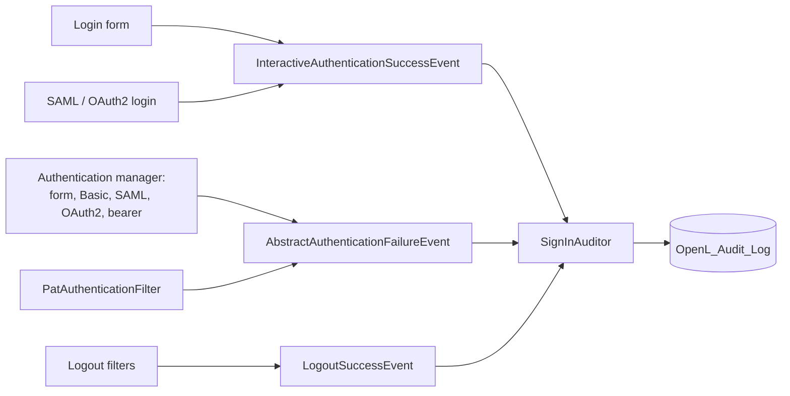

# Audit Log

OpenL Studio keeps an audit log of who did what and when: who signed in and out, whose sign-in was refused, who changed
users, groups, personal access tokens and access rights, whose request was refused for lack of permission, who created,
saved, deleted and deployed projects and changed the branches of their repositories, who changed the system settings,
and who read the log.
Administrators read it on the **Audit Log** page or through `GET /rest/admin/audit`. This page describes where the
events come from, how they are kept and how they are read. The user guide describes the page:
[Reviewing the Audit Log](../user-guides/openl-studio/administration/08-audit-log.md).

## An Event

An event is a row of the `OpenL_Audit_Log` table of the OpenL Studio database (Flyway `V17`, an identity of its own
on Oracle in `V17.1`, the search indexes of PostgreSQL in `V17.1` of its own), mapped by `AuditRecord`:

- **id**, growing with every event; **time** (`eventTime`, UTC); **actor** (the login name of the user who did the
  action); **client address**;
- **authentication** — how the actor signed in, or tried to (`AuditAuthentication`: `form`, `basic`, `token`,
  `bearer`, `oauth2`, `saml`, `link`);
- **category**, **action** and **outcome** (`success`, `failure`, `denied`) — `AuditAction` names its category;
- **target** — the kind and the name of the object the action was done to, kept whole however long it is;
- **project** — the project the action was made on: the target of an action on a project, or the project a branch,
  a bypass of a branch protection or a deployment was made from (`AuditService` reads it from the `project` detail
  `ProjectAuditor` writes). It is not shown: a search by the target matches it too;
- **subject** — the user or the group whose access or membership the action changed;
- **details** — a JSON object of what else tells the action apart, kept whole however long it is.

A longer actor or subject is cut to 100 characters, a client address to 45 and a project to 2000, with `…` at the end.

The row keeps names, not links: an event outlives the user, the group or the project it names. A password or a token
is never recorded; a personal access token is named by its public id.

## Recording

`AuditService.recordEvent(AuditEvent)` puts an event into the log. An event that names no actor is recorded for the
signed-in user, or for no one when OpenL Studio acts by itself, and with the way that user signed in
(`AuthenticationMethods`). The address of the client comes from the current request, or from the request that started
the task recording the event (`AuditClient`): behind a proxy, it is the address the proxy forwards only when the
container reads the forwarded headers, as the OpenL Studio image does (see [Deployment](../DEPLOYMENT.md)). The event is
saved in the transaction of the caller, so a change and its event are saved together, and an event of a change that is
rolled back is rolled back too. Outside a transaction the event is saved at once.

In the Single-User mode `recordEvent` does nothing: there is no sign-in and no access control to account for.

When `audit.outputs.console` is on, every event is also written to the console by the `OpenL.audit` logger at the
`INFO` level, one line per event, for a log collector; the database keeps the events either way. A line holds the
action and the outcome, then the other fields of the event but its time and its category, by the names of the columns
of an export and with the codes of the REST API, such as `signIn failure id=7 actor=jdoe authentication=form
clientAddress=10.0.0.7 details={"reason":"badCredentials"}`. A line break or another control character in a value is
written as an escape (`\n`, `\u2028`), so a value a client typed, such as the name of a refused sign-in, cannot add a
line of its own. The same fields come with the line as key-value pairs `audit.<field>`, the category and the id
included, which a structured layout writes as fields of their own: the `ecs` format of the OpenL Studio image does.

## Sign-ins

Spring Security publishes the sign-ins, and `SignInAuditor` records them:

- **A sign-in** is recorded when it opens a session: the login form, SAML or OAuth2.
- **A request that carries its own credentials** — Basic authentication, a bearer token, a personal access token —
  signs in anew every time, so its sign-in is recorded once for a use of the credentials: at their first request, and
  at the first one after they were idle for the time an HTTP session may stay idle (`session-timeout` of `web.xml`).
  `SignInAuditor` is a `HandlerInterceptor` of the REST API for this: it tells credentials apart as
  `ClientSessions.credentialOf` does, so a browser calling with its session records nothing, and a personal access
  token is named by its public id. It remembers when each credential made its last request, on this node, and forgets
  the idle ones once a minute.
- **A refused sign-in** is recorded for every way of signing in, with the reason (`badCredentials`,
  `locked`, `disabled`, `expired`, `invalidToken`, `error`). The `authenticationEventPublisher` of
  `CommonAuthenticationConfig` serves the OpenL authentication manager and the login-form chains alike; a refusal
  without an event of its own, such as a rejected SAML response, is published as one of bad credentials. The reason
  comes from the exception all the same (`SignInAuditor.reasonOf`): a rejected SAML response is recorded as `error`,
  a refused OpenID Connect sign-in as `invalidToken`. `PatAuthenticationFilter` publishes a refused token itself,
  since no authentication manager reads it.
- **A refused sign-in names a user only when one was typed** (a `UsernamePasswordAuthenticationToken`): the name of
  a bearer token that was not read is the token itself.
- **A sign-out** is published by the logout handler the login form chain adds itself, and by
  `logoutEventPublishingHandler`, which the SAML and OAuth2 logout filters run first. A sign-out the SAML identity
  provider asks for is published the same way.
- **A session that times out** is a sign-out with the reason `timedOut`: an `HttpSessionDestroyedEvent` of a session
  that was idle for at least the time it may stay idle names the user signed in to it. A session ended by a sign-out
  or by a stop of the application was used just before, so it records nothing more.

A failure to record a sign-in is logged and never fails the sign-in.

### How the User Signed In

Every event names how its actor signed in, or tried to, so an action a script or an agent did with a token tells so,
and a filter finds every action done with tokens. `AuthenticationMethods` reads it from the authentication Spring
Security holds:

- a personal access token (`PatAuthenticationToken`) is `token`; a bearer token, read or not
  (`BearerTokenAuthenticationToken`, `AbstractOAuth2TokenAuthenticationToken`), is `bearer`;
- a sign-in through OpenID Connect is `oauth2`, one through SAML is `saml`;
- a request to a transfer link (`TransferLinkAuthentication`) is `link`: it acts as the user who asked for the link
  ([MCP File Transfer Links](mcp-file-transfer.md));
- a user name and a password (`UsernamePasswordAuthenticationToken`) come the same way from the login form, LDAP and
  Active Directory included, and from Basic authentication, so the request tells them apart: a Basic `Authorization`
  header is `basic`, a session is `form`.

A sign-in event names the way of the attempt itself. An event that names its actor otherwise names no way, as the
signed-in user is not that actor. A task that a request hands to a thread of its own, such as a merge, records its
events for the client of that request: the thread pools of OpenL Studio (`AsyncExecutors`) carry its address and its
way of sign-in to the task along with the user. Outside a request and such a task, a user name and a password tell
nothing, so such an event names no way.

## Users, Groups and Tokens

The services that change users and groups announce each change as an `AuditEvent` application event:
`UserManagementService`, `GroupManagementService`, `ExternalGroupServiceImpl`, `PatGeneratorServiceImpl` and
`PersonalAccessTokenServiceImpl`. They are constructed with the publisher. `AuditService.recordEvent` listens to the
event and runs in the thread and the transaction of the publisher, so the change and its event are saved together; the
methods that change a user or a group are transactional for it.

- **The values before a change** are read where the service reads the row anyway: the details of a user, the
  description and the privileges of a group. The groups of a user and its external groups cost one query more, the
  group to delete and the token to delete one each; a change of the external groups costs one more, the groups of
  OpenL Studio among them.
- **Only a change is announced.** A save that keeps every value, a sign-in that brings the same details and external
  groups, and the same privileges set again announce nothing. A blank text counts as no value (`AuditChanges`). The
  external groups of a sign-in are written again only when they change.
- **A membership event names the group as the target and the user as the subject** (`AuditEvent.membership`), so a
  filter by subject finds every group a user joined or left.
- **A change made at sign-in** — a user created or updated from an identity provider, its external groups — is made
  before anyone is signed in, so it names no actor; a user created or changed so is marked `"origin":
  "identityProvider"` (`AuditEvent.ORIGIN`, `AuditEvent.IDENTITY_PROVIDER`).
- **External groups bring groups and roles.** An external group of the name of a group of OpenL Studio gives the user
  the privileges of that group, and every external group gives the user the roles the ACL grants to its name. When
  the external groups change, `ExternalGroupServiceImpl` announces, after `externalGroupsChanged`, a
  `groupMemberAdded` or `groupMemberRemoved` for each group of OpenL Studio among the groups that changed, marked as
  coming from the identity provider and naming its `privileges` (`GroupDao.getGroupsByNames`: one query, the
  privileges fetched with the groups), and has `ExternalGroupRolesAuditor` announce the roles (see
  [Access Rights](#access-rights)). Working them out reads the groups and the ACL, so it runs once the external groups
  and `externalGroupsChanged` are saved and the lock that merges the groups of the user is released, in a transaction
  of its own: a failure is logged and never fails the sign-in.
- **Secrets stay out**: a password set is a `passwordChanged` event with no details; a token is named by its public id
  and its name.

## Access Rights

A role (`AclRole`) is held by a user or a group on a place: all the design or all the production repositories
(target `root`, named `design` or `prod`), a repository (`repository`, the details name its type) or a project
(`project`, the details name its repository). A repository with mapped folders can hold several projects of one name,
so there the details of a project name its folder too (`path`, `AclRoleAuditor.Place.pathOf`). `AclRoleAuditor`
announces a role granted, changed or revoked, with the role before and after in `from` and `to`; the subject is the
user or the group.

- **Every writer reads the role before it changes it**, in the transaction of the change: the ACL controllers of
  projects and repositories (`AclProjectsController`, `AclRepositoriesController`, the roots included), the roles of
  a group saved in its editor (`ManagementController.saveGroup`) and the bulk overwrite
  (`BulkAclOverwriteServiceImpl`). A role set again as it was announces nothing.
- **The bulk overwrite compares two snapshots.** It reads the roles on every root, repository and project before it
  runs and again after it, inside its transaction, and announces each difference, so a role a removed subject loses
  is a `roleRevoked` too. A role inside a project, on a folder or a file, is not compared: the overwrite never sets
  one.
- **The roles a deleted user or group held are not announced one by one**: the deletion itself is the event.
- **Roles that come with an external group** are announced for the user. `ExternalGroupRolesAuditor` reads, for each
  external group the user joined or left, every role the group holds (`SimpleRepositoryAclService.listAllPermissions`:
  for the design and for the production repositories, one query reads the permissions granted to the group,
  `JdbcSidManagingAclService.findPermissions`, past the ACL cache) and `AclRoleAuditor.announceThroughGroup` announces
  each one as `roleGranted` or `roleRevoked` with the subject the user, the detail `group` and `"origin":
  "identityProvider"`. A project is named from its folder in the ACL as it names itself: the last part of the folder,
  or the name the mapping of a repository with mapped folders gives it. A role the user already holds, by itself or
  through another group, is announced all the same: the event tells what the group brings, not what the user may do.
  It is looked up only when the external groups change, so a sign-in with the same groups costs nothing.
- **Permissions that make no role** are named by their mask, such as `mask 2`.

## Refused Requests

`ApiExceptionControllerAdvice` records every `403 Forbidden` answer of the REST API as an `accessDenied` event with
the `denied` outcome: a `ForbiddenException`, or an `AccessDeniedException` of method security such as
`@AdminPrivilege`. The target is the path of the request inside the application (type `request`), and the details
hold its method and the message the client got. A failure to record the refusal is logged and leaves the answer as
it is.

A request without a sign-in is answered `401` by the security chain and is not recorded here; a refused sign-in is.
The WebSocket channel refuses only the messages of a client that is not signed in, so its refusals are not recorded
either.

## Projects

`ProjectAuditor` announces the activity on projects (category `project`) and their deployments (category
`deployment`). A project lives in its repository, which no transaction covers, so an action is announced once it is
done, and a failure to record it is logged and never fails the action. `ProjectAuditor` is a bean the services that
act on projects are constructed with.

Where each action is announced, and what it targets:

- `projectCreated` (project) — `ProjectCreationService`: a template, files, and an archive upload
  (`finishArchiveUpload`).
- `projectCopied` (project) — `ProjectCreationService.copyProject`.
- `projectSaved` (project) — `WorkspaceProjectService.save`, an archive uploaded over a project, and the files chosen
  to resolve the conflicts of a save (`ProjectsMergeConflictsServiceImpl`).
- `projectDeleted` (project) — `WorkspaceProjectService.delete`.
- `projectUnlocked` (project) — `WorkspaceProjectService.unlockProject`, when another user held the lock.
- `branchCreated` (repository) — `WorkspaceProjectService.createBranch`, and `ProjectCreationTargetResolver` for a
  project created on a new branch.
- `branchDeleted` (repository) — `WorkspaceProjectService.deleteBranch`.
- `branchMerged` (repository) — `ProjectsMergeServiceImpl.merge`, and `ProjectsMergeConflictsServiceImpl` for a merge
  whose conflicts were resolved.
- `protectionBypassed` (repository) — `DesignTimeRepositoryController` for a project created, `deleteBranch` and the
  merges, once the change a confirmed bypass let through is made.
- `projectDeployed` (deployment) — `DeploymentServiceImpl.deploy`.

What the events tell, and what they leave out:

- **An event of a project names its design repository and branch**, and its revision when the action made one. A
  project is named by its business name, as the access rights of a project are. In a repository with mapped folders
  its folder is named too: `path`, and `sourcePath` of the project copied, `projectPath` of the project deployed.
- **A branch belongs to its repository**: creating, deleting or merging one changes every project on it, so the target
  is the repository, and the details name the branch and the project the action was made from. The log keeps that
  project in the `project` column, as it keeps the project a bypass and a deployment were made from, so a search by
  the target finds every event of a project by its name. A branch created for a new project
  (`ProjectCreationTargetResolver`) is made from the base branch, not from a project, so it names none; the
  `projectCreated` event that follows names the branch.
- **The role of the creator** is a `roleGranted` event, announced where the creator gets it; a copy or an archive
  upload grants it only to a project without access rights. A deleted project that no branch holds any longer loses
  its access rights, and each role on it is a `roleRevoked` event.
- **A merge runs in a thread of its own**, and its events name the user, the way of sign-in and the client address of
  the request that started it, which the thread pool carries to the merge.
- **An archive uploaded with `overwrite`** records a save, as the request asks to update the project.
- **A bypass is recorded once the change it let through is made**, after the event of the change, so a change that
  fails, such as a merge that meets conflicts, records none. `ProtectedBranchBypassService` only checks; the change
  announces the bypass when the branch it changed is protected (`ProjectAuditor.bypassed`), since only a confirmed
  bypass changes a protected branch there. A user allowed to bypass the protection saves and deletes on a protected
  branch without confirming it: that is recorded as the save or the deletion.
- **Not recorded**: a file written to a closed project through the files API, or to a design repository through its
  files mount, is a revision of the repository with its author (`AuthoringRepository`); the commit that formats the
  workbooks a merge combined belongs to the merge.

## Settings

`SettingsServiceImpl.commit` applies the system settings an administrator saves through the REST API — the system,
mail, authentication and repository settings under `/rest/admin/settings` — and has `SettingsAuditor` announce them:
one `settingsChanged` event (category `settings`) for every save, however many settings it changed.

- **The settings a save gave other values**: the values of the properties the save writes are read before it and
  after it, and every property whose value differs is in the event. A setting saved as it was is not, and a save
  that changes nothing records nothing. A reverted setting has the value it takes by default. A blank value counts
  as no value.
- **A value is recorded as it is written**: the first property source that holds a property gives its value, as it
  does for the environment, but the references the value holds, as `${MAIL_URL}`, are left unresolved
  (`SettingsServiceImpl`). So the value of an environment variable or of another property a setting refers to never
  reaches the event.
- **The target lists the properties that changed** (type `settings`), so a search by the target finds the event by
  any of them. The detail `changed` holds each property with its values before and after, `from` and `to`,
  however many properties the save changed.
- **No credential reaches a value**: `SecretSettings.masked` hides the user and the password of an address or a
  connection string, and every parameter whose name tells a secret (`password`, `token`, `key`, `sig`…), as `***`.
  A value longer than `SettingsAuditor.VALUE_LENGTH` is cut short.
- **A secret value is never recorded**: a setting a model declares secret (`@SettingPropertyName(secret = true)` on a
  field or a getter), by its full name or by the suffix a repository adds to its prefix, and a property whose name
  tells a secret — the last part holds `password` or `secret`, or ends with `key` (`SecretSettings`) — is in the
  event as `{"secret": true}`, without its values.
- **A change is announced once it is saved**: the settings live in a file, which no transaction covers. A failure to
  record it is logged and never fails the save. Neither does a default a repository takes by reference (`.$ref`)
  that names a property no setting has: it cannot be read and counts as no value. The saves are made one at a time,
  so the values read around a save are the ones it wrote.
- **An environment variable, a system property, an init parameter of the context or JNDI overrides the saved
  setting**, so saving such a setting through the REST API changes no value and records nothing. A saved setting
  overrides the properties files of the application, so saving it records the change. The deployment changes its
  settings with a restart, as the next section tells.

### Settings of the Deployment

A setting an environment variable, a system property, an init parameter of the context, JNDI or a properties file
of the application sets — as the values of a Helm chart do — changes with a restart, outside of OpenL Studio.
`EnvironmentSettingsAuditor` compares these settings at every start with the ones of the last start, once
`SpringInitializer` has made the context, and announces the properties added, changed and removed since in one
`settingsChanged` event marked `"origin": "environment"`, with no actor. Its target is the one of a save through the
REST API (`SettingsAuditor.eventOf`), and its details list the properties `added`, `changed` and `removed` by name.

- **The settings compared** are the ones OpenL Studio knows: its defaults (`openl-default.properties`), the properties
  its settings models declare on their fields and getters (`SettingDeclarations`), the settings of every repository
  the lists `design-repository-configs` and `production-repository-configs` name, and those the last snapshot
  holds, so a setting the deployment sets for a repository removed since is compared still. A variable of the
  environment that is no setting, such as one Kubernetes adds for a service, is ignored. The defaults and the
  settings saved through the REST API are no part of the deployment, and neither is a value the default already
  gives: a variable that repeats a default records nothing, and one that goes back to the default is a setting
  removed.
- **No value is kept or recorded**: the snapshot holds a fingerprint of each value (`SettingFingerprints`), and the
  event names the properties only. A value of the environment is written nowhere, the server log included. An
  ordinary setting is fingerprinted by SHA-256 with a salt of its own (`HashingUtils`). A secret one
  (`SecretSettings`) goes through bcrypt (`BCryptPasswordEncoder`), so guessing it takes as long as guessing a
  password. It is bcrypt whatever password encoder OpenL Studio is configured with, so a change of the encoder
  changes no fingerprint. bcrypt gets the SHA-256 of the value, so it takes the value whole however long it is.
- **The snapshot is kept by a `SettingsSnapshotStore`.** `FileSettingsSnapshotStore` keeps it in
  `settings-snapshot.properties` of the home folder of the instance (`openl.home`), which outlives the restarts as
  the clones of the repositories do, and replaces the file as a whole. Replacing it with another store, such as one in
  the database, changes nothing else. The first start, or a start after the file was lost, records nothing and
  keeps a new snapshot; a start that changed nothing leaves the file as it is.
- **Each instance compares its own start**: in a cluster, every node that starts with the new settings announces
  them. The deployment sets its settings once for a run of the server, so a refresh of the context, as a save of the
  settings through the REST API makes, compares nothing and keeps the requests waiting for no bcrypt.
- **A failure is logged without any value** and never fails the start. The snapshot stays as it was, so the next
  start announces the change.

## Reading

`AuditLogController` answers `GET /rest/admin/audit` to administrators (`@AdminPrivilege`, not with a personal access
token). The criteria are a period, an actor, categories, actions, an outcome, the way the actor signed in, a target,
a subject and a client address; the texts match in any case, and the target matches the project of an event too. The
events come the newest first, by id.

A page counts the events its query matches up to 10,000 (`AuditService.TOTAL_LIMIT`): `total` stops there and
`totalLimited` tells that more match, so a search of a large log never counts it to the end. The screen shows the
count as `10000+` and pages through the newest 10,000 events.

What the search reads the table by:

- **The period** — the index of `eventTime`, which the removal of the old events reads by too.
- **The actions and the categories** — the index of `action` and `eventTime`. A category is searched by its actions
  (`AuditRecordDaoImpl.actionsOf`), so the one index serves both, with a period or without.
- **The texts** — the actor, the target, the project, the subject and the client address are matched by what they
  contain (`lower(field) LIKE '%text%'`), which no ordinary index serves. On PostgreSQL, `V17.1` creates a trigram
  index of each of them (`pg_trgm`, GIN, on `lower(field)`) when the extension is installed, and creates the
  extension first when the database user may; if neither, it notes that and goes on, and the search reads the
  table, as it does on the other databases. The target is a `${text}` column, a large object on Oracle and SQL Server, which no ordinary index could hold anyway.

The `Accept` header chooses the form, on one URL: `application/json` answers a page (`AuditEventsPage`), `text/csv`
the same events as a CSV file (`AuditCsvWriter`). The form the header gives the higher quality wins, each taking the
quality of the most specific range that includes it; a tie, such as one any type gives both, answers JSON.
`unpaged=true` reads every event that matches, in either form: the events are read in batches of 500, by id, each in
a short transaction of its own, and written in the request thread as they are read, so the whole log is never held in
memory and a slow client holds no database connection. The JSON
answer is then one page that holds them all. The file holds a line per event, its id first; it starts with a byte
order mark for spreadsheet applications, and a value a spreadsheet would run as a formula is written as text with a
leading apostrophe.

An export or an unpaged read records an `auditLogRead` event with its criteria every time, before the events are
written, so one broken off midway is still on record. A page of JSON is a view of the log, recorded after it is read,
so the page does not hold its own read, and only when the last event of the reader is no read of the log
(`AuditService.recordUnlessRepeated`). Searching the log and turning its pages, with nothing else done in between, are
one event, with the time and the criteria of the first page. Any other action of the reader, a sign-in included, ends
the view, and the events of other users do not. The last event of the reader is read by its id, newest first: it is
one of the latest events of the log, the sign-in of the reader at the latest, so no index of the actor is needed.

## Retention

`audit.retention` sets how long an event is kept, a `java.time.Period` written with its unit (`90d`, `2w`, `6m` for
months, `1y`) or in ISO 8601 (`P1Y6M`); empty, the default, keeps the events forever. A month and a year are those of
the calendar, counted back in UTC. A period that cannot be read or is not longer than zero stops the start, rather
than keep the events forever unnoticed. A number without its unit is such a period: it is refused rather than read as
days, since a `6` meant as months and read as days would remove all but the last six days. The **Audit Log** section
of the System page sets `audit.retention` and `audit.outputs.console` (`AdministrationSettings`). `Periods` reads the
period both there and at the start: `@PeriodConstraint`, which any setting holding a period can take, refuses what the
start would. The save rebuilds the context, so the new values hold at once. `AuditRetention` removes the older events
a few minutes after the start and then once a day, under the `auditLogRetention` lock of the `JdbcLockRegistry`, so
one node of a cluster removes them. Each removal is recorded as an `auditLogPurged` event with the number of events
removed; a run that finds no event to remove records none.

- **The events go in batches of 1000**, the oldest first, each in a transaction of its own
  (`AuditService.removeBefore`), so a log that grew large before the period was set is never removed in one long
  transaction.
- **Each batch renews the lock.** A lock of the `JdbcLockRegistry` expires ten seconds after it was taken or last
  renewed; without the renewal another node would take it during a long removal and remove the same events.
