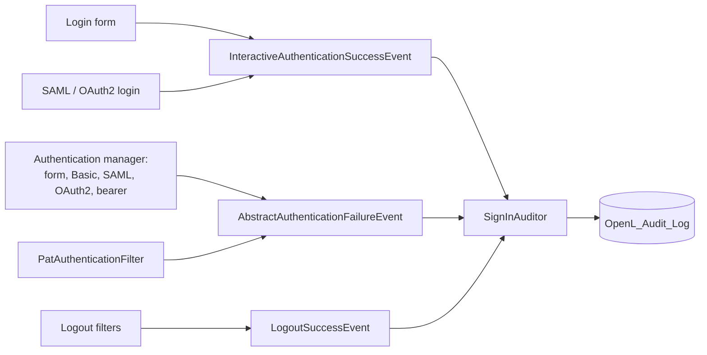

# Audit Log

OpenL Studio keeps an audit log of who did what and when: who signed in and out, whose sign-in was refused, who
changed users, groups and personal access tokens, and who read the log. Administrators read it on the **Audit Log** page or through `GET /rest/admin/audit`. This page describes
where the events come from, how they are kept and how they are read. The user guide describes the page:
[Reviewing the Audit Log](../user-guides/openl-studio/administration/08-audit-log.md).

## An Event

An event is a row of the `OpenL_Audit_Log` table of the OpenL Studio database (Flyway `V17`, an identity of its own
on Oracle in `V17.1`, the search indexes of PostgreSQL in `V17.1` of its own), mapped by `AuditRecord`:

- **id**, growing with every event; **time** (`eventTime`, UTC); **actor** (the login name of the user who did the
  action); **client address**;
- **authentication** — how the actor signed in, or tried to (`AuditAuthentication`: `form`, `basic`, `token`,
  `bearer`, `oauth2`, `saml`);
- **category**, **action** and **outcome** (`success`, `failure`, `denied`) — `AuditAction` names its category;
- **target** — the kind and the name of the object the action was done to, kept whole however long it is;
- **subject** — the user or the group whose access or membership the action changed;
- **details** — a JSON object of what else tells the action apart, kept whole however long it is.

The row keeps names, not links: an event outlives the user, the group or the project it names. A password or a token
is never recorded; a personal access token is named by its public id.

## Recording

`AuditService.recordEvent(AuditEvent)` puts an event into the log. An event that names no actor is recorded for the
signed-in user, or for no one when OpenL Studio acts by itself, and with the way that user signed in
(`AuthenticationMethods`). The address of the client comes from the current request: behind a proxy, it is the
address the proxy forwards only when the container reads the forwarded headers, as the OpenL Studio image does (see
[Deployment](../DEPLOYMENT.md)). The event is saved in the
transaction of the caller, so a change and its event are saved together, and an event of a change that is rolled back is
rolled back too. Outside a transaction the event is saved at once.

In the Single-User mode `recordEvent` does nothing: there is no sign-in and no access control to account for.

When `audit.outputs.console` is on, every event is also written to the console by the `OpenL.audit` logger at the
`INFO` level, one line per event, for a log collector; the database keeps the events either way. A line holds the
action and the outcome, then the other fields of the event by the names of the columns of an export and with the
codes of the REST API, such as `signIn failure id=7 actor=jdoe clientAddress=10.0.0.7
details={"reason":"badCredentials"}`. A line break or another control character in a value is
written as an escape (`\n`, `\u2028`), so a value a client typed, such as the name of a refused sign-in, cannot add a
line of its own. The same fields come with the line as key-value pairs `audit.<field>`, the category and the id
included, which a structured layout writes as fields of their own: the `ecs` format of the OpenL Studio image does.

## Sign-ins

Spring Security publishes the sign-ins, and `SignInAuditor` records them:

- **A sign-in** is recorded when it opens a session: the login form, SAML or OAuth2.
- **A request that carries its own credentials** — Basic authentication, a bearer token, a personal access token —
  signs in anew every time, so its sign-in is recorded once for a use of the credentials: at their first request, and
  at the first one after they were idle for the time an HTTP session may stay idle (`session-timeout` of `web.xml`).
  `SignInAuditor` is a `HandlerInterceptor` of the REST API for this: it tells credentials apart as
  `ClientSessions.credentialOf` does, so a browser calling with its session records nothing, and a personal access
  token is named by its public id. It remembers when each credential made its last request, on this node, and forgets
  the idle ones once a minute.
- **A refused sign-in** is recorded for every way of signing in, with the reason (`badCredentials`,
  `locked`, `disabled`, `expired`, `invalidToken`, `error`). The `authenticationEventPublisher` of
  `CommonAuthenticationConfig` serves the OpenL authentication manager and the login-form chains alike; a refusal
  without an event of its own, such as a rejected SAML response, is published as one of bad credentials.
  `PatAuthenticationFilter` publishes a refused token itself, since no authentication manager reads it.
- **A refused sign-in names a user only when one was typed** (a `UsernamePasswordAuthenticationToken`): the name of
  a bearer token that was not read is the token itself.
- **A sign-out** is published by the logout handler the login form chain adds itself, and by
  `logoutEventPublishingHandler`, which the SAML and OAuth2 logout filters run first. A sign-out the SAML identity
  provider asks for is published the same way.
- **A session that times out** is a sign-out with the reason `timedOut`: an `HttpSessionDestroyedEvent` of a session
  that was idle for at least the time it may stay idle names the user signed in to it. A session ended by a sign-out
  or by a stop of the application was used just before, so it records nothing more.

A failure to record a sign-in is logged and never fails the sign-in.

### How the User Signed In

Every event names how its actor signed in, or tried to, so an action a script or an agent did with a token tells so,
and a filter finds every action done with tokens. `AuthenticationMethods` reads it from the authentication Spring
Security holds:

- a personal access token (`PatAuthenticationToken`) is `token`; a bearer token, read or not
  (`BearerTokenAuthenticationToken`, `AbstractOAuth2TokenAuthenticationToken`), is `bearer`;
- a sign-in through OpenID Connect is `oauth2`, one through SAML is `saml`;
- a user name and a password (`UsernamePasswordAuthenticationToken`) come the same way from the login form, LDAP and
  Active Directory included, and from Basic authentication, so the request tells them apart: a Basic `Authorization`
  header is `basic`, a session is `form`.

A sign-in event names the way of the attempt itself. An event that names its actor otherwise names no way, as the
signed-in user is not that actor. Outside a request, as in a task running in a thread of its own, a user name and a
password tell nothing, so such an event names no way.

## Users, Groups and Tokens

The services that change users and groups announce each change as an `AuditEvent` application event:
`UserManagementService`, `GroupManagementService`, `ExternalGroupServiceImpl`, `PatGeneratorServiceImpl` and
`PersonalAccessTokenServiceImpl`. They are constructed with the publisher. `AuditService.recordEvent` listens to the
event and runs in the thread and the transaction of the publisher, so the change and its event are saved together; the
methods that change a user or a group are transactional for it.

- **The values before a change** are read where the service reads the row anyway: the details of a user, the
  description and the privileges of a group. The groups of a user and its external groups cost one query more, the
  group to delete and the token to delete one each.
- **Only a change is announced.** A save that keeps every value, a sign-in that brings the same details and external
  groups, and the same privileges set again announce nothing. A blank text counts as no value (`AuditChanges`). The
  external groups of a sign-in are written again only when they change.
- **A membership event names the group as the target and the user as the subject**, so a filter by subject finds every
  group a user joined or left.
- **A change made at sign-in** — a user created or updated from an identity provider, its external groups — is made
  before anyone is signed in, so it names no actor; a user created or changed so is marked `"origin":
  "identityProvider"`.
- **Secrets stay out**: a password set is a `passwordChanged` event with no details; a token is named by its public id
  and its name.

## Reading

`AuditLogController` answers `GET /rest/admin/audit` to administrators (`@AdminPrivilege`, not with a personal access
token). The criteria are a period, an actor, categories, actions, an outcome, the way the actor signed in, a target,
a subject and a client address; the texts match in any case. The events come the newest first, by id.

A page counts the events its query matches up to 10,000 (`AuditService.TOTAL_LIMIT`): `total` stops there and
`totalLimited` tells that more match, so a search of a large log never counts it to the end. The screen shows the
count as `10000+` and pages through the newest 10,000 events.

What the search reads the table by:

- **The period** — the index of `eventTime`, which the removal of the old events reads by too.
- **The actions and the categories** — the index of `action` and `eventTime`. A category is searched by its actions
  (`AuditRecordDaoImpl.actionsOf`), so the one index serves both, with a period or without.
- **The texts** — the actor, the target, the subject and the client address are matched by what they contain
  (`lower(field) LIKE '%text%'`), which no ordinary index serves. On PostgreSQL, `V17.1` creates a trigram index of
  each of them (`pg_trgm`, GIN, on `lower(field)`) when the database user may create the extension; if not, it
  notes that and goes on, and the search reads the table, as it does on the other databases. The target is a
  `${text}` column, a large object on Oracle and SQL Server, which no ordinary index could hold anyway.

The `Accept` header chooses the form, on one URL: `application/json` answers a page (`AuditEventsPage`), `text/csv`
the same events as a CSV file (`AuditCsvWriter`). The form the header gives the higher quality wins, each taking the
quality of the most specific range that includes it; a tie, such as one any type gives both, answers JSON.
`unpaged=true` reads every event that matches, in either form: the events are read in batches of 500, by id, each in
a short transaction of its own, and written in the request thread as they are read, so the whole log is never held in
memory and a slow client holds no database connection. The JSON
answer is then one page that holds them all. The file holds a line per event, its id first; it starts with a byte
order mark for spreadsheet applications, and a value a spreadsheet would run as a formula is written as text with a
leading apostrophe.

An export or an unpaged read records an `auditLogRead` event with its criteria every time, before the events are
written, so one broken off midway is still on record. A page of JSON is a view of the log, recorded after it is read,
so the page does not hold its own read, and only when the last event of the reader is no read of the log
(`AuditService.recordUnlessRepeated`). Searching the log and turning its pages, with nothing else done in between, are
one event, with the time and the criteria of the first page. Any other action of the reader, a sign-in included, ends
the view, and the events of other users do not. The last event of the reader is read by its id, newest first: it is
one of the latest events of the log, the sign-in of the reader at the latest, so no index of the actor is needed.

## Retention

`audit.retention` sets how long an event is kept, a `java.time.Period` written with its unit (`90d`, `2w`, `6m` for
months, `1y`) or in ISO 8601 (`P1Y6M`); empty, the default, keeps the events forever. A month and a year are those of
the calendar, counted back in UTC. A period that cannot be read or is not longer than zero stops the start, rather
than keep the events forever unnoticed. `AuditRetention` removes the older events a few minutes after the start and
then once a day, under the `auditLogRetention` lock of the `JdbcLockRegistry`, so one node of a cluster removes them.
Each removal is recorded as an `auditLogPurged` event with the number of events removed; a run that finds no event to
remove records none.

- **The events go in batches of 1000**, the oldest first, each in a transaction of its own
  (`AuditService.removeBefore`), so a log that grew large before the period was set is never removed in one long
  transaction.
- **Each batch renews the lock.** A lock of the `JdbcLockRegistry` expires ten seconds after it was taken or last
  renewed; without the renewal another node would take it during a long removal and remove the same events.
