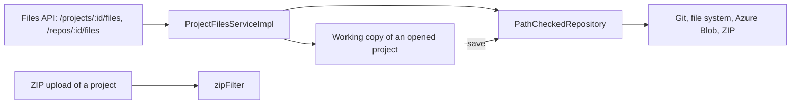

# Ignored Paths

A project folder holds files that are not rules: the build files of Maven, the files of Git, the definitions of a
CI pipeline. OpenL Studio neither shows nor changes them. Two reasons stand behind it:

- **They bury the rules.** A CI pipeline that bumps the version in `pom.xml` adds a revision for every bump, and a
  business user meets build files in every list of files.
- **They run code.** The hooks and the configuration in `.git` run on the machine of a developer, and a CI pipeline
  definition runs with the secrets of the pipeline. A user who may edit rules must not reach them.

## One setting for every repository

The system setting `repository.ignored-paths` (**Ignored Paths** in **Admin → System**) lists Ant-style patterns,
separated by commas, matched against the path in the repository, from its root. The letter case is ignored: a file
system of Windows or macOS opens `.GIT` as `.git`. The `.git` folder at any depth is ignored on top of the setting,
so a value an administrator sets cannot drop it.

```properties
repository.ignored-paths = ${repository.default-ignored-paths}
repository.default-ignored-paths = **/.git*/**, **/pom.xml, **/.mvn/**, **/mvnw*, **/.dockerignore, **/.svn/**, \
  **/CVS/**, **/.cvsignore
```

The build output folder, such as `target`, is not in the default value: its name comes from the build
configuration, such as the `project.build.directory` of a parent `pom.xml`, or `build` for Gradle. The defaults
live in a property of their own, so that a value adds to them without repeating them:
`repository.ignored-paths = ${repository.default-ignored-paths}, **/target/**`. A `.$ref` reference would not do:
it supplies the properties a prefix misses, and never joins two values.

`IgnoredPaths` (`org.openl.rules.repository`) holds the patterns. OpenL Studio reads the setting when it starts, and
again once the settings are applied, as the whole application is reloaded then.

## Where it is enforced



- **The repository.** `RepositoryInstatiator` wraps every repository it creates in `PathCheckedRepository`, which
  keeps the ignored paths out of reach:

  | Operation | Behavior |
  |---|---|
  | `list`, `listFolders`, `listFiles`, the history | An ignored file is left out |
  | `check`, `read`, `checkHistory`, `readHistory` | Nothing is found |
  | `save` of one file, `copyHistory` to an ignored path | Refused with `AccessDeniedException` |
  | `save` of several files or of a folder | The ignored files are left out |
  | `delete`, `deleteHistory` | A deletion that names an ignored file deletes nothing; a deleted folder goes with everything in it, as a deleted project does |
  | `getMergeScope`, `merge` | The changes leave the ignored files out |
  | A `FULL` save of a folder that holds ignored files | Passed on to a repository that keeps the ignored files itself (`IgnoringRepository`: Git and the file system); for another one, such as Azure Blob, saved as `DIFF`, with the deletion of every other file it is not given |

  Everything that reads projects through a repository inherits it: the project list, the Files tab, search,
  compare, the ZIP export and the deployment. A copy of a project in the workspace is built from what the
  repository gives, so it holds no ignored file, and its save keeps the ignored files of the repository. The
  workspace takes the same setting (`LocalWorkspaceManagerImpl`), so a file put into a copy by hand, such as the
  output of a build, is not listed either, and a module path with a wildcard finds no workbook in it.
- **The Files API.** A working copy of an opened project is written without the repository, so
  `ProjectFilesServiceImpl` refuses a write that names an ignored path with `403` `file.path.ignored.message`: a file
  written there would never reach the repository. An upload of an archive or of several files leaves the ignored
  files out. A path of a project is matched as the repository holds it (`FileRoot.repositoryPathOf`).
- **A project uploaded as a ZIP archive** leaves the ignored files out through the `zipFilter` bean, a
  `PathFilter` over the same patterns. `IgnoredPathsConfiguration` declares both beans, `ignoredPaths` and
  `zipFilter`, in Java configuration.
- **A repository on the file system** (`FileSystemRepository`) is given the setting too (`ignored-paths`, which
  `RepositoryInstatiator` answers from the system setting) and keeps the same paths out of reach by itself:
  - a path a request names is matched as the file system resolves it too, so neither a link nor a short name of
    Windows, such as `GIT~1`, gets around the patterns;
  - a full save of a folder keeps its ignored files;
  - a listing does not read an ignored folder, nor does the repository watcher (`FileChangesMonitor`), so a fetch into
    `.git` or a build is no change;
  - the version of a folder (`LocalRepository.getVersion`) leaves the ignored files out;
  - `InPlaceRepository`, which a project edited in place is read through, takes the patterns of its design repository,
    and the project is resolved with `FileSystemRepository.ignores`, so a module path with a wildcard finds no
    workbook in an ignored folder (`ProjectResolver.resolve(Path, Predicate)`). See
    [Changes Made Outside OpenL Studio](changes-made-outside.md#projects-edited-in-place).

## What is out of scope

- **AWS S3 and JDBC repositories** keep a project as one archive that only OpenL Studio writes.
- **OpenL Rule Services** set no patterns, so they ignore the `.git` folder only: a deployment comes from OpenL Studio
  already without ignored files.
