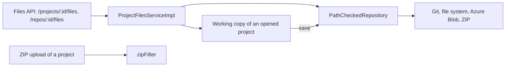

# Ignored, Protected and Hidden Files

A project folder holds files that are not rules: the build files of Maven, the files of Git, the definitions of a
CI pipeline, the output of a build, the files an operating system or an editor leaves behind. OpenL Studio keeps them
apart from the rules in three ways, each set by a setting of its own:

| Kind | Setting | Patterns relative to | Listed and read | Written | Export, deployment, import |
|---|---|---|---|---|---|
| Ignored | `repository.ignored-paths` | the repository root | No | No | Left out |
| Protected | `project.protected-files` | the project root | Yes | Yes | Left out; a replacing import keeps them |
| Hidden | `project.hidden-files` | the project root | Yes | Yes | Moved as any file |

- **Ignored files bury the rules or run code.** A business user meets the output of a build or a `.DS_Store` in every
  list of files. The hooks and the configuration in `.git` run on the machine of a developer, and a CI pipeline
  definition runs with the secrets of the pipeline: a user who may edit rules must not reach them.
- **Protected files belong to the place a project is kept in**, not to the project. A `pom.xml` names the artifact a
  CI pipeline builds and carries the version the pipeline bumps. A developer reads and fixes it in OpenL Studio, and
  the merge of two branches merges it, but it does not travel with the project: an archive exported from one place
  and imported into another would overwrite the build of the other place.
- **Hidden files are of no use to a business user**, such as `rules.xml`, `rules-deploy.xml` and `tags.properties`,
  which other screens edit. The screens of OpenL Studio leave them out of the trees of files unless the user turns on
  **Show Hidden Files** in **My Settings**. A protected file is hidden too. Being hidden changes nothing else: the
  REST API and the MCP server list, read and write such a file as any other.

```properties
repository.ignored-paths = ${repository.default-ignored-paths}
repository.default-ignored-paths = **/.git*/**, **/.svn/**, **/CVS/**, **/.cvsignore, **/Jenkinsfile, \
  **/.dockerignore, **/.mvn/**, **/mvnw*, **/target/**, **/.gradle/**, **/.bsp/**, **/.bloop/**, **/.metals/**, \
  **/node_modules/**, **/.idea/**, **/*.iml, **/.vscode/**, **/.settings/**, **/.project, **/.classpath, **/*.log, \
  **/*.tmp, **/*.swp, **/*~, **/~$*, **/.~lock.*, **/.DS_Store, **/._*, **/__MACOSX/**, **/Thumbs.db, **/desktop.ini
project.protected-files = pom.xml, META-INF/MANIFEST.MF
project.hidden-files = rules.xml, rules-deploy.xml, tags.properties
```

The patterns of all three are Ant-style and separated by commas, and the letter case is ignored (`PathPatterns`). A
slash at the start or at the end of a path is not part of it, so `/pom.xml`, the name a ZIP archive opened as a file
system gives, and `pom.xml` are the same path. A protected or a hidden file is matched by its path from the root of
its project: `pom.xml` names the file at the root of a project, not `rules/pom.xml`.

## Ignored paths: one setting for every repository

The system setting `repository.ignored-paths` (**Ignored Paths** in **Admin → System**) lists the patterns, matched
against the path in the repository, from its root. The letter case is ignored: a file system of Windows or macOS
opens `.GIT` as `.git`. The `.git` folder at any depth is ignored on top of the setting, so a value an administrator
sets cannot drop it.

The setting is the one place the system and temporary files are told apart: the lock files of Microsoft Office
(`~$Rules.xlsx`) and LibreOffice, the files macOS packs into an archive (`__MACOSX`, `._Rules.xlsx`) or leaves in a
folder (`.DS_Store`), those of Windows (`Thumbs.db`, `desktop.ini`), the output of Maven, Gradle and sbt, the files
of the IDEs and the logs. No other code of OpenL Studio tests a name for them. The only rule of its own is the one of
the engine, `FileTypeHelper.isLockFile`, which reads no `~$` file as a workbook where no setting of OpenL Studio is
known: in the OpenL Maven plugin and in OpenL Rule Services.

The build output folder `target` is in the default value; another one, such as `build` for Gradle, is a folder name
a project may use for its rules. The defaults live in a property of their own, so that a value adds to them without
repeating them: `repository.ignored-paths = ${repository.default-ignored-paths}, **/build/**`. A `.$ref` reference
would not do: it supplies the properties a prefix misses, and never joins two values.

`IgnoredPaths` (`org.openl.rules.repository`) holds the patterns. OpenL Studio reads the setting when it starts, and
again once the settings are applied, as the whole application is reloaded then.

## Where it is enforced



- **The repository.** `RepositoryInstatiator` wraps every repository it creates in `PathCheckedRepository`, which
  keeps the ignored paths out of reach:

  | Operation | Behavior |
  |---|---|
  | `list`, `listFolders`, `listFiles`, the history | An ignored file is left out |
  | `check`, `read`, `checkHistory`, `readHistory` | Nothing is found |
  | `save` of one file, `copyHistory` to an ignored path | Refused with `AccessDeniedException` |
  | `save` of several files or of a folder | The ignored files are left out |
  | `delete`, `deleteHistory` | A deletion that names an ignored file deletes nothing; a deleted folder goes with everything in it, as a deleted project does |
  | `getMergeScope`, `merge` | The changes leave the ignored files out |
  | A `FULL` save of a folder that holds ignored files | Passed on to a repository that keeps the ignored files itself (`IgnoringRepository`: Git and the file system); for another one, such as Azure Blob, saved as `DIFF`, with the deletion of every other file it is not given |

  Everything that reads projects through a repository inherits it: the project list, the files of a project, search,
  compare, the ZIP export and the deployment. A copy of a project in the workspace is built from what the
  repository gives, so it holds no ignored file, and its save keeps the ignored files of the repository. The
  workspace takes the same setting (`LocalWorkspaceManagerImpl`), so a file put into a copy by hand, such as the
  output of a build, is not listed either, and a module path with a wildcard finds no workbook in it.
- **The Files API.** A working copy of an opened project is written without the repository, so
  `ProjectFilesServiceImpl` refuses a write that names an ignored path with `403` `file.path.ignored.message`: a file
  written there would never reach the repository. An upload of an archive or of several files leaves the ignored
  files out. A path of a project is matched as the repository holds it (`FileRoot.repositoryPathOf`).
- **A project uploaded as a ZIP archive** leaves the ignored files out through the `zipFilter` bean, a
  `PathFilter` over the same patterns and the protected files. `IgnoredPathsConfiguration` declares the beans,
  `ignoredPaths`, `projectFiles` and `zipFilter`, in Java configuration.
- **A Git repository** (`GitRepository`) is given the setting too. A full save of a folder keeps its ignored files
  (`removeAbsentFiles`), and the walk that tells whether a commit changes a path leaves them out (`createTreeWalk`,
  `TechnicalFilesTreeFilter`, after the cheaper comparison of the object ids). The walk leaves out the protected
  files of the project too, which `RepositoryInstatiator` gives the repository as its `protected-files` parameter. A
  commit that changes only the ignored and the protected files of a project is a technical revision of it, and the
  project stands on its latest commit that changes anything else (`findFirstCommits`): the history marks it as current, and a save based on it is not taken for a save
  of an old version. A merge conflict in an ignored file keeps the version of the branch merged into: no one resolves
  it in OpenL Studio, as no one sees the file. `validateMergeConflict` leaves such files out of the conflict a user
  is asked to resolve, and `resolveConflict` writes the version the tip of the branch holds, or deletes the file when
  the branch holds none, whoever resolves the rest: a resolution given for an ignored file is left out.
- **A repository on the file system** (`FileSystemRepository`) is given the setting too (`ignored-paths`, which
  `RepositoryInstatiator` answers from the system setting) and keeps the same paths out of reach by itself:
  - a path a request names is matched as the file system resolves it too, so neither a link nor a short name of
    Windows, such as `GIT~1`, gets around the patterns;
  - a full save of a folder keeps its ignored files;
  - a listing does not read an ignored folder, nor does the repository watcher (`FileChangesMonitor`), so a fetch into
    `.git` or a build is no change;
  - the version of a folder (`LocalRepository.getVersion`) leaves the ignored files out;
  - `InPlaceRepository`, which a project edited in place is read through, takes the patterns of its design repository,
    and the project is resolved with `FileSystemRepository.ignores`, so a module path with a wildcard finds no
    workbook in an ignored folder (`ProjectResolver.resolve(Path, Predicate)`). See
    [Changes Made Outside OpenL Studio](changes-made-outside.md#projects-edited-in-place).

## Protected files

`ProjectFiles` (`org.openl.rules.repository`) holds the patterns of the protected and the hidden files, and
`IgnoredPathsConfiguration` declares it as the `projectFiles` bean. A protected file is no concern of the
repositories: they list, read, write and merge it as any other file, and a save of an opened project writes it. Only
the operations that move a project from one place to another leave it out:

- **The export.** `ProjectFilesServiceImpl.writeFolderAsZip`, behind the **Export** of a project and the download of
  a folder of it, leaves the protected files out of the archive. A mount that is not a project, such as
  `/repos/:id/files`, has no protected file (`FileRoot.isProject`).
- **The deployment.** `FileChangesToDeploy` and `RepositoryUtils.archive` leave them out of a deployment, with the
  manifest of the project, which the deployment writes anew (`RepositoryUtils.isDeployed`). The deployment drops the
  old `META-INF/MANIFEST.MF` whatever the setting holds: a second manifest would clash with the one it writes. The
  manifest is protected by default all the same, so a deployment archive imported as a project, or exported from
  it, carries none.
- **The import.** A project uploaded as a ZIP archive leaves them out through the `zipFilter` bean. The Files API
  leaves them out of an upload of an archive or of several files (`writeEntries`). An import that replaces a
  project keeps the protected files the project holds: a full save deletes every file it is not given, so
  `ZipProjectSaveStrategy` and the `REPLACE` policy of the Files API give it the protected files as they are. A write
  of one file, such as `PUT /projects/:id/files/pom.xml`, is an edit, not an import: it writes a protected file.
- **The history.** A commit that changes only protected and ignored files of a project is a technical revision of it,
  as described above. A save does write the protected files, so the check of a stale save counts such a commit
  (`isCheckoutOldVersion`, `findLatestChange`): a save based on the revision the project stands on is merged with a
  later version bump of `pom.xml` instead of writing the copy the user read over it.
- **Concurrent writes.** A replace of a closed project reads the protected files it gives back under the edit lock it
  commits under (`writeEntries`), so a change committed in between is not undone.

A repository that keeps a project as one archive, such as AWS S3 or JDBC, has no protected file in it apart: its
project is saved and deployed as the archive it is.

## Hidden files

A hidden file is a matter of the screens alone. `FileNodeMapper` marks each file and folder of a project the
`projectFiles` bean names as hidden or protected with `"hidden": true` in the Files API, and leaves the field out
otherwise. The project tree of OpenL Studio leaves such a file out unless the **Show Hidden Files** setting of
**My Settings** is on, which the browser keeps (`showHiddenFiles` in `settingsStore`). A link that names a hidden file
opens it as any other, and the screens that read `rules.xml` read it whatever the setting.

## What is out of scope

- **AWS S3 and JDBC repositories** keep a project as one archive that only OpenL Studio writes.
- **OpenL Rule Services** set no patterns, so they ignore the `.git` folder only: a deployment comes from OpenL Studio
  already without ignored files.
