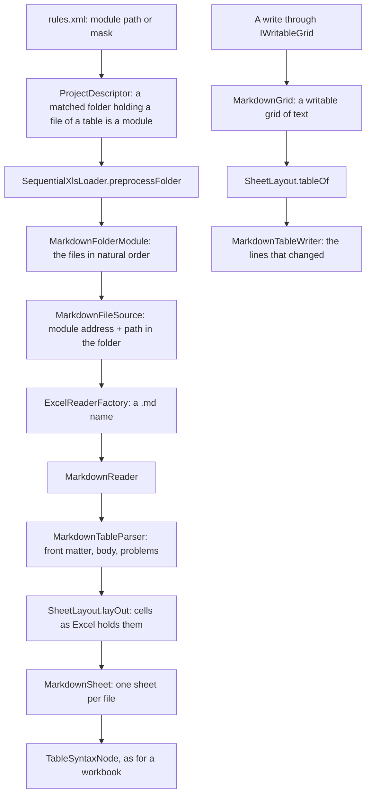

# Markdown Modules

How OpenL reads and writes rules kept in Markdown files, one table per file, next to Excel workbooks. The
format an author writes is specified in [Markdown Tables](../ref/markdown-tables.md); this page is how the code
works.

## Goals

- **The same rules as a workbook.** A table read from a file compiles, runs, tests and traces as the same table read
  from a workbook, and gives the same messages, word for word.
- **Text first.** A change to a table is a change to the lines it touches, so Git compares, merges and reviews it as
  text, and two authors editing different tables never conflict.
- **No second engine.** Everything above the reader — binding, compilation, tests, trace, OpenL Studio screens — stays
  as it is for workbooks.
- **Any size.** A table of millions of cells is read and edited without a node per cell.

## Decisions at a glance

- **A module is a folder**, a file is one table, a sub-folder is a sheet, so a category. Several tables in one file
  repeat the problems of a workbook: merge conflicts, shifting addresses, a hard read.
- **The header is the YAML front matter** of the file: `table`, `properties` and `merges`, a merged range to a line.
  The body is the first GFM table or code block after it; the text after the body is documentation.
- **A Spreadsheet is written in parts** rather than with merged captions: a paragraph between two GFM tables is a row
  merged across the table, and each table after the first repeats the first row (`SpreadsheetParts`). The reader puts
  the merged row back, so the grid, OpenL Studio and the result are those of a workbook.
- **A record of a Data, Test or Run table is one row**, each element of a collection in indexed columns,
  `drivers[0].name`, rather than rows merged under the record. Merged rows only make a table compact, and the engine
  reads both forms into the same objects; indexed columns tell apart two equal elements in a row, which rows compared
  value by value join into one. A merged range in such a table of a file is an error of the format, and a save
  refuses one (`SheetLayout`); a workbook merges them as before.
- **The description is the text above the table**, between the front matter and the body (`MarkdownDescription`), as a
  reader of the file expects it: never a property of the front matter. A quote and an HTML comment there are comments,
  so a note for the authors stays out of the description, which OpenL Studio shows and Rule Services puts into the
  OpenAPI of a rule.
- **The reader works at the level of the workbook reader.** A file reads as a workbook of one sheet, laid out as Excel
  would hold the table, so the loader, the binder and OpenL Studio see a workbook.
- **Cells take the types a workbook gives them**: a whole number, a boolean and a date read as such when they write
  back as the same text, anything else stays text.
- **A save writes only what changed**: a key of the front matter, a row of the body. What a file cannot hold is
  refused with the reason.
- **The reader is in the engine core**, with `commonmark` and SnakeYAML as dependencies of `org.openl.rules`.

## Structure

## Reading

### Finding modules

- `ProjectDescriptor.getAllModulesMatchingPathPattern` takes a matched folder that holds a Markdown file of a table,
  at any depth, as one module named after the folder, by its whole name: a dot in it is no extension. A file of a
  table has a front matter with the `table` key (`MarkdownReader.holdsTable` reads the front matter alone), so a
  folder of documentation, such as one holding a `README.md` or the pages of a site, is no module. Only a folder the
  mask matches is searched, the search stops at the first file of a table, and a folder found without one spares its
  sub-folders the search.
- The Markdown files and the sub-folders of a module folder are not matched on their own; a workbook in it is, so a
  mask that matches folders loses no workbook it matched before. The module folder owns the tables of its Markdown
  files alone (`Module.containsTable`), and the workbook those of its own.
- A module path in `rules.xml` names a folder as it names a workbook. The default masks, used when `rules.xml` has no
  modules, stay `rules/**/*.xlsx` and `tests/**/*.xlsx`, so a folder of documentation never becomes a module.
- A file name pattern (`properties-file-name-pattern`) reads the properties of a module from the path of its folder.

### Loading a folder

- `SequentialXlsLoader.preprocessFolder` reads every file of the folder as a workbook of the module, in the order
  `MarkdownFolderModule.files` gives: the paths with `/`, compared by `NumericStringComparator`, so a number in a name
  counts by its value and the order is the same on every file system.
- The address of a file is the address of the module followed by its path in the folder (`MarkdownFileSource`). The
  tables of a file keep the same address wherever the project is.
- The parts of a `TablePart` table are joined across the folder, as a workbook joins them across its sheets; the
  joined table belongs to the file of its first part.
- `MarkdownFolderModule.misplacedTables` keeps the Environment and the Constants tables in `Environment.md` and
  `Constants.md` at the root, and nothing else in those files. A folder with no file is an error.
- An include of `Environment.md` names a file from the folder of `Environment.md`; a workbook the module folder replaced
  is one level up, as `../Common.xlsx`.

### Reading a file

- `ExcelReaderFactory` tells a Markdown file by its extension, a workbook by its content. `MarkdownReader` reads the
  whole file once, when it is created.
- `MarkdownTableParser` reads the front matter with SnakeYAML (`compose`, so every key keeps its line), then parses the
  rest with `commonmark`, the front matter blanked out so that line numbers stay. A file without front matter is
  documentation as a whole, and so is one whose front matter has none of the keys of a table (`table`, `properties`,
  `merges`), such as a page of a site: the module and `MarkdownReader.holdsTable` tell a file of a table alike.
- The body is found as `TableLines`: the rows of a GFM table are known by their lines alone, and `GfmTableReader` cuts
  the cells out of the lines, a row when it is asked for. A table of millions of cells costs the numbers of its lines;
  the GFM tables extension of `commonmark` serves only the tests, which check that the two agree.
- The syntax of a table stays in its reader and its builder (`MarkdownTableReader`, `MarkdownTableBuilder`): the
  parser gets rows of values, and the writer gives rows of values or the line of a row it keeps.
- The parts of a Spreadsheet are one body (`TableFile.GfmBody`): the reader gives the captions as rows between the
  rows of the parts, and the writer ends a part at a row that `SpreadsheetParts.captionRows` takes for a caption. A
  caption that would read back as other Markdown stays a merged range under `merges`.
- A problem in the front matter leaves the file without a table. A problem in the body — a merged range that does not
  fit, the cells of a row past those of the first row, rows a blank line cuts off — leaves the table without the part
  that breaks the format. `MarkdownProblem` keeps the line, and the cell when the table shows it.

### Laying the table out

`SheetLayout.layOut` gives the cells a workbook would give:

- the header in the top left cell, merged across the table;
- a `properties` cell merged down over the properties, the name and the value of each in the next two columns;
- the body, its merged ranges moved under the properties; a body narrower than the three columns of the properties
  has the last cell of each row merged over the columns it lacks, as a workbook lays it out;
- an indented cell of a TBasic or a ColumnMatch table as an `AlignedValue` with its level (`MarkdownIndent`).

### Values

`MarkdownValues` reads a text as the value a workbook holds for it: a whole number as an `Integer`, `true` and `false`
as a `Boolean`, an ISO date, with or without its time, as a `Date` of the default time zone. A text reads as a value
only when `MarkdownGrid.textOf` writes the value back as the same text, so `007`, `3.0` or `TRUE` stay texts. A
fractional number stays text: a `Double` would round a long number a `BigInteger` reads exactly.

### Errors

- `MarkdownFormatErrors` points an error at the cell of the table, at the header of the table for a problem no cell
  shows, such as a key of the front matter, or at the line of the file when the file holds no table.
  The message tells what is wrong and nothing else, as for a workbook: the place is in the address of the error.
- The error is a `MarkdownFormatError`: it also tells the place of the problem in the file, the text of its line,
  even when it points at a cell.

## Writing

### The grid

`MarkdownGrid` is the writable grid of a file: the table as it is read, with its merged ranges, kept as text. A value
written into a cell becomes the text that reads back as the same value (`MarkdownGrid.textOf`): a date as an ISO date,
a list joined with commas. Nothing reaches the file before the save. A cell finds its merged range among those of its
row alone, so a row inserted above thousands of merged ranges moves them in time linear in their number.

The save reads the table back from the cells (`SheetLayout.tableOf`) and writes it into the text of the file as it was
when the grid was opened (`MarkdownTableWriter`). The file is saved as a workbook is
(`XlsWorkbookSourceCodeModule.save`): written whole and put in its place in one step, and refused when another program
changed it since the module read it, as [Changes Made Outside](changes-made-outside.md) describes. A new file is written
by `MarkdownTableWriter.newFile`.

### Keeping the lines

- **Front matter** — a key keeps its lines while its value is the same. A property keeps its line; a new one is
  indented as the others. The merged ranges are written a range to a line in reading order, so a range added or taken
  away is a line of its own; the same ranges keep their lines in whatever order the file lists them.
- **Description** — kept as written while it is the same. A changed one is written where its first block of text
  stood, and its other blocks are taken away; a new one goes right after the front matter.
- **Body** — a row keeps its line while its cells are the same. A changed row is padded to the widths of the delimiter
  row, so a table aligned by hand stays aligned. A code block stays a code block.
- **Everything else** — the comments, the text after the table, a key the table is read without, a range left out —
  stays as written.
- **Text after the table** — not kept in memory while the table is edited, however long it is: the save copies it
  byte for byte from the file, line breaks and encoding included. A file whose text after the table changed since,
  even keeping its size and modification time, is not saved over. A grid saved again copies it from where its last
  save wrote it.

### What a file refuses

`SheetLayout.tableOf` refuses cells a file cannot hold, and the save fails with the reason (`MarkdownWriteException`):

- the first cell without a header, a header over more than one row;
- a `properties` cell over more than one column, a property without a name in a cell of its own or with a name
  already taken, properties in a table narrower than three columns, where the value has no column;
- a value above the body other than the header and the properties, a merged range a file cannot write;
- a value under a merged range, or a value holding the text ` `, which reads as a line break;
- a merged range in the body of a Data, Test or Run table, whose record is one row.

## Dependencies

- **commonmark** — finds the blocks of a file: the GFM table, the code block, the paragraphs around them.
- **SnakeYAML** — reads the front matter and writes a value that needs quotes.
- Both are dependencies of `org.openl.rules`, so the engine, OpenL Studio, OpenL Rule Services and the plugin read
  Markdown modules with no setting.

## Open Questions

- **Default module masks** — whether module folders join the masks used without `<modules>`. Recommended not to:
  a folder of documentation would become a module.
- **Place of the reader** — in the engine core or a module through SPI. Recommended the core: every product needs the
  reader, and the two libraries are small.
- **Id of a Markdown table** — taken from the module folder, so a file renamed or moved inside the folder keeps the ids
  of its tables. To be confirmed.

## Rejected Alternatives

- **Several tables in one file** — the first version of the format. It repeats the problems of a workbook: every
  change of a module touches one file, tables move when others grow, and the file is hard to read.
- **Marks of merged cells in the cells**, `<` for the cell on the left and `^` for the cell above — they move with the
  text but clutter the table; the `merges` key keeps the table clean and readable on GitHub.
- **Merged ranges on one line**, `merges: [A1:B1, A2:A3]` — every change edits the same line, so two changes conflict.
- **Properties as keys next to `table`** — the keys of the file and the table properties shared one name space, and a
  typo of a key read as a property.
- **Types in the file** — a step named with its type, `Count : Integer`, or a value written as a cast,
  `= (Integer) 3` — change the result model or turn a value into a formula. Reading the types from the text, as a
  workbook keeps them, needs nothing in the file.
- **A reader through SPI** — every build would have to add it, for two small libraries.
