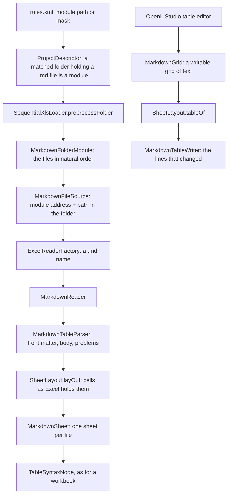

# Markdown Modules

How OpenL reads, writes and converts rules kept in Markdown files, one table per file, next to Excel workbooks. The
format an author writes is specified in [Markdown Tables](../ref/markdown-tables.md); this page is how the code
works.

## Goals

- **The same rules as a workbook.** A table read from a file compiles, runs, tests and traces as the same table read
  from a workbook, and gives the same messages, word for word.
- **Text first.** A change to a table is a change to the lines it touches, so Git compares, merges and reviews it as
  text, and two authors editing different tables never conflict.
- **No second engine.** Everything above the reader — binding, compilation, tests, trace, OpenL Studio screens — stays
  as it is for workbooks.
- **Any size.** A table of millions of cells is read and edited without a node per cell.

## Decisions at a glance

- **A module is a folder**, a file is one table, a sub-folder is a sheet, so a category. Several tables in one file
  repeat the problems of a workbook: merge conflicts, shifting addresses, a hard read.
- **The header is the YAML front matter** of the file: `table` and `properties`. The body is the first GFM table,
  HTML table or code block after it; the text after the body is documentation.
- **Merged cells make the body an HTML table**, one `<td>` spanning its rows and columns with `rowspan` and
  `colspan`, which GFM has no syntax for; a body without any stays a GFM table. A merged cell is a part of the logic of
  a table — a title over its columns, a condition for several rules, the rows of one Data record — so it is kept. The
  previews of GitHub and GitLab show the table with its merged cells, and a row inserted changes its own line alone.
  An HTML table takes about 1.8 times the bytes of a GFM one, and the same once compressed, as Git keeps it.
- **The description is the text above the table**, between the front matter and the body (`MarkdownDescription`), as a
  reader of the file expects it: never a property of the front matter. A quote and an HTML comment there are comments,
  so a note for the authors stays out of the description, which OpenL Studio shows and Rule Services puts into the
  OpenAPI of a rule.
- **The reader works at the level of the workbook reader.** A file reads as a workbook of one sheet, laid out as Excel
  would hold the table, so the loader, the binder and OpenL Studio see a workbook.
- **Cells take the types a workbook gives them**: a whole number, a boolean and a date read as such when they write
  back as the same text, anything else stays text.
- **A save writes only what changed**: a key of the front matter, a row of the body. What a file cannot hold is
  refused with the reason.
- **OpenL Studio edits a Markdown table with the table editor of a workbook.** The look is drawn, not stored, and a
  change of the look is refused.
- **The converter lives in the engine**, and OpenL Maven Plugin calls it. A workbook with a table a file cannot hold
  stays a workbook.
- **The reader is in the engine core**, with `commonmark` and SnakeYAML as dependencies of `org.openl.rules`.

## Structure

## Reading

### Finding modules

- `ProjectDescriptor.getAllModulesMatchingPathPattern` takes a matched folder that holds a `.md` file, at any depth,
  as one module named after the folder; the files in it are not matched on their own.
- A module path in `rules.xml` names a folder as it names a workbook. The default masks, used when `rules.xml` has no
  modules, stay `rules/**/*.xlsx` and `tests/**/*.xlsx`, so a folder of documentation never becomes a module.
- A file name pattern (`properties-file-name-pattern`) reads the properties of a module from the path of its folder.

### Loading a folder

- `SequentialXlsLoader.preprocessFolder` reads every file of the folder as a workbook of the module, in the order
  `MarkdownFolderModule.files` gives: the paths with `/`, compared by `NumericStringComparator`, so a number in a name
  counts by its value and the order is the same on every file system.
- The address of a file is the address of the module followed by its path in the folder (`MarkdownFileSource`). The
  tables of a file keep the same address wherever the project is.
- The parts of a `TablePart` table are joined across the folder, as a workbook joins them across its sheets; the
  joined table belongs to the file of its first part.
- `MarkdownFolderModule.misplacedTables` keeps the Environment and the Constants tables in `Environment.md` and
  `Constants.md` at the root, and nothing else in those files. A folder with no file is an error.
- An include of `Environment.md` names a file from the folder of `Environment.md`; a workbook the module folder replaced
  is one level up, as `../Common.xlsx`.

### Reading a file

- `ExcelReaderFactory` tells a Markdown file by its extension, a workbook by its content. `MarkdownReader` reads the
  whole file once, when it is created.
- `MarkdownTableParser` reads the front matter with SnakeYAML (`compose`, so every key keeps its line), then parses the
  rest with `commonmark`, the front matter blanked out so that line numbers stay. A file without front matter is
  documentation as a whole.
- The body is found as `TableLines`: the rows of a GFM table are known by their lines alone, and the cells are cut out
  of the lines. A table of millions of cells costs the numbers of its lines; the GFM tables extension of `commonmark`
  serves only the tests, which check that the two agree. An HTML table is found as `HtmlTableLines`, from its
  `<table>` line to the line that closes it.
- A reader of each syntax gives the rows of the table and their cells, a merged cell with its spans
  (`MarkdownTableReader`: `GfmTableReader`, `HtmlTableReader`). `TableLayout` lays them out in the body whatever the
  syntax: a cell takes the first column of its row that no merged cell above spans down into.
- A problem in the front matter leaves the file without a table. A problem in the body — a merged cell past the table
  or over another, the cells of a row past those of the first row, rows a blank line cuts off — leaves the table
  without the part that breaks the format. `MarkdownProblem` keeps the line, and the cell when the table shows it.

### Laying the table out

`SheetLayout.layOut` gives the cells a workbook would give:

- the header in the top left cell, merged across the table;
- a `properties` cell merged down over the properties, the name and the value of each in the next two columns;
- the body, its merged ranges moved under the properties; a body narrower than the three columns of the properties
  has the last cell of each row merged over the columns it lacks, as a workbook lays it out;
- an indented cell of a TBasic or a ColumnMatch table as an `AlignedValue` with its level (`MarkdownIndent`).

### Values

`MarkdownValues` reads a text as the value a workbook holds for it: a whole number as an `Integer`, `true` and `false`
as a `Boolean`, an ISO date, with or without its time, as a `Date` of the default time zone. A text reads as a value
only when `MarkdownGrid.textOf` writes the value back as the same text, so `007`, `3.0` or `TRUE` stay texts. A
fractional number stays text: a `Double` would round a long number a `BigInteger` reads exactly.

### Errors

- `MarkdownFormatErrors` points an error at the cell of the table, or at the line of the file when no cell shows it.
  The message tells what is wrong and nothing else, as for a workbook: the place is in the address of the error.
- OpenL Studio sends a reader to the cell, or opens the file on the Files tab at the line
  (`DetailedMessageDescriptionMapperImpl`, `TableModules.fileOf`).

## Writing

### The grid

`MarkdownGrid` is the writable grid of a file: the table as it is read, with its merged ranges, kept as text. A value
written into a cell becomes the text that reads back as the same value (`MarkdownGrid.textOf`): a date as an ISO date,
a list joined with commas. Nothing reaches the file before the save. A cell finds its merged range among those of its
row alone, so a row inserted above thousands of merged ranges moves them in time linear in their number.

The save reads the table back from the cells (`SheetLayout.tableOf`) and writes it into the text of the file as it was
when the grid was opened (`MarkdownTableWriter`). The file is saved as a workbook is
(`XlsWorkbookSourceCodeModule.save`): written whole and put in its place in one step, and refused when another program
changed it since the module read it, as [Changes Made Outside](changes-made-outside.md) describes. A new file, made by
Create Table or by the converter, is written by `MarkdownTableWriter.newFile`.

### Keeping the lines

- **Front matter** — a key keeps its lines while its value is the same. A property keeps its line; a new one is
  indented as the others.
- **Description** — kept as written while it is the same. A changed one is written where its first block of text
  stood, and its other blocks are taken away; a new one goes right after the front matter.
- **Body** — a builder of each syntax writes the rows (`MarkdownTableBuilder`: `GfmTableBuilder`, `HtmlTableBuilder`),
  and a row keeps its line while its cells and their spans are the same. A changed row of a GFM table is padded to
  the widths of the delimiter row, so a table aligned by hand stays aligned. An HTML table keeps its rows while they
  stand one to a line and the table reads without a problem, and is written anew otherwise. The first merge writes
  the table anew as an HTML table, the last unmerge as a GFM table. A code block stays a code block.
- **Everything else** — the comments, the text after the table, a key the table is read without — stays as written.

### What a file refuses

`SheetLayout.tableOf` refuses cells a file cannot hold, and the save fails with the reason (`MarkdownWriteException`):

- the first cell without a header, a header over more than one row;
- a `properties` cell over more than one column, a property without a name in a cell of its own or with a name
  already taken, properties in a table narrower than three columns, where the value has no column;
- a value above the body other than the header and the properties, a merged range a file cannot write;
- a value under a merged range, or a value holding the text ` ` in a GFM table, which reads as a line break.

The converter leaves such a table in its workbook; OpenL Studio shows the reason to the author.

## OpenL Studio

- **Table editor** — writes through `MarkdownGrid`, as through the grid of a workbook: values, rows, columns,
  properties, merged cells and the indent of TBasic and ColumnMatch cells. `MarkdownTables` refuses any other change
  of style, saying so, and marked pieces of the text of a cell. `MarkdownGrid` refuses an Excel formula
  (`MarkdownWriteException`): a text starting with `=` is an OpenL formula, so an Excel formula has no text of its own.
- **Look** — a file keeps none. The Studio look draws the table by the roles of its cells, as any table; in the Excel
  Formatting view a read with the styles lays the OpenL table style over it (`StyledGrid`). See
  [Table Formatting](table-formatting.md).
- **Create, copy, remove** — `MarkdownTableFiles` writes a new table into a file named after the table, in the folder
  of its category, with a number when the name is taken; a module table into its fixed file. Copy works between
  workbooks and Markdown modules both ways and takes the table alone. Remove deletes the file; the last table of a
  module stays. Files are written through the files of the project, so the project is marked modified.
- **Ids** — the id of a table depends on the module folder, not on the file: see
  [Stable Table Ids](table-ids.md).
- **Files tab** — Open in Editor opens the table of a Markdown file.

## Converting Workbooks

- `MarkdownModuleWriter` writes the tables of a workbook into a module folder:
    - a file per table, named from the header of the table, compiled or not, with a number when the name is taken;
    - the Environment tables of a workbook joined in `Environment.md`, the Constants tables in `Constants.md`;
    - a table written in parts written whole, as the compiler joined it;
    - a table of no kind OpenL knows written as text into the `notes.md` documentation of its sheet;
    - a sheet name a folder cannot hold written with `_` for the characters OpenL Studio refuses.
- `MarkdownProjectWriter` writes a copy of a project: a module folder at the path of each workbook without its
  extension, and a `rules.xml` that names the folders. A workbook stays a workbook when a table of it has no Markdown
  form, when another module includes it, when it includes the workbook of another module, or when its folder would
  take the place of a folder of the project.
- [OpenL Maven Plugin](../ref/openl-maven-plugin.md) writes the copy in `openl:compile` when `markdown` is set, and
  packages and deploys it instead of the sources.
- `MarkdownCorpusTest` (`-Dopenl.markdown.corpus=true`) converts every functional test project of the engine and
  compares the messages and the test results of the copy with those of the workbooks.

## Dependencies

- **commonmark** — finds the blocks of a file: the GFM table, the HTML table, the code block, the paragraphs around
  them.
- **SnakeYAML** — reads the front matter and writes a value that needs quotes.
- Both are dependencies of `org.openl.rules`, so the engine, OpenL Studio, OpenL Rule Services and the plugin read
  Markdown modules with no setting.

## Open Questions

- **Default module masks** — whether module folders join the masks used without `<modules>`. Recommended not to:
  a folder of documentation would become a module.
- **Place of the reader** — in the engine core or a module through SPI. Recommended the core: every product needs the
  reader, and the two libraries are small.
- **Id of a Markdown table** — taken from the module folder, so a file renamed or moved inside the folder keeps the ids
  of its tables. To be confirmed.

## Rejected Alternatives

- **Several tables in one file** — the first version of the format. It repeats the problems of a workbook: every
  change of a module touches one file, tables move when others grow, and the file is hard to read.
- **A table without merged cells** — a merged title, condition value or Data record written into each of its cells
  fails the compilation or changes the results: an empty condition value means any.
- **Marks of merged cells in the cells**, `<` for the cell on the left and `^` for the cell above — they move with the
  text but clutter the table, and a preview shows them as text.
- **Merged ranges in the front matter**, `merges:` and a range to a line in A1 notation — a range counts its rows from
  the top of the body, so a row inserted above it rewrites the range, and a preview shows the table without its
  merged cells.
- **Properties as keys next to `table`** — the keys of the file and the table properties shared one name space, and a
  typo of a key read as a property.
- **Types in the file** — a step named with its type, `Count : Integer`, or a value written as a cast,
  `= (Integer) 3` — change the result model or turn a value into a formula. Reading the types from the text, as a
  workbook keeps them, needs nothing in the file.
- **A reader through SPI** — every build would have to add it, for two small libraries.
