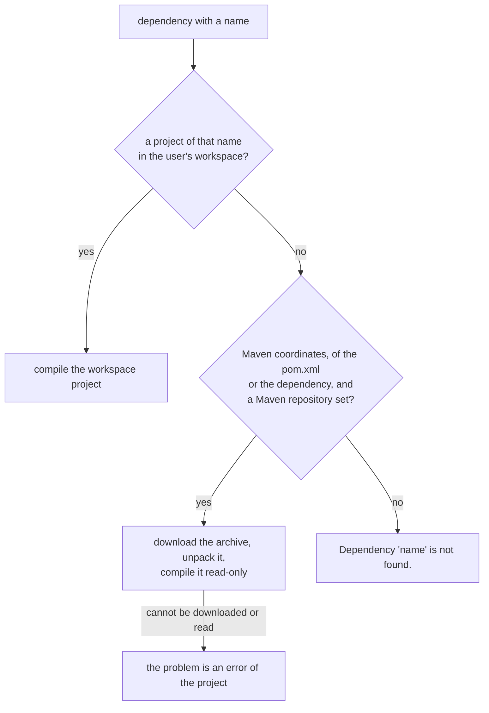
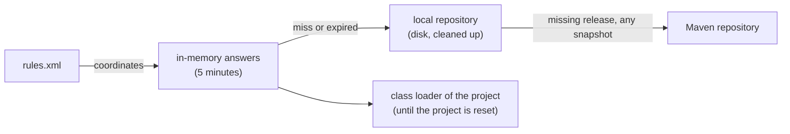

# Maven Dependencies in OpenL Studio

How OpenL Studio compiles a project and runs its tests with the dependencies its `rules.xml` names by Maven
coordinates: a library, and an OpenL project that the user's workspace lacks.

## Goals

- **A project compiles in OpenL Studio as it builds with the OpenL Maven Plugin.** A `<mavenArtifact>` the plugin
  resolves at build time is resolved in Studio too, so the tables using the classes of a library compile and their
  tests run without the jar copied into `lib/` by hand.
- **The project the user works on wins.** A dependency project the user opened is compiled from the workspace, with
  the user's changes. The Maven repository supplies only what the workspace does not hold.
- **Nothing changes until a repository is set.** Without a URL Studio downloads nothing and behaves as before.
- **A dependency that cannot be had is said so.** The project and each of its modules report why, instead of only the
  compilation errors it causes.
- **One Maven model.** Coordinates, scopes and transitive dependencies follow Maven and the OpenL Maven Plugin, not a
  model of Studio's own.

## Decisions at a Glance

- **Resolver** — Apache Maven Resolver 2 with the Maven 3 POM model (`maven-resolver-supplier-mvn3`), embedded in the
  war. Files are transported by the HTTP client of the JDK (`maven-resolver-transport-jdk`) and from the file system,
  so Apache HttpClient 4 and Commons Logging stay out of the war.
- **One remote repository** — `maven.repository.url`, with an optional user and password; `http`, `https` and `file`
  addresses. The **Maven** section of the administration edits it, through `/rest/admin/settings/maven`.
- **One local repository per instance** — `maven.repository.local`, by default `${openl.home}/maven-repository`,
  laid out as `~/.m2/repository` is. It is a cache: each instance of a cluster keeps, cleans and empties its own.
- **Precedence of a project dependency** — the project of the user's workspace with that name, else the archive of
  that name a `pom.xml` depends on, else the archive the Maven coordinates name, else not found.
- **Libraries** — the class loader of the project reads them after its own classpath; the `provided` libraries of a
  `pom.xml` are read by one class loader behind Studio's, which every project shares. Three hooks of
  `AbstractDependencyManager` carry them into the engine; only OpenL Studio implements them.
- **Caching** — every answer, failures included, is kept in memory for five minutes; the files stay on disk until a
  cleanup removes what went unused for a period, or what was used longest ago while the folder is too large.
- **OpenL Rule Services are not changed.** OpenL Studio puts into a deployment what the projects need from the
  Maven repository, so Rule Services run it without one. See [Deployment](#deployment).

## Coordinates

A `<dependency>` names Maven coordinates in `<mavenArtifact>` as the OpenL Maven Plugin reads them:
`groupId:artifactId[:extension[:classifier]]:version`, the version last. Without the extension the coordinates name a
`zip` archive, the packaging of an OpenL project.

- **A dependency without `<name>` is a library.** It is collected with its `compile` and `runtime` dependencies; the
  `test`, `provided` and optional ones are left out, as Maven leaves them out of a runtime classpath. All the libraries
  of a project are collected in one request, so Maven mediates their versions together.
- **A dependency with `<name>` is an OpenL project.** Its archive alone is downloaded: an archive the OpenL Maven
  Plugin packages already holds its libraries in `lib/`, and its own `rules.xml` names its dependencies.

Coordinates that are not three to five parts of letters, digits and `_ . + -` are reported as not valid; nothing is
downloaded for them. A part is never `.` or `..`, so coordinates name no file outside the local repository.

## The pom.xml of a Project

A project built by Maven before pom-less projects keeps its libraries in a `pom.xml` beside `rules.xml`: the OpenL
Maven Plugin packs them into `lib/` of the archive, and `rules.xml` does not name them. A pom-less project inherits
them from its anchor. Studio reads the `pom.xml` as the plugin's build does:

- **Where it is read** — `pom.xml` is a protected file: listed and edited, hidden from business users unless **Show
  Hidden Files** is on, and never deployed ([Ignored, Protected and Hidden Files](ignored-paths.md)). A compilation
  reads it from the folder of the project, with the changes not saved yet (`WebStudio.pomOf`, `ProjectPoms`); a
  deployment and the Overview, from the design repository (`ProjectDescriptorArtefactResolver.getPom`). The design
  repository is read at the head of the branch of the project, as a build of the branch reads it, or at the revision
  opened when it is an older one. A repository keeping each project as one archive, a database or AWS S3, holds the
  `pom.xml` inside the archive and no POM beside it. Nothing is read while no Maven repository is set.

- **The effective model** — `EffectivePom` builds it with `maven-model-builder`: the parents, the properties put in,
  `dependencyManagement` with the imported BOMs, the profiles active by default. A parent is read as in a build of
  several modules: by its `relativePath`, `../pom.xml` by default, beside the `pom.xml` — in the design repository
  (`ProjectPom`), or on disk inside the folder of a project of no design repository, so a path cannot reach another
  file of the server — when it is the parent named; else, like the BOMs, from the Maven repository
  (`PomModelResolver`), where a parent version range takes its highest version. A managed dependency sets only what
  it states: one without a scope leaves the dependency its own, as Maven reads it. The repositories a POM declares
  are not read, those of the POMs of the dependencies neither (`setIgnoreArtifactDescriptorRepositories`), and only
  the `java.*`, `os.*` and separator system properties reach the model.
- **The libraries** — the `compile` and `runtime` dependencies, collected in the request of the `rules.xml` libraries
  with the managed versions of the model, so Maven mediates them together. For a group and artifact both name, the
  `pom.xml` wins, and its management sets the version of a `rules.xml` library, as `openl:sync-versions` does.
- **The provided libraries** — the `provided` dependencies, with what they need, are downloaded too, in a request of
  their own, so a library they need goes with them even when a library of the project needs it as well. Those Studio
  ships itself are not: a jar of Studio holding the Maven descriptor of the library,
  `META-INF/maven/<groupId>/<artifactId>/`, or, for a jar built without one such as those of Spring, named
  `<artifactId>-<version>.jar` and holding classes of the group of the library, and what such a library needs. OpenL
  Rule Services embed what the projects take as provided, which Studio may lack; see [Libraries on the
  Classpath](#libraries-on-the-classpath).
- **What is left out** — as the plugin leaves it out of `lib/`: the `test` and `system` dependencies, the
  `zip` archive of another OpenL project and what it needs, which that project is compiled with, and the groups OpenL
  brings itself, `org.openl.rules`, `org.openl` and `org.slf4j`, with what they need. The last rule holds for the
  `rules.xml` libraries too. A dependency of a type only an extension of the build knows, such as a `tile`, is left
  out as well, and of a dependency of the type `pom` only what it brings is taken, not the POM itself.
- **The OpenL projects** — the plugin unpacks the `zip` dependencies of the `pom.xml`, and those they depend on in turn,
  into the workspace a project compiles in, and a `rules.xml` dependency names one by the `<name>` its own `rules.xml`
  gives. `MavenDependencyResolver.projectsOfPom` downloads them alike, through `zip` dependencies only, and tells their
  coordinates by name, as `rules.xml` writes those of a plain `zip`, `groupId:artifactId:version`; a dependency with a
  `<name>` takes them, winning over its own `<mavenArtifact>` (`withPomCoordinates`). A walk — of a compilation, of the
  projects tree, of the Overview, of a deployment — keeps the projects of every `pom.xml` it goes through, so a
  downloaded project finds those its own `rules.xml` names by name. The Overview of a project reads the `pom.xml` of
  every project of its walk, a closed one too, from the repository at its revision, as a deployment does, and resolves
  them all at once on virtual threads before the walk, which then finds each answer in memory. A name nothing is found
  for takes the coordinates a later declaration gives, as the compilation does, and a request for the same archive
  however written is no conflict. A read of the project that leaves its dependencies out of the fields, such as its
  compile status, walks none; a list of projects reads that of an opened project only
  (`ProjectDependencyResolver.getDependencies(project, everyPom)`), since a closed one would read its repository, and
  download the archives it names, for every project listed.
- **A module of the same build** — the build is the topmost parent found beside the `pom.xml`, each parent by its
  `relativePath`, with every module it lists and the modules those list in turn. A `zip` dependency on one of its
  modules, such as a `${project.version}` sibling, is built with it, as Maven takes it from the reactor
  (`PomReactor`). It is not downloaded and gives no coordinates: the repository holds no such version, such as a
  `-SNAPSHOT` no pipeline publishes, and the project of its name in the workspace is used. A module is matched by its
  `groupId`, `artifactId` and version, inherited from its parent when it does not say them and with the properties
  of the build put in, such as the `${revision}` of a CI-friendly version; the modules of a build
  are read once in five minutes, whichever `pom.xml` of the build asks.
- **A pom-less project** — a project without a `pom.xml` below an anchor: the nearest `pom.xml` in a folder above it,
  when that one declares `openl-maven-plugin` in its own `<build><plugins>` and is not of the `openl` or `openl-jar`
  packaging, as the plugin finds anchors. A nearest `pom.xml` that is no anchor gives none, since the plugin's scan of a
  higher anchor stops at its folder, and so does a project the scan does not reach: below a folder named `target` or
  starting with a dot, or inside the folder of another OpenL project. Studio reads the `pom.xml` the plugin builds such
  a project with, whose parent is the anchor by its relative path (`PomlessPom`): the dependencies, the dependency
  management and the properties of the anchor and of its parents apply as to a `pom.xml` of the project. The management
  sets the version of an OpenL project the `rules.xml` names by `<mavenArtifact>` too, as the plugin sets it, so the
  project takes those coordinates by its name; one the management leaves alone keeps its own. A pom-less sibling under
  the same anchor is no module the build lists: it is the project of its name in the workspace, or a download at its
  coordinates while it is closed, not the reactor version the plugin gives it. A project of no design repository finds
  no anchor outside its folder.
- **A model that cannot be built** — such as one whose parent the repository lacks — is an error of the project,
  `Cannot read the pom.xml of the project:` with the problems; the `rules.xml` libraries are downloaded still.
- **A downloaded project** — its `pom.xml` is not read: its archive holds its libraries in `lib/` already.
- **Caching** — the text of the `pom.xml` is a part of what the answer is kept by, so an edited `pom.xml` is read
  again at the next compilation.

## Which Project Is Compiled

- **The user's workspace** is what `WebStudio.getProjects` reads: the projects the user opened, and the projects
  edited in place. A project that is only in a design repository, closed, is not in it, so its Maven archive is used
  until the user opens it. Opening or closing the project changes the choice at the next compilation.
- **The walk is transitive.** `WebStudioWorkspaceDependencyManagerFactory.workspaceOf` follows the dependencies
  of each project it finds, the downloaded ones included, with the same precedence at every step.
- **A downloaded project must have the name.** The `<name>` of its `rules.xml` is the name the dependency gives;
  another name is an error, since rules address a dependency by name.
- **A downloaded project is read-only.** It is in no design repository: the projects tree lists it under a `Maven`
  repository of its own, and its screens show it without anything that writes.
- **The project list does not show a library.** `ProjectDependencyResolverImpl` lists the projects a `rules.xml`
  depends on, so a dependency without a name is left out rather than shown as a missing project.

## One Project of a Name

Rules address a dependency by its name, so a compilation holds one project of a name. Two projects that need two
versions of one downloaded project — UsesDomain `com.example:domain:1.0.0`, CustomDomain `com.example:domain:2.0.0`
— each compile with their own version. A project that depends on both cannot:

- **The first one reached is compiled.** The walk goes through the dependencies in the order each `rules.xml`
  declares them, each with what it depends on before the next one, and takes the first project of a name. A
  dependency leading to another project of the name is left out (`DependencyConflict`): another version of a
  downloaded project, or a downloaded project beside an opened one of its name. Maven mediates versions the same
  way, nearest first; here the first reached wins.
- **It is told.** The compilation reports a warning on the project it is of
  (`WebStudioWorkspaceRelatedDependencyManager.getDependencyMessages`): `Two projects 'Domain' are required:
  com.example:domain:1.0.0, which 'UsesDomain' depends on, is compiled, and com.example:domain:2.0.0, which
  'CustomDomain' depends on, is left out.` The Overview marks the dependency **Version conflict**, with the versions
  left out on hover (`conflicts` of a dependency, `ProjectDependencyResolverImpl`), unless a project of the name is
  open, which every version compiles with. The **Deploy** dialog warns of such a dependency.
- **A deployment holds the same one.** `MavenDeploymentPlanner` walks the dependencies in the order a compilation
  does, so the project of a name a deployment carries is the one the project is compiled with.
- **A session compiles each project with its own.** The session keeps the dependencies it compiled for the next
  project when that one needs them (`ProjectModel.reuseOf`): only when every project it holds is the very project —
  the same folder — the next one resolves, not merely one of its name. After a project that compiled Domain 1.0.0,
  CustomDomain is compiled anew with Domain 2.0.0.
- **The projects tree tells them apart.** A downloaded project shows its version beside its name, or its coordinates
  when another one of the name has the same version; a project of a design repository shows its repository beside
  its name when another project has the name, or its path when that one is in the same repository
  (`projectQualifiers`). The page of a downloaded project shows its version beside its title.

## On the Overview

`GET /rest/projects/{projectId}` tells where each dependency is compiled from, so the **Overview** tab can show it:

- **`mavenArtifact`** of a dependency — the coordinates its `rules.xml` names (`ProjectDependency`,
  `ProjectDependencyResolverImpl`).
- **`maven`** of a dependency — true while a Maven repository is set and the user has no project of that name open,
  the rule of [Which Project Is Compiled](#which-project-is-compiled). Such a dependency is not `missing`. Nothing is
  downloaded to tell it: the flag follows the rule, not a download.
- **`libraries`** of the project — the coordinates of the dependencies without a name.

`DependencyList` marks a dependency compiled from Maven **From Maven** and links it to its read-only page; an open
project shows its coordinates in grey. `LibraryList` lists the libraries. The editor of the section edits the project
and the coordinates of each dependency; one with coordinates and no project is a library.

## Read-only View

A downloaded project is opened in the session as a project of its own, read-only, under the Projects API id
`maven:groupId:artifactId:version` (`MavenCoordinates.projectId`). Every endpoint of the Projects API serves it, and the
screens of a project of the workspace show it: the project at `/maven/{groupId}/{artifactId}/{version}`
(`ProjectWorkspace`, `ProjectDetail`) and its modules at `.../modules/{moduleName}?table={tableId}`
(`ModuleWorkspace`), addresses that tell the coordinates, beside the `/projects/{projectId}` of the projects of a
repository. The Overview, the Deploy Configuration, the files in the projects tree, the editor of a module with Run,
Test, Trace and Benchmark, the dependencies of the tables and the problems of the compilation are those of any project;
Deploy and Export are offered, nothing that writes.

- **Opened in the session.** `ProjectIdConverter` hands a `maven:` id to `WebStudio.downloadedProject`
  (`DownloadedProjects`). It downloads the archive the coordinates name (no extension or `zip`, no classifier) on
  request, whether the workspace depends on it or not and whatever the name of its project
  (`MavenDependencyResolver.projectAt`), so an address typed or shared opens it; the answer is `404` when no Maven
  repository is set, or the archive cannot be downloaded or is no OpenL project. The project is opened where it is
  unpacked: a `DownloadedRulesProject`, named as its `rules.xml` names it, in a `DownloadedProjectRepository` of its
  own that bears the id. `WebStudio.getProjectByName` and `WebStudio.getProject` find it by that repository, so
  `WorkspaceProjectService.openProject` compiles it as the current project of the session, and its dependencies
  follow [Which Project Is Compiled](#which-project-is-compiled) at every step, the downloaded ones included. The
  session keeps the project while it stays the same download. It stays out of `WebStudio.getProjects`: it is
  compiled for no other project, and the projects of the workspace keep compiling with the dependencies their own
  `rules.xml` names.
- **Read-only, whoever asks.** `RulesProject.isReadOnly` is true for a project of a read-only `LocalRepository`, and
  the project view tells it (`readOnly`). `ProjectStateValidatorImpl` gives such a project the `READ_ONLY`
  restriction, so `ProjectAccessService` tells it as not writable and not deletable, while deployable and exportable;
  the ACL grants nothing but `READ` on it (`RepositoryAclServiceImpl`, `AclProjectsHelperImpl`), and
  `ProjectLockInterceptor` refuses to take it for an edit. The ACL of single-user mode grants everything, so
  `ReadOnlyProjectInterceptor` refuses every request of the REST API about a `maven:` project but a read with
  `409 project.read-only.message`; a compilation, a run, a test, a trace or a benchmark is a read too
  (`@ChangesNothing`). `DownloadedProjectRepository` refuses every write of a file under all of them.
- **Deployed as it is unpacked.** `MavenDeploymentPlanner` puts the project into the extras of the deployment, as a
  downloaded dependency is, with the libraries it carries, and leaves it out of the projects of the design
  repositories the plan takes (`Plan.repositoryProjects`), which `DeploymentServiceImpl` deploys. Export zips its
  folder, as the files of any project.
- **Shown read-only.** The repository of the project answers as `Maven`, and the screens follow the `readOnly` of the
  project view: the title bears the version and a Read-only tag (`ReadOnlyTag`), the Overview tells the repository and
  the coordinates in place of the path, the branch and the revision, Edit, Copy, Remove, Create Test and Create Table
  stand disabled with the reason on hover, and the local changes and the messages editor are not offered. The
  WebSocket topics of a project bear its id as it is (`projectTopic`), as the server names them, so the compilation
  status reaches the screen.
- **Listed beside the design repositories.** `GET /rest/maven` lists every project the workspace depends on that can
  be downloaded, by its coordinates and name (`MavenDependencyController`, `MavenProjectViewer.projects`); a project
  of another extension than `zip`, or with a classifier, is left out, since its `maven:` id would open the plain
  archive, and no table links to it (`MavenDependencyResolver.coordinatesOf`). The Projects
  screen puts them into its tree under a repository of their own, `Maven` (`mavenProjectOf`), and hosts the page of
  one beside the tree, as it hosts the page of a project of the workspace. A project opened by its address that the
  list does not hold is added to the tree while it is shown, so its files unfold there too.

### Links Between Projects

A table names where a table it leads to lives (`TableModules.TableLocation`): the module, and the project by its
`projectId` — `maven:groupId:artifactId:version` for a downloaded one, which `TableModules` tells by the folder it is
unpacked into (`MavenDependencyResolver.coordinatesOf`). The views that send a reader to a table carry it: a word of
a cell (`RawTableCellUsage`), a table a search finds (`SummaryTableView`), the tables a test exercises
(`TableTargetView`), the tests of a table (`TableTestView`), and a message of the compilation about a table or a
module (`TableMessageSource`, `ModuleMessageSource`), which the problems of the project lead to. `projectRoute` and
`moduleRoute` turn a `maven:` id into the `/maven/...` addresses, so a link leads from a project of the workspace
into a downloaded one and back, and from one downloaded project into another.

The MCP server of OpenL Studio reads a downloaded project with its usual tools: `openl_get_project` tells a
dependency compiled from the Maven repository (`maven: true`) and its coordinates, and every project tool takes the
id `maven:groupId:artifactId:version`, so an agent sees the rules a dependency compiles from.

## Libraries on the Classpath

`AbstractDependencyManager.getExternalJarsClassLoader` builds the class loader a project compiles and runs with. The
class loader asks, in this order:

1. the class loader of OpenL Studio, since `OpenLClassLoader` delegates to its parent first — a class Studio ships
   wins over the same class in a downloaded jar;
2. the provided libraries `getProvidedLibraries(project)` returns, of this project and of every other one the manager
   loaded — in Studio, `MavenDependencyResolver.librariesOf(project).provided()`. One class loader of the manager
   reads them, the parent of the class loader of each project, as the one application OpenL Rule Services are would
   read them: every project sees the same class of a provided library. The provided libraries of every project loaded
   are read before the first class loader of a project is built, so each one has the same parent whatever the order
   they are built in. It is dropped with every other class loader when the manager resets all;
3. the classpath of the project: its folder, then its `<classpath>` entries (`lib/*.jar`, `classes/` by default);
4. the libraries `getLibraries(project)` returns — in Studio, `MavenDependencyResolver.librariesOf(project)`;
5. the class loaders of the dependency projects, in the order the project declares them, so a project also reads the
   libraries of the projects it depends on.

The compiled module keeps the class loader, and a test run, a run and a trace set it as the context class loader
(`ProjectModel.execute`): the rules see at run time the classes they were compiled with.

`getDependencyMessages(project)` returns what failed: a library or a project that cannot be downloaded, coordinates
that are not valid, an archive that is not the project named. `SimpleDependencyLoader` adds these errors to what the
project and each of its modules report, ahead of the errors of the compilation, which are often their consequence.

The hooks answer nothing in `AbstractDependencyManager`, so the engine, the OpenL Maven Plugin and OpenL Rule Services
are unchanged.

## Resolution

`MavenDependencyResolver` is a singleton bean of OpenL Studio:

- **The repository system** is built on first use and shut down with the application context. Saving the settings
  restarts the context, so a new URL or password takes a new bean.
- **A session per request** — each resolution opens a session on the local repository and closes it. A repository
  that does not connect in 10 seconds, or answer a request in a minute, fails the resolution, and the failure is kept
  as any other.
- **Failures are not recorded on disk** (`SimpleResolutionErrorPolicy(false, false)`): a library put into the
  repository after a failure is found once the in-memory answer expires, without deleting `*.lastUpdated` files.
- **What the repository misses is not asked for again for five minutes** (`MissingArtifacts`), whichever resolution
  asks: the `pom.xml` files of a walk name the same missing versions, and a repository group answers that one is
  missing only after asking each repository it groups. A listener of the resolver records each artifact and each
  metadata found missing, and a filter of the remote repository refuses it until the period is over; a failure to
  transfer is not recorded, and emptying the local repository forgets them.
- **Snapshots are checked on every resolution** (`UPDATE_POLICY_ALWAYS`), which the in-memory cache limits to once in
  five minutes. A release present on disk is read without asking the repository.
- **An archive is unpacked beside it**, into a folder named after the archive and its modification time
  (`domain-1.0.0-1795125964000/`). A new snapshot is unpacked into a new folder, so a class loader still reading the
  old files keeps them. The archive is unpacked into a temporary folder that is renamed when complete, so a failed
  or concurrent unpacking leaves no half-written folder.

## Deployment

A deployment holds the deployed project, its dependency projects and their libraries, so OpenL Rule Services, which
know no Maven repository, run it as it compiled in Studio. `MavenDeploymentPlanner` works the contents out and
`DeploymentManager` writes them:

- **The source of a dependency project is the user's choice** — the **Deploy** dialog offers **Dependencies** when a
  dependency of the project names Maven coordinates, and the REST requests of `/rest/deployments` and the MCP tool
  `openl_deploy_project` take `dependencySource`: `REPOSITORY`, the default, or `MAVEN`. The choice decides only a
  project both sources have; a project only one has comes from that one, and one neither has is left out, as before.
- **The walk is transitive** — it follows what each chosen project declares: a project of a design repository by
  `ProjectDependencyResolver`, with the same branch rules as the workspace; a downloaded project by its own `rules.xml`.
  A name nothing is found for yet stays open, so a later project of the walk that gives its coordinates brings it in, as
  the compilation does. A project of a design repository reached only through a downloaded one is looked up among those
  the walk from the deployed project resolves.
- **Libraries** — the libraries the deployed project and every dependency project of a design repository name, in
  `rules.xml` or in the `pom.xml` of the revision deployed (`ProjectDescriptorArtefactResolver.getPom`), are
  downloaded and written to the `lib/` folder of that project, which the default classpath reads. A file of the
  project with the same name wins; libraries of other groups that share a file name are numbered, `lib/2-util-1.0.jar`
  (`DeploymentExtras.libraryEntries`). A downloaded project is written as it was packaged: the OpenL Maven Plugin packs
  its libraries into its `lib/` already. The `provided` libraries are not deployed, nor resolved for a deployment
  (`MavenDependencyResolver.librariesToDeploy`): OpenL Rule Services ship them.
- **Both kinds of deployment repository** — a repository of folders gets the files after those of the projects
  (`FileChangesToDeploy`); a repository of archives gets the libraries inside the archive of the project and each
  downloaded project as an archive of its own (`DeploymentExtras`).
- **All or nothing** — a library or a project the deployment needs that cannot be downloaded refuses the deployment
  with `409` and the reasons, since the deployment would not run.
- **Without a Maven repository** the deployment holds the projects of the design repositories only, as before.

## Caching and Lifecycle

- **In memory** — an answer is kept for five minutes by its coordinates: a library set by the list of coordinates of
  a project, a project by its name and coordinates. Compiling the same project again asks nothing in that time, and
  a fix in the Maven repository shows up within it. An answer no project asked for during the period is forgotten.
  Requests for an answer being resolved wait for that resolution instead of starting their own, and requests for
  other coordinates are not held up by it.
- **The errors match the classpath** — the dependency manager reports the answer it built the class loader of the
  project from. A library fixed in the repository shows up, with its errors gone, once the project compiles anew.
- **Class loaders** — the dependency manager keeps one per project until the project is reset or closed, or the
  manager is replaced. A change of `rules.xml` resets the project, so the next compilation reads the new coordinates.
- **On disk** — the local repository keeps what it downloaded and unpacked until the cleanup removes it, or an
  administrator empties it.

## Dependencies No Longer Needed

When a `rules.xml` stops naming a dependency, or names another version:

- **The classpath forgets it at the next compilation.** The project is reset, and its new class loader reads only
  what the coordinates name now. A project dependency no longer named is no longer compiled with it.
- **Memory forgets it within five minutes**, once its answer expires unasked.
- **The disk forgets it once it has gone unused for the cleanup period**, or sooner when the local repository grows
  past the cleanup threshold, as the next section tells.

## Cleanup of the Local Repository

The unit the cleanup works on is a **version** of an artifact: the folder `groupId/artifactId/version` with every file
of it and every folder an archive was unpacked into. Only a version holding the marker below is ever removed — one
OpenL Studio downloaded or used — so a local repository shared with Maven keeps every other file.

- **Use is recorded beside the files.** Every file a resolution reads — a library, an archive of a project, and the
  POMs the dependencies are worked out from — sets the modification time of the marker `.openl-last-used` in the
  folder of its version (a listener of the resolver session calls `LocalMavenRepository.markUsed`). A parent POM is
  thus kept as long as the jars it describes, and a resolution never needs the network for a POM the cleanup
  took. The downloaded files are never touched: the unpacked folder of an archive is named after its modification
  time. A marker touched within the last hour is not written again (`LocalMavenRepository.USE_RECORDING_PERIOD`): the
  cleanup counts in days, and a resolution reads hundreds of files.
- **Two rules, in this order** (`LocalMavenRepository.clean`):
  1. a version unused for longer than `maven.repository.cleanup.period` days is removed;
  2. while the versions OpenL Studio downloaded or used take more than `maven.repository.cleanup.threshold` MB, the
     version used longest ago is removed, then the next. The other files of a folder shared with Maven do not count.

  A zero turns a rule off. The cleanup does not run when both are off.
- **What the projects asked for lately stays.** A version that an answer in memory names — a library, an unpacked
  project — is never removed, whatever the rules say, nor one a live dependency manager reads, its libraries and the
  downloaded projects it compiles, or a downloaded project a session opened (`MavenDependencyResolver.hold`).
  Resolutions and removals exclude each other (`MavenDependencyResolver`, a read-write lock), so no file is removed
  while a resolution reads it. What a dependency manager or a session holds is released once nothing refers to it any
  more.
- **When it runs** — `MavenRepositoryCleanup` cleans the repository five minutes after the start, then every hour.
  Each instance cleans its own local repository by its own settings, which a cluster keeps the same. Pointing
  several instances to one folder is not supported: one may remove what another has just resolved.
- **Emptying on demand** — the **Delete Cache** button of the **Maven** section, through
  `DELETE /rest/admin/settings/maven/cache`, removes every version of the local repository of the instance that
  serves the request and forgets every answer, so
  each project downloads its dependencies again when it compiles next. `GET /rest/admin/settings/maven/cache` answers
  the size of the repository, which the section shows.
- **Recorded in the audit log** — a cleanup that removes something, and every emptying, is a `mavenCacheCleaned`
  event (category `settings`), with the trigger (`cleanup` or `user`), the number of versions removed and the bytes
  they held. An emptying is recorded for the administrator who asked for it; a cleanup for no one.
- **A file the system keeps open stays.** Windows keeps a jar open while a class loader reads it, so that file is not
  removed; the cleanup or the next emptying removes it once the project is reset. On Linux and macOS a removed file
  stays readable to a class loader that opened it already.

## Configuration

| Field                  | Property                             | Default                                 |
|------------------------|--------------------------------------|-----------------------------------------|
| URL                    | `maven.repository.url`               | empty: nothing is downloaded            |
| Username               | `maven.repository.username`          | empty: no authentication                |
| Password               | `maven.repository.password`          | empty; a secret, stored encrypted       |
| Cleanup Period (Days)  | `maven.repository.cleanup.period`    | `30`; `0` keeps what is unused          |
| Cleanup Threshold (MB) | `maven.repository.cleanup.threshold` | `1024`; `0` sets no limit               |
| —                      | `maven.repository.local`             | `${openl.home}/maven-repository`        |

`MavenRepositorySettings` declares the first five for the **Maven** section of the administration and for
`/rest/admin/settings/maven` (`MavenRepositorySettingsController`), which reads them (`GET`) and changes them
(`PATCH`). A property the deployment sets is read-only there, as with every setting.

## Out of Scope

- **Several remote repositories, mirrors and proxies.** One URL serves a repository manager, such as Nexus or
  Artifactory, which groups the others; Studio configures no proxy for the repository.
- **OpenL Rule Services.** They run what is deployed, which carries its libraries and its dependency projects.
- **A project with its own `<classpath>` that leaves out `lib/*.jar`.** The deployed libraries are written to `lib/`,
  which such a project does not read.
- **Editing a downloaded project.** Open the project from its design repository instead; the workspace copy then
  wins.

## Rejected Alternatives

- **Downloading the named file only.** Simple, but every transitive library would have to be listed in `rules.xml`,
  unlike the OpenL Maven Plugin, and versions would not be mediated.
- **The Apache HttpClient transport of the resolver supplier.** It brings HttpClient 4 and Commons Logging into a war
  that already has HttpClient 5; the JDK client needs only one small library, methanol.
- **A closed project of a design repository before the Maven archive.** Studio would have to read every design
  repository to compile, and would compile a version the user did not choose; the user opens the project to choose
  it.
- **Recording failures in the local repository**, as Maven does by default. A fixed repository would stay unseen until
  `*.lastUpdated` files were deleted by hand.
- **Telling use by the access time of the files.** Many file systems are mounted without it (`noatime`), and a
  backup reads every file; a marker the resolver sets says what the projects used.
- **Telling use by the modification time of the downloaded files.** Touching an archive would move the folder it is
  unpacked into, and a checksum tool would take the file for changed.
- **Removing a version as soon as no `rules.xml` names it.** Studio does not read every project of every user and
  every instance, so it cannot know that nothing names a version; an unused period is what tells it.

## Implementation Map

- **`AbstractDependencyManager`** (`DEV/org.openl.rules.project`) — `getLibraries`, `getProvidedLibraries`,
  `getDependencyMessages`, and the class loaders that read the libraries.
- **`SimpleDependencyLoader`** — adds the dependency messages to what a compilation reports.
- **`MavenDependencyResolver`** (`studio-backend`, `org.openl.rules.webstudio.dependencies`) — the resolver, the
  in-memory answers, the unpacking.
- **`ProjectPoms`**, **`WebStudio.pomOf`** — the `pom.xml` of a project; **`ProjectPom`** — the POMs it names by a
  relative path, read beside it, in the design repository of a project of the workspace.
- **`PomlessPom`** — the `pom.xml` of a pom-less project, with its anchor as the parent.
- **`EffectivePom`**, **`PomModelResolver`** — the effective model of the `pom.xml` of a project, with its parents and
  BOMs read from the Maven repository; `MavenDependencyResolver.projectsOfPom` — the OpenL projects it depends on;
  **`PomReactor`** — the modules of the build it belongs to.
- **`MissingArtifacts`** — what the repository missed, not asked for again for five minutes.
- **`LocalMavenRepository`** — the marks of use, the cleanup rules, the emptying.
- **`MavenRepositoryCleanup`** — the hourly cleanup and the audit events.
- **`WebStudioWorkspaceDependencyManagerFactory`** — which project a dependency is, and the dependencies left out
  as another project of their name is compiled (`DependencyConflict`).
- **`ProjectModel.reuseOf`** — whether the dependencies the session compiled serve the next project.
- **`WebStudioWorkspaceRelatedDependencyManager`** — implements the three hooks for a compilation of the session.
- **`ProjectDependencyResolverImpl`** — the project list leaves libraries out, tells the coordinates of each
  dependency and lists the libraries.
- **`MavenProjectViewer`**, **`MavenDependencyController`** (`org.openl.studio.dependencies`) — the list of the
  downloaded projects the workspace depends on, for the projects tree.
- **`DependencyList`** (`studio-ui`) — the Overview marks, **Version conflict** among them.
- **`ReadOnlyTag`** (`studio-ui`, `containers/maven`) — the version and the Read-only tag a downloaded project's
  screens show beside the title.
- **`DownloadedProjects`**, **`DownloadedRulesProject`**, **`DownloadedProjectRepository`** — a downloaded project
  opened read-only in the session, under the id `maven:groupId:artifactId:version`.
- **`ReadOnlyProjectInterceptor`** — refuses every request that would change a downloaded project.
- **`projectQualifiers`** (`studio-ui`) — what tells projects of one name apart in the projects tree.
- **`MavenRepositorySettings`**, **`MavenRepositorySettingsController`** — the settings, the size of the local
  repository and its emptying, through REST.
- **`Maven.tsx`** (`studio-ui`) — the **Maven** section of the administration.
