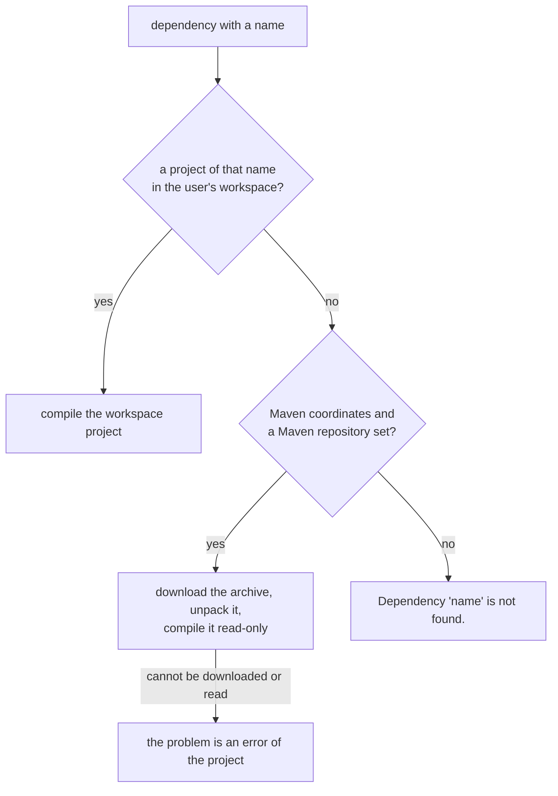
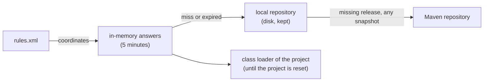

# Maven Dependencies in OpenL Studio

How OpenL Studio compiles a project and runs its tests with the dependencies its `rules.xml` names by Maven
coordinates: a library, and an OpenL project that the user's workspace lacks.

## Goals

- **A project compiles in OpenL Studio as it builds with the OpenL Maven Plugin.** A `<mavenArtifact>` the plugin
  resolves at build time is resolved in Studio too, so the tables using the classes of a library compile and their
  tests run without the jar copied into `lib/` by hand.
- **The project the user works on wins.** A dependency project the user opened is compiled from the workspace, with
  the user's changes. The Maven repository supplies only what the workspace does not hold.
- **Nothing changes until a repository is set.** Without a URL Studio downloads nothing and behaves as before.
- **A dependency that cannot be had is said so.** The project and each of its modules report why, instead of only the
  compilation errors it causes.
- **One Maven model.** Coordinates, scopes and transitive dependencies follow Maven and the OpenL Maven Plugin, not a
  model of Studio's own.

## Decisions at a Glance

- **Resolver** — Apache Maven Resolver 2 with the Maven 3 POM model (`maven-resolver-supplier-mvn3`), embedded in the
  war. Files are transported by the HTTP client of the JDK (`maven-resolver-transport-jdk`) and from the file system,
  so Apache HttpClient 4 and Commons Logging stay out of the war.
- **One remote repository** — `maven.repository.url`, with an optional user and password; `http`, `https` and `file`
  addresses. The **Maven** section of the administration edits it, through `/rest/admin/settings/maven`.
- **One local repository per instance** — `maven.repository.local`, by default `${openl.home}/maven-repository`,
  laid out as `~/.m2/repository` is. It is a cache: each instance of a cluster keeps, cleans and empties its own.
- **Precedence of a project dependency** — the project of the user's workspace with that name, else the archive the
  Maven coordinates name, else not found.
- **Libraries** — the class loader of the project reads them after its own classpath. Two hooks of
  `AbstractDependencyManager` carry them into the engine; only OpenL Studio implements them.
- **Caching** — every answer, failures included, is kept in memory for five minutes; the files stay on disk.
- **OpenL Rule Services are not changed.** A deployed project carries its libraries in `lib/`, and its dependency
  projects are deployed with it.

## Coordinates

A `<dependency>` names Maven coordinates in `<mavenArtifact>` as the OpenL Maven Plugin reads them:
`groupId:artifactId[:extension[:classifier]]:version`, the version last. Without the extension the coordinates name a
`zip` archive, the packaging of an OpenL project.

- **A dependency without `<name>` is a library.** It is collected with its `compile` and `runtime` dependencies; the
  `test`, `provided` and optional ones are left out, as Maven leaves them out of a runtime classpath. All the libraries
  of a project are collected in one request, so Maven mediates their versions together.
- **A dependency with `<name>` is an OpenL project.** Its archive alone is downloaded: an archive the OpenL Maven
  Plugin packages already holds its libraries in `lib/`, and its own `rules.xml` names its dependencies.

Coordinates that are not three to five parts of letters, digits and `_ . + -` are reported as not valid; nothing is
downloaded for them. A part is never `.` or `..`, so coordinates name no file outside the local repository.

## Which Project Is Compiled

- **The user's workspace** is what `WebStudio.getProjects` reads: the projects the user opened, and the projects
  edited in place. A project that is only in a design repository, closed, is not in it, so its Maven archive is used
  until the user opens it. Opening or closing the project changes the choice at the next compilation.
- **The walk is transitive.** `WebStudioWorkspaceDependencyManagerFactory.workspaceOf` follows the dependencies
  of each project it finds, the downloaded ones included, with the same precedence at every step.
- **A downloaded project must have the name.** The `<name>` of its `rules.xml` is the name the dependency gives;
  another name is an error, since rules address a dependency by name.
- **A downloaded project is read-only.** It is in no repository and in no project list; the editor shows its tables
  as those of a dependency, with no address of a project of their own.
- **The project list does not show a library.** `ProjectDependencyResolverImpl` lists the projects a `rules.xml`
  depends on, so a dependency without a name is left out rather than shown as a missing project.

## One Project of a Name

Rules address a dependency by its name, so a compilation holds one project of a name. Two projects that need two
versions of one downloaded project — UsesDomain `com.example:domain:1.0.0`, CustomDomain `com.example:domain:2.0.0`
— each compile with their own version. A project that depends on both cannot:

- **The first one reached is compiled.** The walk goes through the dependencies in the order each `rules.xml`
  declares them, each with what it depends on before the next one, and takes the first project of a name. A
  dependency leading to another project of the name is left out (`DependencyConflict`): another version of a
  downloaded project, or a downloaded project beside an opened one of its name. Maven mediates versions the same
  way, nearest first; here the first reached wins.
- **It is told.** The compilation reports a warning on the project it is of
  (`WebStudioWorkspaceRelatedDependencyManager.getDependencyMessages`): `Two projects 'Domain' are required:
  com.example:domain:1.0.0, which 'UsesDomain' depends on, is compiled, and com.example:domain:2.0.0, which
  'CustomDomain' depends on, is left out.`
- **A session compiles each project with its own.** The session keeps the dependencies it compiled for the next
  project when that one needs them (`ProjectModel.reuseOf`): only when every project it holds is the very project —
  the same folder — the next one resolves, not merely one of its name. After a project that compiled Domain 1.0.0,
  CustomDomain is compiled anew with Domain 2.0.0.

## Libraries on the Classpath

`AbstractDependencyManager.getExternalJarsClassLoader` builds the class loader a project compiles and runs with. The
class loader asks, in this order:

1. the class loader of OpenL Studio, since `OpenLClassLoader` delegates to its parent first — a class Studio ships
   wins over the same class in a downloaded jar;
2. the classpath of the project: its folder, then its `<classpath>` entries (`lib/*.jar`, `classes/` by default);
3. the libraries `getLibraries(project)` returns — in Studio, `MavenDependencyResolver.librariesOf(project)`;
4. the class loaders of the dependency projects, in the order the project declares them, so a project also reads the
   libraries of the projects it depends on.

The compiled module keeps the class loader, and a test run, a run and a trace set it as the context class loader
(`ProjectModel.execute`): the rules see at run time the classes they were compiled with.

`getDependencyMessages(project)` returns what failed: a library or a project that cannot be downloaded, coordinates
that are not valid, an archive that is not the project named. `SimpleDependencyLoader` adds these errors to what the
project and each of its modules report, ahead of the errors of the compilation, which are often their consequence.

Both hooks answer nothing in `AbstractDependencyManager`, so the engine, the OpenL Maven Plugin and OpenL Rule Services
are unchanged.

## Resolution

`MavenDependencyResolver` is a singleton bean of OpenL Studio:

- **The repository system** is built on first use and shut down with the application context. Saving the settings
  restarts the context, so a new URL or password takes a new bean.
- **A session per request** — each resolution opens a session on the local repository and closes it. A repository
  that does not connect in 10 seconds, or answer a request in a minute, fails the resolution, and the failure is kept
  as any other.
- **Failures are not recorded on disk** (`SimpleResolutionErrorPolicy(false, false)`): a library put into the
  repository after a failure is found once the in-memory answer expires, without deleting `*.lastUpdated` files.
- **Snapshots are checked on every resolution** (`UPDATE_POLICY_ALWAYS`), which the in-memory cache limits to once in
  five minutes. A release present on disk is read without asking the repository.
- **An archive is unpacked beside it**, into a folder named after the archive and its modification time
  (`domain-1.0.0-1795125964000/`). A new snapshot is unpacked into a new folder, so a class loader still reading the
  old files keeps them. The archive is unpacked into a temporary folder that is renamed when complete, so a failed
  or concurrent unpacking leaves no half-written folder.

## Caching and Lifecycle

- **In memory** — an answer is kept for five minutes by its coordinates: a library set by the list of coordinates of
  a project, a project by its name and coordinates. Compiling the same project again asks nothing in that time, and
  a fix in the Maven repository shows up within it. An answer no project asked for during the period is forgotten.
  Requests for an answer being resolved wait for that resolution instead of starting their own, and requests for
  other coordinates are not held up by it.
- **The errors match the classpath** — the dependency manager reports the answer it built the class loader of the
  project from. A library fixed in the repository shows up, with its errors gone, once the project compiles anew.
- **Class loaders** — the dependency manager keeps one per project until the project is reset or closed, or the
  manager is replaced. A change of `rules.xml` resets the project, so the next compilation reads the new coordinates.
- **On disk** — the local repository keeps every file it downloaded, and every folder it unpacked.

## Dependencies No Longer Needed

When a `rules.xml` stops naming a dependency, or names another version:

- **The classpath forgets it at the next compilation.** The project is reset, and its new class loader reads only
  what the coordinates name now. A project dependency no longer named is no longer compiled with it.
- **Memory forgets it within five minutes**, once its answer expires unasked.
- **The disk keeps it.** Nothing deletes a file of the local repository: another project or another instance may name
  the same coordinates, and Maven offers no record of who uses a file. The folder is a cache an administrator may
  empty. Studio downloads again whatever a project still names, at its next compilation.
  - Emptying it while Studio runs is safe for files no class loader holds open. A project compiled from a deleted
    file reads it again once it is reset. On Windows a file a class loader holds cannot be deleted until then.
  - The unpacked folders of old snapshots are never used again once a newer one exists, and can be deleted at any
    time no project compiled from them is open.

## Configuration

| Field    | Property                    | Default                                  |
|----------|-----------------------------|------------------------------------------|
| URL      | `maven.repository.url`      | empty: nothing is downloaded             |
| Username | `maven.repository.username` | empty: no authentication                 |
| Password | `maven.repository.password` | empty; a secret, stored encrypted        |
| —        | `maven.repository.local`    | `${openl.home.shared}/maven-repository`  |

`MavenRepositorySettings` declares the first three for the **Maven** section of the administration and for
`/rest/admin/settings/maven` (`MavenRepositorySettingsController`), which reads them (`GET`) and changes them
(`PATCH`). A property the deployment sets is read-only there, as with every setting.

## Out of Scope

- **Several remote repositories, mirrors and proxies.** One URL serves a repository manager, such as Nexus or
  Artifactory, which groups the others; Studio configures no proxy for the repository.
- **OpenL Rule Services.** They run what is deployed, which carries its libraries and its dependency projects.
- **Editing a downloaded project.** Open the project from its design repository instead; the workspace copy then
  wins.

## Rejected Alternatives

- **Downloading the named file only.** Simple, but every transitive library would have to be listed in `rules.xml`,
  unlike the OpenL Maven Plugin, and versions would not be mediated.
- **The Apache HttpClient transport of the resolver supplier.** It brings HttpClient 4 and Commons Logging into a war
  that already has HttpClient 5; the JDK client needs only one small library, methanol.
- **A closed project of a design repository before the Maven archive.** Studio would have to read every design
  repository to compile, and would compile a version the user did not choose; the user opens the project to choose
  it.
- **Recording failures in the local repository**, as Maven does by default. A fixed repository would stay unseen until
  `*.lastUpdated` files were deleted by hand.
- **Removing unused files from the local repository.** Nothing records which project, session or instance uses a
  file, so no deletion is known to be safe; the folder stays a cache.

## Implementation Map

- **`AbstractDependencyManager`** (`DEV/org.openl.rules.project`) — `getLibraries`, `getDependencyMessages`, and
  the class loader that reads the libraries.
- **`SimpleDependencyLoader`** — adds the dependency messages to what a compilation reports.
- **`MavenDependencyResolver`** (`studio-backend`, `org.openl.rules.webstudio.dependencies`) — the resolver, the
  in-memory answers, the unpacking.
- **`WebStudioWorkspaceDependencyManagerFactory`** — which project a dependency is, and the dependencies left out
  as another project of their name is compiled (`DependencyConflict`).
- **`ProjectModel.reuseOf`** — whether the dependencies the session compiled serve the next project.
- **`WebStudioWorkspaceRelatedDependencyManager`** — implements the two hooks for a compilation of the session.
- **`ProjectDependencyResolverImpl`** — the project list leaves libraries out.
- **`MavenRepositorySettings`**, **`MavenRepositorySettingsController`** — the settings and their REST endpoint.
- **`Maven.tsx`** (`studio-ui`) — the **Maven** section of the administration.
