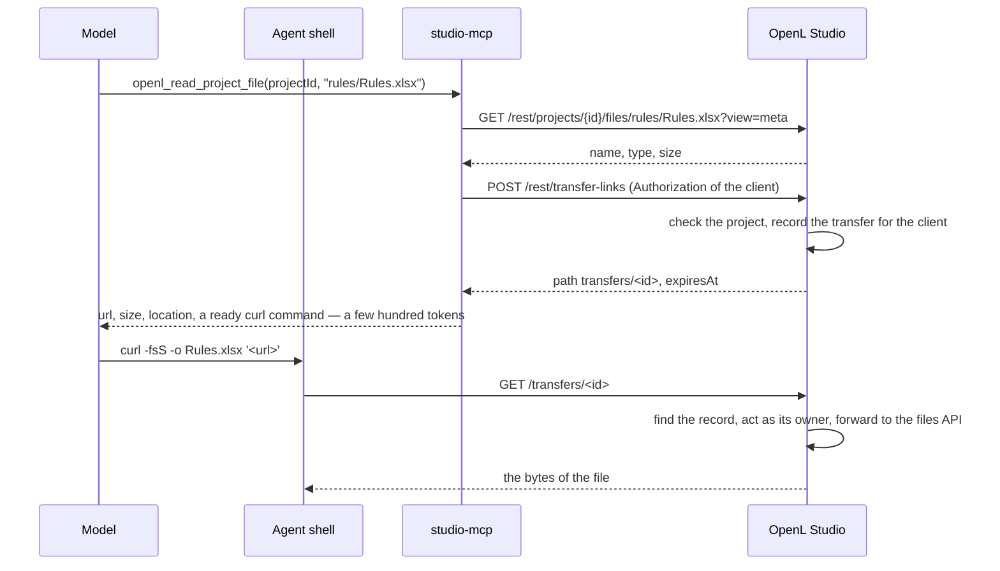
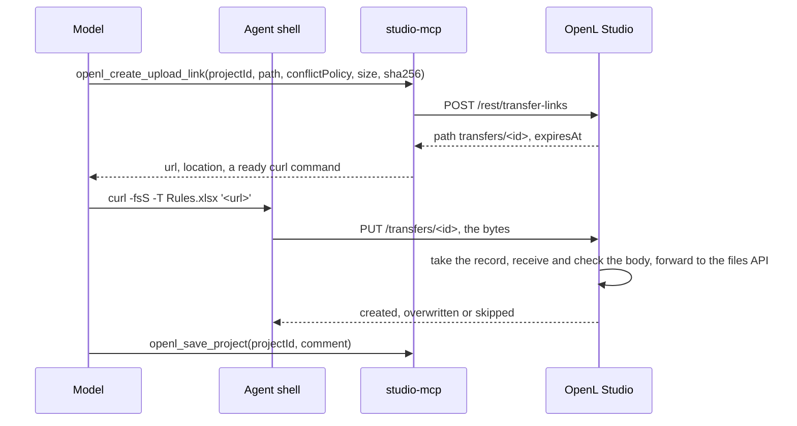

# MCP File Transfer Links

- **Status** — Accepted
- **Date** — 2026-10-23
- **Tickets** — [EPBDS-16756](https://jira.eisgroup.com/browse/EPBDS-16756) (the MCP server),
  [EPBDS-16757](https://jira.eisgroup.com/browse/EPBDS-16757) (the links of OpenL Studio)
- **Scope** — how the [Built-in MCP Server](mcp-server.md) moves the bytes of project files between an AI agent and
  OpenL Studio without passing them through the context of the language model, and which file tools the server has.

---

## 1. Context

An MCP tool that carries the content of a file in its messages puts that content into the context of the model:
whatever enters a tool call or a tool result enters the context. A binary file can travel in an MCP message only as
base64, the worst case for it:

- **Size** — base64 adds a third to the bytes: a rule module of 1 MB becomes about 1.4 million characters.
- **Tokens** — a tokenizer splits base64 into much shorter tokens than prose: about 1.5–3 characters per token
  against about 4 for English text, so a base64 character costs two to three times what a character of prose
  costs. The exact ratio depends on the tokenizer and has to be measured with the token counter of the model.
- **Paid twice on upload** — an agent with a shell runs `base64 file.xlsx`, reads the output into its context, then
  writes it again, character by character, as an argument of the call.
- **Fidelity** — the model reproduces the base64, it does not copy it. One wrong character damages the file;
  [Upload Integrity](upload-integrity.md) refuses a damaged workbook, but any other format is written as it arrives.
- **Limits** — studio-mcp accepts a request body of 5 MB, so an upload inside a call stops at about 3.7 MB of file.
  Paging a read only spreads the same base64 over more calls, and every page stays in the context.
- **No value to the model** — the model cannot read a workbook from its base64. It only moves the bytes between a
  file on the agent's side and a file in the project.

The agent that needs a binary file — Claude Code, Cursor, an IDE agent — almost always has a shell or a file system
of its own: the file comes from, or goes to, a local path. The bytes can travel over HTTP between that machine and
Studio directly, while only a short reference passes through the model.

### 1.1 How agents handle a large tool result

The MCP specification sets no limit on the size of a tool result; each host applies its own:

| Host | A large result | What the model gets |
|---|---|---|
| Claude Code | over 50,000 characters, or over `MAX_MCP_OUTPUT_TOKENS` (25,000 tokens by default) | the result saved to a file and its path; a warning from 10,000 tokens |
| GitHub Copilot CLI | over 20 KiB (`COPILOT_LARGE_OUTPUT_THRESHOLD_BYTES`) | the result saved to a temporary file, its path and a preview |
| Cursor | no published threshold | the result saved to a file of the workspace and a pointer to it; users report silent truncation |

What that means for a binary file read inline, by its size:

| File | Base64 | Estimated tokens | In Claude Code |
|---|---|---|---|
| 16 KB | 21,848 characters | 7,000–15,000 | in the context, whole |
| 36 KB | 50,000 characters | 17,000–33,000 | the threshold of the file |
| 256 KB | 349,528 characters | 115,000–235,000 | saved to a file |
| 1 MB | 1,398,104 characters | 470,000–930,000 | saved to a file |

- **Below the threshold the bytes stay in the context** — and they are paid again on every later turn of the
  conversation, until it is compacted. A 36 KB file costs more than the 10,000 tokens Claude Code warns about, and
  one or two such reads fill a noticeable share of a 200,000-token window.
- **Above it the bytes land in a file of the host, not of the user** — a JSON envelope in a session folder of the
  host. Turning it into the workbook takes `jq` and `base64 -d` on a path the agent did not choose; an agent that
  opens the file with its read tool instead pulls the base64 back into the context page by page.
- **Spilling is a feature of some hosts only** — a host without it puts the whole result in the context, or fails the
  request: Claude Code stops reading an HTTP response at 16 MiB.
- **An error is cut, not spilled** — Claude Code keeps the first and the last 5,000 characters of an error text longer
  than about 11,000 characters.
- **Uploads have no such relief** — no host spills the arguments of a call: the model generates every character of
  the content. A 256 KB file is 350,000 characters of output, beyond the output limit of one response of current
  models — tens of thousands of tokens, depending on the model — and every character stays in the context afterwards.

There is therefore no size from which inline binary content is cheap. A threshold of 256 KB would put every module of
up to 36 KB whole into the context of Claude Code, and every larger one into a file the agent can hardly use.

### 1.2 Forces

- **Context stays small** — a transfer costs the model a few hundred tokens, whatever the file size.
- **Security follows the installation** — a transfer is allowed exactly when the same user could make it through
  `/rest`, in every `user.mode` ([Built-in MCP Server §4](mcp-server.md#4-security)).
- **No long-lived secret in the transcript** — a Personal Access Token never appears in a tool result, a shell
  command or a log the agent writes.
- **One path for the bytes** — a transfer runs through the REST API, so it keeps the checks of
  [Upload Integrity](upload-integrity.md), the [Project Editing Lock](project-editing-lock.md) and the
  [Audit Log](audit-log.md).
- **Few tools** — every tool definition an agent loads costs context too; the transfer adds no tool where an
  existing one can answer.

---

## 2. Options

### 2.0 Keep the bytes inline

Carry base64 in the messages and tune the chunk sizes. Rejected: it changes none of the costs of §1, it only spreads
them over more calls.

### 2.1 MCP resources and `resource_link`

Return a `resource_link` from a tool and let the client read the resource through `resources/read`. Rejected:
`resources/read` returns the bytes as a base64 `blob` in an MCP message again, and whether that blob reaches the model
is up to each client — several hand every blob to their image renderer. MCP has no upload counterpart at all.

### 2.2 The agent calls `/rest` with its own token

Tell the agent to `curl` the files API of Studio with its PAT. Rejected: the PAT has to be in the agent's shell, so it
lands in commands and transcripts; it grants every right of the user for its whole lifetime; in the `oauth2` mode the
IdP token lives in the client configuration, where the shell cannot read it; and a client in `single` mode has no
token to pass, so the agent cannot even tell which mode it talks to.

### 2.3 Existing REST URLs with a one-time token in the query

A tool issues a token that the files API accepts as a credential for one request:
`GET /rest/projects/{projectId}/files/{path}?branch=…&transfer_token=<token>`.

- **For** — no new endpoint: the documented REST API, its validation and its answers are reused as they are.
- **Against** — a token that authenticates a REST URL has to be matched against the method, the path and every query
  parameter, or a stolen token becomes a credential for another request: a changed `conflictPolicy`, another `path`,
  another endpoint. That matching couples a security filter to the parameters of each controller and breaks silently
  when a parameter is added.
- **Against** — the token becomes a new authentication mechanism in the API chain of every `user.mode`.
- **Against** — the URL names the project and the path, so they show in every access log next to the token.

### 2.4 Opaque short-lived links

A tool records the whole operation on the server — who, what, where, how — under a random id, and returns a link
`<public URL of Studio>/transfers/<id>`. The link is the capability: a request to it performs the recorded operation,
until the link expires or, for an upload, until its first request spends it.

- **For** — nothing in the request can be changed: the server already holds every parameter, so a link can only do
  what the tool was asked for.
- **For** — one endpoint, one security rule, for every kind of transfer.
- **For** — the URL tells nothing about the project; once expired or spent it is worthless, also in a log.
- **Against** — a new endpoint and a store of pending transfers, kept in memory — needed only where Studio
  authenticates its clients.

---

## 3. Decision

**Option 2.4 — opaque, short-lived transfer links, served at `/transfers` — in the modes that authenticate. In
`single` mode the tools answer the URLs of the REST API itself.**

- **D1 — The link is the capability.** A random id of 256 bits names a transfer record that holds the user, the
  client that issued it and the full operation. Rejected: a token in the query of the REST URL (§2.3), a signed
  self-describing token (JWT). An upload link needs state on the server to be spent, and a link needs it to end with
  its client session (D6); with state on the server a signature adds nothing.
- **D2 — `/transfers` is a servlet of its own, which forwards to the REST endpoint of the operation.** Rejected:
  `/rest/transfers`, and a servlet that runs the operation itself. Reasons:
  - every path under `/rest/**` is one of `RequestMatchers.apiPatterns()`, whose security chains require the
    credentials a link does not carry; a path of its own lets `SecurityConfig` pass it without authentication. It is
    no part of the REST contract that OpenAPI documents either;
  - the filters of the webapp run for a request as it arrives, not for a forward, so the forwarded request passes no
    security chain a second time, while the dispatcher, the `@ProjectId` resolution, `BranchGuard`, the interceptors,
    the error answers and the formatting of an upload run for it as for any REST call. Running the operation in the
    servlet would copy all of that.
- **D3 — A link expires within minutes; an upload link also works once.** A download link answers every request
  until it expires, so a download cut midway is retried with the same link. An upload link is spent by its first
  request, which removes the record atomically, so one link never writes twice; a failed upload is retried with a new
  link. A spent, an expired and an unknown id get the same `404`. Rejected: one use for downloads too. A download
  writes nothing, so a second use repeats what the first did, and one use would turn every cut download into another
  tool call.
- **D4 — A download link streams the resource itself.** `GET` answers the bytes of the file, of a historical version,
  of a merge-conflict version or of a folder as a ZIP, as the REST endpoint answers them.
- **D5 — An upload link writes one file.** The tool that issues it takes the target — the project, the path, the
  conflict policy, whether to create folders, the branch — and the request to the link writes its body there, into
  the working copy, as the files API does; `openl_save_project` commits it. Rejected: a link that only stages the
  bytes under an id for a later tool call. Staging needs a store of uploads and the `/transfers` API, which `single`
  mode does without (D9); a link bound to its target works the same in every mode, and the agent reads the outcome of
  the write in the answer to its request.
- **D6 — The link is a credential of its own, bound to the client session of its issuer.**
  - **Rights when it runs** — the transfer runs as the user with the user's authorities at that moment, and the
    endpoint it forwards to checks the rights of the operation: a removed permission or a locked project refuses it.
  - **Not tied to the issuing credential** — the PAT or the IdP token that issued the link only authenticated the
    issuing call. A link outlives neither the minutes of D3 nor its client session, so a PAT that expires or is
    revoked, or an IdP token that expires, leaves the links it issued as they are.
  - **Ends with the session** — when the state [Client Sessions](client-sessions.md) keep for the client ends — after
    the idle timeout, or as the application stops or refreshes — every link the client issued ends with it.
- **D7 — No binary content goes inline.** No tool carries base64, in either direction (§1.1). A read of a binary file
  answers a download link instead of the bytes; a write takes text, and a binary file goes up by an upload link.
- **D8 — A text file of up to 5,000 bytes goes inline whole; a larger one answers a download link.** There are no
  pages and no byte ranges. A file is text when the `Content-Type` Studio answers for it says so — `text/*`, or a
  JSON, XML or YAML type — and its `charset` decodes it; studio-mcp does not guess from the bytes. Rejected: the
  25,000 characters of `RESPONSE_LIMITS`, and paging a larger file. Reasons:
  - a character is no measure of tokens. English prose takes about four characters per token, but text in Cyrillic,
    Greek or CJK scripts takes about one token per character or more, so 25,000 characters can cost 25,000 tokens
    and more — the default `MAX_MCP_OUTPUT_TOKENS` of Claude Code. A byte bounds the cost: no tokenizer makes more
    than about one token of a byte, so an inline answer costs at most about 5,000 tokens, half of the 10,000 at which
    Claude Code warns, in any language;
  - pages only spread a large file over more calls, and every page stays in the context; an agent that needs a
    large file whole has it on disk by one link, and searches or reads it there with its own tools;
  - the answer has one form per file, decided by the file alone, so the agent never has to choose a range.
- **D9 — In `single` mode the links are the URLs of the REST API.** A download link is the `GET` of the files API or
  of the merge-conflict API, an upload link the raw-body `POST` of the files API, all at the public address of Studio.
  There is no `/transfers`, no `/rest/transfer-links` and no store. Rejected: transfer links in every mode. Reason:
  `single` mode authenticates nobody — every request runs as the one user — so whoever reaches Studio can call these
  URLs anyway; a transfer link would protect nothing and cost an endpoint, a store and an extra REST call per
  transfer.
- **D10 — Every link answer names where the file lives in its repository.** Next to the link, the answer carries
  `repositoryId`, the design repository of the project as `openl_list_repositories` names it, `repositoryPath`, the
  path of the file inside that repository — the folder of the project followed by the project-relative path — and the
  `branch`. Reason: an agent that has the repository itself — a clone of the same Git remote, the folder of a
  file-system repository — reads or changes the file with its own tools, its history and diffs included, and needs no
  transfer at all. Studio shows the projects of a repository; the repository is the source of them.
  - **What it reflects** — the repository holds what was committed on the branch. A change kept only in the working
    copy of Studio, not saved yet, is not there; a change made in the repository reaches Studio once Studio reads the
    repository again, as any commit of another client does.
  - **What it bypasses** — a write into the repository goes past Studio: past
    [Upload Integrity](upload-integrity.md), the [Project Editing Lock](project-editing-lock.md) and the
    [Audit Log](audit-log.md). The answer names the place; whether to write there is for the user to decide, and the
    guidance of the tools tells the agent to use the upload link unless the user asked for the repository.

---

## 4. Design

### 4.1 Flows

In the modes that authenticate, a tool asks Studio for a transfer link. In `single` mode it skips that call and
answers the REST URL itself (§4.4); the rest of each flow is the same. Either way the tool first reads the public
settings of Studio, `GET /rest/settings`, to tell the mode, and the project, `GET /rest/projects/{projectId}`, for the
location of D10.

Download — the read tool answers a link for a binary file, so it takes no extra call:



Upload:



The bytes go between the agent's machine and Studio directly. They pass neither through the model nor through
studio-mcp, so neither its 5 MB body limit nor its memory applies to them.

### 4.2 Transfer record

In the modes that authenticate, `TransferLinks` keeps a pending transfer in memory, keyed by the SHA-256 of its id, so
a heap dump holds no usable link:

- **Owner** — the user name and the key the state of the issuing client is kept under in
  [Client Sessions](client-sessions.md): `user|pat:<public id>`, `user|sid:<sign-in>`, or the user alone. The record
  stores the key itself, because a request to the link carries no credential to find it by.
- **Operation** — `TransferOperation`: the `Download` of a project file or of a folder as a ZIP archive, with the
  project id, the path, the branch and the version; the `ConflictVersion` of a conflicted file; or the `Upload` of
  one file, with the project id, the path, the conflict policy, whether to create folders, the branch, and the
  declared size and SHA-256, both optional.
- **Bounds** — the expiry, and the client session the record belongs to (D6).

`ClientTransferLinks`, a bean of the client scope, holds the links its client issued. A link leaves the store when it
expires and is looked up, when an upload uses it, when its client issues a link and finds it no longer pending, and
when the state kept for its client ends, which destroys the bean. A client holds at most `transfer.max-pending`
links: a new one beyond it ends the oldest, so the links an agent abandoned never block it.

| Setting | Default | Meaning |
|---|---|---|
| `transfer.link.ttl` | `PT15M` | from issuing a link to its expiry, for a download and an upload alike |
| `transfer.max-pending` | `20` | links one client holds at a time, one at least; a new link beyond it ends the oldest one |

The size of an upload takes no setting of its own: the limits on the request size of the servlet container, and of a
reverse proxy in front of it, apply to `/transfers` as to every request, and the files API refuses more than the
1000 MB of [Upload Integrity](upload-integrity.md) in every mode.

The store is local to one Studio. That is enough while Studio runs as a single node — horizontal scaling is a non-goal
of the [Built-in MCP Server](mcp-server.md#1-context-and-goals) — and a restart ends the pending links.

### 4.3 Endpoints

The modes that authenticate only; `TransferLinksController` and `TransferHandler` are no beans in `single` mode. Issuing
a link is a REST call; using it is not.

- **`POST /rest/transfer-links`** — `TransferLinksController` issues a link of a `kind` — `download`, `archive`,
  `conflictVersion` or `upload` — for a project it resolves by its id, which checks that the user may read it. A path
  that is absolute, not normalized or leads out of the project is refused with `400`, as the link forwards to the
  address of its file. It answers `{ path, expiresAt }`: `path` is `transfers/<id>`, relative to the address of
  Studio. The rights of the operation are checked when the link is used, by the endpoint it forwards to. A request of
  a browser session has no client key, and is refused with `400`.
- **Public address** — studio-mcp resolves `path` against the address in `OpenL-Public-Url` of the MCP request: the
  address the client reached `/mcp` at, as `ForwardedHeaderFilter` restores it from `X-Forwarded-*`
  ([Built-in MCP Server §3.2](mcp-server.md#32-the-mcp-servlet)). The issuing call comes from studio-mcp at an internal
  address, so Studio could not build a reachable address from it, and needs no setting of its public address.
- **`/transfers/{id}`** — `TransferServlet`, a `@WebServlet` of the webapp, hands the request to `TransferHandler`, a
  bean of the Spring context, so a refresh of the context drops the pending links with it. Without the bean, in
  `single` mode, it answers `404`.

`TransferHandler` serves two methods:

- **`GET /transfers/{id}`** — for a download record: forwards a `GET` to `/rest/projects/{id}/files/{path}`, each part
  of the path encoded whole, so that a `;` of a file name starts no path parameter, with
  `branch`, `version` and, for an archive, `download`, or to `/rest/projects/{id}/merge/conflicts/files` with `file` and
  `side`. It answers every request until the link expires (D3), each with the content at that moment, and serves no
  ranges: a cut download is fetched again whole.
- **`PUT /transfers/{id}`** — for an upload record. The id is looked up, and the record taken, before a byte of the
  body is read: a request without a valid link is answered `404` at once, before `100 Continue`, which curl waits for
  on an upload of more than 1 MB, so Studio never reads the body of a request without a valid link. The body is
  received into a temporary file only the owner of the process may read, hashed as it comes, up to the 1000 MB of
  [Upload Integrity](upload-integrity.md): a longer body is refused with `400`. A declared size or SHA-256 the body
  does not match is refused with `400` too, and nothing is written. The handler then forwards a raw
  `POST` of that file, as `application/octet-stream`, to `/rest/projects/{id}/files/{path}` with `createFolders`,
  `conflictPolicy` and `branch`; the files API checks it as [Upload Integrity](upload-integrity.md) describes and
  answers `201`, `204` for a skipped file, or `409`. The forward reads the body from one stream, which the handler
  closes, and the temporary file is deleted afterwards.

How a forward runs:

- **Security chains** — `/transfers/**` is one of the paths of `SecurityConfig` that pass without authentication,
  session, CSRF or security context, as the static resources do. It is not one of `RequestMatchers.apiPatterns()`: the
  id is the credential.
- **Running as the owner** — before it forwards, the handler signs the request in as the owner,
  `TransferLinkAuthentication` with the authorities `patUserInfoUserDetailsService` loads for the user now, and enters
  the client session of the stored key through `ClientSessions.enter`. A user who cannot act any more — removed,
  disabled, locked — and a client whose state ended get the `404` of an unknown link.
- **One client** — the forwarded request finds the state that client holds, its pending merge conflict for a
  version, and takes the locks a REST call of that client takes, so its write runs one after another with the other
  writes of the client ([Project Editing Lock](project-editing-lock.md)).
- **Synchronous** — the forward runs on the thread of the request, as a REST call does: a transfer holds the read lock
  of `SecurityFilter` for as long as it runs, as an upload through the files API does, and a refresh of the context
  waits for it.
- **Answers** — the endpoint answers the forwarded request as it answers any REST call, its error answers included.
  The handler answers its own refusals in the same form, through `ExceptionMappingService`:
  `openl.error.404.transfer.link.unknown.message` and `openl.error.400.transfer.upload.mismatch.message`.
- **Headers** — every answer carries `Cache-Control: no-store` and `Referrer-Policy: no-referrer`.

### 4.4 Single-user mode

studio-mcp builds the links itself, from the public address of Studio — the one `OpenL-Public-Url` carries — and the
REST API that already serves each transfer:

| Transfer | Link |
|---|---|
| a project file | `GET <public>/rest/projects/{projectId}/files/{path}?branch=…&version=…` |
| a folder as a ZIP | the same, with `download=true` |
| a merge-conflict version | `GET <public>/rest/projects/{projectId}/merge/conflicts/files?file=…&side=…` |
| an upload | `POST <public>/rest/projects/{projectId}/files/{path}?createFolders=…&conflictPolicy=…&branch=…` |

- **The mode** — `GET /rest/settings`, which Studio answers without credentials, names no `userMode` in single-user
  mode. studio-mcp reads it with every link: a cheap call, and a Studio whose settings change restarts studio-mcp
  anyway ([Built-in MCP Server §3.5](mcp-server.md#35-lifecycle)).
- **Upload** — the body goes raw, as `application/octet-stream`, to the files API, which checks it as
  [Upload Integrity](upload-integrity.md) describes and answers `201`, `204` for a skipped file, or `409`.
- **Not one-time** — the link is the REST API: it works as long as the resource exists, any number of times, and
  never expires.
- **No declared size or SHA-256** — the files API checks neither, so the size and SHA-256 an upload link takes apply
  to the transfer links only.

### 4.5 Tools

The file tools and what each one answers:

- **`openl_read_project_file`** — reads the metadata of the file first. A text of up to 5,000 bytes (D8) is read and
  answered inline; a larger file is answered with a download link without a byte of it being read; a binary file of
  up to 5,000 bytes is read once, to learn its type, and answered with a link too. A folder, a path ending in a slash
  or the project root, is answered with a link to its ZIP archive. It takes the project, the path, `version` and
  `branch`.
- **`openl_search_project_files`** — finds files, and lists a folder: a search from it with no other criteria, each
  match with its size and date.
- **`openl_write_project_file`** — writes a text from its `content`. Its `content` has no size limit, as the model
  writes what it authors; the description tells the agent to send a file it has on disk by the upload link instead of
  typing it out.
- **`openl_create_upload_link`** — takes the target of the write — `projectId`, `path`, `conflictPolicy`,
  `createFolders`, `branch` — and, optionally, the `size` and `sha256` of the file, and answers the link that writes
  it. A download needs no tool of its own: the read answers the link.
- **`openl_delete_project_file`** — deletes a file or a folder.
- **`openl_copy_project_file`** — copies a file inside Studio, so no byte moves through the agent, where a download and
  an upload would take four calls.
- **`openl_move_project_file`** — moves a file. It deletes its source, so it is a tool apart from copy, whose name and
  annotations say so.
- **`openl_read_merge_conflict_file`** — reads `fileAvailability` of the pending conflict first: a version marked
  `false` holds no file and is refused, and a version that is not text is answered with a link without being read. A
  text version of up to 5,000 bytes is answered inline, a larger one with a link. A conflicted text file is decided
  through `openl_get_merge_conflict_text` and a workbook through `openl_get_merge_conflict_workbook`, which show only
  the conflicting lines, tables and cells; this tool is for a version read whole, a binary one above all. A conflict
  names its file by the path in the repository, so the link answers that path as it is, with the branch of the side —
  ours or theirs — and no branch for the base.

No tool changes part of a text file: under D8 the agent sees a larger file only on disk, changes it there with its own
tools, and sends it back by an upload link, which costs the context nothing either; a small file is read inline and
written whole.

A tool answers a link as text of its JSON result — the URL, the method, the expiry of a transfer link, the size when
it is known, the MIME type when it is known, the location in the repository (D10), a ready `curl` command and a short
note — never as a `resource_link` or a Markdown link: a client may fetch or preview a link it renders, which would
pull the bytes into the context. The command quotes every word for a POSIX shell: `curl -fsS -o <name> <url>` for a
download, `curl -fsS -T <file> <url>` for a transfer link of an upload, and
`curl -fsS --data-binary @<file> -H 'Content-Type: application/octet-stream' <url>` for an upload in single-user mode.

The tool result of `openl_read_project_file` for a binary file, in a mode that authenticates — the text the model
reads. studio-mcp builds it from the metadata of the file, the answer of `POST /rest/transfer-links` and the project;
in `single` mode it builds the same result with the REST URL and without `expiresAt`:

```json
{
  "url": "https://studio.example.com/transfers/k3Jx…",
  "method": "GET",
  "expiresAt": "2026-10-23T10:15:00Z",
  "size": 482113,
  "repositoryId": "design",
  "repositoryPath": "Insurance/rules/Rules.xlsx",
  "branch": "main",
  "curl": "curl -fsS -o 'Rules.xlsx' 'https://studio.example.com/transfers/k3Jx…'",
  "note": "Run curl to save the file; the link works until it expires, a cut download is fetched again with it."
}
```

- **No shell** — an agent that cannot run an HTTP client gets the same link and cannot use it. It could not use
  base64 of a workbook either: it can neither read it nor save it.
- **Guidance** — the tool descriptions tell the agent to read tables through the table tools, to use a link for any
  file that comes from or goes to a local path, and to commit an upload with `openl_save_project`, whose comment is
  required where the repository supports comments. The OpenL skills the server serves name tools only, not their
  arguments, and no skill is added for files (§8).

---

## 5. Security

A transfer link is a bearer capability: whoever holds it within its lifetime may use it — a download link as often as
they like, an upload link once. The design keeps that window narrow:

- **Narrow** — one operation on one resource, an upload included; never a credential for anything else.
- **Short** — 15 minutes by default (`transfer.link.ttl`), and ended with the client session that issued it (D6);
  an upload link is spent by its first request too. A download link that leaks reads that one file, which its owner
  may read, until it expires; a link that leaks after it expired, after it was spent or after its session ended is
  worthless.
- **Unguessable** — 256 bits from `SecureRandom`, compared by its hash.
- **Rechecked** — the owner's authorities and the rights of the operation are checked when the link is used, not
  only when it is issued. The issuing credential is not: the link is a credential of its own (D6).
- **Refused unread** — a request to an id that is not pending is answered before its body is read (§4.3), so the
  endpoint without authentication reads no body for anyone who calls it.
- **Logs** — Studio's own logging and the audit log never write the id. The access log of the servlet container —
  Jetty `RequestLog`, Tomcat `AccessLogValve` — and of a reverse proxy record the path, the id included; the
  protection rests on the short lifetime, and for an upload on its one use, not on the id staying out of logs. An
  audit event of a transfer names its authentication as `link`, so a filter finds every action an agent did through
  links.
- **HTTPS** — the link carries the scheme of the public address. Over plain HTTP the link is as exposed as a PAT
  would be, but for one resource and minutes.

In `single` mode a link is a URL of the REST API, which every client that reaches Studio may call without credentials
anyway: the link grants nothing that was not granted already, and its leak exposes nothing new.

Accepted risk: a client or a sandbox that previews every URL it sees may fetch a download link too. It does not spend
it — the agent's own request still works — and a preview never reveals more than the one file the user could read
anyway. A preview sends `GET`, never `PUT`, so it cannot spend an upload link.

---

## 6. Consequences

- **Context** — a transfer of any size costs the model a tool call, a shell command and their short answers.
- **Speed and limits** — the bytes go over one HTTP request; uploads reach the limit of the servlet container, of a
  reverse proxy in front of it, or the 1000 MB of [Upload Integrity](upload-integrity.md), whichever is lowest,
  instead of the 5 MB body of studio-mcp.
- **Integrity end to end** — in the modes that authenticate, the declared SHA-256 of an upload lets Studio check the
  bytes the agent meant to send. For the uploads that declare it, this closes the out-of-scope point of
  [Upload Integrity](upload-integrity.md#what-is-out-of-scope). A download carries no digest: `curl -f` and the
  framing of the answer tell a cut transfer, and a working-copy file that changes between the link and the request
  would make any digest given with the link wrong.
- **Network reach** — the agent's machine must reach the public address of Studio; a sandbox with an allow-list of
  hosts has to list it. An agent that cannot has no way to move a binary file.
- **Two calls for an upload** — a link, then the request; and a third, `openl_save_project`, to commit it, since no
  link takes a commit message.
- **Two forms of a link** — transfer links where Studio authenticates, REST URLs in `single` mode; the tools answer
  both in one shape, so the agent does not tell them apart.
- **New surface** — one servlet without authentication whose id is the credential, and an entry point of
  `ClientSessions` that enters a client by its key; covered by §5 and by their tests.
- **A file read costs more calls** — the metadata, the settings and the project, besides the link or the content:
  cheap calls to Studio, none of which reaches the model.

---

## 7. Verification

- **Studio** — `TransferLinksTest` (ids, expiry, one use, the limit per client, the end with the client),
  `TransferHandlerTest` (the forwards and their parameters, acting as the owner for the issuing client, every
  refusal, the body checked before the forward), `TransferLinksControllerTest`, `ClientSessionsTest` (`currentKey`,
  `enter`) and `AuthenticationMethodsTest` (`link`).
- **studio-mcp** — the tests of `file-handlers.ts` and `project-merge-handlers.ts`: text inline, links in both modes,
  the location, the `curl` commands and their quoting, and the arguments the tools refuse.
- **ITEST** — `transfer_links` of `itest.studio/repos` moves files through links in a running Studio, with no
  credential: a download fetched twice, a `PUT` on it refused, an upload written once and refused the second time, an
  upload that does not match its declared SHA-256 written nowhere, and an unknown link refused. The `every-tool`
  suite of `itest.studio/mcp` calls every file tool through `/mcp`.

---

## 8. Open points

- **A conflict resolved with a file of the user's own** — no file goes inline into a resolution:
  `openl_resolve_merge_conflicts` takes a version per file, line decisions for a text file and table or cell decisions
  for a workbook, and studio-mcp builds the merged `CUSTOM` file itself. A binary file other than a workbook can
  therefore only take a whole version. Resolving it with a file the user prepares would need an upload into the
  resolution, which sends every conflicted file in one request: a staged upload — the store D5 avoids — or the file
  written into the working copy first.
- **Images** — an MCP image result lets a model look at a picture of a project, which a link does not. No use case
  asks for it today.
- **Uploads of new projects** — a project created from an archive could take an upload link the same way; not needed
  by a tool today.
- **Several nodes** — a Studio cluster would need the store in a shared place, or links that route to the node that
  issued them, and a client session known to every node.
- **A skill for files** — EPBDS-16756 asks for a skill that tells an agent when to move a file by link, how to change
  it locally and how to check the result. None is added: moving a file with `curl` is simple, and the tool
  descriptions say when to do it. A skill is added only when an evaluation proves it pays — agents run on the same
  file tasks against a throwaway OpenL Studio with and without it, as the agent guide of studio-mcp prescribes for
  skills, show fewer tokens or fewer failed transfers with it.
- **Token figures** — the estimates of §1.1 come from published ratios; measure them with the token counter of the
  models the agents use before quoting them elsewhere.

---

## 9. Sources

- **studio-mcp** — `src/transfer-links.ts` (the links, their location and their commands),
  `src/handlers/file-handlers.ts`, `src/handlers/project-merge-handlers.ts`, `src/schemas.ts`, `src/client.ts`
  (`getProjectFileMeta`, `getSettings`, `createTransferLink`, `projectFileUrl`, `conflictFileUrl`) and
  `src/http-server.ts` (`MAX_BODY_BYTES`, `OpenL-Public-Url`).
- **OpenL Studio** — `org.openl.studio.transfer` (`TransferServlet`, `TransferHandler`, `TransferRequest`,
  `TransferLinks`, `ClientTransferLinks`, `TransferOperation`, `TransferLinkAuthentication`, and
  `rest.controller.TransferLinksController`), `ClientSessions`, `SecurityConfig`, `ProjectFilesController`,
  `ProjectsMergeController`, `FileIntegrityValidator` and `AuthenticationMethods`.
- **Hosts** — [Claude Code: MCP output limits](https://code.claude.com/docs/en/mcp#mcp-output-limits-and-warnings),
  [GitHub Copilot CLI: context management](https://docs.github.com/en/copilot/concepts/agents/copilot-cli/context-management),
  [Cursor forum: MCP tool responses](https://forum.cursor.com/t/cursor-truncates-mcp-tool-responses/168384).
