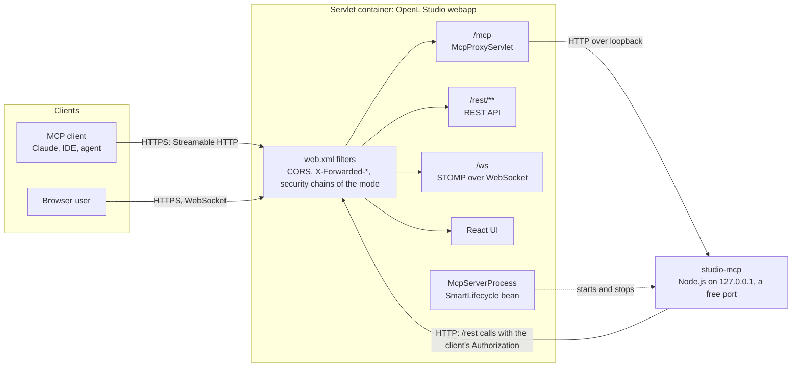
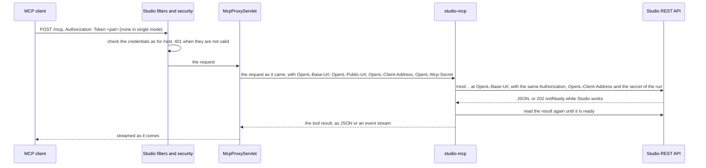
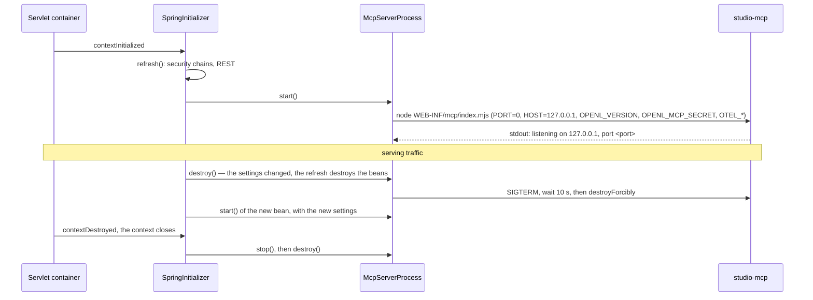

# Built-in MCP Server

OpenL Studio carries its MCP server, studio-mcp, and serves it at `/mcp` of its own address. Studio runs the server as
a Node.js child process on the loopback interface and passes the requests of MCP clients to it once its own security
has checked them. The server answers them by calling the Studio REST API; it never opens a WebSocket.

- **Scope** — how the server runs, how a request reaches it, security per `user.mode`, packaging and testing.
- **Elsewhere** — [MCP Server Internals](mcp-server-internals.md) maps the sources of the server, and the
  [OpenL Studio MCP Server Guide](../user-guides/mcp-server/index.md) tells users how to connect an agent.

---

## 1. Context and goals

The MCP server used to be released apart from OpenL Studio and had to be matched to a Studio release, its reference
guides and its skills by hand. It now ships inside every Studio installation, so both always version as one unit.

- **One deliverable, one version** — the server ships with OpenL Studio and reports the Studio version.
- **One public origin** — the servlet container of Studio is the only listener exposed to the network;
  `https://studio.example.com/mcp` is the MCP endpoint.
- **Security follows the installation** — an MCP client authenticates as a REST client of the same Studio does.
- **Testable in the Maven build** — an ITEST suite runs the server inside OpenL Studio.

Non-goals: horizontal scaling, MCP client development, a rewrite of the server in Java.

### 1.1 What the design relies on in OpenL Studio

- **Context refresh** — `SpringInitializer`, a `ServletContextListener` declared in `web.xml`, builds the
  `XmlWebApplicationContext` of Studio and refreshes it in place when the dynamic properties change, for example after
  an administrator saves the authentication settings. A component that follows the settings is a bean of that context.
  Studio is not a Spring Boot application: it borrows only condition annotations such as `@ConditionalOnExpression`.
- **Filters** — `web.xml` maps `CorsFilter`, `ForwardedHeaderFilter` (`X-Forwarded-*`), `SecurityFilter` and
  `ChangeOriginFilter` to `/*`, and every one supports asynchronous requests. `SecurityFilter` takes the
  `filterChainProxy` bean of the current context on every request.
- **User modes** — `user.mode` selects how Studio authenticates; `single` is the default:

| `user.mode` | Browser login | A REST call is accepted with |
|---|---|---|
| `single` | none — every request runs as `security.single.username` with ADMIN | anything (`permitAll`) |
| `multi` | form at `/login`, users in the Studio database | a session, Basic, a PAT |
| `ad` | form at `/login`, Active Directory over LDAP | a session, Basic, a PAT |
| `saml` | `/saml2/authenticate/webstudio`, then the SAML IdP | a session, a PAT |
| `oauth2` | `/oauth2/authorization/webstudio`, then the OIDC IdP | a session, a PAT, a Bearer token of the IdP |

- **Personal Access Tokens (PAT)** — available in every mode but `single`: `openl_pat_<publicId>.<secret>`, shown
  once and stored hashed, sent as `Authorization: Token <pat>`, and acting with the current authorities of its owner.
- **Client state** — a REST client with credentials opens no HTTP session; Studio keeps the state of its compilations,
  runs, test results, debug session and merge conflicts for the credential, and in `single` mode for the one user
  ([Client Sessions](client-sessions.md)).
- **WebSocket** — STOMP over WebSocket at `/ws` serves the browser UI. The MCP server does not use it: it reads the
  result of background work through REST, where Studio answers `202 {"status":"notReady"}` until the work is done.

---

## 2. Architecture overview



- **`/mcp` is a servlet of the webapp.** Every request passes the filters of `web.xml` and the API chain of the mode,
  which checks its credentials as it checks a REST call, before `McpProxyServlet` passes it on.
- **studio-mcp listens on loopback only**, on a free port. A lifecycle bean of the Studio context runs it, so the
  server restarts with every refresh of the context.
- **studio-mcp calls the REST API** of the Studio that passed it the request, at the local address of the connector
  the request came in through, with the `Authorization` header of the MCP client. Studio checks the credentials again
  on every REST call.

A tool call, end to end:



---

## 3. Deployment

### 3.1 Distributions

- **Docker image** — the OpenL Studio image carries Node.js and serves the server at `/mcp`; the Rule Services images
  built from the same `Dockerfile` carry neither.
- **`DEMO`** — Studio and its server at `/webstudio` and `/webstudio/mcp`, next to OpenL Rule Services.
- **WAR in a customer container** — carries the server, its supervisor and the `/mcp` servlet, but no Node.js: the
  operator installs a runtime. Every servlet container of the [supported platforms](../supported-platforms.md) serves
  `<context>/mcp` alike: the endpoint is a servlet of the webapp and needs nothing from the container.

### 3.2 The `/mcp` servlet

`McpProxyServlet` (`org.openl.studio.mcp`) serves the MCP server under the context path of Studio, and `McpProxy` passes
each exchange on:

- **Mapping** — `/mcp/*` with async support, so both `/mcp` and `/mcp/` reach it.
- **Security** — `RequestMatchers.apiPatterns()` lists `/mcp/**` next to `/rest/**` and `/ws`, so the API chain of
  the mode checks every request (§4). A request without valid credentials gets `401` before it reaches studio-mcp.
- **Async** — the servlet starts an async request without a timeout, and a virtual thread runs the exchange, so
  neither a thread of the container nor the read lock of `SecurityFilter` is held while studio-mcp works or an event
  stream stays open.
- **Pass-through** — the method, the path below the context path, the query, the headers and the body go to
  `http://127.0.0.1:<port of the server>` over HTTP/1.1, never through a proxy. The headers of the connection —
  `Connection`, `Content-Length`, `Host`, `Transfer-Encoding` and the like — and `Date` stay behind in both directions.
- **Studio address** — `OpenL-Base-Url` tells studio-mcp where to call Studio: the local address and port of the
  connector the request came in through, over HTTP, and the context path. Any connector serves, the one behind a
  reverse proxy included, so no setting names it; a connector that speaks only HTTPS cannot be called back.
- **Public address** — `OpenL-Public-Url` tells studio-mcp the address of Studio the client opened: the URL of the
  request as `ForwardedHeaderFilter` restores it from `X-Forwarded-*`, cut at the context path. The filter hides the
  forwarded headers from the webapp, so studio-mcp gets none of them.
- **Client address** — `OpenL-Client-Address` tells studio-mcp the address of its client, the remote address of the
  request, which the container restores behind a proxy. studio-mcp calls the REST API itself, from the address of
  Studio, so it names that address back in each call, with the secret Studio gave its run in `OPENL_MCP_SECRET`
  (`OpenL-Mcp-Secret`). Studio takes the address only from a call that carries the secret of the run of now
  (`McpCalls`), and the audit log records it as the address of the client. Each of the three headers replaces one of
  the same name the client sent.
- **Secret of the run** — the servlet passes each request on with the secret of the run in `OpenL-Mcp-Secret`, and
  studio-mcp refuses a request without it with `403`. Another process that reaches the loopback port straight cannot
  name an `OpenL-Base-Url` of its own and so take the secret the calls to Studio carry.
- **Streaming** — the answer is copied as it comes and flushed whenever no more of it is waiting, so each event of a
  stream reaches the client when studio-mcp writes it.
- **Limits and errors** — 5 seconds to connect and no limit on the exchange. A client that goes away fails the async
  request, and the servlet stops the exchange. The answer is `503` while studio-mcp does not run and `502` when it
  cannot be reached.

### 3.3 WAR layout

```
webapps/ROOT/
├── licenses/mcp-licenses.json     # the npm packages bundled into WEB-INF/mcp, for the About dialog
└── WEB-INF/
    ├── web.xml
    ├── lib/…
    └── mcp/
        ├── index.mjs              # studio-mcp and its dependencies, minified ES modules (§5)
        └── *-<hash>.mjs           # the chunks index.mjs imports when it needs them, such as the OpenTelemetry SDK
```

- The WAR carries no Node.js binary: it is one artifact for every OS and architecture (§3.4).
- `WEB-INF` keeps the bundle away from the static resources. It must never travel under `META-INF/resources`, which the
  container serves as static content — that is how `studio-ui` ships the React app.
- The webapp must be exploded: Node.js runs the file `WEB-INF/mcp/index.mjs`, and for a packed WAR, whose `getRealPath`
  answers `null`, `McpServerProcess` finds no bundle and leaves the server off.

### 3.4 Node.js runtime

- **Docker image** — one `Dockerfile` builds the OpenL Studio and the Rule Services images. Only the image whose webapp
  carries `WEB-INF/mcp`, the OpenL Studio one, installs the `nodejs` package of Alpine, of the major version
  `node.version` names; the Rule Services images carry no Node.js. The package links the libraries of the system and
  holds the English locale data only: it takes about half the size of the official build and about 10 MB less
  memory, and its minor version follows the updates of Alpine. A multi-platform build installs the package of each
  architecture. The About dialog lists Node.js with the `LICENSE` of the same release.
- **`DEMO`** — `start*` takes Node.js 24 or later from the `PATH`, or downloads the release `node.version` names into
  `DEMO/node` next to the JRE and the servlet container it already downloads, and passes it in `mcp.node`. A failed
  download leaves the MCP server off and the Demo running.
- **WAR in a customer container** — Node.js on `PATH`, or the `mcp.node` setting. Without a runtime the endpoint stays
  disabled and Studio logs a single WARN; Studio itself still starts.
- The runtime must satisfy the `engines` field of studio-mcp.

### 3.5 Lifecycle



- **A Spring bean, not a `web.xml` listener** — `SpringInitializer` refreshes the context in place when the dynamic
  properties change (§1.1). A listener started once would keep serving the old settings.
- **Start and stop** — the bean starts studio-mcp once the context is refreshed (`SmartLifecycle.start()`) and stops
  it in `DisposableBean.destroy()` too: an in-place refresh of `XmlWebApplicationContext` destroys the old beans
  without stopping the lifecycle beans first, and only closing the context calls `stop()`.
- **Output** — studio-mcp writes plain text to stdout and stderr, while the Docker image logs ECS JSON through log4j2.
  A platform daemon thread per stream pipes each line into the SLF4J logger `org.openl.studio.mcp.node` — stdout as
  INFO, stderr as WARN — instead of letting it break the JSON stream. The readers are never virtual threads: reading
  the output of a process blocks natively for as long as studio-mcp runs and holds the carrier thread. The
  virtual-thread scheduler has by default as many carriers as the JVM has processors, and a setting can cap it lower.
  On two carriers the two readers would hold both, no exchange of `McpProxy` would ever be scheduled, and every request
  to `/mcp` would hang without a byte of answer. The exchanges themselves only wait on sockets, which parks a virtual
  thread and frees its carrier.
- **Port** — studio-mcp takes a free port of the loopback interface and names it at the end of the line it logs once
  it listens, `listening on 127.0.0.1, port <port>`; the bean reads the port from that line. No setting names a port,
  so no other program can take it first. `McpProxyServlet` asks the bean for the address of the running server.
- **Memory** — the bean starts Node.js with `--max-semi-space-size=1`, a young generation of 1 MB per semi-space. The
  default one grows to tens of megabytes the few short-lived objects of studio-mcp never fill; the smaller one saves
  about a quarter of the memory of the server, for more frequent minor garbage collections.
- **Failure** — a disabled endpoint, a missing bundle or runtime, an exit or no port named within 20 seconds leaves the
  endpoint off with one WARN. It does not fail Studio, because the WAR may run where no Node.js exists. A server that
  exits later is not started again until the next refresh of the context.
- **Settings** — `mcp.enabled` (`true`) and `mcp.node` (`node`, found on the `PATH`).

The bean passes studio-mcp its configuration in the environment, on top of the environment of Studio:

- **`PORT`** — `0`, any free port;
- **`HOST`** — `127.0.0.1`, so only the loopback interface reaches the server;
- **`OPENL_VERSION`** — the version of Studio, which the server reports in `serverInfo`;
- **`OPENL_MCP_SECRET`** — a random secret of this run, which the calls of the server to the REST API carry, so Studio
  tells them from any other request, and which the requests Studio passes on carry, so the server takes no other
  (see [The `/mcp` servlet](#32-the-mcp-servlet));
- **`NODE_USE_ENV_PROXY`** — removed, so that Node.js does not send the calls to Studio through the proxy of the
  environment;
- **`OTEL_SDK_DISABLED`** — `false` when Studio sends traces or metrics, `true` otherwise, so the server loads the
  OpenTelemetry SDK only then;
- **`OTEL_SERVICE_NAME`** — the service name of Studio with the suffix `-mcp`.

---

## 4. Security

An MCP client authenticates at `/mcp` as a REST client of the same Studio does. Studio checks the credentials, and
studio-mcp passes the `Authorization` header on to every REST call unchanged, where Studio checks it again. studio-mcp
holds no credential of its own and checks none.

### 4.1 Modes

| `user.mode` | The MCP client sends | Studio checks at `/mcp` and `/rest` |
|---|---|---|
| `single` | nothing | nothing: every request runs as the one user |
| `multi`, `ad` | `Authorization: Token <pat>`, or Basic | the PAT, or the user name and password |
| `saml` | `Authorization: Token <pat>` | the PAT |
| `oauth2` | `Authorization: Token <pat>`, or `Bearer` with an access token of the IdP | the PAT, or the IdP token |

- **A PAT is sent as `Token`**, the scheme of OpenL Studio. A PAT sent as `Bearer` is refused.
- **Client state** — Studio keeps the state of the trace, test-result and merge-conflict flows for the token of a
  request, so every MCP request with one token reaches the same state; in `single` mode every client shares the state
  of the one user ([Client Sessions](client-sessions.md)).
- **No MCP OAuth** — Studio serves no protected-resource metadata and no authorization server for MCP clients: the
  user configures the token in the client (§8).

### 4.2 Network

- **Loopback** — studio-mcp listens on `127.0.0.1` only, so nothing but `McpProxyServlet` reaches it.
- **Browser origins** — a page of another origin calls `/mcp` only when `cors.allowed.origins` lists it, as for
  `/rest`. The default `cors.allowed.headers` include the headers of the MCP protocol, and `cors.exposed.headers`
  exposes `Mcp-Session-Id` to the page for legacy 2025 clients. studio-mcp checks neither `Origin` nor `Host`.
- **TLS** — ends in front of Studio or at its connector; studio-mcp calls Studio back over HTTP at the connector the
  request came in through (§3.2).

---

## 5. Packaging and versioning

What ships inside `WEB-INF/mcp`, and where each part comes from:

- **Server** — studio-mcp bundled with the code it takes of its production dependencies into minified ES modules,
  `index.mjs` and the chunks it imports only when it needs them, which Node.js runs without a `package.json`. The
  OpenTelemetry SDK is such a chunk: a server that sends no telemetry never loads it.
- **Licenses** — a plugin of the bundler lists every package the bundle takes code of, with its license file and
  NOTICE, in `licenses/mcp-licenses.json` of the war, which the About dialog shows, and fails on a license outside
  the ones the frontend build accepts.
- **Guides** — the server serves the specifications and the Reference Guide OpenL Studio carries at `/docs`, so they
  are always the ones of the same release.
- **Skills** — the OpenL skills of `STUDIO/studio-mcp/skills`. The bundle carries them, and the server serves them
  through the MCP skills extension (SEP-2640); see [MCP Server Internals](mcp-server-internals.md#skills). Users read
  of them in [Working with an AI Agent](../user-guides/mcp-server/working-with-agents.md#openl-skills). The server
  offers no MCP prompts.
- **Project `AGENTS.md`** — part of each project, read through `openl_get_project_agent_context` from the Studio REST
  API. It versions with the project, not with the server.

Versioning and build:

- **Version** — `serverInfo` reports the Studio version, which `McpServerProcess` passes in `OPENL_VERSION`; there is
  no second version to match. `openl_get_server_info` adds the build number of Studio for bug reports.
- **Build module** — `STUDIO/studio-mcp` mirrors `STUDIO/studio-ui/pom.xml`: the same `frontend-maven-plugin`
  executions with the root `node.version` and `npm.version`, and the same `-Dnpm.test.skip`, `-Dnpm.build.skip`
  switches. Rolldown bundles the server, and the bundle travels in the non-public `mcp/` classpath folder of the
  module jar, which the OpenL Studio war unpacks into `WEB-INF/mcp`.
- **Source of the bundle** — the openl-mcp sources moved into `STUDIO/studio-mcp`, which couples the server to Studio
  one to one at the price of the separate MCP cadence. Rejected: a pinned openl-mcp release, which each Studio release
  would pin by hand.

| Phase | Action | Plugin |
|---|---|---|
| `initialize` | install Node.js and npm (root properties); `npm install` | `frontend-maven-plugin` |
| `compile` | type-check and bundle studio-mcp into `dist/index.mjs`, with its license list | `frontend-maven-plugin` |
| `process-classes` | copy the bundle (`*.mjs`) into `mcp/` of the jar, its license list into `licenses/` | resources |
| `test` | studio-mcp unit tests (Vitest) with coverage, skipped by `-Dnpm.test.skip` | `frontend-maven-plugin` |
| `package` | jar with the bundle; the OpenL Studio war unpacks it into `WEB-INF/mcp` | jar, dependency plugins |

---

## 6. Testing

- **Unit tests** — Vitest tests beside the sources of studio-mcp, on a mocked HTTP client and an in-process transport
  ([MCP Server Internals](mcp-server-internals.md)).
- **Integration tests** — `ITEST/itest.studio/mcp` boots the unpacked war in the embedded server of `ITEST/server-core`,
  so an MCP request takes the path it takes in production: the filters and the security chains of Studio, then
  `McpProxyServlet`, then studio-mcp, which `McpServerProcess` starts with the Node.js runtime the suite installs
  (`mcp.node`). Its declarative `*.req`/`*.resp` files cover:
  - in `single` mode: server discovery, a tool that reaches `/rest`, the CORS headers of an allowed origin, the state
    Studio keeps between stateless requests, and a `2025-11-25` client that opens a session, lists and calls the tools
    in it and closes it;
  - in `multi` mode: a request without a valid token is refused with `401`, then every tool of the server is called
    with a Personal Access Token.
- **Telemetry** — `ITEST/itest.studio/telemetry` starts Studio with the `OTEL_*` variables of the Docker image and a
  collector of its own, and checks that one tool call sends the spans of the request, of the tool and of the call to
  `/rest` in the trace of the client, with their duration metrics (see
  [Tracing with OpenTelemetry](../integration-guides/opentelemetry.md)).
- **Other suites** — every other Studio suite but `telemetry` sets `mcp.enabled=false`.
- **DEMO** — the CI job that starts `demo.zip` on Linux, Windows and macOS checks that `/webstudio/mcp` answers a
  discovery request.

---

## 7. Decisions

- **D1 — studio-mcp runs as a Node.js child process, supervised by a Spring lifecycle bean.** Rejected: GraalJS in the
  JVM, a rewrite on the MCP Java SDK, a `web.xml` listener. Reason: the MCP TypeScript SDK and studio-mcp need
  Node.js; a rewrite discards 75 tools; `SpringInitializer` refreshes the context in place, and only a bean of that
  context follows the refresh.
- **D2 — a servlet of the webapp, `McpProxyServlet`, serves `/mcp`.** Rejected: a proxy outside the webapp, in the
  servlet container or in front of it. Reason: `/mcp` passes the filters and the security chains of Studio, so the
  credentials of an MCP client are checked the way the ones of a REST call are, on every servlet container and with no
  configuration outside the WAR. Consequence: every `web.xml` filter supports async requests, and a virtual thread per
  exchange holds neither a thread of the container nor the read lock of `SecurityFilter` (§3.2).
- **D3 — the credentials of the client are checked by Studio and passed on unchanged.** Rejected for now: an
  authorization server in Studio issuing tokens for MCP clients, and token exchange for `/rest`. Reason: it works in
  every mode with the existing PATs and IdP tokens, and studio-mcp keeps no secret (§8).
- **D4 — the integration tests run in ITEST, on its embedded server.** Rejected: a launcher of a servlet container
  distribution; Playwright. Reason: it reuses the server and the declarative files of the other suites.

---

## 8. Open points

- **MCP OAuth** — Studio serves no protected-resource metadata and no authorization server, so a client that discovers
  OAuth through the MCP authorization specification cannot sign in by itself: the user gives it a PAT, or in `oauth2`
  mode an access token of the IdP.
- **A password check per REST call** — Studio checks a PAT with its password encoder on every REST call a tool makes,
  and a tool call makes several.
- **Client-bound Studio state** — every MCP request with one token reaches one state; in `single` mode every client
  shares the state of the one user, one debug session included.
- **Refresh restarts the server** — saving the settings restarts studio-mcp and drops legacy MCP sessions, the way it
  drops HTTP sessions.
- **Enabled by default** — `mcp.enabled` is `true`, so every installation with Node.js on the `PATH` starts the
  server, a WAR in a customer container included.
- **Studio over HTTPS only** — studio-mcp calls Studio over HTTP at the connector a request came in through, so a
  Studio whose every connector speaks HTTPS cannot be called back.
- **Long tool calls** — the tools wait inside one call: up to 10 minutes for a merge, 2 minutes for test results or a
  table run, and 30 seconds for a compilation. A `2026-07-28` call is answered with one JSON response, so no byte
  reaches the client before it. Studio does not cut that wait: the async request of the servlet has no timeout, and
  the exchange with studio-mcp has no time limit (§3.2). A reverse proxy in front of Studio has to wait as long.

---

## 9. Sources

- **studio-mcp** — `src/http-server.ts` (the transports of both protocol eras), `src/auth.ts` (the `Authorization`
  header passed on as Studio checked it), `src/client.ts` (the REST calls) and `src/guides-registry.ts` (the guides of
  `/docs`).
- **OpenL Studio** — `McpServerProcess`, `McpProxyServlet`, `McpProxy`, `RequestMatchers`, `CorsFilter`,
  `SpringInitializer`, `SecurityFilter`, `SecurityConfig`, `PatSecurityConfiguration`, `ClientSessions`, `web.xml`,
  `openl-default.properties`, the `Dockerfile` and `DEMO/start`.
- **Versions** — Spring, Node.js, npm and `frontend-maven-plugin` come from the root `pom.xml` properties; the
  MCP SDK and the Node.js requirement of studio-mcp from its `package.json`.
