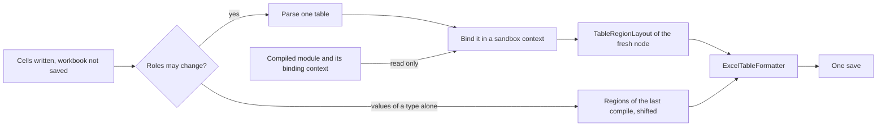

# Single-Table Bind for Format on Save

How a table saved with **Format tables on save** is formatted in the roles of the edit itself, and a table created
or copied in the roles its module gives it, by binding only that one table against the module compiled before, with
no compile of the module, its dependents or its children. The first save of a table, whoever writes it — the table
creation window, the REST API, an agent through the MCP server — leaves it as a compile and a **Reformat** would. The
formatting itself is described in [Table Formatting](table-formatting.md#format-tables-on-save).

## The problem

A table edit is formatted with no compile, in the regions of the last compile:

- `TableWriter.formatOnSave` takes the regions with `RegionShift.ofCompiled(table)`, the layout of the last compile.
- `RegionShift` moves the regions along the lines the edit inserts and removes. It does not read the cells again.
- `TableRegionLayout` builds the regions from the compiled `TableSyntaxNode`: the bound node of its meta-info reader,
  its member, such as the `DecisionTable`, and the types the compiler bound its values to (`ValueTypes`).

Alone, that formats an edit that changes how the compiler reads the table in the roles the table had before it:

- a decision table column header changed from a condition to a return, such as `C1` to `RET1`;
- a parameter added to or removed from the header of a SimpleRules, SmartRules or lookup table;
- the return type of a Spreadsheet changed, a step renamed `RETURN`, or a step of a `SpreadsheetResult` marked `*`;
- the operation of a TBasic step changed to `RETURN`, or the algorithm of a ColumnMatch table;
- a field of a Data or a Test table changed to `_PK_` or `_error_`.

The screen follows at once, as it reads the regions of the next compile. The file would keep the wrong look until
the table is saved again.

A created table has no compile to take its roles from. Laid out from the regions its create request carries, or from
its text alone (`GuessedReads`), it can take other roles than its compile gives it: the text of a decision table
written turned, its conditions down its first column, is read upright, so its titles and its values take the roles of
its rules, and a SmartRules table matching several conditions to the fields of one argument takes a condition for
each argument, its other conditions for returns. A table an agent creates and never edits again would keep that look.

## The idea

The roles of one table depend on the types, methods and fields the module defines, not on the other tables'
bodies. The compiled module already knows all of them. Binding only the edited table against it gives a fresh node
whose layout tells the new roles. The node is used for formatting only: it is not put into the module, and nothing
else is compiled.

This is how an editor highlights code by a shallow semantic analysis of the part shown, with no build.

## The engine

`SingleTableBinder.bind(table, module)` in `org.openl.rules.lang.xls` binds a parsed table against a compiled module
and returns the node with its meta-info reader and member. It runs the steps `XlsBinder.bindInternal` runs for each
table:

1. `PropertiesLoader.loadProperties(tsn)` — the properties of the table;
2. `AXlsTableBinder.preBind(tsn, openl, context, module)` — the header and the structure;
3. `IMemberBoundNode.finalizeBind(context)` — the body, such as the conditions of a decision table or the cells of a
   Spreadsheet. A table of a method first takes its method from `AMethodBasedNode.createMethod()`, which the module
   never receives.

The steps `addTo(module)`, `generateByteCode` and the validators are left out. A call to another table is resolved
against the methods the module already compiled: once the module is compiled, no method waits to be bound, so
nothing else is compiled on the way. A table the compiler cannot read is bound as far as it gets.

- **The binding context survives the compile.** `XlsModuleOpenClass.getRulesModuleBindingContext()` keeps every type,
  method, field, constant and custom SpreadsheetResult type of the module. Only `clearForExecutionMode()` drops it,
  which OpenL Rule Services calls and OpenL Studio does not.
- **A table whose binder writes into the module is not bound** (`AXlsTableBinder.bindsAlone`). A Datatype reads its
  fields while its bytecode is generated and adds its type to the module; a Vocabulary, a Datatype too, adds its type
  the same way. A Conditions, an Actions and a Returns table add their definitions to the `XlsDefinitions` of the
  module as they are bound, and a Constants table its constants to the module. Such a table keeps the regions of the
  last compile when it is edited, and is laid out from its text when it is created.
- **The rows of a Data, a Test or a Run table are not converted.** Its columns and their types tell its roles; its
  `finalizeBind` is skipped.

### The sandbox

Called on the context of the compiled module as it is, the binders would write into the module. Each write stays in
a sandbox, `SandboxBindingContext`, a `RulesModuleBindingContext` over a root context of its own:

| Where | What would happen | Sandbox |
|---|---|---|
| `AExecutableNodeBinder.checkForDuplicates` | The key of the table is registered already: `DuplicatedTableException`, and no bound node is made | The keys registered are its own. The property tables of the module and of its categories are read from the module context |
| `RulesModuleBindingContext.addType` of a `ModuleSpecificType` | A Spreadsheet returning its own SpreadsheetResult type: `updateWithType` adds the steps to the shared type, or fails once its Java bean is generated | The type is kept in the sandbox |
| `DataNodeBinder.makeTable`, `PropertiesLoader`, `PropertyTableBinder` | A table registered in the module `DataBase`, a compiled `Table` of the same name filled again | `SandboxDataBase`, through `RulesModuleBindingContext.getDataBase()`: it registers its tables and reads the module tables, for the foreign keys |
| Errors, messages, local variables | Added to the module context | Kept in the root context of the sandbox |
| `MessageSourceResourceMethod.keepCall` | A call of `msg` kept in the module, for the localization check | The `msg` method of the sandbox keeps no call |
| `XlsModuleOpenClass.buildOrGetCombinedSpreadsheetResult` | `SpreadsheetResult` types combined, as by `a ? SprA() : SprB()`, kept in the module | A combination the module has not made is kept apart, by thread, for the bind (`keepCombinedTypesApart`) |
| `XlsModuleOpenClassHolder` | A thread-local module the binders read | Set for the bind and restored after |
| Decision table | Its member is set in `addTo`, and `CompiledReads.decision` reads it | The member is set on the fresh node only |

### A defect the bind found

`XlsCell.getTopLeftCellFromRegion()` failed on a cell merged with none, where a cell of a parsed grid returns
itself. A SmartRules, SimpleRules or SmartLookup table bound over a sheet loaded for writing lost its conditions. It
returns the cell itself now.

## Format on save

`TableWriter.save` asks for the bound regions before the workbook is saved, on the node `TableIds.nodeOf` parses from
the written table (`TableRegionLayout.boundRegionsOf`):

- regions equal to those `RegionShift` moved: only the lines the edit touched are formatted, as with no bind;
- other regions: the whole table is formatted in them, and `FormattedTables` records them.

The update, append and source edits give the writer the compiled module that holds the table
(`ProjectModel.compiledModuleOf`: the module open, or a module it depends on, whose `XlsMetaInfo` holds the node of
the table). A property write adds rows above the body, so it does not bind. A bind that fails leaves the save to the
shifted regions, and formatting never fails a save.

### A created table and a copy

A table created in a module is bound alone against the module as compiled before, whole, once it is written
(`TableCreatorService.createTable`, `TableWriter.boundRegionsOf`), and formatted whole in the regions its
layout gives. A copy is bound the same way against the module it is written to (`TableCopyServiceImpl.copyInto`).
Every way of creating a table thus takes its roles from the compiler, as an edit and a **Reformat** do.

A table of a Markdown module is never bound, whether edited, created or copied into it: its file keeps no formatting,
so the save formats nothing (`TableWritersFactory`, `TableCopyServiceImpl.copyInto`). See
[Markdown Modules](markdown-modules.md).

A table that cannot be bound alone keeps the earlier sources: a table whose binder writes into the module (see
[The engine](#the-engine)), and a table written into a module that has no compile yet, such as a module created with its first table. A created table then takes the
regions its create request carries, or else the regions its text tells; a copy the regions of its source.

### When it binds

`RegionShift` is told each cell a save writes, merges or unmerges, and each line it inserts or removes. A save binds
the table only after an edit that may change the roles (`RegionShift.structureEdited`):

- a cell written, merged or unmerged other than a value of a type (`VALUE`, `OUTPUT`, `RESULT` of a type other than
  code): the header, the properties, a title, a declaration, a key. A merge or an unmerge tells every cell it covers,
  unless the save lays the same merge again;
- a value of no type, which is a name: the name of a step of a Spreadsheet takes the role of a value, and its `*` mark
  decides what a `SpreadsheetResult` returns;
- a value of code: the operation of a TBasic step may return or start a subroutine, and a formula is code too;
- a column inserted or removed, or a row inserted next to or removed from a line holding more than values of a type
  and keys.

An edit of values of a type alone binds nothing: the most frequent edit keeps the cost it had.

### A probe first

A Data, Test, Run, decision or lookup table taller than 64 rows (`TableRegionLayout.PROBE_ROWS`) is bound in its
first 64 rows alone: its body repeats one line of values under its titles, so its first rows tell the roles of all its
rows (`LayoutKind.rolesShownByFirstRows`). When they take the roles the shifted regions give them, the shifted regions
serve, and the rest of the table is neither bound nor laid out. Otherwise the whole table is bound, laid out and
formatted whole. The header, the properties, the titles and the declarations stand in those rows, so an edit of them
is seen there.

A Spreadsheet, a TBasic and a ColumnMatch table are bound whole: each of their steps takes a role of its own, and
what a Spreadsheet returns may stand on its last row, which a header edit changes.

An edit of a title, a declaration or code below the first rows, such as the kind of a condition of a decision table
written turned on its 90th row, binds the whole table at once: the first rows would not show it
(`RegionShift.structureEditedFrom`, the row moving with the rows inserted and removed above it). A probe and the whole
bind share one `ReadOnceSheetGrid`.

Two layouts take the same roles when each cell takes the same role, returned or not, and the same lines start groups
(`TableRegionLayout.sameRoles`). The types of the values and how the cells are cut into regions do not count, as the
look of a cell in the file follows its role alone.

### Each cell read once

The bind reads the table from a `ReadOnceSheetGrid`, which keeps what a cell of a sheet loaded for writing read: the
compiler reads a cell of a decision table several times, and two thirds of the time of a bind went to POI reading it.
The layout of the bound node reads the grid open for writing, which the save formats.

## Checked

- **Parity** — every table of `Example-4-Reference-Guide`, 640 of them, bound alone, is laid out in the regions the
  compile of its module lays it out in, and leaves its module with the same methods, types, fields, fields of each
  type, data tables and their data, definitions, kept calls of `msg` and combined types, the very objects
  (`SingleTableBindTest`). A Conditions table of another expression, a Constants table of another name, a Spreadsheet
  calling `msg` and one combining two other results, edited and bound alone, leave them as they were too.
- **Roles an edit changes** — one edit of each kind of table below is formatted as the edited table compiled and
  formatted whole is. Formatted in the shifted regions, each differs (`FormatOnSaveBoundTest`, and the ITEST
  `format_on_save_new_roles`, which edits the tables it created: every read after an edit fails with the bind
  switched off and equals the read after a **Reformat** with it on). An edit writes several cells at one save where
  one alone would leave the table broken:
    - a `SpreadsheetResult` made to return a number, given a step marked `*` to return, and a Spreadsheet given the
      step `RETURN`;
    - a Rules table whose condition `C2` and return `RET1` change places;
    - a SimpleRules and a SmartRules table made to return a type of two fields, a condition becoming a return;
    - a SimpleLookup table given one condition more, and a SmartLookup table given one less;
    - a TBasic table whose step `SET` returns;
    - a Test table whose argument and expected result `_res_` change places;
    - a Data table whose first field becomes `_PK_`.
- **A created table** — a table of every kind, twenty-nine of them, created through the API with no regions in the
  order of what they use, is formatted as the table compiled and formatted whole is, a Datatype and a Vocabulary laid
  out from their text included. A table the compiler reads either way is also created turned: a Rules, a SimpleRules,
  a SmartRules, a SimpleLookup and a SmartLookup table, a Data, a Test and a Run table. Each turned decision table,
  and a SmartRules table matching four conditions to the fields of its one argument, laid out from its text alone
  differs (`FormatOnCreateBoundTest`, and the ITEST `format_on_save_new_roles`, which creates them in a project started
  empty: the reads after each create equal the reads after a **Reformat**, and the reads of these decision tables fail
  with the bind switched off, as the text of the others already tells their roles). A copy written into a workbook
  saved since its compile, whose source has no regions to give it, is formatted all the same (`TableCopyServiceTest`).
- **No errors** — every table these checks write compiles with no error or warning, before an edit, after it and once
  created: the look of a table with errors is not what they tell. A table with errors is bound as far as the compiler
  reads it, and laid out as its compile with the same errors lays it out, from its text where the compiler read none
  of its body, so a **Reformat** leaves it as the save did.
- **No look to change** — an edit of a Method, Properties, Environment or Constants table changes no look of its
  cells in the file. A ColumnMatch table is created, not edited: one save cannot give it the weights and the scores
  another algorithm reads with no error. Conditions, Actions and Returns tables are not checked.

## Measured

Measured in-process on a MacBook with an 8 GB heap, `BigTablesBindPerfTest` with `-DbigTables=true` (and
`-Dsurefire.argLine=-Xmx8g -DbigTables=true`): a project of one module holding the table, compiled again before each
save, three saves of each kind, the median. A value edit writes a cell in the middle of the body; a title edit writes
the title of a column, which binds the table.

| Table | Value edit: shifted | Value edit: bound | Title edit: shifted | Title edit: bound | Probe | Whole bind and layout |
|---|---|---|---|---|---|---|
| Data, 10 × 100,000 | 3.84 s | 3.79 s | 3.87 s | 4.03 s | 1 ms | 0.98 s |
| Data, 100 × 10,000 | 4.72 s | 4.65 s | 4.50 s | 4.57 s | 11 ms | 1.77 s |
| SmartRules, 4 conditions × 100,000 | 1.96 s | 1.95 s | 1.92 s | 1.93 s | 3 ms | 1.57 s |
| Rules, 3 conditions × 100,000 | 1.62 s | 1.59 s | 1.67 s | 1.54 s | 1 ms | 1.04 s |
| SmartRules, 20 conditions × 10,000 | 0.83 s | 0.79 s | 0.79 s | 0.80 s | 6 ms | 0.70 s |

- **An edit that keeps the roles costs nothing measurable** — a value edit does not bind, and a title edit binds
  64 rows in 1–11 ms. The saves stay within the noise of the save without the bind.
- **An edit that changes the roles** costs a bind and a layout of the whole table: 0.7–1.8 s on these tables, the
  last column above. Its save formats the whole table, as the first save after a compile that changed the roles
  does.
- **Without the trigger and the probe**, binding the whole table on every save made a value save 29–41% slower on
  the Data tables and 91–133% slower on the decision tables. A Data table binds in 11–94 ms, as its rows are not
  converted; its layout costs about a second per million cells. A decision table binds in 0.4–1.1 s and allocates up
  to 0.9 GB for 100,000 rules: it loads every rule and builds its indexes.

## Alternative considered

Format again after the compile that follows the save: compare the regions of the new compile with those
`FormattedTables` recorded, and format and save the table again when they differ. It is simpler, but it saves the
workbook twice, writes a second local-history revision, races with the next edit of the user, and does nothing with
**Verify on Edit** off. The single-table bind is preferred.
