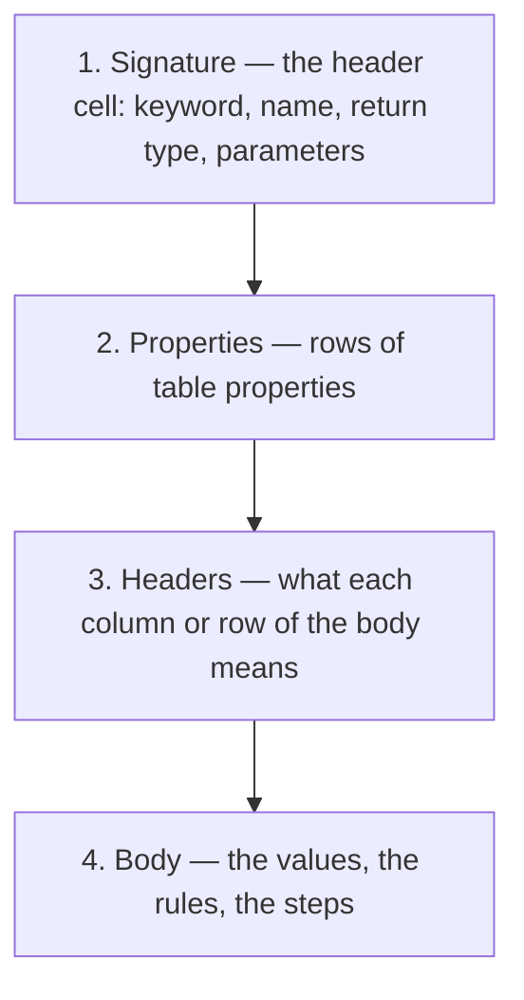
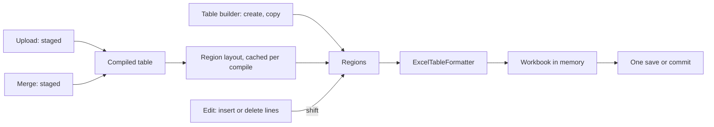
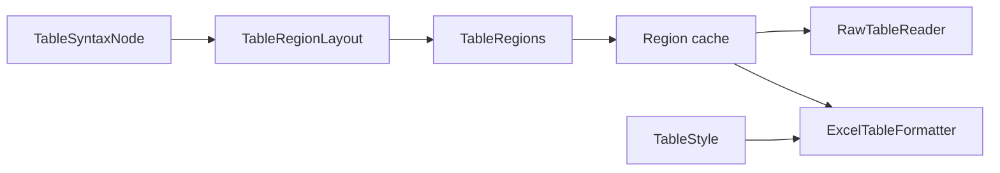

# Table Formatting

How OpenL Studio gives every OpenL table one readable look: on the screen, and written into the Excel files.

## Goals

A business user opens a table to find a rule, a value or a result. The look must answer three questions at a
glance: what the table is, what it takes, and what it gives.

- **Self-explaining** — the four sections every table shares are visually separated, and inputs look different
  from outputs.
- **One style** — a single OpenL table style. There is no list of themes and nothing to select.
- **Excel-native** — the Excel file holds only what Excel itself offers: the theme colours, the theme fonts, and
  the built-in cell styles. Changing the theme of a workbook in Excel recolours its tables.
- **Cheap** — formatting a table costs at most one pass over its cells and adds a bounded number of cell formats to
  the workbook. A table edit is formatted with no compile, in the lines it changed when the table was formatted
  before; only new content, such as an uploaded workbook, is compiled once to be formatted.

## Decisions at a glance

| Area | Decision |
|---|---|
| Style | One OpenL table style, built into the code. There is no theme to select or to write. |
| Writing to Excel, by hand | One project action: **Reformat Excel files**. There is no action for a single table. |
| Writing to Excel, always | System setting **Format tables on save**, on by default: every table saved, created, copied, uploaded or merged is formatted. |
| Edit toolbar | Formatting buttons only with **Format tables on save** off and **Excel Formatting** on; indent always for TBasic and ColumnMatch. |
| `.xls` files | Not formatted, ignored by every formatting path. |
| Screen | The **Excel Formatting** switch of the theme menu, under **Compact**. Off: the Studio look. On: the Excel look. |
| Switching | The switch only re-renders. Both looks are drawn from one read of the table. |
| Studio look | Formulas and code are highlighted as CodeMirror highlights code; values are coloured by their type. |
| Colour picker | Only the 60 theme colours and the 10 standard colours of Excel. No custom colour. |
| Text marks | Four marks on a piece of a cell text, bold in a functional colour: kept by every formatting, written as rich text, no cell style. |
| REST API | One compact read: a style dictionary and role regions, every fact sent once. |

## Table anatomy

Practically every OpenL table is made of four sections. Some tables skip a section; none adds one.



- **Signature** — a line above and below. The table name is bold and the parameter names are in the text colour. The
  keyword, the types and the punctuation are grey.
- **Properties** — grey, with a line above and below.
- **Headers** — titles in the heading font, the code with a line above and below, the titles with a line above.
  Titles of what the table takes are told apart from titles of what it gives.
- **Body** — a line below closes the table.

### Roles

A cell takes its look from its **role**. A role is a meaning, never a position: the layout is read from the
compiled table.

| Role | Section | Meaning | Example |
|---|---|---|---|
| `signature` | Signature | The header cell | `SmartRules Double Premium(Driver driver)` |
| `properties` | Properties | A table property, name and value | `effectiveDate`, `lob` |
| `code` | Headers | A technical declaration the compiler reads | `C1`, `RET1`, `age >= min`, `policyNumber`, `>Policies` |
| `inputTitle` | Headers | A title of what the table takes | **Driver Age**, **Step** |
| `outputTitle` | Headers | A title of what the table gives | **Premium**, **Formula**, `_res_` title, a Data title, a horizontal value of a lookup |
| `key` | Body | What names a row or a column | a Data ID, a rule name |
| `value` | Body | A value the table takes or holds | a condition value, a TBasic action, a Spreadsheet step name |
| `output` | Body | A value the table gives | a returned value, an expected result, a data value, a Datatype field or a constant name |
| `section` | Body | A heading inside the body | a merged Spreadsheet row, a TBasic `SUB` |
| `result` | Body | What the table returns | the `RETURN` step, the steps marked `*` of a Spreadsheet |

One modifier draws a separator inside the body:

- **`group`** — a line above the first line of a group. A group is the rules that share a merged condition
  value, or the conditions of a ColumnMatch table indented under one name. Merged decision tables are hard to read
  without it. The columns of a lookup that share a merged horizontal value are a group too, with a line on the left
  of the first of them from the titles down: it does not cross the signature, the properties or the code. In a Data,
  a Test and a Run table a row is a group once any row of the table takes several lines — its key merged over them,
  the elements of a collection a line each: a line above every row after the first one sets the rows apart, or on
  the left of it in a transposed table.

### Roles per table type

The ten roles are shared by all table types, but each type holds its cells in its own structure. This section
says, for each type, which of its cells take which role, and so which Excel cell style and colour. The formatter
and the Studio look both follow it.

For example, a SmartRules table:

| | A | B | C |
|---|---|---|---|
| 1 | `SmartRules Double Premium(Driver driver)` · `signature`, merged over A–C | | |
| 2 | `effectiveDate` · `properties` | `01/01/2026` · `properties` | |
| 3 | **Driver Age** · `inputTitle` | **Region** · `inputTitle` | **Premium** · `outputTitle` |
| 4 | `18-25` · `value` | `North` · `value` | `1200` · `output` |
| 5 | `26-65` · `value` | `South` · `value` | `950` · `output` |

- **In Excel** — row 1 takes **Title**, row 2 **Explanatory Text**, A3:B3 **Heading 3** (fill `lt2`), C3
  **40% - Accent1**, A4:B5 **Input** and C4:C5 **Output** (fill `accent1` lighter 80%). Row 5 also gets the line
  that closes the body.
- **In the Studio look** — the same cells take the role tokens. `18-25` is drawn in the number colour, `North` in
  the string colour, and `1200` in the number colour on the output fill.

A Spreadsheet table reads differently, because its structure is steps × columns:

| | A | B |
|---|---|---|
| 1 | `Spreadsheet Double Calc(Policy p)` · `signature` | |
| 2 | **Step** · `inputTitle` | **Value** · `outputTitle` |
| 3 | `Base Rate` · `value` | `= p.rate` · `output`, type `code` |
| 4 | **Adjustments** · `section`, merged over A–B | |
| 5 | `Age Factor` · `value` | `= AgeFactor(p.age)` · `output`, type `code` |
| 6 | `RETURN` · `result` | `= $Value$BaseRate * $Value$AgeFactor` · `result`, type `code` |

Which steps of a Spreadsheet take `result` depends on what it returns. The compiler decides it, and the layout
reads its answer:

- **A single value** — such as `Double` above: the step named `RETURN`, or the last step when none is so named. A
  column named `RETURN` takes the place of the step.
- **`SpreadsheetResult`, with steps or columns marked `*`** — the returned cells are the marked steps × the marked
  columns. When only steps are marked, every column the result keeps (not marked `~`) is returned, and the other
  way round. The returned cells and the names of their steps and columns take `result`.
- **`SpreadsheetResult`, nothing marked `*`** — every step not marked `~` is returned. Since that is the whole
  table, or nearly, no cell takes `result`.

For example, a Spreadsheet returning two of its steps:

| | A | B |
|---|---|---|
| 1 | `Spreadsheet SpreadsheetResult Quote(Policy p)` · `signature` | |
| 2 | **Step** · `inputTitle` | **Value** · `outputTitle` |
| 3 | `Base Rate` · `value` | `= p.rate` · `output`, type `code` |
| 4 | `Premium*` · `result` | `= $BaseRate * p.factor` · `result`, type `code` |
| 5 | `Tax*` · `result` | `= $Premium * 0.05` · `result`, type `code` |
| 6 | `Audit Note` · `value` | `= "checked"` · `output`, type `code` |

Rows 4 and 5 are adjacent, so they are one `result` region: one line above row 4 and one double line below row 5.
Marked steps apart from each other make regions of their own.

Every type takes `signature`, and `properties` when it has them. A transposed table takes the same roles, turned
with its lines of data. The table below lists the remaining roles per type.

| Table type | `code` | `inputTitle` | `outputTitle` | `key` | `value` | `output` | `section`, `result` |
|---|---|---|---|---|---|---|---|
| Datatype | type column | title row | — | — | defaults, other columns | field names | — |
| Vocabulary | — | — | — | — | values | — | — |
| Spreadsheet | — | step column title | column titles | — | step names | cells | merged step rows; the returned step, or the steps and columns marked `*` |
| Rules | `C`/`RET` row, expressions, parameters | condition titles | return and action titles | `RULE` column | condition values | return values | — |
| SimpleRules, SmartRules | — | condition titles | return titles | rule names | condition values | return values | — |
| SimpleLookup, SmartLookup | — | vertical titles in the corner | horizontal values | — | vertical values | the return grid | — |
| Data | field row, `>` reference row | — | titles | IDs (not `_PK_`) | — | values | — |
| Test | field row, `>` reference row | input titles | `_res_`, `_error_` titles | reference IDs | input values | expected results | — |
| Run | field row, `>` reference row | input titles | — | reference IDs | input values | — | — |
| TBasic | column IDs row | titles | — | labels | operations, conditions, actions | — | `SUB`, `FUNCTION`; `RETURN` |
| Method | — | — | — | — | the code | — | — |
| ColumnMatch | column IDs row | titles | return, score rows | condition names | operations, weights, values | returned values | — |
| Conditions | inputs, expression, parameters | titles | — | part names | — | — | — |
| Actions, Returns | inputs, expression, parameters | — | titles | part names | — | — | — |
| Environment, Properties | — | — | — | setting names | values | — | — |
| Constants | type column | — | — | — | values | names | — |

The following tables are not formatted and are drawn as their Excel file draws them:

- tables of the type **Other**;
- a table gathered from several partial tables;
- a table of a dependency project.

### Tables the compiler cannot read

A table the compiler reads none of — its type, its parent type or its tested table is missing, or its body cannot be
built — still writes its parts where its kind writes them. Its roles are taken from its text, with the same map as
above:

- **Orientation** — a Data, a Test or a Run table is transposed when its field names (a name starting with a
  lower-case letter, `_` or `$`, such as `vehicleID` or `_res_.total`) stand down its first column and not across its
  first row. A Datatype and a Constants table are transposed when their titles say so, or when their first row, not
  their first column, holds only types. A Rules table is transposed when the kinds of its columns, such as `C1` or
  `RET1`, stand down its first column.
- **Data, Test, Run** — the field row, the `>` reference row when there is one, the titles, then the values. The key
  of a Data table is its first field unless it is `_PK_`; the keys of a Test and a Run table are the fields with a
  `>` reference.
- **Datatype, Constants** — the columns titled **Type** and **Name**, or else the first and the second column.
- **Vocabulary** — a Datatype whose header names the type of its values, such as `Datatype Gender <String>`.
- **Spreadsheet** — the step names down the first column and the column titles across the first row. It returns
  nothing for `void`, the step or the column named `RETURN`, the steps and columns marked `*` for a
  `SpreadsheetResult`, or else the last step.
- **Rules** — three lines of code and a line of titles; a column is a condition, a return or the rule names by its
  kind.
- **SimpleRules, SmartRules** — as many condition columns as the header names parameters, keeping at least the last
  column for the return.
- **SimpleLookup, SmartLookup** — the horizontal conditions take as many rows as the title of the first column; the
  parameters they leave are the vertical conditions, at least one, and the columns after them the return grid.
- **TBasic, ColumnMatch** — the ids written in the first row; a ColumnMatch algorithm OpenL does not know reads as
  `MATCH`.
- **Conditions, Actions, Returns** — the part titled **Title** by its keyword, or else the fourth part, or the last.

A body whose text tells none of its parts, such as a Rules table naming no kind of column, takes `value`.

### Value types

The Studio look colours a body value by its type. The type comes from the compiler, never from a guess on the text.

| Type | Values |
|---|---|
| `code` | an OpenL expression: a cell starting with `=`, a `code` cell, the body of a Method table, the operations, conditions and actions of a TBasic table |
| `number` | numbers and ranges of numbers |
| `date` | dates and ranges of dates |
| `boolean` | `true`, `false` |
| `string` | everything else, an array taking the type of its elements |

## The OpenL table style in Excel

### Only what the workbook's theme offers

- **Fonts** — the theme's `majorFont` and `minorFont`, written as a scheme font (`<scheme val="major|minor"/>`).
  The face name written beside it is read from the workbook's own theme part, never hard-coded. Every role takes
  the font size of the workbook's **Normal** style, so row heights do not change.
- **Fill colours** — only `lt2`, `dk2` and `accent1`–`accent6`, with a tint. `lt1` and `dk1` are never a fill:
  they are white and black in every Excel theme. A cell with no fill has no fill, not a white one.
- **Text colours** — `dk1`, and `dk1` lighter by 50% for what matters less. A [mark](#marks-on-a-piece-of-a-text)
  on a piece of a text is the one other text colour: a standard colour of Excel, as an Office theme has no red.
- **Colours as theme references** — every colour is written as a theme index with a tint, whatever theme the
  workbook has. Changing the theme in Excel (**Page Layout > Colors**) recolours the tables. No colour is written
  as RGB, whatever theme the workbook has.

SpreadsheetML numbers the theme colours with the first two pairs swapped: `0` is `lt1`, `1` `dk1`, `2` `lt2`, `3`
`dk2`, and `4`–`9` are `accent1`–`accent6`. The writer names them by the theme slot and maps them in one place.

### Role styles

Each role is an Excel built-in cell style from the **Titles and Headings**, **Data and Model** and **Themed Cell
Styles** groups of the **Cell Styles** gallery. A selected cell therefore shows its meaning in the gallery, and a
user who applies the style from the gallery gets the same look.

Office defines several of these styles with fixed RGB colours, for example the orange of **Input**. A built-in
style can be redefined with theme colours, so the formatter writes each linked style into the workbook with the
look of its role: theme colours and theme fonts only. No custom cell style is created.

| Role | Excel cell style | `builtinId` | Font size | Look |
|---|---|---|---|---|
| `signature` | Title | 15 | Normal (Office: 18) | `majorFont`, `dk1`; text in pieces (below); lines above and below |
| `properties` | Explanatory Text | 53 | Normal (Office: 11) | italic, `dk1` lighter 50%; lines above and below |
| `code` | Calculation | 22 | Normal (Office: 11) | `dk1` lighter 50%; lines above and below |
| `inputTitle`, `section` | Heading 3 | 18 | Normal (Office: 11) | `majorFont`, bold, centred; fill `lt2`; line above |
| `outputTitle` | Heading 2 | 17 | Normal (Office: 13) | `majorFont`, bold, centred; fill `accent1` lighter 60%; line above |
| `key` | Heading 4 | 19 | Normal (Office: 11) | bold, `dk1` |
| `value` | Input | 20 | Normal (Office: 11) | `minorFont`, `dk1`, no fill |
| `output` | Output | 21 | Normal (Office: 11) | `minorFont`, `dk1`; fill `accent1` lighter 80% |
| `result` | Total | 25 | Normal (Office: 11) | bold; a thin line above, a double line below |

A heading inside the body looks like a title of what the table takes, so the two roles share **Heading 3**.

The formatter owns these nine styles in a workbook it formats. It writes their definitions each time it formats, so
an edit of them in Excel is replaced, including on cells outside OpenL tables that use them. The **Normal** style is
never changed.

**Font size** — every style takes the size of the workbook's **Normal** style: 11 in a new Office workbook, and
whatever size the workbook's Normal style has otherwise. The size is written into the style, so a table keeps the
row heights of the rest of the sheet. The Office size of each style, given in brackets, is what Office writes when
the style is first used. The formatter replaces it with the Normal size.

The `builtinId` values are those of ECMA-376 Part 1, §18.8.7, the ids Excel writes for these styles.

A cell's own format adds only what the style cannot hold: the lines at the edge of a region (below), and what is
kept from the cell.

Lines:

Every line is drawn in `dk1`, the text colour of the theme:

- **Role line** — thin. It is drawn above and below the signature, the properties and the code, above the titles
  and a section, and below the body.
- **Group line** — hair. It is drawn above a group of rows, and on the left of a group of columns from the titles
  down.
- **Result lines** — thin above the result, double below it.

A line sits on the top edge of the region that it sets apart from what stands above it, never on the bottom edge of the
region above: the signature, the properties, the code, the titles and a section each draw theirs on the first row of
their region. The parts of the header — the signature, the properties and the code — also close their region with a line
on its last row, so each is framed above and below; the titles have only their line above. A lookup lays out each row of
its horizontal values as an `outputTitle` region of its own, so each row is set apart; any other region of titles, such
as the titles of a transposed table, has one line above it. The cell's own format draws these lines, the line closing
the body, the line above a group and the lines of a `result` region. A `result` region of several rows has its two lines
once, at its top and bottom; **Total** keeps its lines in its definition, so a single row a user marks with it in Excel
looks the same.

There are no vertical lines. Headers and body are told apart by fill, so a transposed table needs no rotated
lines.

Alignment:

- Titles and sections are centred.
- Values take the **General** alignment, so Excel aligns numbers right and text left by their type.
- The signature and keys are aligned left.
- An indented cell is aligned left, whatever its role: Excel shows an indent only in a text aligned left.
- Every cell is centred vertically, so a merged condition value reads against its whole group.

Kept from the cell as it was:

- the number format;
- the indent (it carries the structure of TBasic and ColumnMatch tables);
- wrap text;
- text rotation.

Everything else — font, fill, borders, horizontal and vertical alignment — comes from the role.

### The signature in pieces

The signature is the only cell written as rich text. Its pieces are read from the compiled header:

| Piece | Font |
|---|---|
| keyword (`SmartRules`, `Datatype`) | `dk1` lighter 50% |
| return type, parent type, tested table | `dk1` lighter 50% |
| table name | bold, `dk1` |
| parameter types, punctuation | `dk1` lighter 50% |
| parameter names | `dk1` |

Every other cell is written as plain text, but for its [marks](#marks-on-a-piece-of-a-text). Any other piece of rich
text found in it is replaced by the same text in the cell's font.

The signature is the whole first row of a table, so the formatter merges that row into one cell across the table. A
merge of a part of the row is widened to the whole row. A row holding a value beside the header, or one a merge
reaches out of, is left as it is, so no value is lost and no other merge is cut. The merge goes through the grid
model of the sheet when the table is read through one, so the merged regions it keeps stay those of the sheet.

The rows of the properties, and the rows of the code and of the titles of a table written the usual way round, take
their role in every cell up to the right edge of the table, the empty ones included.

### Marks on a piece of a text

A rule author marks a piece of a cell text to draw the attention of the reviewers to it, such as a word of an
expression. A mark is bold text in one of four colours, the functional colours of Ant Design:

| Mark | API | In Excel | In the Studio look |
|---|---|---|---|
| Error | `error` | bold, Red `#FF0000` | bold, `colorErrorText` |
| Warning | `warning` | bold, Orange `#FFC000` | bold, `colorWarningText` |
| Success | `success` | bold, Green `#00B050` | bold, `colorSuccessText` |
| Info | `info` | bold, Light Blue `#00B0F0` | bold, `colorInfoText` |

- **Rich text, no style** — a mark is a run of the shared string of the cell, with its font written inline in the
  run. It adds no cell format, named style or font to the styles of the workbook, and the cell keeps its own style.
- **Standard colours** — a mark is written as the RGB of a standard colour of Excel, not as a theme colour: an
  Office theme has no red, and a mark keeps its meaning whatever theme the workbook has. A piece of text bold in one
  of the four colours reads as that mark, whoever wrote it, Excel included.
- **Kept by formatting** — the formatter keeps the marks of every cell but the signature and rebuilds each marked
  run on the font of the cell's role, bold in the colour of its mark. Any other run is written in the cell font, so
  italics or another colour applied in Excel do not survive formatting.
- **No compile change** — the compiler reads the text of a cell, never its runs.
- **Where** — every cell of a table, except the header and a cell written with an Excel formula, in an `.xlsx`
  workbook. A value written as a number, a date or a boolean holds no text to mark.

The Studio look draws the marks over everything else, the code highlighting included. The functional colours of a
theme are made darker, or lighter in a dark theme, until they reach 4.5:1 on every fill of a role, as the text of the
application does: the warning colour of Ant Design falls well below that on white. The Excel look and Compare draw the
standard colours as Excel does.

A change of the marks alone is neither a difference of Compare nor a conflict of a merge of branches: both compare
the text of a cell. A merge copies a cell with its runs, so the marks of the side taken are kept.

**Editing.** The table toolbar offers the four marks and **Clear Mark**, active while an open cell holds a text, an
expression or a text of several lines. A cell holding marks is written in a field that shows them, and text typed
inside a marked piece takes its mark; one without is written in the plain field. Pasted text loses its fonts.

**API.** The `update` of a cell takes the marks with the value:

```json
{
  "operation": "update",
  "target": {
    "type": "cell", "row": 4, "column": 2, "value": "= DriverEligibility ( $DriverType, hadTraining )",
    "marks": [{ "from": 35, "to": 46, "color": "warning" }]
  }
}
```

- `marks` absent — a new value is written as plain text, and an unchanged value keeps the marks it has.
- `marks: []` — the value is written with no marks.
- Marks are refused with `400` on the header, on a value that is not a text, out of the text or overlapping, and in
  an `.xls` workbook, whose tables the editor offers no marks for. A text the cell type turns into a number, or an Excel formula, keeps no marks.

The read returns the marks as the `runs` of the cell, like any other rich text; a client tells a mark by its bold
and its colour.

### Regions, not cells

A role is laid out as a rectangle of cells: a **region**. A Data table of 10,000 rows is about six regions,
whatever its size. The writer turns each region into cell formats like this:

1. A cell format is identified by its key: the role and its edge (no line, line above, line below, or both), plus
   what is kept from the cell (number format, indent, wrap text, rotation).
2. The workbook's existing formats are indexed by that key once per workbook, so formatting a table again finds
   them and adds nothing.
3. Each cell gets the index of its format. No style object is created per cell.

The number of cell formats a workbook gains is bounded by roles × edges × the distinct number formats of its tables:
tens, not thousands. **Reformat Excel files** also removes the cell formats and the named styles no cell uses any more,
so a workbook formatted many times does not grow, and a workbook that arrived with a format per cell, or with the
thousands of named styles Excel copies along with a sheet, shrinks to what its cells use.

That removal is part of the formatter and runs only with **Reformat Excel files**: it scans every cell of the
workbook, which a save of one table must not pay for. A save, formatted or not, removes nothing: a named style the
user keeps unused, and an OpenL role style no table uses yet, stay in the workbook. This replaces `XSSFOptimizer`,
which compacted the named styles on every save of a table (EPBDS-6482), and whose compaction of the cell formats had
no caller.

Excel tables (**Format as Table**, list objects) were considered and rejected. They forbid merged cells and need
unique header texts, which OpenL tables cannot guarantee.

### Files the style is not written to

- **`.xls`** — not supported. The binary format has other limits (no theme, no theme fonts, 56 colours, 4,000
  cell formats) and security gaps. Format on save and **Reformat Excel files** ignore `.xls` files: they are
  neither written nor reported. The Studio look still draws their tables, because it reads roles, not the file's
  formatting.
- **An `.xlsx` without a theme part** — files written by tools other than Excel may have none. The writer adds the
  Office theme first (POI `StylesTable.ensureThemesTable`), so the theme references resolve as Excel resolves them.

## The two looks on the screen

The **Excel Formatting** switch sits in the theme menu of the header, right under **Compact**. It is kept in the
browser (`localStorage`, `openl.theme.excelFormatting`) like the other theme settings, and is off by default.

| | Studio look (switch off) | Excel look (switch on) |
|---|---|---|
| Drawn from | roles, value types, signature pieces | the cell formats of the workbook |
| Colours | the tokens of the Studio theme, light or dark | the workbook's theme, on light paper |
| Workbook formatting | ignored, except the indent | shown as Excel shows it |
| Code and values | highlighted | as written |

Both looks are drawn from the same response. The switch re-renders the grid and sends no request. Compare always
draws the Excel look.

In both looks the screen frames a table in a solid line, `colorBorder`, along every edge where the table ends. The
frame belongs to the screen, not to the workbook: no cell border is written for it. A line the workbook or a role
draws along an edge is drawn in its place. The table lies on the plain ground of the theme, `colorBgBase`, and so
do the numbers of its lines beside it.

### The Studio look

Each role maps to an Ant Design token, so all 14 Studio themes and the dark appearance follow without a table of
their own:

| Role | Token |
|---|---|
| `signature` | `colorText`; grey pieces `colorTextSecondary` |
| `properties`, `code` | `colorTextSecondary` |
| `inputTitle`, `section` | fill `colorFillTertiary`, weight 600, centred (an indented `section` cell on the left) |
| `outputTitle` | fill `colorPrimary` at 12% over `colorBgContainer`, weight 600 |
| `output` | fill `colorPrimary` at 6% over `colorBgContainer` |
| `key` | weight 600 |
| `result` | weight 600 |

Every line the look draws — of the roles, of the result and above a group — is `colorTextBase`, so the parts of a
table stand apart at a glance. The lines sit where the Excel style draws them.

The text of every role reads on its fill in every theme, light and dark, as the text of the application does on its
surfaces: 4.5:1, and 3:1 for the grey pieces, as for the secondary text. The tertiary text, the secondary fill and the
primary background hover of Ant Design fall below that in some themes, so the table takes the tokens above.

Text is coloured by the code editor's highlight style for the current Studio theme (`codeMirrorThemes.ts`):

- **`code`** — tokenised by a CodeMirror stream language and coloured by the theme's `HighlightStyle`, through the
  inline-style highlighter shared with the user guides:
    - `openl` — the Java grammar of `@codemirror/legacy-modes` (`clike`), extended with the OpenL operators and
      literals;
    - `tbasic` — `openl` plus the TBasic operation keywords (`IF`, `ELSE`, `END`, `SUB`, `FUNCTION`, `RETURN`,
      `BREAK`, `CONTINUE`, and the rest the algorithm compiler accepts).
- **`number`, `boolean`, `string`** — the theme's `syntax` hues, the same as parameter values
  (`--openl-syntaxNumber`, `--openl-syntaxBoolean`, `--openl-syntaxString`).
- **`date`** — the number hue.

A value of a data type is coloured whole, its separators included: all of `2026-10-15`, `1,000.50`, `[18..25)` or
`$1K` takes one colour. Only code is split into tokens.

Code keeps the table's proportional font. A monospace font would widen every column holding code.

### The Excel look

The grid draws each cell format from the style dictionary of the response. Theme colours are resolved on the
server with the workbook's own theme, so the client receives plain colours. Shared borders are not merged on the
server: the grid collapses them as Excel does, the wider line winning.

Both looks write the text in the font of the application, at the size the screen gives tables, whatever font the
workbook names: the read carries no font name or size.

## The read API

`GET /projects/{projectId}/tables/{tableId}?raw=true` returns everything both looks need, once.

```json
{
  "id": "c1f0e2a7",
  "kind": "SmartRules",
  "pos": "B3:D44",
  "totalRows": 42,
  "layout": { "transposed": false, "firstDataLine": 2 },
  "regions": [
    { "role": "signature", "top": 0, "left": 0, "bottom": 0, "right": 2 },
    { "role": "inputTitle", "top": 1, "left": 0, "bottom": 1, "right": 1 },
    { "role": "outputTitle", "top": 1, "left": 2, "bottom": 1, "right": 2 },
    { "role": "value", "type": "number", "top": 2, "left": 0, "bottom": 41, "right": 0 },
    { "role": "value", "type": "string", "top": 2, "left": 1, "bottom": 41, "right": 1 },
    { "role": "output", "type": "number", "top": 2, "left": 2, "bottom": 41, "right": 2 }
  ],
  "groups": { "rows": [14, 27] },
  "signature": [
    { "part": "keyword", "to": 10 },
    { "part": "type", "to": 17 },
    { "part": "name", "to": 25 },
    { "part": "punctuation", "to": 26 },
    { "part": "parameterType", "to": 32 },
    { "part": "parameterName", "to": 39 },
    { "part": "punctuation", "to": 40 }
  ],
  "styles": [
    {
      "border": {
        "top": { "style": "solid", "width": 1, "color": "#44546a" },
        "bottom": { "style": "solid", "width": 1, "color": "#44546a" }
      }
    },
    { "color": "#7f7f7f" },
    { "bold": true },
    { "bold": true, "align": "center", "background": "#e7e6e6" },
    { "bold": true, "align": "center", "background": "#b4c6e7" },
    { "background": "#d9e1f2" }
  ],
  "source": [
    [
      {
        "value": "SmartRules Double Premium(Driver driver)",
        "style": 0,
        "colspan": 3,
        "runs": [{ "to": 18, "style": 1 }, { "to": 25, "style": 2 }, { "to": 33, "style": 1 }, { "to": 40 }]
      },
      { "covered": true },
      { "covered": true }
    ],
    [{ "value": "Driver Age", "style": 3 }, { "value": "Region", "style": 3 }, { "value": "Premium", "style": 4 }],
    [{ "value": "18-25" }, { "value": "North" }, { "value": 1200, "style": 5 }]
  ]
}
```

The example shows the first three rows of a window. A run with no `style` takes the cell's style.

- **`regions`** — the roles of the whole table, in table coordinates. They partition the table and cover it
  whatever window of rows is read, so a page of rows needs no layout of its own. A region carries `type` when all
  its values have the same type. A cell whose type differs from its region's carries its own `type`.
- **`groups`** — the `rows` and the `columns` of the body that start a group; a list without lines is left out, and so
  is `groups` of a table without groups.
- **`signature`** — the pieces of the header text as offsets, for the Studio look. The Excel look takes the
  cell's own `runs`.
- **`styles`** — the Excel cell formats the cells of the read use, each once, resolved to plain colours, in the
  attributes the table actions write them with (`background`, `color`, a `border` side as its `style`, `width` and
  `color`). A cell names its format by index. A cell in the workbook's Normal format names none. A format names no
  font name or size: the screen writes every table in the font of the application.
- **`runs`** — only for a rich-text cell: the end offset and the style index of each piece. The text is not
  repeated.

Every fact is sent once:

- a cell format is sent once in `styles` and named by index;
- the text of a rich-text cell is not repeated in its runs;
- each cell sends only its own borders, and the grid collapses shared edges;
- the line closing the body belongs to a region, so two windows of rows never both send it;
- one read serves both looks.

Other parts of the read:

- `styles=false` — leaves out `styles` and `runs` for a client that only wants values.
- `metaInfo` — what the compiler knows of each cell, such as its type and the tables it uses, on request.
- `formula` beside the value — the Excel formula and the value it computed are different facts.

## Writing the style

Every path that formats a table runs the same formatter over the table's regions:



### Reformat Excel files

An action of the project, in its **More** menu. Its tooltip:

> Formats every table of every Excel file of the project with the OpenL table style: the theme colours, theme fonts
> and cell styles of Excel. Values are not changed. Tables of the type Other are left as they are.

The action:

1. Compiles the project if it is not compiled. It does not refuse while a compilation is due.
2. Formats every table that is formatted at all.
3. Saves each workbook once and removes its unused cell formats.

It answers `POST /projects/{projectId}/format` with `{formatted: [tableId], skipped: [tableId]}`. A table is
skipped when it is gathered from several partial tables. `.xls` files are ignored.

### Format tables on save

A system setting in **Administration > System**, `table.format-on-save` (`formatTablesOnSave`), on by default. Its
tooltip:

> Formats a table with the OpenL table style every time it is saved, created or copied, with no compile. An Excel
> file uploaded into a project is formatted too. While it is on, the table editor offers no formatting buttons, only
> the indent of TBasic and ColumnMatch tables.

Formatting a table edit must not compile, so it takes the regions from what is already known:

- **An edited table** — the regions of the last compile, when the module has not been written since that compile.
  Inserted and deleted rows and columns shift and stretch them, with no compile. A value edit changes no region.
- **A created table** — the builder of the table type emits the regions of what it writes, and the create request
  carries them. The table creation window knows them: it writes the header, the titles and the rows. A table created
  without them, such as one created through the API in a typed view, is formatted at its next save after a compile.
- **A copied table** — the regions of the source table, moved to the copy.
- **Not known** — the module was written since its last compile, which happens only with **Verify on Edit** off.
  The save is not formatted, and inserted lines keep the format of their neighbours. The next save after **Verify**,
  or **Reformat Excel files**, formats the table.

The formatter writes into the workbook before it is saved, so an edit and its formatting are one save and one
local-history revision.

A save formats only what the edit changed when the table's previous save left it formatted, in the regions the edit
starts from, and nothing has written its workbook since:

- **A value edit** formats only the header, which every save writes in its pieces again: a value written into it is
  plain text.
- **Inserted, deleted and appended lines** — the inserted lines are formatted, and the lines on either side of where
  lines were inserted or removed, whose edges move.
- **Restyled cells** — the rows of the cells a style edit changes, such as their indent, are formatted again. A merge
  or unmerge changes no cell format.
- **Everything else formats the whole table** — the first save after the setting is turned on or after a compile
  that changed the roles, a workbook written by anything else since, and a header and properties that came to take
  another number of rows.

OpenL Studio remembers the tables its last saves formatted, with the timestamp and length of their workbook files as
those saves left them. A table it forgot, as after a restart, is formatted whole at its next save.

A save can change a role: for example, a header edit can turn a condition column into a return column. The screen
follows at once, because the Studio look reads the regions of the new compile. The file takes the new look at the
table's next save.

### Uploaded Excel files

With **Format tables on save** on, an Excel file that reaches a project from outside the table editor is formatted
too:

- a file uploaded or replaced through the project files API, `POST` or `PUT /projects/{projectId}/files/{path}`;
- the files of a ZIP archive written into a project folder, `POST /projects/{projectId}/files/{folder}/` with
  `application/zip`, including `conflictPolicy=REPLACE`, which replaces the whole project;
- the files of a ZIP archive that updates an existing project of a repository,
  `PUT /repos/{repo-name}/projects/{project-name}` with `overwrite=true`.

Nothing is known of an uploaded workbook's tables until it is compiled, so this is the one formatting path that
compiles. The content is formatted before anyone else can see it:


- **A project opened by the user** — the upload is written to the user's workspace, which is the stage: nothing is
  committed before **Save**. The project is compiled — the compile that any upload needs anyway — and the uploaded
  workbooks are formatted and written again in the workspace. When the upload replaces workbooks of the module open,
  as **Update** does, the compile of that module serves; otherwise the whole project is compiled.
- **A closed project, and a project updated from a ZIP archive** — the content goes straight to the design
  repository. It is staged in a temporary folder first: the project as it stands with the upload written over it, or
  the archive unpacked, which is otherwise read in place. Each module holding an uploaded workbook is compiled there
  with the project's dependencies, its uploaded workbooks are formatted, and the content is committed once.

Only the uploaded `.xlsx` files are formatted. The other workbooks of the project are left as they are, and so are
`.xls` files. A workbook that cannot be formatted, for example because the compilation stopped, is written as it was
uploaded: formatting never fails an upload.

Formatting changes no value, merge or indent, so it does not make the compiled module stale. The compile of an
opened project serves the screen afterwards as it is.

### Merged workbooks

With **Format tables on save** on, an `.xlsx` workbook a merge of branches combines from both branches is formatted
the way an uploaded workbook of a closed project is (`MergedWorkbookFormatting` over `UploadFormatting`): staged with
the project the merge changes, and compiled once. An `.xls` workbook is left as merged.

- **Sync** — once the Git repository has committed the merge, the workbooks it combined by itself are read from the
  merge commit and staged with the project as that commit holds it. The formatted ones are committed on the target
  branch in a commit of their own, based on the merge commit, so a change the branch took meanwhile is merged with
  them. Formatting after the commit keeps the repository free while the project compiles. The merge runs on a thread
  of its own, outside the request of the user, so the staged compile takes the session the merge was started in.
- **Resolve Conflicts** — the workbook **Merge table by table** builds is formatted before it is shown, downloaded or
  saved, and so are the workbooks a resolution merges by itself. They are staged with the project as the branch the
  merge changes holds it, or with the copy in the workspace in a save conflict, and committed with the resolution.

Only the workbooks of the merged project are formatted: a workbook of another project the branches hold is committed
as the merge combined it. A workbook that cannot be formatted is left as merged, and so is every workbook of a Sync
whose formatting commit conflicts with a change the branch took meanwhile: formatting never fails a merge.

### The edit toolbar

The formatting buttons are shown only where formatting is both kept and seen: **Format tables on save** off, and
the **Excel Formatting** switch on. In every other case they are hidden: a save would overwrite the formatting, or
the Studio look would not show it.

| Format tables on save | Excel Formatting switch | Align, bold, italic, underline, fill, font colour | Indent, outdent |
|---|---|---|---|
| off | on | shown | every table |
| off | off | hidden | TBasic and ColumnMatch tables only |
| on | either | hidden | TBasic and ColumnMatch tables only |

The indent stays for TBasic and ColumnMatch tables because it is structure, not look. TBasic reads the level of a
step from it. ColumnMatch builds its tree of conditions from it (`MatchAlgorithmCompiler`).

The switch is a setting of the browser, so the toolbar re-renders when it is toggled. Nothing is read again. The
setting is read with the other application settings, `GET /settings` (`formatTablesOnSave`), when OpenL Studio loads.

The style operations of the table actions API follow the setting: while it is on, a `style` operation other than
`indent` is refused with `400`. An integration then cannot write formatting that the next save overwrites.

### The colour picker

The fill and font colour pickers offer exactly Excel's own palette, and nothing else:

- **Theme Colors** — the 10 theme colours of the workbook, each with 5 shades: 60 swatches. A pick is written as a
  theme colour and tint.
- **Standard Colors** — the 10 fixed colours of Excel, Dark Red `#C00000` to Purple `#7030A0`. A pick is written as
  that RGB.

The API takes a colour as `{"theme": "accent1", "tint": 0.4}` or `{"rgb": "#C00000"}`. Any other RGB value is
refused with `400`.

## Layout in the backend



- **`TableRegions`** — the regions, groups and signature pieces of one table: a small immutable record.
- **`TableRegionLayout`** — per kind of table, builds `TableRegions` from the compiled node: the bound node of the
  table's meta-info reader, or its member, such as the `DecisionTable` or the Spreadsheet structure.
- **Region cache** — a weak map keyed by the compiled `TableSyntaxNode`. A compile makes new nodes, so it
  invalidates the cache. Every page of a large table reuses one layout.
- **`TextMarks`** — reads the marks of a cell and writes a text with its marks, for the writer of a cell update and
  for the formatter.
- **`TableStyle`** — the role looks, in code: a Java enum with each role's built-in style, font scheme, fill,
  lines and alignment. With one style there is nothing to configure, so there is no style file.
- **`ExcelTableFormatter`** — writes `TableRegions` into a workbook: it writes the nine built-in styles, indexes and
  reuses cell formats, and writes the signature pieces.
- **`RegionShift`** — moves the regions of the last compile along the lines a save inserts and removes, and names
  the lines it touched.
- **`FormattedTables`** — the tables recent saves left formatted, with their regions and the state of their workbook
  files, so that a later save formats only the lines it touched.
- **`RawTableReader`** — reads the window of cells, collects the used cell formats into `styles`, and adds the
  cached regions.

## Cost

| Operation | Target |
|---|---|
| Read a page of a 100,000-row table | one layout per compile, not per page; no per-cell style objects |
| Payload | a few dozen style entries per table, whatever its size |
| Format on save | the lines the edit changed, or one pass over the table's cells; no compile; one save |
| Reformat Excel files | one compile of the project, one pass per table, one save per workbook |
| Upload with format on save | one compile of the staged project, one pass per uploaded table, one write or commit |
| Workbook growth | bounded by roles × edges × number formats; unused formats removed on reformat |
| Named styles | one pass over them per workbook formatted, whatever their number |

### Measured

Measured on a container of 4 CPUs and 6 GB (a 4.8 GB heap) with JDK 25, one user session, each request recorded with
JFR between two full garbage collections:

- **Edits** — a Data table of 10 columns × 100,000 rows and one of 100 columns × 10,000 rows. Each edit is saved three
  times with **Format tables on save** off, then once more on, the first save that formats the whole table, then three
  times on. A row or column is inserted inside the body; an inserted column is removed again, unmeasured, before the
  next run, so every run edits a table of the same size. One run of each, not counted, warms the code up.
- **Uploads** — a module of 1,000 tables of every kind updated as **Update** writes it, and a project of 20
  workbooks replaced from a ZIP archive and from its files. Off and on alternate six times after a pair not counted.

The figures are medians, and the ratios are on ÷ off for time, CPU time and peak heap. The time of an edit is the
wait of its save. The time of an upload is the upload and the compile of the next read of a table, as a formatted
upload compiles within its request what an upload without formatting leaves to that read.

| Edit | Table | Off | On | Time | CPU | Peak heap | First save on |
|---|---|---|---|---|---|---|---|
| A value changed | 10 × 100,000 | 4.63 s | 4.43 s | 0.96 | 0.91 | 1.02 | 8.11 s |
| | 100 × 10,000 | 4.98 s | 4.92 s | 0.99 | 0.94 | 0.99 | 10.10 s |
| A row inserted | 10 × 100,000 | 10.04 s | 10.17 s | 1.01 | 1.04 | 1.06 | 12.99 s |
| | 100 × 10,000 | 10.39 s | 10.44 s | 1.00 | 0.98 | 0.93 | 14.52 s |
| A column inserted | 10 × 100,000 | 11.10 s | 11.81 s | 1.06 | 1.05 | 1.01 | 14.30 s |
| | 100 × 10,000 | 12.04 s | 12.16 s | 1.01 | 1.07 | 1.03 | 16.41 s |

- **A table formatted at its previous save** saves within 10% of a save without formatting, in time, CPU and peak
  heap. It allocates as much, and its garbage collection pauses as long. The compile of the next read takes as long.
- **The first save that formats the whole table** — after the setting is turned on, after a compile that changed
  the roles, or after the workbook was written by anything else — costs one pass over every cell: 1.3–2 times the
  save without formatting, once.
- **Before this step** a value save of these tables took 24–30% longer with formatting on, and 36–43% more CPU: every
  save formatted every cell. The pass itself was made cheaper too: a cell format is read once and written only when
  it changes, and the header is written one run per piece.
- **A workbook naming many styles** — Excel copies the named styles of a sheet along with it, so a workbook built
  from the sheets of others can name tens of thousands. Formatting looks the role styles up among them in 50 ms for
  50,000 styles, measured with POI alone. The list XMLBeans hands out reads the XML from its first element at each
  access: walked over that list instead of the array, the same lookup made a one-cell save take 72 s, and 284 s the
  next time (EPBDS-16931). The suite `task_EPBDS-16931-many-named-styles` of `ITEST/itest.studio/repos` formats two
  saves of a workbook naming 20,000 styles within the 10 s a response may take in the `perf` profile; before the fix
  both ran out of it. POI writes the cell styles of a workbook in a time that grows with the square of their
  number, formatted or not: 0.7 s for 25,000, 2.5 s for 50,000 and 10 s for 100,000. **Reformat Excel files**
  removes the unused ones.
- **Not formatting's own limit** — POI refuses a record larger than 100 MB, so a 100 × 30,000 table cannot be opened
  for editing, and a 100 × 25,000 one saves once and then cannot be opened again, with formatting off as well.

| Upload | Off | On | Time | CPU | Peak heap |
|---|---|---|---|---|---|
| A module of 1,000 tables updated | 0.95 + 0.51 s | 1.84 + 0.05 s | 1.30 | 1.17 | 1.03 |
| A project of 20 workbooks from a ZIP | 0.99 + 0.69 s | 2.35 + 0.04 s | 1.43 | 1.44 | 1.00 |
| The same project from its files | 0.91 + 0.56 s | 2.16 + 0.03 s | 1.47 | 1.53 | 1.05 |

- **An upload costs 30–47% more time and 17–53% more CPU**, the upload and the compile of the next read counted
  together; its peak heap stays within 5%. A formatted upload does the compile the next read would do, then lays out
  every table of the uploaded workbooks, loads each workbook for writing and saves it again. A project whose upload
  spans several modules is compiled whole, where the next read without formatting compiles only the module open.
- **Before this step** the same uploads took 1.6–2.0 times as long: the module open was compiled twice, and the
  header of every table was written piece over piece.
- **Above the target** — the uploads stay above the 10% of the plan. The formatting that remains — a layout, a pass
  over each table and one save per workbook — is the work of formatting itself. Formatting an upload after its
  response, or leaving it to the next save and **Reformat Excel files**, would take it out of the user's wait; that
  is a decision left open.
