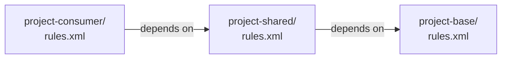

# OpenL Tablets — Rules Project Descriptor (`rules.xml`)

```xml
<!-- All inner tags of rules.xml are optional -->
<project>

    <!-- If <name> is not defined the folder name or zip file name or artifactId is used -->
    <!-- If <name> cannot be determined by some reason, an error will occur -->
    <name>My Rules Project</name>
    <comment>Optional description</comment>

    <!-- If <modules> are not defined then `rules/**/*.xlsx` and `tests/**/*.xlsx` are used by default -->
    <modules>
        <!-- Ant-style Wildcard: match all xlsx in rules/ - it is preferred way -->
        <module>
            <name>AllRules</name>
            <rules-root path="rules/**/*.xlsx"/>
        </module>
        <module>
            <!-- The real module name is filename of the matched file if absent-->
            <name>AllTests</name>
            <!-- Ant-style files inclusion -->
            <rules-root path="tests/**/*.xlsx"/>
            <!-- Studio only for very rare cases to solve Out of memory errors in huge projects. -->
            <webstudioConfiguration>
                <compileThisModuleOnly>false</compileThisModuleOnly>
            </webstudioConfiguration>
        </module>
        <!-- Explicit module with a single file. Paths are relative to the project root and use '/';
             a backslash is read as '/'. A workbook a pattern also matches is read once, by this module
             and under its name, so the name must differ from the one the pattern gives the workbook -->
        <module>
            <name>Main Algorithm</name>
            <rules-root path="rules/SharedRules.xlsx"/>
            <!-- Regexp method filter to include only specific methods from all modules in the generated interface. DEPRECATED -->
            <!-- Matches method signatures in the format "ReturnType methodName(Type1, Type2, ...)". -->
            <method-filter>
                <includes>
                    <value>.+DetermineIndividualPolicyPremium\(.+\)</value>
                </includes>
                <excludes>
                    <value>.+Tests\(.+\)</value>
                </excludes>
            </method-filter>
        </module>
    </modules>

    <!-- JAR and groovy dependencies on the classpath -->
    <!-- Classpath entries are resolved at runtime and can include JAR files, compiled classes, or Groovy scripts. -->
    <!-- If not defined `groovy/` and `lib/*.jar` are used by default -->
    <classpath>
        <!-- Ant-style wildcard for all JARs in lib/. -->
        <!-- It is not recommended to include binary JARs files inside the project as sources. -->
        <!-- They are added automatically on the packaging maven phase. -->
        <entry path="lib/*.jar"/>
        <!-- Groovy scripts are included in the classpath and can be accessed from rule tables. -->
        <entry path="groovy/"/>
        <!-- Compiled Java classes can be included in the classpath for use in rules. -->
        <!-- It is not recommended to include compiled classes inside the project as sources. -->
        <entry path="classes/"/>
    </classpath>

    <!-- Cross-project rule dependencies and libraries -->
    <dependencies>
        <dependency>
            <name>SharedDataProject</name>
            <!-- If true - makes all modules of the dependency available without an explicit `Environment` table. -->
            <autoIncluded>false</autoIncluded>
            <!-- Maven coordinates of the zip archive of the dependent project: groupId:artifactId:version. -->
            <!-- OpenL Studio downloads it while the user has no project of the name open (see below). -->
            <!-- In pom-less mode (see openl-maven-plugin.md) this becomes a real Maven dependency; -->
            <!-- when omitted, the participant tries to match <name> against sibling pom-less projects. -->
            <mavenArtifact>com.example:shared-data-project:1.0.0</mavenArtifact>
        </dependency>
        <dependency>
            <!-- A dependency without <name> is a library: groupId:artifactId:jar[:classifier]:version. -->
            <!-- OpenL Studio downloads it with the libraries it needs at runtime and puts them on the classpath; -->
            <!-- the OpenL Maven Plugin packs them into lib/ of the project archive. -->
            <mavenArtifact>org.apache.commons:commons-text:jar:1.15.0</mavenArtifact>
        </dependency>
    </dependencies>

    <!-- Ant-style (* and ?) method filter by names only are exposed in the generated interface -->
    <!-- If absent, all methods are exposed -->
    <exposed-methods>
        <include>get*</include>
        <include>calculate</include>
        <exclude>*Internal</exclude>
        <exclude>get??</exclude>
    </exposed-methods>

    <!-- Business dimension property file resolution -->
    <properties-file-name-pattern>%lob%-%state%</properties-file-name-pattern>
    <!-- Custom Java class for advanced property file name resolution logic; must implement a specific interface defined by OpenL. -->
    <properties-file-name-processor>com.example.CustomPropertiesFileNameProcessor</properties-file-name-processor>

    <!-- OpenAPI integration -->
    <!-- If absent, openapi.json in RECONCILIATION mode is defined by default -->
    <openapi>
        <!-- Path to the OpenAPI specification file; supports .json or .yaml formats. -->
        <!-- openapi.json is the default name and location for the spec file, but it can be customized as needed. -->
        <path>openapi.json</path>
        <!-- Mode of operation: GENERATION creates modules with rules from the spec; RECONCILIATION validates rules against the spec. -->
        <mode>GENERATION</mode>
        <!-- generated modules names -->
        <model-module-name>Models</model-module-name>
        <algorithm-module-name>Algorithms</algorithm-module-name>
    </openapi>
</project>
```

## Validation on Save

OpenL Studio checks a `rules.xml` written to a project through the project files API — the project overview, the file
editor, or a direct call — and the one the OpenAPI tables generation writes. The descriptor is rejected when

- `name` is blank, cannot name a folder, or is a reserved word;
- a module `name` cannot name a file, or is the name of another module — a workbook a pattern reads is a module named
  after the file;
- a module declares no path, or a path naming no file of the project, its letter case included;
- a path is read by another module already: another module declares it, or a pattern reads it under the same name —
  a module declared without a name, or under the name of its workbook;
- `openapi` generates the tables in `GENERATION` mode into two modules whose names differ only in letter case, or not
  at all;
- `properties-file-name-processor` names a class the project cannot provide, or one that is not a
  `PropertiesFileNameProcessor`;
- `properties-file-name-pattern` names an unknown property, repeats a property, groups properties of different types,
  or carries a date format the engine cannot use.

Only what a write changes is checked, so a descriptor rewritten for another reason — a module registered, a project
migrated — is never rejected for a module or a setting it inherited. An upload of several files or of an archive
brings its own libraries with it, and its descriptor is written unchecked for the same reason.

The files module paths name, and the workbooks patterns read, are looked for in the project's working copy. A project
that is not open in the workspace has no working copy, so they are left unchecked.

A pattern that carries no `%property%` is a plain file name mask and is accepted — it assigns no properties to the
modules it matches.

The processor class is looked up on the project's own classpath, so a class shipped in the project's `lib/` is found.
A project that is not open in the workspace has no working copy from which those libraries can be read, so a declared
processor — and the patterns that processor interprets — are left unchecked.

## Maven Dependencies in OpenL Studio

A `<dependency>` with `<mavenArtifact>` names Maven coordinates as the OpenL Maven Plugin reads them:
`groupId:artifactId[:extension[:classifier]]:version`, the version last. Without the extension the coordinates name a
`zip` archive, the packaging of an OpenL project. When the Maven repository is set in the **Maven** section of the
administration, OpenL Studio downloads these dependencies to compile a project and run its tests:

- **A library** — a dependency without `<name>`, such as `org.apache.commons:commons-text:jar:1.15.0`. It is
  downloaded with the libraries it needs at runtime — its `compile` and `runtime` dependencies, not the `test`,
  `provided` or optional ones — and the classpath of the project reads them after its own `<classpath>` entries.
- **An OpenL project** — a dependency with `<name>`, such as `com.example:shared-data-project:1.0.0`. A project of
  that name the user opened always wins, with the user's changes. While the user has none open — the project is
  closed, or in no design repository at all — the archive is downloaded and unpacked, and the project compiles as a
  read-only dependency, with what it depends on in turn. Opening or closing the project switches between the two at
  the next compilation. Its `rules.xml` must have the name the dependency gives.

A dependency that cannot be downloaded — the repository does not have it, the coordinates are not valid, the archive
is not the project named — is an error of the project and of each of its modules, which starts with
`Cannot download a Maven dependency:` or names the coordinates. What was found, or failed, is kept for five minutes,
so a fix in the Maven repository shows once that time has passed.

The files are kept in a local Maven repository (`maven.repository.local`) and downloaded once; a snapshot version is
checked in the Maven repository again. A dependency no project used for a period, or used longest ago while the folder
is too large, is removed from it. While no Maven repository is set, nothing is downloaded: a library is expected
in `lib/`, where the OpenL Maven Plugin packs it, and a project dependency among the projects the user opened.
OpenL Rule Services download nothing either: OpenL Studio puts into a deployment the libraries the projects name by
Maven coordinates, in the `lib/` folder of each project, and the project dependencies, from a design repository or
from the Maven repository, as the user chooses in the **Deploy** dialog.

## Multi-Module Projects

Multiple projects can depend on one another. Each project has its own `rules.xml`.



> [!Note]
> In OpenL Studio, dependent projects must be deployed to the same repository workspace. In Rule Services, all
> projects are deployed as a deployment unit.
