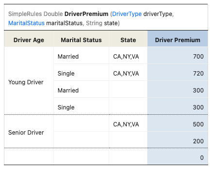
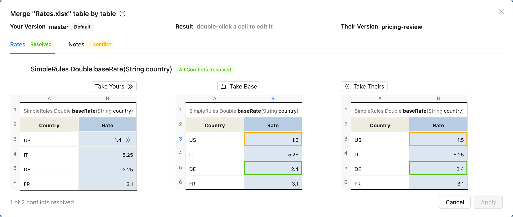
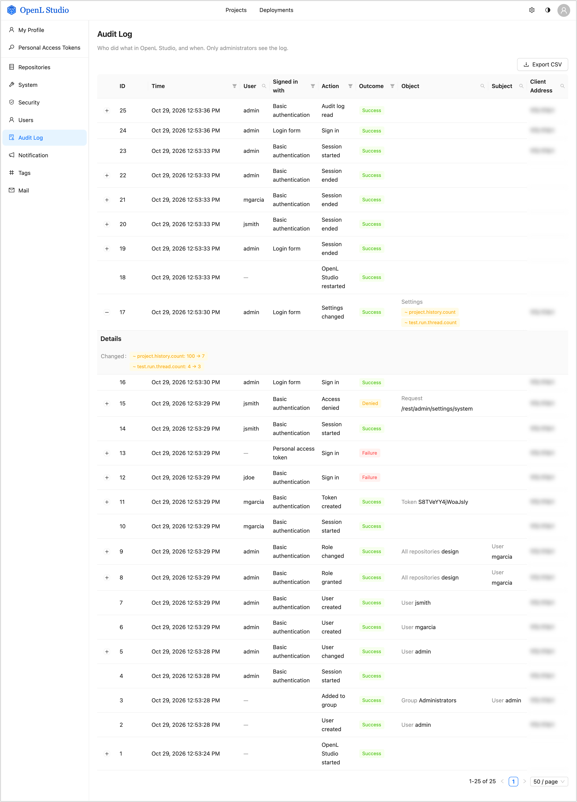
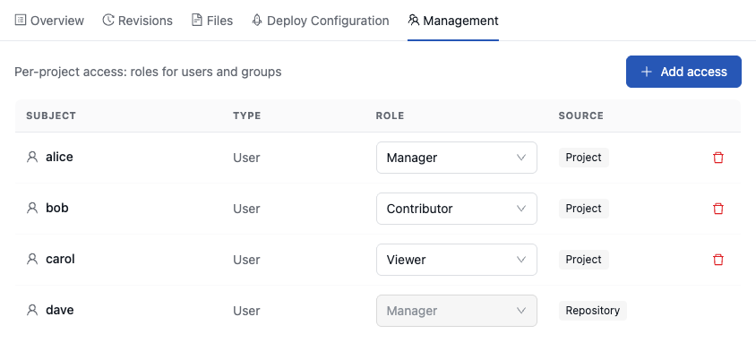
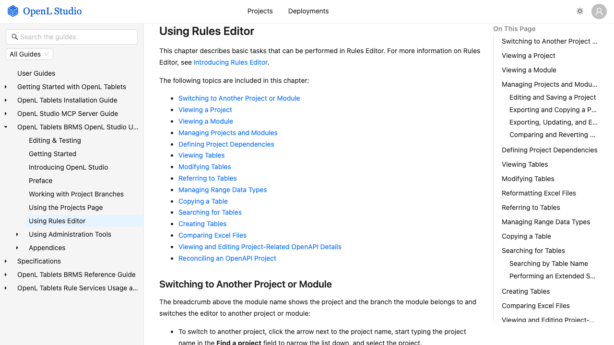
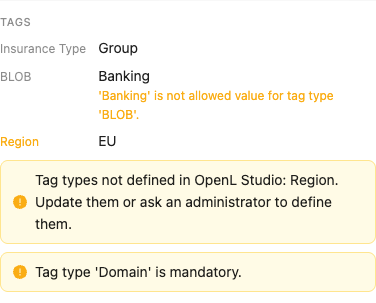

OpenL Tablets **7.0.0** opens OpenL Studio to AI agents. The MCP server now ships inside OpenL Studio and answers at
`/mcp`, so an agent works with OpenL projects under the rights of its user and gets the reference guides and OpenL
skills of the same release. The user guides ship inside OpenL Studio too, and the last JSF screens — the rules editor,
its toolbar, Test, Run, Benchmark and Compare — are rebuilt in React.

Rules authors get one table style that shows what each table takes and gives, written into the Excel files on every
save, and a Sync that merges Excel workbooks table by table, row by row and cell by cell instead of asking which whole
file to keep. Administrators get an audit log of sign-ins, access changes, project activity and settings, and
Managers grant access to the projects they manage.

The rules language becomes predictable across countries: numbers lose the `$` sign and octal notation, `Double`
arithmetic computes with the decimals the numbers show, and locale-dependent functions are removed. This is a major
release: the OpenL Studio API is served only under `/rest`, projects are addressed by stable ids, Groovy moves from
4 to 6, and the WAR files are released on GitHub instead of Maven Central. Review the breaking changes before
upgrading.

## Highlights

* An MCP server built into OpenL Studio lets AI agents read, change, test, trace and deploy rules for their user.
* One OpenL table style formats every table by what its cells mean, on screen and in the Excel files on save.
* Sync merges Excel workbooks by table, row, column and cell, and resolves text conflicts line by line in place.
* An audit log records sign-ins, access changes, refused requests, project activity and settings changes.
* The user guides ship inside OpenL Studio and are searchable without internet access.
* OpenL Studio runs entirely on React; JSF and RichFaces are gone.
* `Double` arithmetic computes with the decimals the numbers show: `0.1 + 0.2` is `0.3`.
* Projects and tables keep stable ids across renames, branch switches and restarts.

## New Features

### Built-in MCP Server

OpenL Studio carries an MCP server and serves it at `/mcp` of its own address. AI agents and IDEs, such as Claude
Code, Visual Studio Code with GitHub Copilot, Cursor or Codex, connect to it over the Model Context Protocol and work
with OpenL projects for their user: they find projects and tables, read and change rules, run tests and tables, step
through a trace, work with branches and merges, and deploy projects.

* The server is a Node.js program that OpenL Studio starts and stops with itself. The OpenL Studio Docker image
  carries Node.js, the DEMO package downloads it, and a WAR deployment runs the server when Node.js is on the `PATH`.
* An agent sends a personal access token of its user as `Authorization: Token <token>` and sees and changes only what
  this user can. Single-User mode needs no credentials, and in `oauth2` mode an access token of the identity provider
  is accepted as `Bearer <token>`.
* The server speaks MCP `2026-07-28` and still serves clients of the earlier versions, such as `2025-11-25`.
* The server reports the version of OpenL Studio and offers the reference guides and the OpenL skills of the same
  release — `planning`, `branching`, `testing`, `versioning`, `trace-investigation` and `change-log-and-reapply` —
  through the MCP skills extension.
* Large and binary files, such as Excel modules, travel outside the model. OpenL Studio issues short-lived transfer
  links with `POST /rest/transfer-links`, and a script of the agent downloads or uploads the file at `/transfers/<id>`
  without holding a token.

```properties
mcp.enabled = true
mcp.node = node
transfer.link.ttl = PT15M
transfer.max-pending = 20
```

### Rules Editor Inside Projects

The Rules Editor is no longer a JSF tab of its own: a module opens from the screen of its project in **Projects**,
its tables are listed as soon as that module compiles, and every table is read and written through the REST API. With
it, the last pages drawn on the server are gone — JSF, RichFaces, CDI and JSP leave OpenL Studio, and every address
answers with the React application.

* **Run**, **Trace**, **Test** and **Benchmark** open React panels under their toolbar buttons, and their results show
  every value with one viewer; **Run into File** and **Trace into File** download the results.
* **Compare Excel Files**, the comparison of two versions of a module in **Local Changes**, of a project with one of
  its revisions and of the versions of a conflicted file open one React comparison window over a REST API.
* A cell edit, its styling and the rows and columns inserted or removed are saved in one request that compiles only
  the changed module, and each message points at the cell it is about.

### OpenL Table Style

Every table gets one look, the OpenL table style, that shows at a glance what the table is, what it takes and what it
gives. A cell takes its look from what it means in the compiled table — signature, properties, titles, conditions,
returns, values — never from where it stands, and the style uses only what Excel offers: the theme colours, the theme
fonts and the built-in cell styles, so a formatted file looks the same in Excel and follows the theme of the workbook.

* **Format tables on save** (`table.format-on-save`, on by default) formats every table saved, created or copied,
  every `.xlsx` file uploaded into a project and every workbook a merge of branches combines. Turn it off for teams
  that format their tables by hand.
* **Reformat Excel files** in the **More** menu of the editor formats every table of the project at once.
* The **Excel Formatting** switch of the theme menu draws a table as its Excel file formats it; off, the table is
  drawn in the look of OpenL Studio, with formulas highlighted as code and values coloured by their type.

Formatting keeps the value, the number format, the indent, the wrapping and the rotation of every cell. `.xls` files
are not formatted.

```properties
table.format-on-save = true
```



### Excel-Aware Sync and Merge

Sync no longer sends a workbook to manual resolution only because both branches changed the same sheet. A sheet
changed on both sides is merged cell by cell when no side shifts its content, and otherwise table by table and row by
row: rows, columns and tables one branch inserts, deletes or moves are taken from it, and rows or columns both
branches insert at the same place of a table are all kept, those of the branch merged into first. Only cells changed
differently on both sides, or a combination that could put a change in the wrong place, remain a conflict.

* Saving a project over the save of another user in the same branch combines the two changes the same way.
* A remaining conflict is resolved in the **Resolve Conflicts** dialog: a workbook table by table, each table taken
  whole from one version or merged cell by cell, and a text file line by line, with your version, the result and
  their version side by side. The MCP server resolves conflicts the same way.
* **Compare File Versions** compares a conflicted file with the base, the version both branches started from, in three
  views: **Their Changes**, **Your Changes** and **Both Versions**.
* The merge revision names each sheet combined from both branches.



### Stable Project and Table Ids

A project and a table keep their id through the changes that used to replace it. A project id is 13 upper-case
characters computed from its repository and folder, so it survives a rename in `rules.xml`, a branch switch, an open, a
close and a restart. A table id is 16 characters computed from its workbook, kind and name, so it survives the table
moving on its sheet, a row or column inserted above it and a merge.

* While the server runs, the old id of a project moved outside OpenL Studio, of a renamed table or of a table whose
  module file moved still serves it and names the new id in `Content-Location`; the id of a deleted project or table
  answers `410 Gone`.
* Two projects with the same name keep separate ids, and a table has the same id in every copy of its project.

### Audit Log

OpenL Studio keeps an audit log in its database in every user mode but Single-User. It records who signed in, whose
sign-in was refused, who signed out and which sessions ended without a sign-out; changes of users, groups, personal
access tokens and roles, including the roles a user gains or loses through the groups of an identity provider at
sign-in; requests refused for lack of permission; project, branch and deployment activity; changes of the system
settings and of the settings a deployment adds, changes or removes between starts; the starts, restarts and stops of
OpenL Studio; and the reads of the log itself.

* Administrators open the **Audit Log** from the navigation menu, filter the events and export them as CSV. A change
  is shown as a diff, and the value of a secret setting is never recorded.
* `audit.retention` keeps the events for a period, such as `90d`, `6m` or `P1Y6M`, and keeps them forever when empty.
  It is also set on the **System** page.
* `audit.outputs.console` also writes every event to the console through the `OpenL.audit` logger, for a log
  collector to pick up.
* The events are read with `GET /rest/admin/audit`, as a page of JSON or as `text/csv`.

```properties
audit.retention =
audit.outputs.console = false
```



### Project Access Managed by Managers

A user with the **Manager** role on a project or on its repository grants, changes and revokes the **Viewer**,
**Contributor** and **Manager** roles of other users and groups on that project in its new **Management** tab,
without involving an administrator. A change takes effect on the next request of the user. A role inherited from the
repository is listed read-only, and a Manager cannot change or revoke their own role.



### Embedded User Guides

OpenL Studio ships the user guides of its own version and shows them inside the application at `/docs`, so they are
available without internet access and always match the running release. The **Documentation** card of the Help page
opens them. The viewer shows the table of contents, the page and its outline, draws Mermaid diagrams, highlighted
code, CSV tables and OpenL tables in the grid of the table editor, and searches the full text of all guides, one guide
or one section. The specifications of the project files are served at `/docs/ref`.



### Appearance Themes

OpenL Studio follows the light or dark appearance of the operating system, and a switch beside the avatar in the
header turns on the opposite one. A compact density fits more rows and fields on a screen, and besides the standard
Ant Design colours the user picks one of 13 colour themes of well-known code editors, such as Dracula, Solarized,
VS Code, GitHub, Monokai and Nord, each in a light and a dark variant.

* Every screen takes its colours from the theme, the login and error pages and the table dependency graph included,
  and the theme also paints the code editor of project files and the code samples of the embedded user guides.
* Workbook tables keep the colours of Excel in any theme, so a filled cell stays readable on a dark page.

### Projects Edited in Place in Single-User Mode

In single-user mode with a design repository on the file system, OpenL Studio edits the projects right in their
folders: there is no **Open**, **Close** or **Save**, and the edits made in OpenL Studio, its MCP server, Excel and an
IDE land in the same files. When a file changes outside, the editor shows that the project changed, with **Refresh**,
and the MCP server compiles the project again before a tool reads it.

* A workbook changed on disk since it was read is not saved over (`409`), a file another program holds open answers
  `423` naming it, and the version another program saved is kept in the local history before it is overwritten.
* In every mode, a table or a file is read with its version in `ETag`, and a write that names an older version in
  `If-Match` answers `412 Precondition Failed`; the editor always names it, and the MCP server requires it for every
  change of an existing table or file.
* Files are written whole, so Excel, an IDE or OpenL Rule Services never read a half-written file.

### Project Tags on the Overview Tab

The tags of a project are shown and edited on its **Overview** tab and saved to `tags.properties`. A tag whose tag type
is not defined in OpenL Studio is shown in the warning colour and can be edited or deleted.

* An administrator arranges the tag types by dragging their rows on **Administration > Tags**, and the Overview tab
  lists the tags in that order.
* The **Tag Types and Values** screen lists the tag types and values that projects carry but OpenL Studio does not
  define, with the number of projects, and adds them in one click; a value opens the Projects list filtered by it.
* `PUT /rest/admin/tag-config/types/order` sets the order, and `GET /rest/admin/tag-config/tags` and
  `POST /rest/admin/tag-config/tags` list and add the tags found in projects.



## Improvements

### OpenL Studio Editor

* Added text marks to table cells: a selected part of a cell text is marked **Error**, **Warning**, **Success** or
  **Info** from the table toolbar, shown bold in the functional colours of the theme, and saved in the workbook as
  bold rich text in a standard Excel colour, without changing the cell style or how the table compiles; the table
  actions API takes them as `marks` of a cell update.
* Changed **Test**, **Run** and **Benchmark** to open their results straight in a separate browser window, as **Trace**
  does, instead of a dialog over the editor. All results share one window, which the next result reuses and brings to
  the front, and a long run can be stopped without holding the editor.
* Improved the **Create Table** dialog to read the types it offers from the compiled project, the types of dependency
  projects included, through the new `GET /rest/projects/{projectId}/types`, instead of rebuilding them from the
  sources of the tables it can see.
* Improved the Basic trace view to show every call of a finished trace at any depth: the first view lists the upper
  levels whole, a deep branch loads from the tree kept after the run when it is expanded, and a step lists its calls
  100 at a time, where the tree used to stop at 50,000 calls.
* Improved the table editor to keep the table actions bar and the edit toolbar in view while a long table scrolls, so
  rows and columns are inserted and removed without scrolling back to the top.

### OpenL Studio User Interface

* Moved **My Settings** into a header menu beside the theme icon, grouped into Table, Testing and Trace settings that
  apply at once and are kept in the browser, and listed **Personal Access Tokens** in the user menu.
* Added an **About** dialog to the user menu that shows the OpenL Studio version and lists the frontend and backend
  third-party libraries and the server software of the Docker image, with their versions, licenses and `LICENSE` and
  `NOTICE` files.
* Added links to a project, `/projects/{projectId}`, and to a table of a module,
  `/projects/{projectId}/modules/{moduleName}?table={tableId}`, which open on a cold load, offer **Open** for a closed
  project and draw the linked table once its module compiles.
* Improved the **Create project** dialog to show a validation or server error inside the dialog and keep the entered
  data, instead of closing and losing it.

### Projects and Repository

* Added the `repository.ignored-paths` setting, **Ignored Paths** in the **System** section, which hides build, version
  control and CI files such as `pom.xml`, `.gitignore` and the `.github` folder from users, keeps them out of exports
  and deployments, protects them from changes, and counts a revision that changes only them as technical. The `.git`
  folder is always ignored.
* Improved the **Projects** tab to show only the projects of the default branches until a branch is picked in the
  **Branch** filter, made the **Tree** view show the projects the **Filters** view selects, and added **Clear
  filters** to both; `GET /rest/projects` marks such projects with `inDefaultBranch`.
* Added the `project.detect-by-excel-files` setting, **Detect projects by Excel files** in the **Projects** section of
  the system settings, cleared by default, so a folder with an Excel file but no `rules.xml` is no longer listed as a
  project; a project created from Excel files, a ZIP archive, an OpenAPI file or a demo gets a standard `rules.xml`
  with its workbooks under `rules/`.
* Removed the **From workspace** mode of **Create project** and its
  `POST /rest/repos/{repo-name}/projects/from-workspace` endpoint; a local project is exported as an archive and
  created from it instead.
* Added warnings to the **Tags** section of the **Overview** tab for a mandatory tag type without a value,
  `Tag type '<tag type>' is mandatory.`, and for a value a non-extensible tag type does not allow,
  `'<value>' is not allowed value for tag type '<tag type>'.`, without blocking the save.
* Improved the tags editor of the **Overview** tab to open the whole list of tag types or values on click and narrow it
  case-insensitively while typing, still accepting a value outside the list.
* Added the `Example-4-Reference-Guide` example project with a tested sample of every table type, of the formula
  syntax and of the built-in functions, and compiled every demo project and ran its tests during the build; the
  `org.openl.rules.demo` jar ships inside OpenL Studio only and is no longer deployed to Maven Central.
* Improved the project list to check permissions once per project instead of once per branch and to stop re-reading
  repository configurations, which made it take over ten seconds on an instance with about 320 projects in many
  branches.
* Improved the indexing of design revisions, which matches a deployment to the design revision it was built from, to
  hash a file unchanged between revisions once instead of in every revision; a first full index of a large Git
  repository took more than an hour.
* Improved OpenL Studio to write `rules.xml` and `rules-deploy.xml` through an XML mapping of the descriptor instead
  of building their text by hand, so an edit on the **Overview** tab keeps the elements it does not manage.

### Sync and Merge

* Added an estimate of conflicts to the **Sync** dialog: before anything is merged, each file both branches changed is
  marked **Possible conflict** or **Merges by itself**, and a note tells how many files may conflict.
* Improved every comparison of Excel files to line up the rows and columns of a table as a text comparison lines up
  lines, marking each as added, removed, changed or equal, to recognise moved tables, and to compare without compiling
  the module. One colour scheme marks the changes in every comparison, the **Save** dialog and **Resolve Conflicts**,
  a conflicted workbook is shown in three columns — yours, the base and theirs — and a revision of another branch is
  compared from the revision both branches parted at, as a pull request is.
* Added the files a revision changed to the **Revisions** tab, listed when the revision is expanded, each opening the
  Compare window, and a comparison of any two revisions of a project; the MCP server lists them too.
* Added to the **Sync** dialog the projects each direction changes, with their number of changed files, the projects
  added or removed and the files changed in both branches before the merge, and a summary by project after it, with
  **Compare** for each file and the sheets an automatically merged workbook took from each branch; the **Save** dialog
  lists the files a save commits, each comparable with the saved revision.

### REST API

* Removed the duplicate `/web` prefix of the OpenL Studio API: every endpoint is served only under `/rest`, and the
  WebSocket handshake moved to `{context}/ws`, which requires authentication.
* Added `id` of the new project to the answers of a project create, `PUT /rest/repos/{repo}/projects/{name}`, and a
  project copy, `POST /rest/repos/{repo}/projects/{name}/from-project`, and let a copy name its source by the project
  id alone.
* Added the `tableId` parameter to `GET /rest/projects/{projectId}/tests/summary` and its Excel export, which limits the
  summary to one test table; an id no test table of the run has answers an empty summary.
* Extended the OpenAPI of OpenL Rule Services to publish the values of a vocabulary datatype wherever it is used: on
  the items of an array field instead of the array itself, in a spreadsheet result cell, for the only parameter of a
  rule and for its response; the **Run** and **Trace** form of OpenL Studio offers them as a list.
* Extended the OpenAPI import of OpenL Studio to generate a vocabulary datatype for every `enum` of an OpenAPI file,
  and OpenAPI reconciliation to require a vocabulary datatype with exactly the listed values wherever the file
  declares an `enum`.

### Rules Engine

* Added the index of the element to array index operators: `array[(element, index) <operator> <expression>]`, with
  optional types as in `rates[(Double rate, Integer i) transform to rate * (i + 1)]`; the index counts from 0 and every
  operator takes it, the short forms included.
* Improved arithmetic on `Double` values to compute with the decimals the numbers show: the operators `+`, `-`, `*`,
  `/`, `%`, `++`, `--` and the functions `remainder`, `quotient`, `floorDiv` and `mod` round the exact result once,
  so `0.1 + 0.05 - 0.03` is `0.12` instead of `0.12000000000000002`.
* Extended decision table condition indexing to a lookup of a column value in an input array, such as
  `contains(codes, code)`, several lookups over the same array, a lookup guarded by a static check joined by `and`,
  written as a ternary or testing that the array is empty, and a condition written as a call of a one-expression
  table, so such tables no longer evaluate their conditions rule by rule on every call.
* Reduced the constrainer behind the `validateDT` gap and overlap check of decision tables to the part the check uses
  and joined it into `org.openl.rules`; the check now reports the smallest input of a table without rules as uncovered
  and handles a condition domain of 2^31 values or more, where it threw `ArrayIndexOutOfBoundsException` or
  `NegativeArraySizeException`.
* Improved `sum`, `avg` and `product` of `Double` values to round the exact total once instead of after every value,
  so `sum(0.1, 0.2)` is `0.3`.
* Restored `%` and `**` as short forms of `remainder` and `pow`, and the `K`, `M` and `B` multipliers in formulas,
  with exact values; a comma groups thousands in number cells and formulas only between groups of three digits.

### MCP Server

* Moved large and binary project files out of the agent context: `openl_read_project_file` answers a text of up to
  5,000 bytes inline and any other file, or a folder as a ZIP archive, as a download link with a ready `curl` command,
  `openl_create_upload_link` answers a link that uploads a file, and no tool carries base64; OpenL Studio issues the
  links through `POST /rest/transfer-links`.
* Improved the tool descriptions that agents misread: the `idle` compile state of `openl_list_projects` and
  `openl_get_project`, the module edit history of `openl_list_project_local_changes`, and `summary.after` of
  `openl_merge_project_branches` as the new revision of the target branch.
* Aligned the arguments of sibling tools: `openl_set_trace_breakpoints` takes `breakpoints`, as `openl_start_trace`
  does, and `openl_run_table` accepts `inputJson` as a JSON string as well as an object.

### Maven Plugin and Distribution

* Added `openl:migrate` steps for the changes of 7.0.0: `rules.removed-functions` rewrites the calls of the removed
  functions such as `format`, `dateToString`, `stringToDate`, `parseFormattedDouble` and `addIgnoreNull`,
  `rules.currency-sign` removes the `$` sign from numbers, `config.deploy.jackson-typing` replaces the removed Jackson
  typing settings in `rules-deploy.xml`, and `groovy.generic-static` and `groovy.removed-math` adapt Groovy code to
  Groovy 6 and to the math functions removed from `RulesUtils`.
* Deprecated the `deploymentName` parameter of the `package` goal: the deployment archive is always
  `<finalName>-deployment.zip`, and the new `pom.unused-parameters` step of `openl:migrate` removes `deploymentName`,
  `deploymentPackage` and the parameters no goal declares from `pom.xml`.
* Reduced the number of published Maven modules: the table editor, the security and the Spring OpenAPI modules are
  joined into the OpenL Studio backend, `studio-backend`, and the WARs are released on GitHub as `openl-studio.war`,
  `ruleservices.war` and `ruleservices-all.war`.

### Administration and Observability

* Stopped tracing every Hibernate and JDBC call in the OpenL Studio and OpenL Rule Services Docker images by default,
  which made the collector hang; `OTEL_INSTRUMENTATION_HIBERNATE_ENABLED=true` and
  `OTEL_INSTRUMENTATION_JDBC_ENABLED=true` bring the spans back.
* Added the `security.password.encoder` setting: `bcrypt`, the default, or `noop`, which keeps passwords and token
  secrets in plain text for integration tests and logs a warning at startup; any other value stops OpenL Studio.
* Added OpenTelemetry traces and metrics to the OpenL Studio pages and the built-in MCP server, driven by the same
  `OTEL_*` environment variables as the Java agent of the backend; the pages send them through the `/rest/telemetry`
  relay, so the collector need not be reachable from browsers, and a request is one trace from the page or the MCP
  client to the backend.
* Improved the list of groups of a user in the administration to collapse again after it is expanded.

### Documentation

* Removed the deprecated Method, TBasic, ColumnMatch and TablePart tables from the Reference Guide, the tutorials and
  the examples, which teach the current table types instead.
* Documented that a test of a `Double` result without a precision allows a difference of one ULP of the actual value,
  and how `round` treats an empty scale and an empty rounding mode.

## Bug Fixes

### Rules Engine

* Fixed a lexical error on names written in Korean and other scripts, caused by fixed Unicode ranges of the characters
  an identifier may hold.
* Fixed `Double` arithmetic returning binary approximations such as `41.251499999999986` that failed a test expecting
  `41.2515`: the operators and functions on `Double` values now compute with the decimals the numbers show.
* Fixed `null + 3` and `null - 3` returning an empty `Date` instead of `3` and `-3`, which also reported a misleading
  `Cannot convert from 'java.util.Date' to 'java.lang.Integer'.` next to `Identifier '...' is not found.`: the literal
  `null` added to or subtracted from a number now takes the type of the other operand.
* Fixed a one-dimensional array not being converted to a two-dimensional one in a Rules table, which failed with `Cannot
  convert from 'MyDatatype[]' to 'MyDatatype[][]'.`
* Fixed a missing error for two datatypes with the same name and package in a project and in the project it depends on:
  the module now reports `Duplicate type definition: MyDatatype`.
* Fixed a missing error for an unidentified variable in a Spreadsheet cell, lost when another table compiled that cell
  first.
* Fixed the error `Field 'null' is not found.` for a dotted field name in a named-argument constructor, such as `new
  MyType(intFiel.d = 5)`: the error now shows the field name.
* Fixed `new Customer(name = name)` leaving the field `null`: a named constructor argument read the field of the new
  object instead of the rule parameter.
* Fixed `new Customer(city = city, name = name)` swapping the fields and overwriting the rule parameters, caused by
  named arguments after `new` being passed to a positional constructor.
* Fixed the error `The element is null.` for a Spreadsheet returning a single value when no step has a name: the problem
  is now reported as `There is no step to return: no step of the Spreadsheet has a name.`
* Fixed a Spreadsheet section caption, a row merged across the table, becoming a result step holding its own text: it no
  longer appears in the `SpreadsheetResult` fields, the OpenAPI schema or the response.
* Fixed an external action not being matched with the last column of a SmartRules table of the `void` type without a
  return column, which failed with `Cannot parse cell value 'T1'. Expected value of type 'void'.`
* Fixed a SmartRules table overwriting the values set explicitly in its return column with input parameters of the same
  name.
* Fixed the empty key error and the `Foreign table has errors` error caused by columns a merged header added to the size
  of a Data or Test table.
* Fixed `CompositeMethod cannot be cast to Comparable` for a formula in the upper bound of a two-column range condition,
  which was taken for a table of constant values and indexed.
* Fixed a condition over an alias column failing with `OutsideOfValidDomainException` for a value outside the alias only
  when the condition was indexed: such a value now matches no rule, with or without an index.
* Fixed SmartRules and SimpleRules conditions over `BigInteger` never matching a whole-number cell beyond the `int`
  range or a range list, and conditions over `Long` comparing the values as `double`, so a neighboring value above 2^53
  matched the wrong rule.
* Fixed a `DoubleRange` condition such as `> 10` not matching `Infinity`, and a negative bound such as `-1` taking the
  number next to it on the wrong side.
* Fixed `0.5%` and `12.345%` failing to compile with a lexical error, and `0.07%` being `7.000000000000001E-4` in a
  formula and in a `Double` cell: a percent literal now accepts any number of decimals and is exact.
* Fixed `250%` in a `Long` cell loading as `2` and `5%` in an `Integer` cell as `0`: such a text now fails with a parse
  error.
* Fixed a text cell `1.5e3` failing with `Cannot parse cell value` and `toNumber("1.5e3")` returning an empty value: a
  number with a lowercase `e` exponent is now read as the one with `E`.
* Fixed dates in text cells not being read: a date without time into `LocalDateTime`, a US time after noon and a US day
  of one digit failed with `Cannot parse cell value`.
* Fixed `new DateRange("2019-03-12")` and a text cell `2024-12-25 00:00:00` in a SmartRules or SimpleRules `Date`
  condition failing to parse: a date range now reads ISO dates besides the US form `12/31/2024`.
* Fixed `toDate` ignoring the text after a date, so that `toDate("2024-03-06-01")` returned `03/06/2024` instead of an
  empty value, `toDate(text, "")` reading only the US form, `like("", "*")` returning `false`, `@` matching only `A`-`Z`
  instead of any letter, and `textSplit` missing a separator that starts inside an earlier partial match.
* Fixed `transform` evaluating the null elements of an array that `order by`, `split by` and `select` skip: `transform
  to` and `transform unique to` now skip them too.
* Fixed `transform unique` failing with a `NullPointerException` when the array or the collection is missing, such as
  the values of a missing `Map`.
* Fixed array index operators failing with `array element type mismatch` when the declared element type differs from the
  actual one, such as `ORDER BY` over an array, `SELECT ALL` and `SPLIT BY` over a list; `ORDER BY` over an array now
  returns the original elements in the new order.
* Fixed the array functions changing the type of the array: `removeElement`, `slice`, `removeNulls`, `sort` and
  `addElement` turned `int[]` into `Integer[]`, `add` cut `2.5` to `2` in an `int[]`, `flatten` of an `int[][]` failed
  and `remove` failed on a missing array.
* Fixed `min`, `small`, `big` and `median` ranking `NaN` above every number: they now return `NaN` when one of the
  values is `NaN`, as `max` does.
* Fixed `round(5000000000.4, DOWN)` wrapping around to `705032704` and `round(16777217, 0)` returning `1.6777216E7`: the
  rounding mode now caps at the `Integer` limits as `round(x)` does, and a whole number is no longer rounded as a
  `Float`.
* Fixed `abs` not compiling for `BigDecimal` and `BigInteger`, and the math functions reading an empty argument as `0`,
  such as `sqrt(v)` being `0` and `cos(v)` being `1`: they now return an empty value.
* Fixed a test of a `BigDecimal` result passing with a wrong digit after the 16th because both values were compared as
  `Double`: the values are now compared with all their digits.
* Fixed a rule called by its id failing with `No matching methods` when Dispatching Validation is on: an alias created
  by the `id` property is no longer wrapped in a dispatcher.
* Fixed the slow array and range arguments of a function call, such as `product($F1:$F5)`: array elements are no longer
  read and written through the native `Array.get` and `Array.set`, so an array call is within a few percent of a varargs
  call.
* Fixed conditions mixing enumeration and range values, such as `1,2` and `3-5`, returning nothing without a message
  because `1,2` was read as the number 12.
* Fixed numeric cells beyond the `int` range not being read into `Long` and `BigInteger` values, which caused `Cannot
  parse cell value '2.147483648E9'` in Test and Data tables and wrong rules being selected for such arguments.

### Rules Editor

* Fixed cell editors behaving differently across browsers, with a cell of a test table keeping its focus and the Save
  button staying disabled in Chrome.
* Fixed special characters such as `'`, `,`, `;`, `:` and `=` breaking the editing of a numeric cell, and decimals not
  being enterable until the page was refreshed.
* Fixed the `Type` of a Datatype field not being a link when the `Type` column is not the first column.
* Fixed an error shown for a Method table body pointing at the wrong row when a row holds several lines, and nothing
  being marked in a body of several rows.
* Fixed the "Sorry, page not found" page appearing when switching between the modules of a project whose folder name
  differs from the name in `rules.xml`.
* Fixed the expanded state of the project tree leaking between projects.
* Fixed range editors missing for Smart Lookup conditions that have usages, so numeric ranges in horizontal conditions
  can be edited again.
* Fixed a datatype used as a value, such as a vocabulary passed to `getValues`, not being underlined and linked to the
  table declaring it.
* Fixed a datatype field bound to a context property losing the link to its type and the type of its default value.
* Fixed a table row whose cells all merge into the next one being displayed taller than a line, which broke the table
  layout in Chrome.
* Fixed the Editor menu panel being shown on the project page when a sync removed the module that was open; the project
  page now opens cleanly.
* Fixed the cursor landing in the wrong place when clicking a Spreadsheet error in a table that has properties, because
  the properties shifted the error links.
* Fixed an NPE logged for every cell when a ColumnMatch table that does not compile was opened.
* Fixed the "The element is null" error on a Spreadsheet table whose own properties cannot be read; the default
  properties are now kept.
* Fixed an NPE and silently wrong keys when a title cell crosses the horizontal condition border, which showed an
  incorrect error.
* Fixed an `ArrayIndexOutOfBoundsException` in the hint of a constructor call with a wrong named argument.
* Fixed an NPE in a multi-row test table of a rule overloaded without inputs, which showed "The element is null."
  without saying what is wrong.
* Fixed the error for a duplicated input being reported for every cell bound to it; it is now reported once at the
  header.
* Fixed missing dependency graph links for tables called through varargs.
* Fixed Boolean cells holding `y`, `n`, `t` and `f` being shown as typed instead of as `true` and `false`.
* Fixed inconsistent capitalization of Boolean values in the table view when the cells had different types in Excel.
* Fixed a table name made bold in Excel not being shown bold in the Editor.
* Fixed Double values below `0.001` being shown in exponent format such as `4.0E-4` in the cell editor.
* Fixed the year of a date being cut to two digits, such as `80` instead of `1980`, after opening the cell editor and
  clicking away.
* Fixed the date drop-down of an alias datatype offering two-digit years, so the chosen date was saved in a wrong
  century and failed validation against the alias domain.
* Fixed a missing drop-down and calendar for alias and Date cells in the first row added to an empty Data or Test table.
* Fixed the cell editor of a property added to a Properties table opening the list of the previous property, such as US
  States, instead of its own editor.
* Fixed the date picker being partly hidden, so a property such as `Countries` could not be added to a table in Google
  Chrome.
* Fixed a property saved with its default value, such as `failOnMiss` set to `false`, not appearing in the table and in
  the Table Details panel.
* Fixed a cell being cleared after editing when the cell below it contained an error.
* Fixed "Internal server error" shown instead of a clear message when a column cannot be inserted because the table
  reaches the last Excel column.
* Fixed the text selection being lost, and the cell editor or the Run panel closing, when the mouse is released outside
  the field during selection.
* Fixed the "Modified" field of a table being shown cleared after the table is edited from the search results.
* Fixed the cell editor showing browser console errors on editing fields.
* Fixed the cell editor showing the Include checkboxes of a range condition at different heights, one above and one
  below its field.
* Fixed the Reference Guide listing values of the Validate DT property that OpenL Studio does not offer; it lists `on`
  and `off`.
* Fixed the hint of a table link being partly hidden behind the Table Details panel.
* Fixed a bold hint being shown when hovering a bold cell.
* Fixed no hint being shown for an argument of an alias datatype, and no hint for the default value of a property.
* Fixed a horizontal scroll on the Table Details panel when the table name or a property value is long.
* Fixed table toolbar buttons being scrambled when the table name is very long.
* Fixed a table title written in several lines being shown cut in the project tree, such as `b)` instead of the table
  name.
* Fixed module names in the project tree being split and shifted when they are long.
* Fixed the Editor menu panel breaking on macOS when the project name is long, and the Copy and Delete buttons in the
  project list wrapping into two lines in Safari.
* Fixed the Firefox log error "illegal character U+009E" on opening OpenL Studio.
* Fixed the table editor having no way back to the view mode after a double click: the editor now has a close button
  that returns to the table view.
* Fixed the editor keeping the user on a module page with a "Project is not found" error after the project is closed or
  unlocked in another session: the module page now shows an Open button and stays usable without errors.
* Fixed the error UI (red and yellow squares) flashing for a moment while a module without errors or warnings is opened.
* Fixed font and fill colors not being applied to a cell in the table editor in Safari.
* Fixed a freshly set font color disappearing when bold, italic or underline is applied after it.
* Fixed the "Load This Module Only" checkbox of the module editing form being changed by the keyboard while the mouse
  could not change it; the option is now an ordinary checkbox editable in both ways.
* Fixed a new empty row appearing under a Spreadsheet table after a table property is removed.
* Fixed the editor hanging with an endless loading indicator when a cell value exceeds the Excel limit of `32767`
  characters: the editor now stays usable, shows `Failed to save the table: The maximum length of cell contents (text)
  is 32767 characters` and leaves the table unchanged.
* Fixed the Table Details panel disappearing after several properties are added one after another.
* Fixed the NullPointerException on rapid module switching through the breadcrumb, which came from the removed JSF
  module page.
* Fixed the Problems block not showing the error of a Spreadsheet table that has a properties row: the error location
  was shifted by the properties row and fell outside the table.
* Fixed the "Oops! Something went wrong." page when a table is opened and some classes referenced by it are missing in
  the project `*.jar` libraries: the table opens and the problems name the missing class.
* Fixed a long project path being displayed incorrectly in Chrome, Safari and Edge: it now wraps over several lines.
* Fixed the inconsistent colors of the Run, Trace and Benchmark menus, which are now separate toolbar buttons.
* Fixed the UI becoming unresponsive after several test runs in multi-user mode.

### Table Editing and Excel Files

* Fixed table edits being silently lost when two threads loaded the same workbook at once: the write answered success
  but the change, such as an appended row or a deleted table, was absent from the `.xlsx` file.
* Fixed the table style changing when a table is copied into another module: the colors of a header, rows and borders
  now stay as the source shows them.
* Fixed the copy table dialog offering the first sheet of the module instead of the sheet of the copied table.
* Fixed the copy table dialog not showing a date property of the source table, such as Effective Date or Expiration
  Date, because the date was carried in a locale-dependent format.
* Fixed Excel formulas keeping their old references after a row or column was inserted into a table, so a formula
  silently computed from another cell.
* Fixed a cell holding an Excel formula with an error result, such as `=D5/0`, being read as `unknown type: FORMULA`
  instead of `#DIV/0!`.
* Fixed the table editor losing the fill of a cell when bold, italic or underline was applied to it, so the cell turned
  white or black.
* Fixed Excel formulas turning into plain values in a table copied with Copy or Copy as New Version, so the copy shows
  the formulas of the original.
* Fixed the Create Table wizard failing to advance from the step "Construct a table" for a Simple Rules table with
  several rows: the table is created in the Create Table dialog.
* Fixed the table write APIs accepting payloads that leave a blank row or column inside the table, which silently split
  the table, and a Data or Test table that titles none of its columns; such writes are now refused.
* Fixed `POST /rest/projects/{id}/tables/{tableId}/copy` writing a property value that cannot be read as a date as text
  and answering 201 while the module stops compiling; the request is now refused.
* Fixed a range or a boolean typed into a cell being saved in another notation, such as `2-5` becoming `[2..5]`.
* Fixed a full-table update rewriting cells it did not change, which turned their ranges into another notation.
* Fixed cells below deleted table rows being saved in another notation (`24` as `24.0`), which produced hundreds of
  value-equal changes in diffs and merges.
* Fixed adding columns or rows to a large table taking minutes: each inserted row moved every row below it, each
  appended row re-read the whole sheet and each last-column cell grew the table.
* Fixed saving a table taking minutes in a workbook with many named cell styles, caused by quadratic lookups of the
  OpenL styles on format.
* Fixed table copy writing a text that starts with `=` as an Excel formula into the workbook, and the copy of a table
  with such an expression stopping with an endless loader: an OpenL expression is never written as an Excel formula, and
  the copy keeps the original cell text.
* Fixed OpenL expressions such as `="A"` being turned into Excel formulas in other cells when a table is edited and
  saved while the `Update table properties` setting is enabled.
* Fixed the color of a table becoming grey after the table is copied to another module: the copy keeps the original cell
  styles.
* Fixed the `UnsupportedOperationException: Not supported formula type` error in the log when a table with an Excel
  shared formula such as `=RANDBETWEEN(1;1000)` is opened.
* Fixed creating, copying or moving a file of a closed project over `POST /rest/projects/:projectId/files/:path`,
  `file-copy` and `file-move` failing with `409` and `Commit author name is blank.`, and an overwrite or a deletion
  being committed under the previous author and message of the file; fixed `rules.xml` still declaring a module after
  its file was deleted from a closed project of a design repository.
* Fixed whole numbers written into a cell being saved as `67.0` instead of `67`, unlike the cells saved by Excel.
* Fixed a table moved to grow having its untouched cells rewritten when saved: texts were trimmed, `1` became `1.0` and
  the merged title was copied into every merged cell.
* Fixed a text starting with `=`, such as `= product($F1:$F4)`, being saved as an Excel formula that the cell showed as
  `0`: an OpenL formula stays a text, and an Excel formula is written only when it is asked for.
* Fixed tables created in one module at the same time failing with `500` `The module is not compiled` or answered with
  an empty body: the project writes of one client are applied one after another now.
* Fixed deleting a block of rows or columns across two merged groups of a table shrinking the first group by the whole
  block and leaving the second one unfitted, which gave overlapping merges and `IllegalStateException`.

### Search

* Fixed "Oops! Something went wrong." when a very long text was entered in the extended search fields, which ended in an
  HTTP 414; the fields are now capped.
* Fixed the advanced search keeping the old value of a property that was removed and added again.
* Fixed the property selector of the advanced search being empty after a property was added.
* Fixed the whole advanced search panel closing on Clear or Today in a date field.
* Fixed the advanced search panel closing on a click in the main search panel, and not reliably closing with its arrow.
* Fixed utility tables being listed in the search results when Hide utility tables is on.
* Fixed the Search results including special tables in an unstable order: all found tables, special ones among them, are
  now sorted A to Z, with names starting with a digit first.
* Fixed the search page failing with "Oops! Something went wrong." when an unknown `searchScope` parameter is passed in
  the address line: the module opens without an error.
* Fixed the search method being invoked when no search was performed: the Search dialog asks the server only when the
  user starts a search.
* Fixed the Advanced filter pop-up freezing after repeated use.
* Fixed missing and unexpected search answers of the removed Smart Assistant, such as none for the `random` function;
  the Extended search of the editor and the search of the user guides return the expected results.

### Test, Run and Trace

* Fixed Run, Trace and Benchmark in OpenL Studio executing a nested JSON input with a value outside the vocabulary of an
  alias: such a value is now refused with `Value '...' is outside vocabulary '...'. Allowed values: ...` before the
  execution.
* Fixed test cases being numbered per line, so a multi-row case took several numbers, and sub-objects of a multi-row
  test case landing in wrong elements; the multi-row records of Data and Test tables are now set apart by a line.
* Fixed a user error raised by a test case making the whole Spreadsheet result show as the expected value instead of the
  expected cell values.
* Fixed "Run into File" for tests producing wrong data for list inputs found by a primary key and shifted result
  columns.
* Fixed a JSON table run failing with `Cannot invoke "java.lang.Boolean.booleanValue()"` when `isProvideRuntimeContext`
  is missing in `rules-deploy.xml`.
* Fixed a Spreadsheet result argument arriving empty in Run and Trace, which lost the populated input.
* Fixed the `POST /rest/projects/{projectId}/tests/run` error `object.mapper.configuration.failed.message` shown without
  a readable text when `rules-deploy.xml` references classes missing from the project classpath; the missing classes are
  now named.
* Fixed the Run and Tests REST APIs publishing a Spreadsheet result in a form a client cannot read; it is now written as
  a bean.
* Fixed `POST /rest/projects/{projectId}/tests/run` accepting `testRanges` without `tableId` and silently testing the
  whole project; the request is now refused.
* Fixed `GET /rest/projects/{projectId}/tests/summary` reporting 0 failures, or 0 tests and N failures, when a test
  table or the rules it tests do not compile; such tables are now reported as not run, and every case of an uncompilable
  test table counts as a failed test.
* Fixed Run, Trace and Run with a `runtimeContext` executing a table, or a version of an overloaded table, that does not
  compile and answering HTTP 200 with a result worked out from the readable cells and no errors.
* Fixed Trace failing with `is not valid JSON` while Run showed `StackOverflowError` for the same input: a deep
  recursion now keeps valid JSON, a stack overflow is parked at the root call, deep trace rows scroll into view, trace
  tree styles are read once instead of per row (which froze the tab), and an NPE in the REST error handler after the
  response was committed is gone.
* Fixed "something went wrong" and an NPE when a `CustomSpreadsheetResult` type is chosen for an input value of a Run.
* Fixed arrays being shown in the Run input in a different way than other collections.
* Fixed extra information shown in the input column of a test result for a `List` input value.
* Fixed the Run result showing always the first element of a Data table as input instead of the one used.
* Fixed an Internal Server Error when expanding a trace in which a datatype was passed instead of an element into
  another method.
* Fixed the traced Spreadsheet table being shown with default formatting and a color different from the original: the
  traced table keeps the colors, fills and fonts of the table in the workbook.
* Fixed the `Skip Empty Parameters` option being offered for Trace, where it has no effect.
* Fixed Trace silently dropping input objects with an inherited field when `@class` is missing in the JSON: the dialog
  now shows the error `Could not resolve subtype of AtomicType: missing type id property '@class'`.
* Fixed an error in the log when a test that consumes an extreme amount of memory is traced and the trace items are
  expanded.
* Fixed the Tree Form not being displayed for an input parameter of the `CustomSpreadsheetResult` type: the Run panel
  shows an editable form with the fields of the type.
* Fixed the returned value being displayed in the `_error_` column when a test returns no error: the column is empty and
  the value shows only in the result column.
* Fixed the Run menu being unavailable for a table without input parameters: the Run panel opens and executes the table.
* Fixed the data of a `Collection` and a `List` input being passed to the rule as `null`: the Run form passes all
  entered elements.

### Compare

* Fixed the Compare pop-up cutting the comments of the right table, and not showing the notes of the cells in Compare
  Excel files on the first comparison.
* Fixed an Internal Server Error in the Compare pop-up when the project was opened meanwhile, and an extra empty space
  that did not let the table preview be extended.
* Fixed Compare Excel files not accepting two files with the same name from different locations.

### Projects and Repository

* Fixed a project Overview edit being saved automatically after an OpenAPI file was selected, and a deploy configuration
  edit being applied before its own Save; both are now kept until Save or Cancel.
* Fixed a filter group on the Projects page not being draggable to the end of the filters rail, because it was dragged
  together with all its values and only by a small grip.
* Fixed the Sources and OpenAPI sections of the project page and the Deploy Info section of the module page being pushed
  below a long list of methods, with a horizontal scroll, for a project created from OpenAPI.
* Fixed the Create Project dialog being corrupted, with misaligned fields and a scroll bar, at the screen resolution
  3840x2160.
* Fixed the list in the Manage Dependencies pop-up scrolling together with its header.
* Fixed the module copy leaving the project list on the left instead of the module tree.
* Fixed saving a project of a `repo-file` design repository replacing the project folder with the copy taken at open,
  which reverted changes made on disk, deleted new files and restored deleted ones: only the files changed in OpenL
  Studio are written now.
* Fixed the project status of a `repo-file` design repository listing every project file as a pending change after one
  edit and reporting files added or deleted on disk with the opposite type: only the files changed since the project was
  opened are listed now.
* Fixed `GET /rest/projects` answering HTTP 500 `Illegal base64 character 20` when `dependsOn` held a project name: it
  answers `400` now and says that a project id is expected.
* Fixed a commit comment longer than 255 characters being refused with a bare `Length is greater than allowable maximum
  of '255'`: the limit is now stated in the OpenAPI models and in the MCP tool schema, and the error names the `comment`
  field.
* Fixed projects and repositories of the `repo-file` type requiring the `REPOSITORY_EDT_COMMENT_TEMPLATE__REF_` and
  `REPOSITORY_EDT_NEW_BRANCH__REF_` settings: a project is now saved and created without comment generation, and the
  history is not offered for a file repository.
* Fixed the Save button being available for a local project.
* Fixed OpenAPI Reconciliation errors `Expected response is not found` and `Unexpected response is found` for the same
  media type written with and without the charset, such as `text/plain` and `text/plain;charset=UTF-8`.
* Fixed the horizontal scroll bar of the Help page, the main page of OpenL Studio.
* Fixed a copied project not linking its source project in the "Copied from" comment of a revision on the Revisions tab.
* Fixed a project copy into Git keeping the unsaved name of the source project, which failed the copy when Project Info
  was edited but not saved.
* Fixed the Resolve Conflict dialog not appearing and the save failing after a project was renamed, an old revision was
  opened and the project was renamed again.
* Fixed an unclear error when saving a project while the Design repository database is down; the message now names the
  repository that failed to store the project.
* Fixed an empty deployment (an empty `MANIFEST.MF`) being left by the permission check of a changeset when the Design
  repository is a database and the Deploy repository is local or Git.
* Fixed modules that are no longer needed continuing to load after a project was opened and closed quickly and a
  dependent project with `autoIncluded = false` was opened; only the dependency modules a project compiles are counted
  and the background compile of a replaced project is stopped.
* Fixed a Windows local path, whose drive letter was read as a URL scheme, being rejected in the "Local path" field.
* Fixed an error creating a project when a file name contains a character such as `?`; the error now names the file.
* Fixed a project name containing `/` or `\` showing "Something went wrong on API server!" instead of the
  name-validation message.
* Fixed a project created from Excel files not placing them in the `rules` folder.
* Fixed navigation to a dependency project failing with "Not Found" on the Overview screen for local projects whose name
  differs from the project folder; dependencies are now resolved by logical name.
* Fixed an unfriendly full-page 403 screen when creating a project in a protected branch; the error now names the
  protected branch and the create dialog shows it.
* Fixed the exported project archive being named after a wrong revision and in server time; it is now named after the
  revision it holds, in the reader's own time.
* Fixed a save or file write answering before the project index published it, so the next read showed the previous
  revision or a project missing from the list, including a project created through `openl_create_project` of the MCP
  server.
* Fixed `PATCH /rest/projects/{id}` with a revision that cannot be opened answering 409 but leaving the project in
  `EDITING` with all files deleted; the revision is now checked before the opened copy is overwritten.
* Fixed `POST /rest/projects/{id}/files/{path}` ignoring `conflictPolicy` for a single file, so an existing file always
  answered 409.
* Fixed host `core.autocrlf=true` in the Git configuration converting the CRLF line breaks of saved text files to LF.
* Fixed a project left modified after a module was restored to the revision the project was saved at, which refused
  closing the project and switching its branch.
* Fixed the project staying In Editing after it was saved.
* Fixed a user staying on the table, with an endless loading spinner, of a project unlocked or closed by another user,
  and an endless spinner on Edit of a table already changed by another user.
* Fixed "No changes. Locked by admin" being shown for a project of the same user.
* Fixed the error "Error occurred during uploading file" after refreshing the page following Update file.
* Fixed a module not being renamed after an incorrect name was entered and then corrected.
* Fixed the Add Module dialog showing a disabled "Load This Module Only" checkbox.
* Fixed the Create button being disabled after one of the uploaded Excel files was cleared in the Create Project dialog.
* Fixed not all revisions being copied into a new project.
* Fixed the project list being displayed instead of the project page after a branch of the project is deleted: the user
  stays on the project.
* Fixed the missing success messages when a project is copied: Studio shows `Project copied to <name>` or the name of
  the new branch.
* Fixed a copied project with revision history not being opened and the failure of such a copy in a flat repository with
  `rules.xml`: copying the revision history is no longer offered, and the Copy project dialog copies the latest or a
  chosen revision into a new project.
* Fixed the `ClassCastException` in the log when a project is deleted while another design repository is of the Azure
  type.
* Fixed the `NullPointerException` in the log from the project tree of the old Repository screen (`RepositoryTreeState`,
  `RepositoryDiffController`): the screens are replaced by the Projects page and the Compare dialog.
* Fixed the "Project source file was modified." pop-up appearing after a project file was opened in Excel without any
  change.
* Fixed a project with the same name in another folder being opened by a link built from the Base64 of
  `repositoryId:projectName`: projects have own ids, and an old name-based id answers `404 The project identifier is
  invalid or not found.`
* Fixed the project status not changing from "No Changes" to "In Editing" after a line is appended to a table through
  the REST API: the project becomes `EDITING`.
* Fixed the Editor losing the projects after the browser was left open for a long time: the workspace of a user is
  released only when the last session of the user ends.
* Fixed the sign-out being delayed while a project is still loading.
* Fixed the session-timeout pop-up of the Repository screen appearing in a different style from the other error
  messages, and a stale "Cannot create project because project with such name already exists." message appearing after
  the page was refreshed.
* Fixed the Copy project dialog saving the comment of the original project instead of the entered one when old revisions
  were copied.
* Fixed a comment template that puts a placeholder such as `project-name` in double braces breaking the New Project
  dialog: the template now fills the comment, with the project name substituted.
* Fixed the GitHub user name being shown as the author in the revision history of a project instead of the OpenL Studio
  user who made the change.
* Fixed a browser alert, instead of an in-application confirmation dialog, being shown when a deploy configuration was
  deleted from the table.
* Fixed the branch selected for a closed project being silently reset to the default branch by a background repository
  refresh, which wrote the replaced project's old branch back.
* Fixed the S3 repository storing the `sse-algorithm` setting as object metadata instead of requesting server-side
  encryption: every write now sends the `x-amz-server-side-encryption` header, and the KMS key id for `aws:kms`.

### Deployment

* Fixed a stale "Deploy Configuration added" message in the Deploy Project dialog; it now says the project was deployed.
* Fixed the Deployment Name field of the Deploy Project dialog having no validation; the reason a name is refused is now
  shown under the field.
* Fixed the Deployment list being empty when the deployment repository is a remote database.
* Fixed "No entries found" on the Deployment repository screen appearing or disappearing depending on the projects of
  the Design repository.
* Fixed projects deleted from OpenL Rule Services reappearing after another project was deployed from OpenL Studio.
* Fixed an error in the log when opening a deployment of a project whose deployed branch was deleted.
* Fixed only the `master` branch being offered when adding a project to deploy from a non-flat Git repository.
* Fixed the wrong status of an already deployed project when a repository is selected on the Deploy screen: the Deploy
  dialog reloads the deployment names for the selected repository.
* Fixed the missing message about the updated deploy configuration and the message appearing between the buttons: the
  result of Deploy is shown as a notification in the top-right corner.

### Sync and Merge

* Fixed the error "Failed to resolve conflict." after editing a revision in which the project was renamed.
* Fixed HTTP 404 on the merge screen when a file was deleted in one of the branches and the Compare or Their Revision
  link was clicked, and long branch names breaking the dialog.
* Fixed saving merge conflict resolutions being refused with HTTP 413 and the raw `ProblemDetail` record shown instead
  of an error message.
* Fixed resolving a merge with more than 256 conflicted files failing with HTTP 500 `IndexOutOfBoundsException`.
* Fixed a committed merge being reported as failed by a timeout on a slow environment when the project index published
  it late.
* Fixed the `javax.faces.el.EvaluationException` on branch merge on Tomcat on Windows, which came from the old JSF merge
  dialog: merging is done in the new React dialog.
* Fixed a long Sync of a large project being cut off by a reverse proxy: the merge now runs in the background, `GET
  /rest/projects/:projectId/merge` answers `202` with the status `notReady` until it ends, writes to the project are
  refused with `409` meanwhile, and a running merge can be cancelled with `DELETE
  /rest/projects/:projectId/merge/conflicts`, which leaves the branches as they were.

### Administration and Security

* Fixed the misleading email-like hint in the Username field of the Add access screen.
* Fixed REST calls with a bearer token or a personal access token compiling the project on every request, because each
  call opened a new HTTP session.
* Fixed a new repository being compared with the previously selected one in Administration > Repositories, which left
  the AWS S3 Region name and SSE algorithm lists empty for the first deployment repository and let Apply overwrite an
  existing repository.
* Fixed the unsaved-changes dialog appearing on leaving a design repository configured by environment variables,
  although no field was changed.
* Fixed `No bean named 'singleUserModeInit' available` on start with `demo.init=true` and `user.mode=multi`; the demo is
  now skipped outside the single-user mode.
* Fixed CSRF protection being disabled on all OpenL Studio endpoints, which let a cross-site page act as the signed-in
  user; cross-site state-changing requests are now rejected, and CORS is answered the same way, with `Vary: Origin`, in
  OpenL Studio and OpenL Rule Services.
* Fixed a user without admin rights joining the Administrators group and changing the own password without the current
  one through the user edit API; user edits now require the admin privilege.
* Fixed personal access tokens failing to be read on Oracle with `ORA-18716`.
* Fixed repository settings inherited through `$ref` in environment variables being editable in the Administration page,
  where changes were lost or overrode the environment; they are now read-only and changing them is refused. Also fixed
  an NPE when a saved repository was switched to Git.
* Fixed the user signed in through SAML being directed to the Editor instead of the Administration page after the
  changes are applied: the page reloads and returns to the same Administration tab with the new value.
* Fixed the `HTTP Status 401` errors after a sign-in through OAuth2 with Google: every sign-in lands on the requested
  page.
* Fixed the `There is no permission for modifying 'rules.xml' file` errors in the log for a user who can add but not
  modify files: access is granted with the roles Viewer, Contributor and Manager, and a refused change answers 403
  without a log record.
* Fixed a user with the VIEW and ADD permissions gaining the permission to delete a project after uploading a module:
  the Viewer role cannot upload or delete, and the Contributor role is limited to its own project.
* Fixed the Deployers group getting the VIEW permission on the production repository twice.
* Fixed the sequence error when a group or an ACL record is created in a database restored from a dump: a new ACL SID is
  inserted and read on one connection.
* Fixed the `SEVERE` error in the log when a project is created without a value of a mandatory tag.
* Fixed the message "You have unsaved changes" when the repository settings page with a stored password is left without
  any change.
* Fixed the Zip Slip vulnerability in `org.openl.util.ZipUtils`: archive entries with path traversal sequences such as
  `../` can no longer write files outside the project.
* Fixed a notification with a whitespace-only message being sent and displayed as an empty bar: it is not shown and is
  not stored now.
* Fixed no validation error being shown for an invalid Thread Number for Tests in System Settings: letters, decimals,
  zero and negative numbers are refused with "Number of threads must be positive integer", and `PATCH
  /rest/admin/settings/system` answers `400` for them.
* Fixed the Tags page showing only a generic success message after Fill Tags for Projects, and tag fill skipping closed
  projects saved without a commit author: the result is listed per project, with the reason for a project left alone.
* Fixed the Users list tooltip of an unverified email showing the raw key `email_not_verified` instead of a message.
* Fixed the Resend Verification Email button being always disabled: it is disabled only while the Email field holds an
  unsaved different address.
* Fixed `PUT /rest/user` answering HTTP 500 and sending no verification email for a user added without a first name,
  although the user was created.
* Fixed `PUT /rest/users/profile` answering HTTP 500 and saving the profile halfway when the optional `treeView` was
  omitted; the Default Order setting is removed, and a request that still sends `treeView` answers `400` `Unknown field
  'treeView'`.
* Fixed a refused personal access token getting a bare `401 Unauthorized`: the answer now carries `WWW-Authenticate:
  Token error="invalid_token"` with the reason, and the audit log records the failure with the reason and the public id
  of the token.

### OpenL Rule Services

* Fixed the Swagger UI page showing no operations for a service with a method named `toString` or as another member of a
  JavaScript object: such a method now gets the `operationId` `toString_1`, while its path stays `/toString`.
* Fixed the slow first download of `openapi.json` and `openapi.yaml` and of the Swagger UI page of a service with big
  spreadsheet results: the schema was built for every property anew, once for the JSON and once for the YAML format, and
  is now built once, which brings 30 seconds down to a few.
* Fixed the description of a datatype field of a `Map`, a list or an array being repeated several times in the OpenAPI
  schema.
* Fixed a service failing to deploy with `RuleServiceDeployException` and `Conflicting getter definitions` when
  spreadsheet steps differ only in letter case, such as `Code` and `code`, with `jackson.propertyNamingStrategy` set to
  `LowerCamelCaseStrategy`.
* Fixed the deployment-wide setting `ruleservice.isProvideRuntimeContext` having no effect when `rules-deploy.xml` has
  no `<provideRuntimeContext>` tag.
* Fixed a service failing to deploy when its Groovy Spring configuration proxies a bean by class, as Spring CGLIB needed
  `--add-opens java.base/java.lang`.
* Fixed the deployment of a project from a zip archive failing with `Unexpected end of ZLIB input stream` when the
  archive contains a `*.yaml` file.

### MCP Server

* Fixed `openl_open_project` with `branch` and `revision` on an already opened project ignoring the revision and
  answering `Branch switched to 'master' successfully`: the project now opens at the revision.
* Fixed `openl_list_deployments` showing `Version: N/A` and `Status: N/A` for every deployment in the markdown output:
  it now names the project, the deployer, the time and the design revision.
* Fixed `openl_list_table_property_definitions` cutting the answer at 25,000 characters after 26 of 40 properties and
  pointing to `limit`/`offset` parameters it does not have: the JSON answer holds all definitions, and a cut markdown
  answer ends after a whole item with an accurate note.
* Fixed `openl_list_tables` in the `markdown` and `markdown_detailed` formats being cut in the middle of a row without a
  continuation point: the cut falls after a whole row and the answer names the `offset` to continue with.
* Fixed `openl_append_table_rows` answering `success: true` for a row that broke a transposed test table: the answer now
  reports whether the table compiles, the compilation errors and how to restore the module.
* Fixed the `markdown_concise` response format returning only `Retrieved details successfully.` for `openl_get_project`,
  `openl_project_status`, `openl_open_project`, `openl_save_project` and `openl_run_table`: the answer now carries the
  data of the result.
* Fixed `openl_list_projects` in the `markdown_concise` format listing opaque project ids instead of project names: each
  project is named, with its id.
* Fixed `openl_get_test_results` called with only `projectId` answering with millions of characters for a large project:
  the tool description warns about the size of the unpaged results.
* Fixed `openl_get_table` not saying whether the answer holds the whole table, and replacing an answer over 25,000
  characters by a cut `truncated_json_preview` without `totalRows`: every answer carries a `window` block with
  `startRow`, `endRow`, `totalRows`, `complete` and `nextStartRow`, and a cut answer holds whole rows and names the
  `startRow` to continue with.
* Fixed `openl_read_project_file` and `openl_write_project_file` not being round-trip safe: CRLF line endings were
  turned into LF on rewrite and byte ranges split multi-byte characters into `U+FFFD`; the file is now returned whole,
  with the bytes unchanged.
* Fixed the raw cell schemas of the MCP table-writing tools being inconsistent: a multi-value cell returned by
  `openl_get_table` was accepted by the full-table update but rejected by the cell, row, column and range updates, so it
  could not be written back.

### DEMO and Docker

* Fixed the nginx proxy generated by `compose.yaml` refusing every upload larger than 1 MB with the HTML error 413, such
  as creating a project from a big zip archive: the generated configuration sets `client_max_body_size 0;`.
* Fixed the error "Sorry! Something went wrong." after applying a Workspace Directory outside the DEMO folder in the
  Admin settings.

## Breaking Changes

This section summarizes changes that may require action before or after upgrading.

* **The OpenL Studio API is served only under `/rest`** — The `/web` prefix is removed with no redirect, and the
  WebSocket endpoint moves to `{context}/ws`, which now requires authentication. A `GET` of an old `/web/...` address
  answers `200` with the HTML of the application page.
* **A project is identified by an opaque id** — Project ids are 13-character values computed from the repository and
  the folder of the project. The former Base64 ids of `repository:name` and project names answer `404`, so saved links
  and scripts that build ids need updating.
* **The WAR files are released on GitHub** — Maven Central no longer carries the OpenL Studio and OpenL Rule Services
  WARs. The GitHub release holds `openl-studio.war`, `ruleservices.war` and `ruleservices-all.war`, so a Maven build
  can no longer extend the OpenL Rule Services WAR as a `war` dependency.
* **Groovy 6 replaces Groovy 4** — A Groovy source of a project that calls a static member through a parameterized
  type no longer compiles, and Groovy 6 needs more heap at rest.
* **Numbers in rules are read the same way in every country** — The `$` sign is removed from numbers, octal numbers
  are removed, a comma groups thousands only between groups of exactly three digits, `->` is removed, `++` and `--`
  warn as deprecated, and `**` returns a `Double`, as `pow` does.
* **`Double` arithmetic computes with the decimals the numbers show** — The operators and `sum`, `avg`, `product` and
  `median` round the exact result once, so `0.1 + 0.2` is `0.3`, and a test compares a `BigDecimal` result with all its
  digits. Expected results that hold binary approximations change.
* **Locale-dependent and duplicate functions are removed** — `dateToString`, `stringToDate`, `parseFormattedDouble`,
  `addIgnoreNull` and `addArrayElementIgnoreNull` are removed, and `format` writes numbers and dates in US English, as
  `toString` does. `openl:migrate` rewrites most calls.
* **Rules functions and operators give different results at their edges** — Among them: math functions of an empty
  value are empty, `min`, `small`, `big` and `median` return `NaN` for a `NaN` value, array functions keep the type of
  the array, `round(x, mode)` stops at the `Integer` limits, `toDate` needs the whole text to be a date, and `like`,
  `textSplit`, `transform unique to` and `ORDER BY` change at their edge cases.
* **Excel cells and tables are read more strictly** — A cell holding an Excel error reads as the error, a fractional
  percent in a whole-number cell no longer compiles, a Spreadsheet row merged over every titled column is a caption
  instead of a step, a named constructor argument takes its value from the rule, and decision table conditions over
  vocabularies, infinite numbers and `DoubleRange` values match differently.
* **The Java API loses deprecated and rules-only members** — `JsonUtils`, the math functions of `RulesUtils`,
  `ModuleFileSourceCodeModule` and further deprecated constructors and methods are removed, and the primitive overloads
  of `Round` and `RulesUtils.remove` are gone, so code compiled against an earlier version fails until it is compiled
  again.
* **The REST API changes for removed settings and stricter checks** — The user profile carries no UI settings,
  `treeView` or `profiles`; table versions are answered by `dimensions` instead of `displayName`; a run or a trace of a
  table that does not compile answers `409`; `PUT /rest/users/{username}` is for administrators only; and the
  deprecated status, history, mail settings and user options endpoints are removed.
* **Settings are removed or read differently** — `data.format.date`, `data.format.time`, `data.format.datetime`,
  `rules.tree.view` and `rules.tree.view.default` are no longer read; `ruleservice.datasource.deploy.classpath.jars`
  takes only `NEVER`, `IF_ABSENT` or `ALWAYS`; the `EVERYTHING` typing mode and `simpleClassNameAsTypingPropertyValue`
  are removed; and the `sse-algorithm` of an AWS S3 repository now encrypts the objects.
* **My Settings are kept in the browser** — They are no longer stored in the user profile, so the settings saved
  before the upgrade are not used, and the Default Order of the module tree is removed.
* **OpenL Studio hides build and version control files** — `repository.ignored-paths` keeps files such as `pom.xml`,
  `.gitignore` and `.mvn` out of project listings, exports and deployments by default.
* **A folder without `rules.xml` is no longer a project by default** — Excel-only folders are listed only when
  `project.detect-by-excel-files` is `true`.
* **The MCP server starts with OpenL Studio** — It is on by default and needs `/mcp` forwarded by a reverse proxy;
  `mcp.enabled = false` keeps it off.
* **The OpenL Maven Plugin names the deployment archive after `finalName`** — The `deploymentName` parameter has no
  effect and is deprecated for removal.

## Library Updates

### Runtime Dependencies

| Library                 | Version                                                   |
|:------------------------|:----------------------------------------------------------|
| Groovy                  | 6.0.0 (from 4.0.33)                                       |
| Apache POI              | 6.0.0 (from 5.5.1)                                        |
| JGit                    | 7.8.0.202609011348-openl2 (from 7.3.0.202506031305-openl) |
| Jetty                   | 12.1.14 (from 12.1.12)                                    |
| Netty                   | 4.2.20.Final (from 4.2.17.Final)                          |
| Jackson                 | 2.22.4 (from 2.22.1)                                      |
| CXF                     | 4.1.9 (from 4.1.8)                                        |
| Kafka                   | 4.4.0 (from 4.3.1)                                        |
| Hibernate ORM           | 6.6.59.Final (from 6.6.55.Final)                          |
| Hibernate Validator     | 8.0.6.Final (from 8.0.5.Final)                            |
| OpenTelemetry           | 2.33.1 (from 2.30.0)                                      |
| AWS SDK                 | 2.57.9 (from 2.45.0)                                      |
| Azure Blob Storage      | 12.37.2 (from 12.35.0)                                    |
| Swagger Core            | 2.2.55 (from 2.2.53)                                      |
| Swagger Parser          | 2.1.48 (from 2.1.46)                                      |
| Apache HttpClient5      | 5.6.5 (from 5.6.4)                                        |
| Apache HttpCore5        | 5.4.4 (from 5.4.3)                                        |
| Nimbus JOSE + JWT       | 10.10 (from 10.9.1)                                       |
| jose4j                  | 0.9.7 (from 0.9.6)                                        |
| json-smart              | 2.6.1 (from 2.6.0)                                        |
| Micrometer              | 1.17.2 (from 1.17.0)                                      |
| Bouncy Castle           | 1.86.2 (from 1.85.2)                                      |
| ASM                     | 9.11.1 (from 9.10.1)                                      |
| Byte Buddy              | 1.18.17 (from 1.18.11)                                    |
| SLF4J                   | 2.0.20 (from 2.0.18)                                      |
| Guava                   | 33.8.0-jre (from 33.7.1-jre)                              |
| Gson                    | 2.15.0 (from 2.14.0)                                      |
| Commons Lang            | 3.21.0 (from 3.20.0)                                      |
| lz4-java                | 1.13.0 (from 1.11.2)                                      |
| snappy-java             | 1.1.10.12 (*newly pinned*)                                |
| SnakeYAML               | 2.7 (*newly pinned*)                                      |
| JsonPath                | 3.0.0 (*newly pinned*)                                    |
| H2                      | 2.5.252 (from 2.4.240)                                    |
| Oracle JDBC             | 23.26.4.0.0 (from 23.26.3.0.0)                            |
| PostgreSQL JDBC         | 42.7.14 (from 42.7.13)                                    |
| MSSQL JDBC              | 13.6.2.jre11 (from 13.4.0.jre11)                          |
| Maven API               | 3.10.0 (from 3.9.16)                                      |
| Maven Plugin API        | 3.16.0 (from 3.15.2)                                      |
| Plexus Utils            | 4.1.0 (from 4.0.3)                                        |

snappy-java is pinned to address CVE-2026-90559. With the last JSF screens gone, OpenL Studio no longer depends on
RichFaces, Jakarta Faces (MyFaces), Weld, AspectJ, Jakarta Server Pages and jsontools.

### Test Dependencies

| Library                 | Version              |
|:------------------------|:---------------------|
| Mockito                 | 5.24.0 (from 5.23.0) |
| XMLUnit                 | 2.14.0 (from 2.13.0) |
| Testcontainers Keycloak | 4.4.0 (from 4.3.1)   |
| S3Mock                  | 5.2.3 (from 5.1.0)   |
| GreenMail               | 2.1.15 (from 2.1.12) |
| datasource-proxy        | 1.11.1 (from 1.11.0) |
| commonmark-java         | 0.32.0 (*new*)       |

### Build Tooling

| Tool                  | Version                  |
|:----------------------|:-------------------------|
| Node.js               | v24.21.0 (from v24.18.0) |
| npm                   | 12.0.2 (from 12.0.1)     |
| Frontend Maven Plugin | 2.0.2 (from 1.15.4)      |
| Lombok                | 1.18.48 (from 1.18.46)   |
| Error Prone           | 2.51.0 (from 2.50.0)     |
| NullAway              | 0.14.3 (from 0.13.8)     |
| JaCoCo                | 0.8.16 (*newly pinned*)  |
