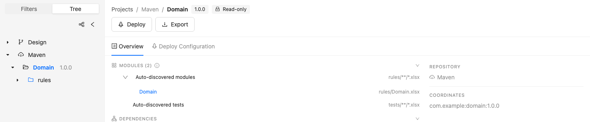
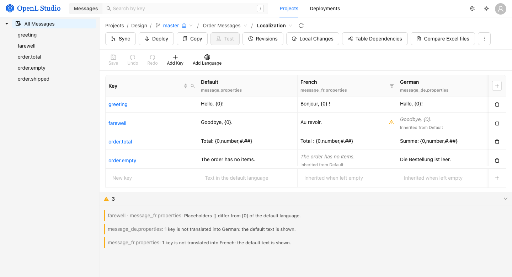
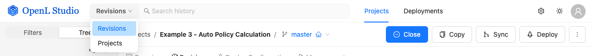
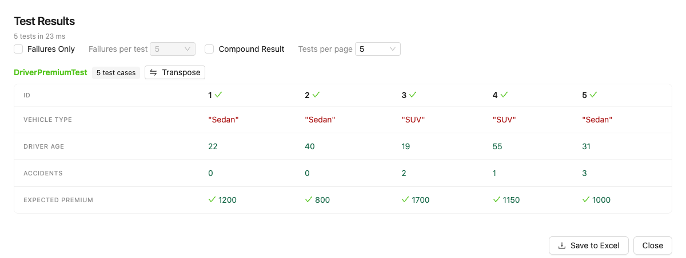

OpenL Tablets **7.1.0** lets OpenL Studio compile a project the way the OpenL Maven Plugin builds it. The libraries
and the OpenL projects that `rules.xml` and `pom.xml` name by Maven coordinates are downloaded from a Maven
repository, so the tables that use them compile, their tests run, and a deployment carries what OpenL Rule Services
needs.

Rules authors get a **Localization** screen with every language of the messages in one table, warnings for missing,
untranslated and broken messages, a test precision in significant figures, and test results laid out as the test
table is written. AI agents connected to the built-in MCP server keep an `AGENTS.md` of each project they change,
set table properties without rewriting cells, read the OpenL skills from any client, and migrate a project with the
migration notes of each release.

The screens of OpenL Studio are polished: one search field in the top bar, project files in the projects tree, a
project switcher on the project page and the dependencies of a project following its branch. The release also fixes
more than 150 defects, many of them long-standing, in the rules engine, the editor and the repository. Several fixes
change how an existing project compiles or runs, and `pom.xml` becomes a protected file instead of an ignored one:
review the breaking changes before upgrading.

## Highlights

* OpenL Studio downloads the Maven dependencies of `rules.xml` and `pom.xml` to compile, test and deploy a project.
* A **Localization** screen edits the messages of every language in one table and checks them on compile.
* AI agents create and keep the `AGENTS.md` of a project, and migrate projects with the Rules Authors migration notes.
* A test precision in significant figures, `4sf`, or `sf` for the figures each expected value is written with.
* Test results are laid out the way the test table is written, transposed ones included.
* One search field in the top bar searches every screen, and **Enter** searches the cells of the whole project.
* `pom.xml` is edited in OpenL Studio as a protected file, and technical files are hidden from business users.
* Opening or switching the branch of a project moves its dependencies to the same branch.
* Compare hides the tables that differ in formatting only.
* OpenL Maven Plugin runs on Maven 3.8.8 and later, and a build that skips tests no longer compiles `tests/`.

## New Features

### Maven Dependencies in OpenL Studio

OpenL Studio compiles a project and runs its tests with the dependencies that its `rules.xml` names by Maven
coordinates in `<mavenArtifact>`, as the OpenL Maven Plugin does at build time. It downloads them from one Maven
repository, such as Maven Central or a Nexus or Artifactory server of the company, set on the new **Maven** page of the
administration or by the `maven.repository.*` properties. Without a URL nothing is downloaded and OpenL Studio
behaves as before.

* **A library** — a `<dependency>` without `<name>`, such as
  `<mavenArtifact>org.apache.commons:commons-text:jar:1.15.0</mavenArtifact>`, is downloaded with its `compile` and
  `runtime` dependencies, and the rules of the project can use its classes.
* **An OpenL project** — a `<dependency>` with `<name>` and `<mavenArtifact>` is downloaded as a `zip` archive while
  no project of that name is open, and compiled as a read-only dependency. Opening a project of that name compiles it
  instead, with your changes.
* **A `pom.xml`** — the dependencies of the `pom.xml` beside `rules.xml`, and of the anchor `pom.xml` of a pom-less
  project, are read as the OpenL Maven Plugin reads them: parents by relative path, imported BOMs, managed versions
  and `provided` libraries.
* **Overview and Maven projects** — the **Dependencies** of a project mark a downloaded project **From Maven** and a
  version clash **Version conflict**. The projects tree lists the downloaded projects under **Maven**, and a project
  of the Maven repository opens read-only at `/maven/<groupId>/<artifactId>/<version>`.
* **Deployment** — a deployment carries the libraries and the dependency projects downloaded for it, so OpenL Rule
  Services runs it without a Maven repository; the **Deploy** dialog chooses whether a dependency project comes
  **From design repositories** or **From Maven repository**.
* **Cache** — the downloads are kept in a local folder of each instance, cleaned of what went unused for a period or
  over a size limit, and **Delete Cache** empties it. A dependency that cannot be downloaded is reported as an error
  of the project, starting with `Cannot download a Maven dependency:`.
* The MCP server reads the downloaded dependency projects too.

```properties
maven.repository.url =
maven.repository.username =
maven.repository.password =
maven.repository.local = ${openl.home}/maven-repository
maven.repository.cleanup.period = 30
maven.repository.cleanup.threshold = 1024
```



### Localization Editor

The localization messages of a project, the `message*.properties` files of its `i18n` folder, get a **Localization**
screen of their own, offered in the module switcher of Rules Editor below the modules. It shows every key in a row
and every language in a column, so a text missing in one language is seen at once.

* A language without its own text shows in grey the text it falls back to and where it comes from, such as
  **Inherited from Default**; the keys that only dependency projects define are changed in their own project.
* Keys and languages are added and texts are edited on the screen, and the table is filtered and sorted by its column
  titles; the search field of the top bar narrows the list of keys down.
* The screen also opens from a localization file in the projects tree, from the key of a `msg` call in a table cell
  and from a localization warning.
* A project reads the messages of the projects it depends on: a key its own file does not have is taken from them,
  the more specific language still winning.
* On compile, OpenL Studio warns about a duplicate key, a key without a separator, a key the default file does not
  have, placeholders that differ from the default language, a text that breaks the message format, a broken `\u`
  escape, an apostrophe that hides a placeholder and the keys a language does not translate. A `msg` call whose key is
  written as text is checked for a key without a default text and for the number of values it passes.
* The MCP server checks, reads and changes the localization of a project by key, a page of keys at a time.



### Project Instructions for AI Agents

An AI agent connected to the MCP server of OpenL Studio now creates the `AGENTS.md` of a project it changes when the
project has none, and keeps it up to date, so the next task starts from it instead of looking through the project
table by table. The new `project-guidance` skill says what the file holds: what the project computes, how its rules
compute it step by step, the dimension properties in use, the conventions, the business terms and the tables that
implement them, how the tests are organized and the pitfalls found while working.

* The file leaves out what the agent can ask OpenL Studio in a call or two, such as the modules, tables, fields and
  dependencies, and the values of the tables.
* After a change, the agent updates only what the change made out of date and keeps the instructions written by people
  as they are. A changed value leaves the file as it is.
* Every plan of the `planning` skill carries a guidance item for each changed project, after its tests, and the
  summary says whether the file was created, updated or left as it was. An `AGENTS.md` of a folder above the project
  is never changed.

## Improvements

### OpenL Studio User Interface

* Added one search field to the top bar for every screen: it names what it searches, such as **Projects**,
  **Revisions**, **Tables**, **Messages** or **All Guides**, filters the page as the text is typed, and is reached from
  anywhere with `/`. In Rules Editor, **Enter** searches the cells of every table of the project, headers included,
  and lists the tables found in place of the table; **Enter** again searches the projects it depends on too.
* Removed the separate **Files** tab of a project: a file or a folder picked in the projects tree shows in place of a
  tab, with its actions and **Add** in every folder pane, and the tree shows the size of each file, a format icon, and
  marks added, modified and deleted files until the project is saved.
* Added a project switcher to the project name on the project page and in the editor path, and listed the ten
  projects and branches used most recently in the browser first in the project and branch switchers.
* Reworked the projects list: **Modified** is split into sortable **Author** and **Modified At**, tags leave the list,
  the sort direction is remembered, and the grid view is removed.
* Added a check box to the head of each group of the **Filters** view that selects or clears every value of the group,
  with a dash when only some are selected.
* Showed the default branch in blue with a house icon and a protected branch in orange in the path, on the
  **Overview** and in the projects list.
* Coloured the names of rules, datatypes and fields in a table by their kind, so a link to a rule call reads apart from
  a link to an object before it is clicked.
* Moved page titles out: the actions stand on the line of the path, the editor leads with **Test** and the project
  page with **Close**, and the actions the line has no room for fold into a **⋮** menu.
* Let the tables tree, the user guides contents and the **Table Properties** pane fold away to a narrow strip named
  after them.
* Moved **Excel Formatting** from the theme menu to the **Table Settings** of **My Settings**, and named the switch that
  shows the technical files of a project **Show All Files**, its tooltip listing them.
* Sorted the users by their last sign-in, the latest first, coloured the actions of the audit log by what they do,
  and printed a user guide page whole, headed with its title and the OpenL Studio version.



### Rules Editor and Testing

* Added a precision in significant figures to Test tables: `4sf` rounds the returned and the expected value at the
  fourth significant figure of the expected value, and `sf` takes the figures each expected value is written with, as
  its cell or number format shows them. Both are accepted by the `precision` property and in a column name, such as
  `_res_ (4sf)` or `_res_ (sf)`.
* Laid out test results the way the test table is written: a transposed test table shows a case to a column, and
  **Transpose** turns the results the other way round without changing the workbook.
* Removed the **Test** button from a Test table, where it repeated **Run**: **Run** offers **Within Current Module
  Only**, **Failures Only**, **Failures per test** and **Compound Result**, and **Test into File** saves the results.
* Formatted a table in the roles its compilation gives it at the very save that creates, copies or edits it, so a step
  marked `*`, a column turned from a condition into a return or a changed return type gets its look at once.
* Hid in Compare the tables that differ in formatting only: the **Formatting changes** check box lists them again, and
  a comparison that finds nothing else says **Only the formatting differs**.
* Copied a table into its own module onto the sheet of the source table when no sheet is named, through the REST API
  and the MCP server as in the **Copy** dialog.



### Projects and Repository

* Moved the dependencies of the same repository with their project: opening a project offers to open them on the
  branch of the project, and switching or creating a branch of an open project switches them too. A dependency with
  unsaved changes, or of another repository, keeps its branch.
* Split the files of a project into ignored, protected and hidden: `project.protected-files` keeps `pom.xml` and
  `META-INF/MANIFEST.MF` editable but out of an export, a deployment and an import, `project.hidden-files` hides
  `rules.xml`, `rules-deploy.xml` and `tags.properties` from business users, and `repository.ignored-paths` also
  ignores the system and temporary files of operating systems, editors and build tools. The Files API marks such a
  file with `"hidden": true`.
* Removed the **Customize comments** check box and the **User message templates** of a design repository: OpenL Studio
  suggests standard comments, and a comment is validated whenever the repository sets a pattern.
* Recorded every change made on the **Tags** page in the audit log: tag types created, changed, deleted and reordered,
  tags added, renamed and deleted, project name templates changed and tags filled for projects.

### MCP Server

* Added `openl_set_table_properties`, which adds, changes and removes the properties of a table without rewriting its
  cells, widening a narrow table as **Edit the properties** of OpenL Studio does.
* Served every file of the OpenL skills through `openl_list_guides` and `openl_get_guides`, as `skill/<skill>` and
  `skill/<skill>/<path>`, for clients without the MCP skills extension or resources.
* Served the `## Rules Authors` section of the migration notes of each release since 5.25 as the `migration/<version>`
  guides, so an agent migrates a project release by release. OpenL Studio also lists these notes under **Migration
  Notes** of its user guides.

### Rules Engine

* Documented that a cell holding an Excel formula with an empty result, such as `=""`, is read as an empty cell.

### Maven Plugin

* Supported Maven 3.8.8 and every later release: the plugin is built against the Maven 3.8.8 API and requires it,
  instead of failing on 3.8.8 with `NoSuchMethodError` and being refused by 3.9.9.
* Marked the `verify` goal thread-safe, so a parallel build no longer warns about it, and made it fail instead of
  hanging when the build runs out of heap.
* Left the modules of the `tests/` folder out of compilation when a build runs with `-DskipTests` or
  `-Dmaven.test.skip=true`, which now also skips the `test` and `verify` goals.

## Bug Fixes

### Rules Engine

* Fixed a Vocabulary built on a collection, such as `<List>` or `<Map>`, compiling without a message; it is now
  refused, as an array base type is.
* Fixed a class of a project naming a class that does not exist compiling cleanly and failing only when a rule runs.
* Fixed a parse error on a cast written right before a range of Spreadsheet cells, such as `(String[]) $A1:$A3`.
* Fixed an alias array element accepting a value outside the alias.
* Fixed `contains` not finding a value in a `List` or a `Set`.
* Fixed `toString` of an array writing the Java object id instead of `[1, 2, 3]`.
* Fixed `dateDif` failing on an empty unit; it now returns an empty value.
* Fixed `dateDif` with the `YF` unit dividing the days after the last full year by the length of the year they start
  in, and `YD` and `MD` going negative when the end falls earlier in the day than the start on an anniversary.
* Fixed `weekOfYear` and `weekOfMonth` following the locale of the server; they count ISO-8601 weeks.
* Fixed an invalid `like` pattern written as text failing only when the rule runs; it is reported at compilation.
* Fixed a text passed to `modifyContext` failing with `ClassCastException` instead of being read as the type of the
  property.
* Fixed the third version of a rule with a context parameter reported as `Method is already defined`.
* Fixed the short constructor of a datatype of a dependency project reported as a missing method.
* Fixed `RecursiveSpreadsheetMethodPreBindingException` for a rule returning a united spreadsheet result that calls
  itself.
* Fixed an inactive version of a Spreadsheet widening the result type of the calls of the rule.
* Fixed a rule of formulas returning a list of spreadsheets as `Object[]`, which OpenL Rule Services answered with
  `ClassCastException`; it returns a `List`.
* Fixed compilation of an unchanged project randomly failing with `Field not found` in a combined custom spreadsheet
  result type, caused by a half-copied dependency type and an order of steps taken from hashes.
* Fixed a keyword used as a name, also in a Test table, failing without a hint to back-quote it.
* Fixed an unknown type in a cast reported twice, the second time as a cast error.
* Fixed an order key that does not use the element sorting nothing without a message; it now warns.
* Fixed a text in the first row of a table out of its header cell being ignored without a message; it now warns.
* Fixed a table version that is not three numbers being taken without a message; it now warns.
* Fixed a Spreadsheet row with values but without a step name being ignored without a message; it now warns.
* Fixed the Environment properties being ignored without a message and an unrecognized Environment keyword reported
  as an error instead of the warning it is.
* Fixed a big whole number in a cell formatted as **Text** being read in scientific notation.
* Fixed `K`, `M` and `B` multipliers failing in number cells of a Data table while ranges and formulas took them.
* Fixed a number cell rejecting the name of a constant of its type.
* Fixed a cell of a Rules table written in braces not being read as a formula, as a Spreadsheet cell is.

### Decision Tables and Lookups

* Fixed a lookup horizontal value merged over several columns returning the value of its first column only; a lookup
  that returns an array now returns the values of all these columns.
* Fixed a lookup whose values do not fill its return columns compiling and dropping the last columns; it now fails
  with `The width of the Lookup table(3) is not a multiple of the RET width(2).`
* Fixed a lookup key merged down over rows not being read as one horizontal condition, and Rules tables with
  horizontal conditions only, or a note beside their values, failing to compile.
* Fixed a transposed SmartLookup compiling or not depending on where it stands on the sheet.
* Fixed a Rules table with its lookup part in the first column reading rule values from the rows of the keys when its
  horizontal values hide their rows; it now fails with `Vertical condition is mandatory for Lookup table.`
* Fixed titles without a slash being read as horizontal condition values of an external conditions table, and a
  mistyped header of such a table reported without its name.
* Fixed a condition matching a `Map` or a `List` value of another type to no rule, `true` matching every row of a
  condition that reads another column, and a cell of several values failing with `Argument is not an array`.
* Fixed an empty condition value matching a `false` or empty formula cell.
* Fixed `$C1.param` in a return column running the formula of the matched condition again.
* Fixed a condition expression being run when every rule left keeps its cell blank.
* Fixed `Collect` in a Rules table failing with a parse error instead of saying it is not for Rules tables.
* Fixed a column without an expression reported with two generic errors; it now reports
  `Column 'C2' has no expression.`
* Fixed an error on a reference to a parameter of a return column, which recursed endlessly.
* Fixed a column title merged over several columns failing with an index error instead of naming the merge.
* Fixed `validateDT` missing an alias value that no range of the table takes, hanging the compilation on an open
  `Integer` range, failing with `UnsupportedOperationException` on a table whose conditions did not compile, and
  skipping a condition it cannot check without a warning.

### Data and Test Tables

* Fixed the last element of a list given cell by cell under a merged field title being a copy of the first one, and
  such a table failing with `Table structure is wrong`.
* Fixed a Data record failing with `ArrayIndexOutOfBoundsException` on array cells merged over its rows.
* Fixed a table column rejecting an element of a nested array, such as `a[0][1]`.
* Fixed a test reading a field of a missing result element of a primitive type as `0` instead of empty.
* Fixed a test reading the spreadsheet steps of an expected error as empty, and passing a check of a field the error
  does not have.
* Fixed a test result column dropping the field of a typed list element.
* Fixed a precision in the column name of an array result, such as `_res_ (5)`, read as an array index.
* Fixed `NumberFormatException` logged when a test column has a text index.
* Fixed two Test, Run or Data tables of the same name reported as duplicated fields.
* Fixed a test table that ties on several tested methods reporting only one of them.
* Fixed `OutOfMemoryError` of a test table with many cases and large spreadsheet results, which held every case until
  its end.

### Rules Editor

* Fixed a deprecated property reported on the whole table header instead of on its cell.
* Fixed the field hints and links lost in a cell whose index operation has an error.
* Fixed the name of a table without a `name` property, such as a Constants, Test or Run table, shown as its generated
  method name in the right panel.
* Fixed the values of an enumeration property listed in the order of their codes instead of by name.
* Fixed the Problems section of a table pushing the table under the compile problems panel.
* Fixed the code editor painting every Groovy name red in the dark Standard theme and leaving `.properties` keys and
  `.java` files plain.
* Fixed a cell offering wrong input controls for a condition value outside its alias.
* Fixed a cell that takes several alias values opening a plain text area instead of the list of values, caused by
  column widths rounded down.
* Fixed a long field path in a cell breaking inside a name instead of before a dot.
* Fixed the cell editor drawing a white box next to a check box and growing its row.
* Fixed the mark panel of an open cell covering the row above it without a text selection.
* Fixed the Studio look drawing group lines solid, dropping the indent of a right-aligned cell, styling the rule cells
  of a SmartLookup with an error as column titles, framing the types of a Datatype as header code, and not drawing a
  Spreadsheet step marked `~` as a local value.
* Fixed a search of the cells not finding a date cell by the day typed, and a search by several values of a property
  such as `tags` finding nothing.
* Fixed a tree search not telling how many tables the type filter hides from it.

### Table Editing and Excel Files

* Fixed a table lost on save when its merged header touched a value above it.
* Fixed a group line lost on save when the first rule of its group was removed, and steps marked `*` in a
  `SpreadsheetResult` restyled as its result.
* Fixed the table properties moving when a column is inserted or removed.
* Fixed a header merged over rows copied as repeated body cells.
* Fixed a moved table leaving orphan shared formulas that Excel repairs, which corrupted the workbook.
* Fixed a `BigDecimal` cell rounded to a `double` on save, which failed its test.
* Fixed editing a workbook with a part over 100 MB failing with `Something went wrong.` when a table was copied or a
  test was created.
* Fixed a range edited in its dialog losing the notation the author wrote.
* Fixed the tables API losing the rules of a SimpleRules table under a merged condition, turning an array property
  into text in brackets, such as `[Auto]`, and dropping the merged cells of an updated row or column.
* Fixed copying a Conditions, Actions, Returns or Constants table failing with `400`, and the **Copy** window crashing
  on a table without a name.

### Test, Run and Trace

* Fixed the **Trace** panel opening without the input entered in the **Run** panel; Run, Trace and Benchmark share
  the input of a table.
* Fixed an `Object` parameter failing to open in **Run**.
* Fixed a `Comparable` input not being read as the text, number or boolean it holds.
* Fixed a `BigDecimal` input or result losing the digits beyond `double` precision in the JSON input and in the
  results.
* Fixed a nested subtype failing to run with `missing type id property '@class'`.
* Fixed a range result shown as a value to expand instead of its text.
* Fixed the line breaks of a text value lost in run and test results.
* Fixed **Run into File** writing `Double` fields as `1.0E-4`, hanging on a parameter with an array of arrays or a
  `Map`, overflowing the stack on an empty recursive input, and asking which columns to export once per test case.
* Fixed a lookup trace not highlighting the result under a merged horizontal value.
* Fixed a trace highlighting every rule that matched instead of the rule that returned.
* Fixed a trace tree lost after a `StackOverflowError`, and blank details of a deep call of such a recursion.
* Fixed a failed benchmark shown as `0 measurements`.
* Fixed a test of a dependency project shown in the results as plain text instead of a link.

### Compare

* Fixed the frame of a table whose formatting changed spanning the screen and moving over the table on scroll.

### Projects and Repository

* Fixed the project list and the first project requests waiting for minutes after a start, caused by merge bases and
  revision histories read for every project.
* Fixed an empty copy of a project that the workspace renamed after listing it.
* Fixed a project in a Git repository opened with a stale `pom.xml` when the latest revisions of its branch, such as
  the version bumps of a CI pipeline, changed only that file.
* Fixed each save to a local design repository keeping a full copy of the repository on disk for an hour, which filled
  the disk on a bulk import.
* Fixed copying a project to another repository failing with `NullPointerException` on a repository without commits
  and for a user with View and Create permissions there.
* Fixed project creation failing with `Project creating is failed.` when a project was locked and the repository
  settings changed.
* Fixed the comments of `rules.xml` lost when a project is created from a ZIP archive.
* Fixed a module of a project whose `rules.xml` name ends with a space failing to open.
* Fixed the **Overview** listing workbooks of ignored folders as modules matched by pattern.
* Fixed a project without `rules.xml`, while projects are not detected by Excel files, failing on its **Management**
  tab, on a copy to a branch and on a deployment; deleting or moving the `rules.xml` a project is found by is refused.
* Fixed access granted on a project surviving the deletion of its last branch and applying to a new project in the
  same folder.
* Fixed **Group projects** offering the tags of projects the tree does not show.
* Fixed a failed push reported as a general failure: the reason the Git server gave, such as a missing permission or a
  branch changed on the server, is shown.
* Fixed the **Copy file** window refusing a path or a file name without saying why.
* Fixed a revision the repository does not have answered with `500` or `409` instead of `404`.
* Fixed the **Create project** and **Copy project** dialogs reset by a repository re-read, and the **Delete** comment
  hint validating the previous value of the field.
* Fixed the **Revisions** tab no longer linking the source project of a copy.

### Deployment

* Fixed concurrent deploys of one deployment undeploying its services.
* Fixed a deployment to a database repository failing for a user without an email or a display name.
* Fixed a deploy comment asked for a repository that keeps none.

### Administration and Security

* Fixed the OAuth2 client secret, the access and secret keys of an AWS S3 repository and the account key of an Azure
  Blob Storage repository saved in plain text when `secret.key` is set; every secret setting is now stored as
  `ENC(...)`, as the passwords are.
* Fixed Git settings accepted for an account that may not write to the repository.
* Fixed an internal server error on sign-in when the identity provider sends a name that is too long.
* Fixed OpenL Studio hanging on SAML metadata read from a URL that never answers.
* Fixed **Restore Defaults** warning that it discards the repository and security settings, which it keeps.
* Fixed adding a production repository recording a settings change of another repository in the audit log.
* Fixed any properties file of the working folder, the home folder or the classpath changing the settings of an
  application deployed at the root context, as in the Docker images.
* Fixed `SEVERE` memory leak warnings of Tomcat after editing a workbook.
* Fixed the generated OpenAPI file missing its `info` section.

### OpenL Rule Services

* Fixed the `@PrepareStoreLogData` advices skipped when an interceptor fails, and an advice that fails on a failed call
  replacing the error of the call; a `ServiceInvocationAdviceListener` now also learns of a call that a "before"
  interceptor rejected.
* Fixed the store log data of an interceptor that Spring creates as a proxy bean, such as one annotated with
  `@Traced`, being skipped because the proxy class was checked instead of the class of the interceptor.
* Fixed a service configured by the `spring.SpringConfig` of a dependency project instead of its own.
* Fixed an OpenL Rule Services application packed as an executable Spring Boot JAR failing to start with
  `The resource with name '...' already exits.` or deploying nothing: the `repo-jar` data source and
  `ruleservice.datasource.deploy.classpath.jars` read the projects in `BOOT-INF/lib` and the ZIP archives in
  `BOOT-INF/classes/openl/`. The new **OpenL Rule Services in Spring Boot** guide shows how to run the services in a
  Spring Boot application, as a web service or as a Java library.
* Fixed the OpenAPI schema omitting the child datatypes when the type property is off, and reading the body of a
  multipart method as a single string.
* Fixed OpenAPI reconciliation missing a wrong return type when a template declares the result, and rejecting a rule
  that returns a child of the declared type.

### Maven Plugin

* Fixed the test reports of a Test table without a name written as `TEST-OpenL.Main.SayHello$Test$0`; they are named
  after the tested table, such as `TEST-OpenL.Main.SayHelloTest`.
* Fixed a project failing to deploy when its `rules.xml` names a module of the `tests/` folder.

### MCP Server

* Fixed four list tools pointing to a next page they could not read.
* Fixed the table types specification showing a property row without the `properties` keyword, so an agent wrote a
  body row and broke the table.

## Breaking Changes

This section summarizes changes that may require action before or after upgrading.

* **`pom.xml` is protected rather than ignored** — A developer edits it in OpenL Studio, while an export, a deployment
  and an import leave it out; `rules.xml`, `rules-deploy.xml` and `tags.properties` are hidden unless **Show All
  Files** is on. A custom `repository.ignored-paths` keeps ignoring what it lists.
* **A project stands on the latest revision of its branch** — It opens with the files the branch holds, such as a
  `pom.xml` of a CI version bump, and a revision that changes only protected files is a technical revision.
* **Commit comments are no longer configured per repository** — The User message templates and the
  **Customize comments** check box are removed, and the repository settings API refuses their fields with `400`.
* **An application at the root context reads only `application.properties`** — In the Docker images, a properties
  file of another name in the working folder, the home folder or the classpath is no longer read as settings.
* **All secrets are stored encrypted** — With `secret.key` set, the OAuth2 client secret, the keys of AWS S3 and Azure
  Blob Storage repositories and the generated SAML key are stored as `ENC(...)`, and can be read only with the same
  key.
* **Several fixes change how a project compiles or runs** — Among them: a Vocabulary on a collection does not compile,
  `dateDif` `YF`, `YD` and `MD` and `weekOfYear` and `weekOfMonth` give other results, a lookup returning an array
  returns all the values under a merged horizontal value, conditions check the type of an `Object` value, and tests
  read missing fields and error steps differently.
* **More is checked at compilation** — An invalid `like` pattern written as text, a project class that refers to a
  missing class, and a rule whose result does not match the response of its OpenAPI operation stop the project instead
  of failing when the rule runs or going unnoticed.
* **New warnings** — A table version that is not three numbers, an order key that does not use the element and a
  text beside a table header compile with a warning.
* **The extended search of Rules Editor is removed** — **Enter** in the search field searches the cells of the tables
  instead; a search by table type or by table properties is no longer offered.
* **Excel Formatting moved to My Settings** — The choice made in the theme menu is not carried over.
* **OpenL Rule Services changes for extensions** — The store log data advices run when an interceptor fails, and a
  service takes the Spring configuration of its own project only.
* **The OpenAPI schema of a service without a type property changes** — A place that may hold a child datatype lists
  the datatype and its children through `anyOf`.
* **OpenL Maven Plugin** — The reports of unnamed Test tables are renamed, and a build that skips tests does not
  compile `tests/`.

## Library Updates

### Runtime Dependencies

| Library          | Version                          |
|:-----------------|:---------------------------------|
| Jetty            | 12.1.15 (from 12.1.14)           |
| Netty            | 4.2.21.Final (from 4.2.20.Final) |
| Jackson          | 2.23.0 (from 2.22.4)             |
| OpenTelemetry    | 2.34.0 (from 2.33.1)             |
| Swagger Core     | 2.2.56 (from 2.2.55)             |
| Swagger Parser   | 2.1.49 (from 2.1.48)             |
| Apache HttpCore5 | 5.5 (from 5.4.4)                 |
| Micrometer       | 1.18.0 (from 1.17.2)             |
| Bouncy Castle    | 1.87 (from 1.86.2)               |
| Commons Lang     | 3.22.0 (from 3.21.0)             |
| lz4-java         | 1.14.1 (from 1.13.0)             |
| PostgreSQL JDBC  | 42.7.15 (from 42.7.14)           |
| Maven Resolver   | 2.0.26 (*new*)                   |
| Plexus XML       | 3.1.1 (*new*)                    |
| Maven API        | 3.8.8 (from 3.10.0)              |
| Plexus Utils     | 4.2.0 (from 4.1.0)               |

OpenL Studio carries Maven Resolver to download the Maven dependencies of projects. OpenL Maven Plugin is built
against the Maven 3.8.8 API, the oldest Maven release it supports.

### Test Dependencies

| Library                 | Version              |
|:------------------------|:---------------------|
| Testcontainers Keycloak | 4.4.1 (from 4.4.0)   |
| commonmark-java         | 0.33.0 (from 0.32.0) |

### Build Tooling

| Tool        | Version                |
|:------------|:-----------------------|
| Error Prone | 2.53.0 (from 2.52.0)   |
| NullAway    | 0.14.4 (from 0.14.3)   |
