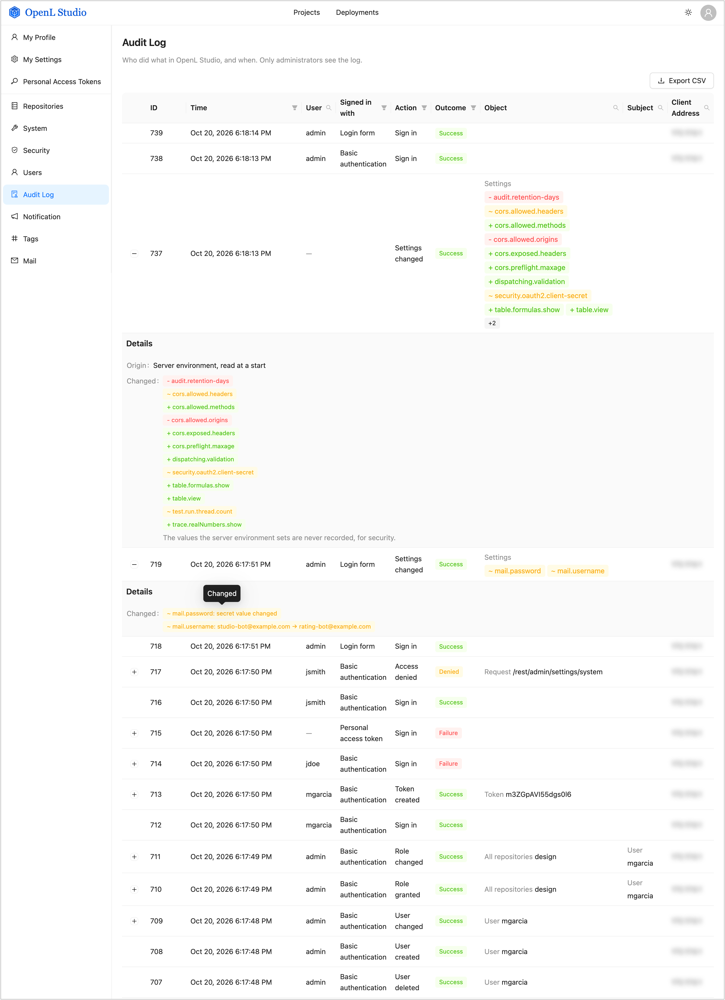

### Reviewing the Audit Log

The audit log records who signed in to OpenL Studio and when, whose sign-in was refused, who signed out, who changed
users, groups, personal access tokens and access rights, which requests were refused for lack of permission, who
created, saved, deleted and deployed projects and changed the branches of their repositories, and who read the log
itself. OpenL Studio keeps it in its database in every user mode but Single-User, which has no sign-in. Only users
with administrator privileges see it.

In the navigation menu, click **Audit Log**. The page lists the events, the newest first, a page at a time. The list
counts up to 10,000 events: when more match, it shows `10000+` and pages through the newest 10,000. Narrow the
filters to reach older events, or export them.

*Audit log of OpenL Studio*

Each event shows the following:

- **ID** — the number of the event, which tells it apart in the log and in an export.
- **Time** — when the event happened, to the second, in the time zone of the browser.
- **User** — who did the action. A refused sign-in names a user only when a user name was typed; a token is never
  recorded in its place. An action OpenL Studio does by itself, such as removing old events, names no user.
- **Signed in with** — how the user signed in, or tried to: **Login form**, **Basic authentication**, **Personal
  access token**, **Bearer token**, **OpenID Connect** or **SAML**. So an action a script or an agent did with a token
  tells so. An action that goes on after its request is answered tells it only for a token, OpenID Connect or SAML.
- **Action** — what was done.
- **Outcome** — **Success**, **Failure** when the action failed, such as a sign-in with a wrong password, or
  **Denied** when it was refused for lack of permission.
- **Object** — what the action was done to.
- **Subject** — the user or group whose access or membership the action changed.
- **Client Address** — the address the request came from. Behind a proxy, it is the address of the client only
  when the server reads the address the proxy forwards, as the OpenL Studio Docker image does.

Click the expand icon of an event to see its details, such as why a sign-in was refused. A change is shown as a diff
is, under **Changed**, and pointing at a mark names the change:

- **`~` on yellow** — a value changed: the value before the change, an arrow and the value after.
- **`+` on green** — a value added where there was none, or a group or privilege given.
- **`-` on red** — a value removed, or a group or privilege taken away.

The details never hold a password or a token: a personal access token is named by its public identifier.
A repository that keeps projects in folders of their own can hold several projects of one name, so there the details
of a project also name its folder.

The log records these actions:

- **Sign in** — a sign-in through the login form, SAML or OpenID Connect. A refused sign-in is recorded for every
  way of signing in, including Basic authentication, a bearer token and a personal access token, with the reason.
  A script or an agent that sends its credentials with every request, such as a personal access token, signs in
  anew every time: its sign-in is recorded at its first request, and again at the first one after its credentials
  were not used for as long as a session may stay idle, 30 minutes by default. A personal access token is named by
  its public identifier.
- **Sign out** — a sign-out, including one the identity provider asks for. A session left idle for longer than it
  may stay ends with a sign-out too, marked as timed out.
- **User created**, **User changed**, **User deleted** — a user created, deleted, or with a new name, display name,
  e-mail or e-mail verification, with the values before and after. A user that the identity provider creates or
  changes at sign-in is marked as coming from the identity provider.
- **Password changed** — a password set for a user. The password itself is never recorded.
- **Added to group**, **Removed from group** — a user put into a group or taken out of it: the group is the object
  and the user is the subject. A user joins or leaves a group of OpenL Studio at sign-in too, when the identity
  provider starts or stops reporting a group of the same name: such an event is marked as coming from the identity
  provider and names the privileges of the group.
- **External groups changed** — the groups the identity provider reports for a user changed at sign-in, with the
  groups added and removed.
- **Group created**, **Group changed**, **Group deleted** — a group created, deleted, renamed or described anew.
- **Group privileges changed** — a privilege, such as the administrator privilege, given to a group or taken from it.
- **Token created**, **Token deleted** — a personal access token, named by its public identifier and its name.
- **Role granted**, **Role changed**, **Role revoked** — a role, such as **Viewer** or **Manager**, given to a user or
  a group, replaced or taken away, with the roles before and after. The object is where the role is held: all the
  design or all the production repositories, a repository or a project. The subject is the user or the group. The
  roles a group gets in its editor and the access rights overwritten all at once through the REST API are recorded
  the same way. A group the identity provider reports anew at sign-in gives the user every role the group holds, and
  a group it no longer reports takes them away: each such role is recorded as **Role granted** or **Role revoked** for
  the user, marked as coming from the identity provider and naming the group. A role the user holds already, by
  itself or through another group, is recorded all the same.
- **Access denied** — a request refused because the user may not do what it asks, such as a change of the access
  rights of a project the user does not manage. The object is the path of the request; the details hold its method
  and the reason given to the user.
- **Project created**, **Project copied** — a project created from a template, from files or from an archive, or as
  a copy of another project, with its repository, branch and revision. Its creator gets the **Contributor** role on
  it, recorded as **Role granted**, unless the project already had access rights.
- **Project saved** — the changes of a project saved to its repository, with the revision and the comment. An archive
  uploaded over a project and the files chosen to resolve the conflicts of a save are recorded as a save too. A file
  written to a closed project through the REST API is a revision of the repository with its author, not an event of
  the log.
- **Project deleted** — a project deleted, with the comment. When no branch holds the project any longer, its access
  rights go with it, and each role it had is recorded as **Role revoked**.
- **Project unlocked** — the lock of another user released by force, naming that user.
- **Branch created**, **Branch deleted** — a branch of a design repository, which is the object, created from a branch
  or a revision, or deleted with the projects only it held.
- **Branches merged** — a branch merged into another one, also when the conflicts of the merge were resolved first.
- **Branch protection bypassed** — a protected branch changed by a user allowed to bypass its protection, who
  confirmed it.
- **Project deployed** — a project deployed to a production repository: the deployment is the object, and the details
  name the project, its repository, branch and revision, and the comment.
- **Audit log read** — a view or an export of the log, with the filters it was made with. Every export is recorded.
  A view is recorded once, when it starts: searching, filtering and turning the pages, with nothing else done in
  between, add no event. Any other action of the user, a new sign-in included, makes the next view recorded again.
- **Old events removed** — the removal of the events older than the retention period, with their number.

A change that leaves every value as it was is not recorded.

#### Finding Events

Click the filter icon in the header of a column to filter the list by it. The list then shows the events that match
the filters of all the columns, from its first page:

- **Time** — the first and the last second of the events, both included. Either one can be left open.
- **User**, **Object**, **Subject** and **Client Address** — text the name or the address contains, in any case.
  Type the text and press Enter; clear it to drop the filter. **Object** finds an event made on a project by the name
  of the project too, such as a branch created from it or its deployment, so it finds everything done to a project.
- **Signed in with** — how the users who did the actions signed in, such as **Personal access token**.
- **Action** — the actions, each one by itself or all the actions of an area, such as **Sign-in**. Type in the
  search of the filter to find an action.
- **Outcome** — how the actions ended.

While a filter is set, **Clear filters** above the list drops all of them.

#### Exporting the Audit Log

Click **Export CSV** to save every event the filters match as a CSV file, a line per event, its ID first. The time
is written in UTC, and a value a spreadsheet application would run as a formula is written as text. Every export
is recorded in the log, with its filters.

#### Keeping the Audit Log

By default, the events are kept forever. A retention period removes the older events once a day, and a copy of every
event can also go to the console for a log collector. Both are set in `application.properties`, as described in
[Audit Log](../../installation-guide/configuration.md#audit-log) of the configuration guide.
