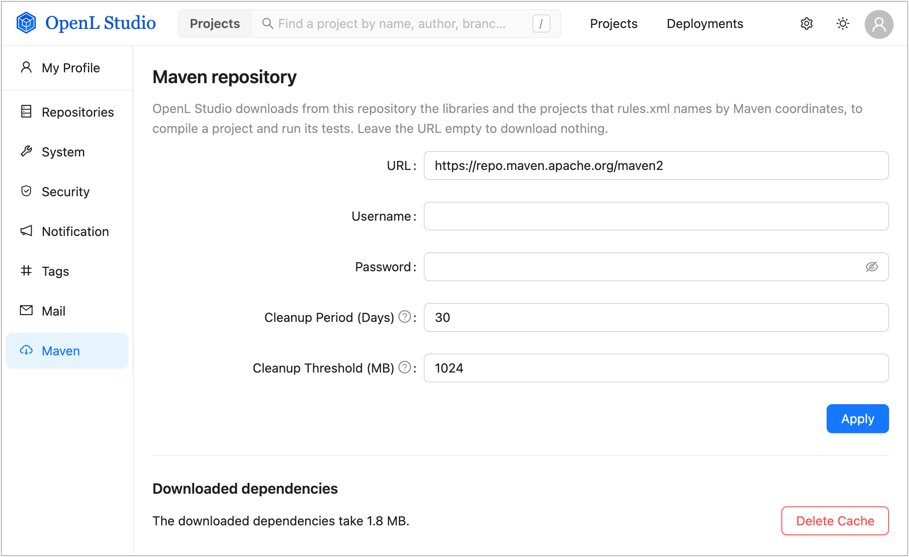

### Managing the Maven Repository

A `rules.xml` can name its dependencies by Maven coordinates in `<mavenArtifact>`: a library, such as a jar with Java
classes the rules call, and an OpenL project. A project built by Maven has a `pom.xml` beside `rules.xml`, whose
dependencies are libraries of the project too, and whose `zip` dependencies are the OpenL projects `rules.xml` names
by name. A pom-less project takes them from the `pom.xml` of the folder above it that builds it with the OpenL Maven
Plugin, which also sets the versions of the coordinates its `rules.xml` names. OpenL Studio downloads them from a
Maven repository, such as Maven Central or a Nexus or Artifactory server of the company, to compile the project and
run its tests.

To set the Maven repository, proceed as follows:

1. In the administration area, click **Maven** on the left.
2. In the **URL** field, enter the address of the repository, such as `https://repo.maven.apache.org/maven2`, or
   `file:///opt/maven-repository` for a repository in a folder of the server.
3. If the repository requires authentication, enter the **Username** and the **Password**.
4. In the **Cleanup Period (Days)** field, enter how many days a downloaded dependency no project uses is kept.
5. In the **Cleanup Threshold (MB)** field, enter how large the downloaded dependencies may grow before the ones used
   longest ago are removed.

   A `0` in either field turns that rule off. A dependency a project reads at the moment is never removed.

6. Click **Apply** and confirm.

   OpenL Studio restarts, so all users lose their unsaved changes.

*Maven repository settings*

To stop downloading, clear the **URL** field and click **Apply**.

The size of the downloaded dependencies shows under **Downloaded dependencies**. To delete them all, click **Delete
Cache** and confirm. Every project downloads its Maven dependencies again when it compiles next. In a cluster, each
OpenL Studio instance keeps its own downloads, and the button deletes those of the instance that serves you.

What OpenL Studio does with the downloaded dependencies:

- **A library** — a `<dependency>` without `<name>`, such as
  `<mavenArtifact>org.apache.commons:commons-text:jar:1.15.0</mavenArtifact>`, is downloaded with the libraries it
  needs at runtime, and the rules of the project can use their classes.
- **An OpenL project** — a `<dependency>` with `<name>` and `<mavenArtifact>`, such as
  `com.example:shared-data-project:1.0.0`, is downloaded while you have no project of that name open. The project
  compiles as a dependency and cannot be edited. Once you open a project of that name, it is compiled instead, with
  your changes; closing it switches back to the downloaded one.
- **A deployment** — a deployed project carries the libraries it names, and the **Deploy** dialog lets the user take
  a dependency project from the Maven repository instead of Design repository, so OpenL Rule Services need no
  Maven repository.

A dependency that cannot be downloaded shows as an error of the project, which starts with
`Cannot download a Maven dependency:` or names the coordinates. OpenL Studio asks the Maven repository again after
five minutes.

For the coordinates and the rules OpenL Studio follows, see
[Maven Dependencies in OpenL Studio](https://openl-tablets.github.io/openl-tablets/ref/rules.xml#maven-dependencies-in-openl-studio).
For the properties of these settings and the folder that keeps the downloaded files, see
[OpenL Tablets Installation Guide > Maven Repository](../../installation-guide/configuration.md#maven-repository).
