## Getting Started

This chapter explains logging into OpenL Studio and briefly introduces the user interface. The following topics are included in this chapter:

-   [Signing In to OpenL Studio](#signing-in-to-openl-studio)
-   [Modifying User Profile](#modifying-user-profile)
-   [Switching the Theme](#switching-the-theme)
-   [Displaying the OpenL Studio Help](#displaying-the-openl-studio-help)
-   [Viewing the Version and Licenses](#viewing-the-version-and-licenses)
-   [Signing Out of OpenL Studio](#signing-out-of-openl-studio)
-   [Introducing Rules Editor](#introducing-rules-editor)
-   [Introducing the Projects Page](#introducing-the-projects-page)

### Signing In to OpenL Studio

To sign in to OpenL Studio, proceed as follows:

1.  In the web browser address bar, enter the OpenL Studio URL provided by the system administrator.
    The OpenL Studio URL has the following pattern:

    `http://<server>:<port>/webstudio`

    In the single user mode, users are automatically signed in as the single user, which is named after the operating
    system account that runs OpenL Studio unless another username is configured. In the multi-user mode, the following
    form appears.

       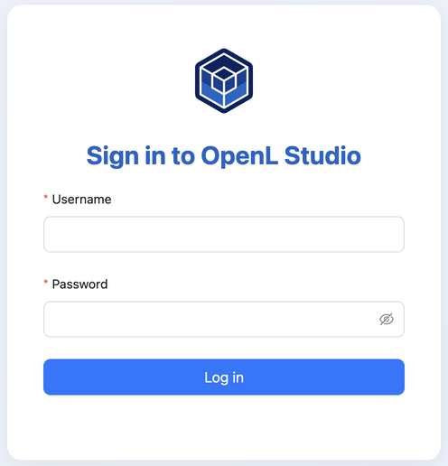

       *Login window*

1.  Enter the user name and password provided by the system administrator and click **Log in**.

If the user profile does not contain an email address or display name, the **Complete Your Profile** window opens after
authentication. Enter the required details and click **Save** to continue to OpenL Studio. First Name and Last Name are
optional. The display name can be entered directly or generated from them. The same check runs when OpenL Studio
automatically signs in the single user in single-user mode.

For more information on OpenL Studio UI, see [Introducing Rules Editor](#introducing-rules-editor) and [Introducing the Projects Page](#introducing-the-projects-page). For more information on the single and multi-user modes, see [Security Overview](introduction.md#security-overview).

### Modifying User Profile

OpenL Studio provides a navigation panel accessible from the top-right corner of the application for updating profile information. To open it, click the user icon in the top-right corner. The panel displays the current username and email address, and provides access to the following items:

-   **My Profile** — update account details, name, and password
-   **Personal Access Tokens** — manage API authentication tokens (not shown in single-user mode)
-   **Administration** — open the administration tools (shown to administrators only)
-   **Help** — open the OpenL Studio help
-   **About** — view the version, build date and license of OpenL Studio and the licenses of the third-party
    libraries it includes
-   **Sign Out** — end the current session (not shown in single-user mode)

**My Profile** and **Personal Access Tokens** open a page with a navigation menu on the left, which lists both.

The display and testing preferences are not in the panel: the settings icon beside the theme icon opens
**My Settings**, described in [Modifying My Settings](#modifying-my-settings).

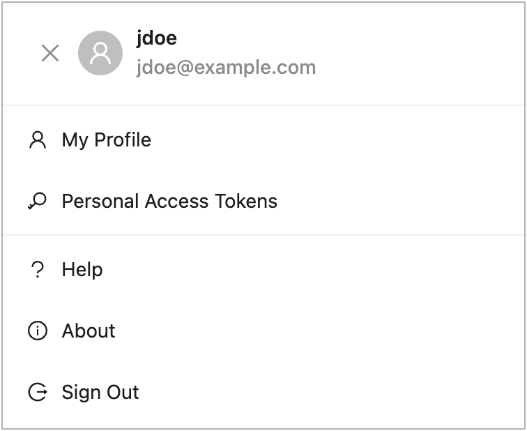

*Opening the user profile panel*

This section describes how to modify user profile information and includes the following topics:

-   [Modifying My Profile](#modifying-my-profile)
-   [Synchronizing with a Third Party Service](#synchronizing-with-a-third-party-service)
-   [Modifying My Settings](#modifying-my-settings)
-   [Managing Personal Access Tokens](#managing-personal-access-tokens)

#### Modifying My Profile

To manage profile details, proceed as follows:

1.  In OpenL Studio, in the top-right corner, click the user icon.
2.  In the panel, click **My Profile**.

    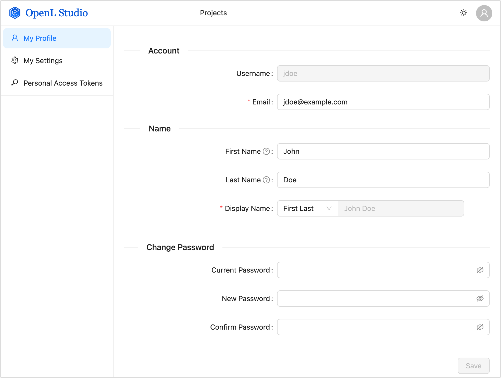

    *My Profile page*

3.  In the **Account** section, update the **Email** field as needed. The **Username** field is read-only.
4.  In the **Name** section, update **First Name**, **Last Name**, and **Display Name** as needed.

    **Email** and **Display Name** are required and cannot be empty, unless an external system manages them. **First Name** and **Last Name** are optional.

    If user data is synchronized from an external system such as Active Directory, the email, first name, last name, and display name fields are locked from editing, which is indicated by a tooltip icon next to the field label.

    In single-user mode, all fields are editable. A field is locked only when its `security.single.*` property is defined by a more prioritized configuration source, such as a Java system property or an environment variable.

    The **Display Name** field includes a format selector to generate the value from **First Name** and **Last Name** or
    enter a custom value, with a preview shown alongside.

5.  To change the password, in the **Change Password** section, enter the **Current Password**, **New Password**, and **Confirm Password** values.

    Once any of these fields is filled in, all three are required, and the new password cannot consist of spaces only. To keep the current password, leave all three fields empty.

    The **Change Password** section is shown only in multi-user mode, where user credentials are stored in OpenL Studio. Single-user mode has no login form, and in the external authentication modes, credentials are managed by the identity provider.

6.  Click **Save**.

#### Synchronizing with a Third Party Service

When users are managed by a third party service, such as Active Directory, it is necessary to regularly check that the data in the OpenL Studio user storage is synchronized with the data defined in the third party service. Data is compared periodically or on specific events and if necessary, must be synchronized.

The following user information requires synchronization:

-   first name
-   last name
-   display name
-   email address

The following general guidelines apply:

-   If the field value is synchronized with the third party service, the field becomes locked from editing.
-   If the field is added locally and not synchronized, the field value remains available for editing.

The following synchronization rules apply:

-   If the third party email address, first name, or last name value is empty or unavailable, the current email address, first name, or last name is not emptied.
-   If the third party email address, first name, last name, or display name is not empty, the current values for local user email address, first name, last name, or display name is changed to the value received from the third party.
-   If the display name value is empty or unavailable, the local display name is not modified.

An exception is the situation when the first or last name was changed.

-   If the display name was set to “first name + space + last name”, it is updated to the new “first name + space + last name”.
-   If the display name was set to the “last name + space + first name”, it is updated to the new “last name + space + first name”.
-   If the display name is set to **Custom** and its value in OpenL Studio is not empty, and in the third party service, it is empty, upon synchronization, the display name set locally is not changed.
-   If the display name value is empty in OpenL Studio and the third party service, but the first name and last name values are not empty, the display name is set to “first name + space + last name”, regardless of the pattern specified upon local user creation.

If this user was not created as a local user previously but instead, created upon the external user logon, the display name value stays empty.

#### Modifying My Settings

**My Settings** are kept in the web browser, not on the server. They apply to every tab of the browser and are
remembered for the next visit, but another browser or another computer starts from the defaults. A change applies
at once; there is nothing to save.

To manage personal settings, proceed as follows:

1.  In OpenL Studio, in the top-right corner, click the settings icon beside the theme icon.

    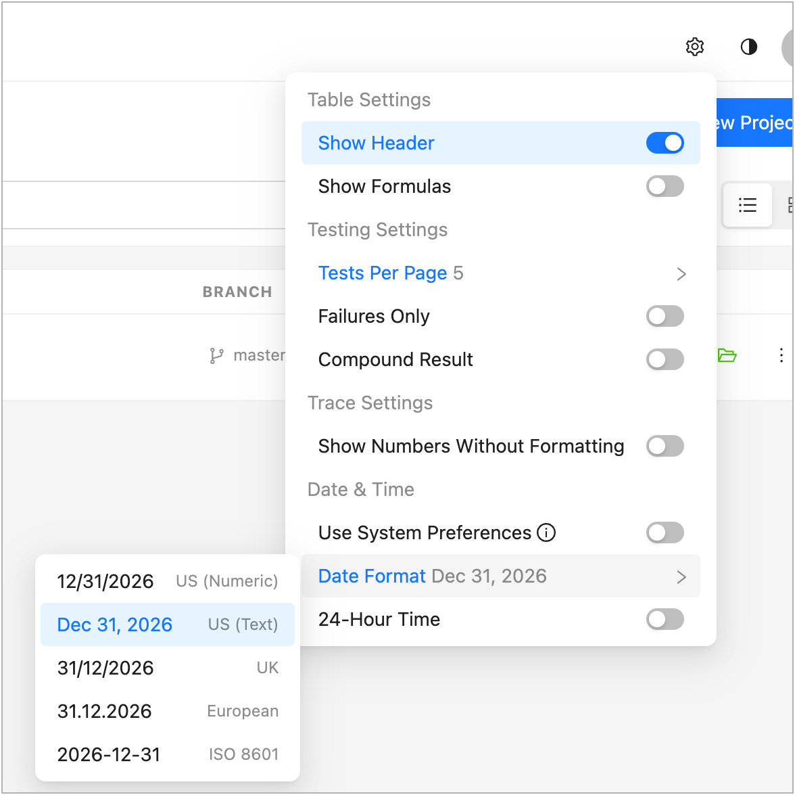

    *My Settings menu*

2.  In the **Table Settings** group, turn the following options on or off:

    -   **Show Header** — display the table header row.
    -   **Show Formulas** — display MS Excel formulas in table cells.

    Whether the tables are drawn in the colours of the OpenL Studio theme or as the Excel file formats them is chosen
    in the theme menu, by the **Excel Formatting** switch described in [Switching the Theme](#switching-the-theme).

3.  In the **Testing Settings** group, configure the following options:

    -   **Tests Per Page** — number of test results displayed per page; point to it and pick 1, 5, 20 or **All**.
        Default is 5.
    -   **Failures Only** — show only failed test cases in the results.
    -   **Compound Result** — display compound test results.

    For more information on testing settings, see [Running Unit Tests](editing-testing.md#running-unit-tests).

4.  In the **Trace Settings** group, turn the following option on or off:

    -   **Show Numbers Without Formatting** — display numeric values without locale-based formatting in the trace view.

The menu stays open while the options are changed. To close it, click the settings icon again or anywhere outside
the menu.

#### Managing Personal Access Tokens

Personal access tokens allow you to authenticate with OpenL Studio APIs without using your password. They are useful for scripts, integrations, and automated tools.

Personal access tokens are available in all multi-user authentication modes — **Multi-user**, **Active Directory / LDAP**, **SSO: SAML**, and **SSO: OIDC (OAuth2)**. The **Personal Access Tokens** item is not displayed in single-user mode.

To create a personal access token, proceed as follows:

1.  In OpenL Studio, in the top-right corner, click the user icon, and in the panel, click **Personal Access
    Tokens**.

    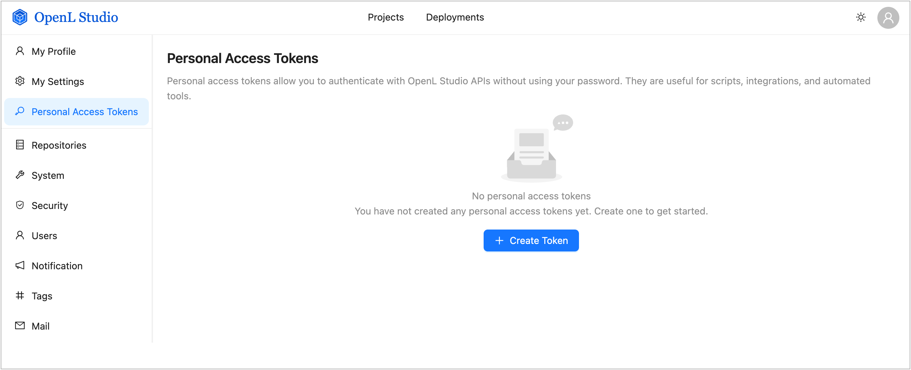

    *Personal Access Tokens page*

2.  Click **+ Create Token**.

    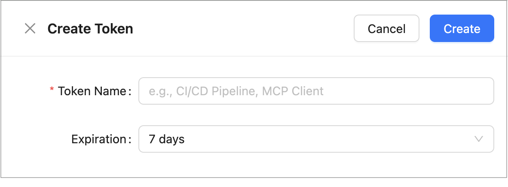

    *Create Token drawer*

3.  In the **Create Token** drawer, enter a **Token Name** that identifies the token's purpose, such as `CI/CD Pipeline` or `MCP Client`.
4.  Select an **Expiration** period: 7 days, 30 days, 60 days, 90 days, a custom date, or no expiration.
5.  Click **Create**.
6.  Copy the generated token value immediately.

    The token is displayed only once and cannot be retrieved after closing the drawer.

    The token can be used in API requests with the following header:

    `Authorization: Token <value>`

To delete a token, in the tokens list, click the delete icon next to the token and confirm the deletion.

### Switching the Theme

To change how OpenL Studio looks, in the top-right corner, click the theme icon next to the user icon. The menu offers independent choices, and each choice applies at once. The menu stays open while you choose, so you can try several themes in a row. To close it, click the theme icon again or anywhere outside the menu.

The first switch selects the appearance. Off, the default, OpenL Studio uses the appearance the operating system asks for and switches along with it. The switch is named after the other appearance:

-   **Dark** — shown while the operating system is light or does not tell its appearance; turning it on keeps OpenL Studio dark
-   **Light** — shown while the operating system is dark; turning it on keeps OpenL Studio light

Once turned on, the switch keeps its appearance even when the operating system later changes its own. Turning it off follows the operating system again, and the switch keeps its name. If the operating system has meanwhile switched to the appearance the switch keeps, clicking the switch leaves it on and turns it to the other appearance instead. The theme icon shows the choice in force: a half-filled circle while OpenL Studio follows the operating system, a sun for light, and a moon for dark.

Under the appearance, the **Compact** switch controls how densely the screens are laid out. Turning it on tightens the spacing, the controls, and the text, so more rows and fields fit on a screen.

Under **Compact**, the **Excel Formatting** switch controls how the tables of the Excel files are drawn. Off, the default, a table is drawn by what its cells mean, in the colours of the theme, light or dark. On, a table is drawn as the Excel file formats it. The switch changes only the screen: the Excel files and the projects are not changed. For more information, see [Viewing Tables](rules-editor.md#viewing-tables).

The second group selects the colour theme, shown beside a dot of its own main colour. **Standard** uses the colours of Ant Design, the component library OpenL Studio is built with. The other themes are colour flavours of popular code editors: each paints the screens, the tables, the code editor of project files, and the code samples of the user guides shown in OpenL Studio in its own colours. Every theme has a light and a dark variant, and the appearance selects between them.

With **Excel Formatting** on, the tables keep the colours Excel shows them in, whatever the theme: black text on white, unless the workbook colours a cell itself. A cell filled in the workbook therefore stays readable in a dark theme as well.

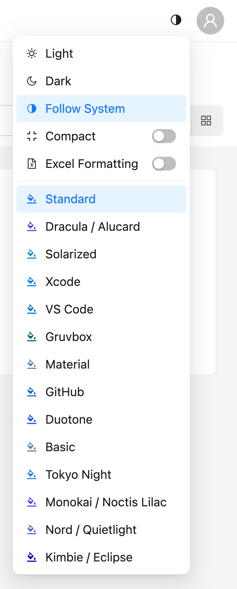

*Choosing the appearance, the density, the look of the tables, and the theme*

The choices are independent: every theme is displayed in either appearance, at either density, with the tables in either look.

New users start with the appearance of the operating system, the **Standard** theme, the comfortable density, and **Excel Formatting** off. The choices are stored in the web browser, so they apply to the same browser on the same computer and are restored on the next sign-in. An appearance is stored only while the appearance switch is on; with it off, nothing is stored, and OpenL Studio follows the operating system. Using a different browser or computer starts from the defaults again.

### Displaying the OpenL Studio Help

To display the OpenL Studio help topics, in OpenL Studio, in the top-right corner, click the user icon and select **Help**.

The **Documentation** section of the help page opens the user guides inside OpenL Studio. They are the guides of the
running version, so they are available without internet access.

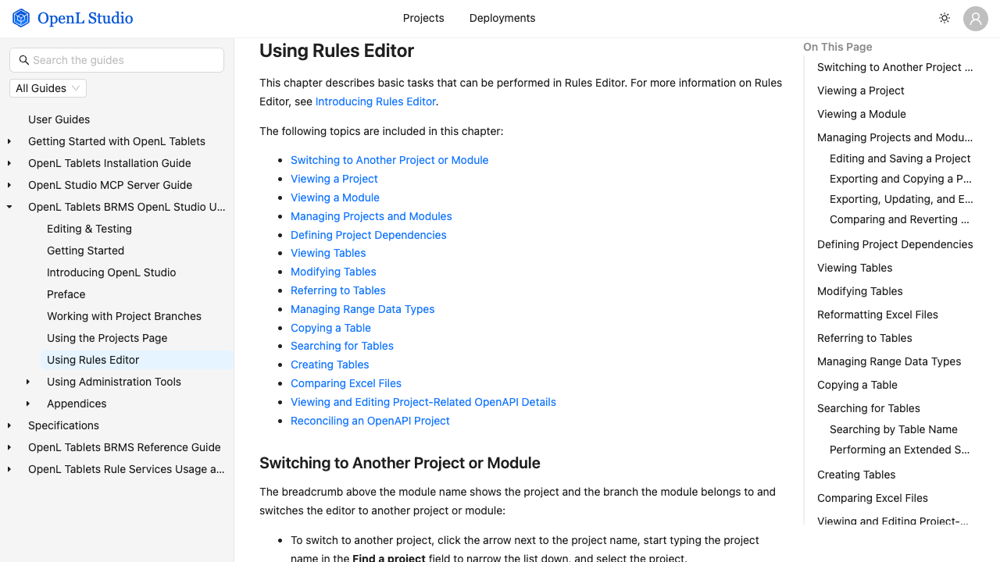

*Reading the user guides inside OpenL Studio*

-   The left pane lists the guides and their pages. Click a page to open it, or click the arrow next to a section to
    expand it. If titles are cut off, drag the right edge of the pane to widen it; the browser remembers the width.
-   The **On This Page** pane on the right lists the sections of the open page. Click a section to scroll to it; the
    browser address then includes the section, so a bookmark opens the page at that section.
-   A link to another page of the guides opens it in the same view; a link to another site opens in a new browser tab.

To find a topic, type in the **Search the guides** box at the top of the left pane. The pane then lists the sections
holding every word typed, the best first; the last word also matches a longer word it begins, so the list follows the
typing. The list under the box narrows the search to a guide or a section the open page belongs to, or widens it back
to **All Guides**. Click a result to open its page at that section, or clear the box to return to the list of pages.

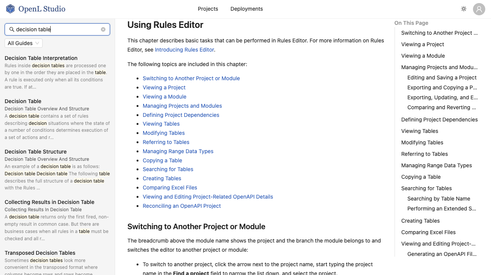

*Searching the user guides*

Every page has an address of its own under `/docs`, the one it has on the documentation site, so it can be bookmarked
or sent to another user of the same OpenL Studio.

### Viewing the Version and Licenses

To view the version and licenses, in the top-right corner, click the user icon and select **About**. The **About OpenL
Studio** window shows the version, build date and license of OpenL Studio, and the third-party libraries it includes
with their licenses. Click a license to open it in a new browser window.

### Signing Out of OpenL Studio

To sign out of OpenL Studio, proceed as follows:

1.  In OpenL Studio, in the top-right corner, click the user icon.
2.  In the panel, click **Sign Out**.

### Introducing Rules Editor

This section briefly introduces Rules Editor and includes the following topics:

-   [Rules Editor Overview](#rules-editor-overview)
-   [View Modes](#view-modes)

For more information on tasks that can be performed in Rules Editor, see [Using Rules Editor](rules-editor.md#using-rules-editor).

#### Rules Editor Overview

**Rules Editor** enables users to browse rule modules and modify table data. It opens when a user selects a module or a table of an open project, for example, in the **Overview** tab of the project page.

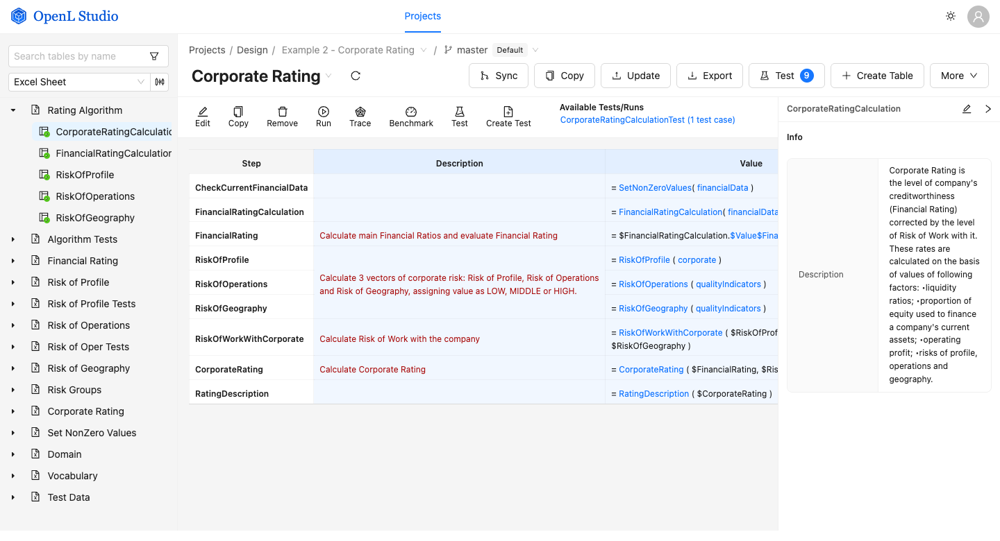

*OpenL Studio Rules Editor*

Rules Editor displays one module at a time. To switch between modules, select a module in the module switcher next to the module name, or use breadcrumb navigation above the module name for quick switching between projects or modules of the current project.

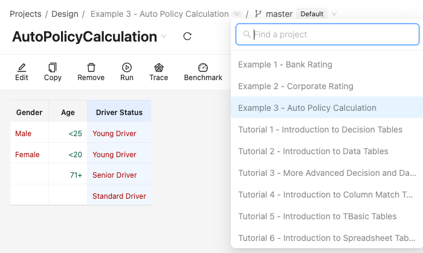

*Rules Editor breadcrumb navigation*

One rule project can contain several modules.

The following table describes Rules Editor organization:

| Pane                     | Description                                                                                                                                        |
|--------------------------|----------------------------------------------------------------------------------------------------------------------------------------------------|
| Left pane                | Displays the module tree providing a list of elements in the currently displayed rule module, with the search field and the view mode above it.  |
| Middle pane              | Displays contents of the table selected in the left pane and provides controls for modifying table data, running tests, and checking test results. |
| Right pane               | Displays **Table Details**, the properties of the currently displayed table.                                                                       |
| Upper part  of the window | Contains the breadcrumb, the module name, and the module actions as described further in this section.                                        |

The following table describes the Rules Editor controls of the module:

| Control                                                                                                                           | Description                                                                                                                                                                                                                                                                                                            |
|-----------------------------------------------------------------------------------------------------------------------------------|------------------------------------------------------------------------------------------------------------------------------------------------------------------------------------------------------------------------------------------------------------------------------------------------------------------------|
| 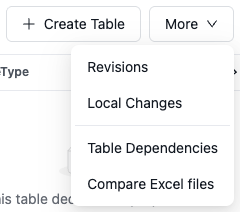                                                                  | **Create Table** opens the table creation window with an immediately editable table skeleton. The **More** menu offers the following options:  - Revisions: displays project revisions.  - Local Changes: opens a window for reverting module changes.  - Table Dependencies: opens a graph displaying dependencies among tables of the module, including the data model, that is which data type extends which and which data type a field refers to. Every data type is drawn as an entity box listing the fields it declares, a vocabulary as a box listing its values, and the data model of each project is framed as an area of its own, apart from the tables that call each other.  - Compare Excel files: initiates a dialog for comparing Excel files.  - Reformat Excel files: formats every table of every Excel file of the project with the OpenL table style, as described in [Reformatting Excel Files](rules-editor.md#reformatting-excel-files). It is offered to a user who can change the project. |
| 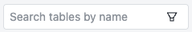                                                                  | Filters the module tree by table name. The filter icon at the end of the field opens the extended search. For more information on performing searches, see [Searching for Tables](rules-editor.md#searching-for-tables).                                                                                                                                                                                                    |
|                                                                   | Refreshes OpenL Studio with the latest changes in Excel files.                                                                                                                                                                                                                                              |
| 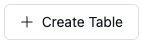                                                                  | Opens the table creation window with an immediately editable table skeleton.                                                                                                                                                                                                                                            |
| 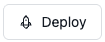                                                                  | Deploys the project. For more information on project deployment, see [Deploying a Project](repository-editor.md#deploying-a-project).                                                                                                                                                                                                        |
| 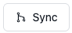                                                                  | Synchronizes and merges the updates made in the specified branches.                                                                                                                                                                                                                                                    |
| 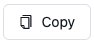                                                                  | Copies the project. For more information on project copying, see [Copying a Project](repository-editor.md#copying-a-project).                                                                                                                                                                                                              |
|                                                                   | Saves the changes and sets the project status to **No Changes**.                                                                                                                                                                                                                                                       |
| 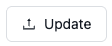 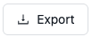 | Updates the current module with the uploaded Excel file. Exports the current version of the module.                                                                                                                                                                                            |

The **Projects** and **Deployments** links in the top bar lead back to the pages of projects and deployments, and the **Administration** item of the user menu in the top-right corner, shown to administrators, opens the administration tools. For more information on administrative functions, see [Using Administration Tools](administration/index.md#using-administration-tools).

#### View Modes

OpenL Studio provides different modes for displaying rule elements. In this guide, modes are contingently divided into a **simple view** and **extended view**.

To switch between views, in the top right corner, click the settings icon and use the **Show Header** and **Show Formulas** options of **My Settings**.

When a table is opened in a simple view, OpenL Studio hides various technical table details, such as table header and MS Excel formulas. An example of a table opened in a simple view is as follows.

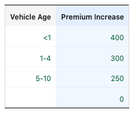

*A rule table in a simple view*

In the extended view, all table structure is displayed. An example of a table opened in an extended view is as follows.

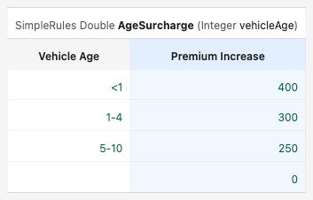

*A rule table in an extended view*

Rule tables can be organized, or sorted, and displayed in the module tree in different way depending on the selected value.

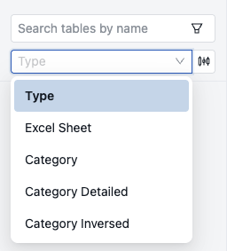

*Modes for sorting tables in the module tree*

By default, tables are sorted by their location in Excel sheets. The mode selected last is remembered by the browser.

Whatever the mode, the utility tables — the tables that do not belong to any known OpenL type, such as comments left beside the rules — are not listed unless asked for: they take no part in the rules, so they are hidden by default. To list them, click the filter button next to the mode, select **Show utility tables** in the **Advanced filter** dialog and click **Apply**. The choice is remembered by the browser.

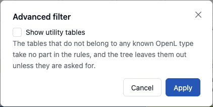

*Advanced filter of the module tree*

| Mode                     | Description                                                                                                                                                                                                                                                                                                                                                                                                             |
|--------------------------|-------------------------------------------------------------------------------------------------------------------------------------------------------------------------------------------------------------------------------------------------------------------------------------------------------------------------------------------------------------------------------------------------------------------------|
| **By Category**          | The tree structure is rather logical than physical.  Rule tables are organized into categories based on the **Category** table property, declared in the table or inherited, such as from the module file name through the properties file name pattern, or, if the property is not defined, based on the Excel table sheet names.  This view is **simple.** An example of a module tree sorted by the category parameter is as follows:  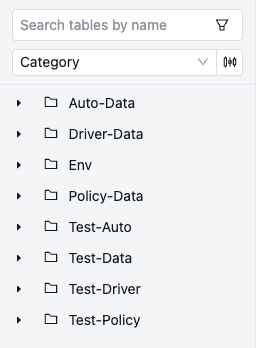  *Module tree sorted by category* |
| **By Category  Detailed** | The **By Category Detailed** view displays modules sorted by the first value of the **Category** property, the values being separated by dashes, as in `Test-Auto`; a category of one value holds its tables itself.  In the following example, the same module tree is sorted by **Category Detailed** and, for example, **Test \> Auto** category is displayed  in the **Test** node and **Auto** sub-node:  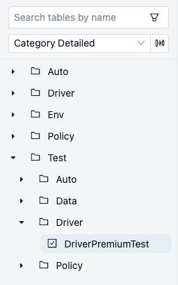  *Module tree sorted by Category Detailed*            |
| **By Category  Inversed** | The following example provides the module tree sorted by **Category Inversed** where modules are sorted by the second value of the **Category** property:  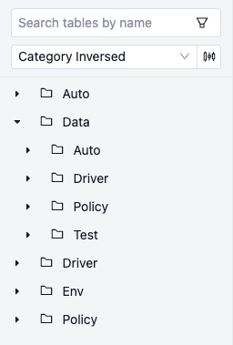  *Module tree sorted by Category Inversed*                                                                                                                                                |

**Note:** If the scope in a **Properties** table is defined as **Module**, in the **By Category** view, this table is displayed in the **Module Properties** sub-node as in the last example. If the scope is defined as **Category**, the table is displayed in the Category **Properties** sub-node.

The two following modes display a project in a way convenient to experienced users, with module tree elements organized by physical structure rather than logically, in an **extended** view.

| Mode        | Description                                                                                                                                                                            |
|-------------|----------------------------------------------------------------------------------------------------------------------------------------------------------------------------------------|
| **By Type** | The tables are gathered by their kind, in this order: Decision, Spreadsheet, TBasic, Column Match, Data, Run, Test, Datatype, Vocabulary, Method, Constants, Conditions, Actions, Returns, Configuration, Other and Properties. A vocabulary, a datatype that declares values rather than fields, stands in a group of its own, apart from the datatypes. Resting the pointer on a group says what it holds. An example of a module tree sorted by type is as follows:  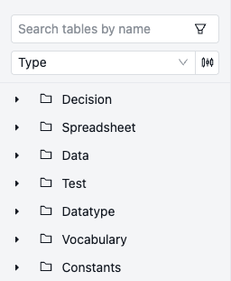  *Module tree sorted by type* |
| **By Excel Sheet** | The following tree is sorted by the order the tables are stored in the Excel file:  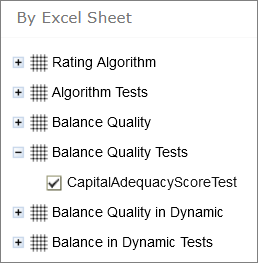  *Module tree sorted by order in the Excel file*         |

### Introducing the Projects Page

The **Projects** page provides controls for browsing and managing Design repository. After the sign-in, OpenL Studio opens the help page; a user opens the **Projects** page by clicking **Projects** or the **OpenL Studio** name in the top bar. The **Deployments** link next to it opens the page of deployments. The **Projects** page resembles the following:

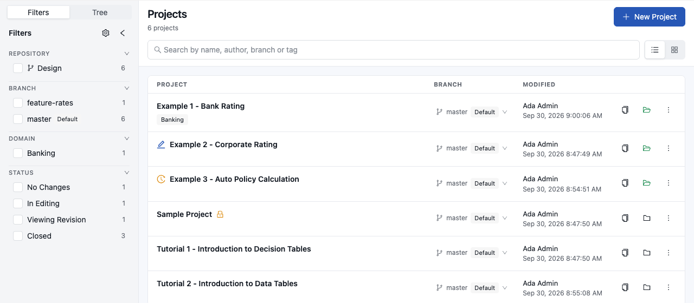

*OpenL Studio Projects page*

The following table describes the organization of the **Projects** page:

| Part                | Description                                                                                                                                                                                                                                                                                                                                                                                      |
|---------------------|--------------------------------------------------------------------------------------------------------------------------------------------------------------------------------------------------------------------------------------------------------------------------------------------------------------------------------------------------------------------------------------------------|
| Left panel          | Shows the **Filters** view, which narrows the list down by repository, branch, tag and status, and the **Tree** view, which shows the projects stored in Design repository and user's workspace as a tree.                                                                                                                                                                                      |
| Project list        | Lists the projects as a table or as cards and offers the actions available for each project, such as copying, opening, closing and deleting a project. **New Project** creates a project.                                                                                                                                                                                                        |
| Project page        | Opens when a user selects a project. Its **Overview**, **Files**, **Deploy Configuration** and **Management** tabs show the configuration, the files and folders, the deployment settings and the access roles of the project. The **Revisions** tab shows history when the repository stores project revisions. Unlike Rules Editor, the project page displays physical project contents in terms of files and folders. |

A user opens Rules Editor from a project page by selecting a module of an open project, for example, in the **Overview** tab.

For more information on tasks that can be performed on the **Projects** page, see [Using the Projects Page](repository-editor.md#using-the-projects-page).
