## Working with Project Branches

This section introduces project branches and describes how to use them. Branches are useful when several users work on the same project simultaneously and then merge the changes or keep them as separate project versions.

The following topics are included in this section:

-   [Creating a Branch](#creating-a-branch)
-   [Working with Branches](#working-with-branches)
-   [Resolving Conflicts](#resolving-conflicts)
-   [Using Protected Branches](#using-protected-branches)

### Creating a Branch

A repository branch can be selected or created while creating a project. This applies to projects created from a
template, Excel files, an OpenAPI file, a ZIP archive, another project, or the user's workspace. Both configured and
user-defined names can be used. For more information on name patterns, see [Setting Up a Connection to a Git
Repository](administration/01-repository-settings/02-git-repository-settings.md#setting-up-a-connection-to-a-git-repository).

Proceed as follows:

1.  On the **Projects** page, click **New Project** and select a creation method.
1.  Select a branch-capable Design repository.
1.  In the single **Branch** field, select an existing branch from the suggestions or enter a valid new branch name.
1.  Complete the remaining fields and click **Create**.

If the entered branch does not exist, OpenL Studio creates it from the repository default branch and writes the new
project there. A project created only in that branch uses it as the home branch. After the project is created, its
page opens. The project list shows it while it is open in the
workspace, or once its branch is picked in the **Branch** filter; other authorized users find it the same way,
without a manual refresh. For more information, see [Filtering and Grouping the Project
Tree](repository-editor.md#filtering-and-grouping-the-project-tree). If the repository is empty, the first project
commit creates the selected branch, including a valid non-default branch. Invalid Git names and names that do not
match the configured branch-name pattern are reported below the **Branch** field before the request is sent.

> [!Note]
> To copy an existing project, select **Copy project** as the creation method. The copy has its own project name and
> target branch.

#### Creating a Branch of an Existing Project

A branch of an existing project starts from the last commit of the branch the project is on. To create it, proceed as follows:

1.  Click the **Copy** icon in the row of the project on the **Projects** page, or click **Copy** on the page of the project.

    The **Copy project** window shows the **Current Branch** and suggests a name in the **New Branch Name** field. The name follows the pattern configured for the repository.

    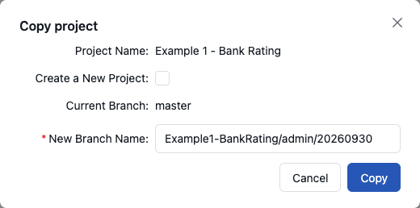

    *Creating a branch of a project*

1.  Enter another name if necessary. Invalid Git names and names that do not match the configured branch-name pattern are reported below the field.
1.  Click **Copy**.

The project moves to the new branch. If the project has unsaved changes, the window warns that the new branch starts from the last commit and moving the project onto it discards them, and asks for the confirmation **I understand the consequences, move to the new branch**. When the project cannot move, OpenL Studio creates the branch and leaves the project on its current branch. Save or discard the changes, and then switch the project to the new branch.

### Working with Branches

This section describes how to view existing branches, switch between them on the project page and in the editor,
inspect project membership, and delete branches. OpenL Studio discovers projects from the current Git tree
of every readable branch. A folder with `rules.xml` is always a project. A folder without the descriptor is also
treated as a project when it has an Excel file in its root and the global
`project.detect-by-excel-files` setting is enabled. This setting is disabled by default. A project that
exists only outside the default branch is represented by a protected branch when one contains it and by the branch
with the newest commit otherwise. While no branch is picked in the **Branch** filter, the project list and the
project tree keep to the default branch of each repository, so such a project is listed once its branch is picked,
or while it is open in the workspace. The branch menu loads the branches that
contain the project when it is opened. Proceed as follows:

1.  To display a current project branch, open a project.

    The current project branch is displayed in the path above the project name, in the **Branch** field of the **Overview** tab, and in the **Branch** column of the **Projects** page. The default branch is marked **Default**, and a protected branch is marked with a shield icon.

1.  To switch between branches, click the branch in the path above the project name, in the **Branch** field of the **Overview** tab or in the row of the project on the **Projects** page. The editor offers the same branch menu above the modules. In the list that appears, select the required branch.

    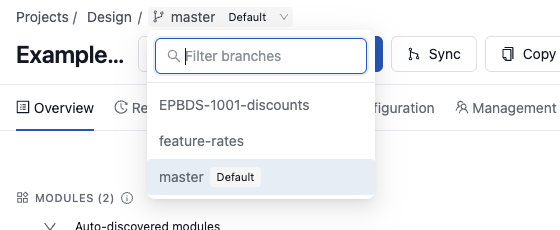

    *Switching between branches*

    The menu lists only the branches whose current content contains the project. Membership is read-only
    because it is discovered from Git content. The **Filter branches** field narrows a long list down.

    If the project has unsaved changes, switching the branch asks to confirm that they are lost.

    To create a copy in another branch, use **New Project** > **Copy project** and select the target branch.
    To remove a project from a branch, switch the project to that branch and use **Delete**.

1.  To delete a non-default branch, switch to this branch and click **Delete Branch** on the page of the project, or click the **Delete Branch** icon in its row on the **Projects** page.

    The non-default branch is deleted completely, it cannot be later restored, and it does not appear in the **Manage
    branches** list. The project in the branch is deleted. If the non-default branch contains commits not merged to the
    default branch, a warning message is displayed upon deletion attempt. A branch on which the project is locked by
    another user cannot be deleted while the lock is held: the lock means that user is editing the project there.

    **Delete Branch** is unavailable in these cases:

    - the branch is the default one;
    - the branch is protected and the user cannot bypass branch protection;
    - the branch is the only one that contains the project and the user cannot delete the project. Deleting that
      branch removes the project, so it takes the same permission as deleting the project. Users who have it are
      warned in the confirmation dialog that the project will be gone.

    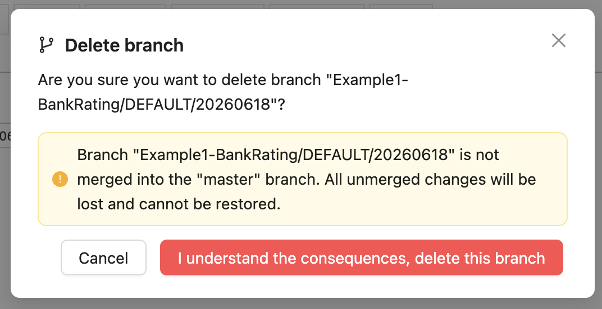

    *Deleting a non-default branch with unmerged commits*

1.  To delete a project from its current branch, switch the project to the required branch and click
    **Delete** on the page of the project.

    The project is deleted from the current branch of Design repository. A project that another branch still holds
    stays in the repository on that branch; while no branch is picked in the **Branch** filter, the project list keeps
    showing it only when the default branch holds it. This change is recorded in repository history.

1.  To merge two branches, click **Sync** and select one of the following options:

    | Option                | Description                                                                   |
    |-----------------------|-------------------------------------------------------------------------------|
    | Receive their updates | Changes from a selected branch are copied to the currently active branch.     |
    | Send your updates     | Changes from the currently active branch are uploaded to the selected branch. |

    **Merge with branch** lists the branches that hold the project. To merge into a branch that does not hold it
    yet — the main branch, for a project created in its own branch — select **Show every branch of the
    repository**. A project whose only branch is the current one offers that wider list right away, so the
    target can always be selected. Synchronizing a clean project introduces it into the selected branch, and the
    dialog says so when the selected branch does not hold the project yet.

    A branch holds every project of the repository, so Sync merges whole branches: it takes in, or sends out, the
    changes of every project the other branch changed, not only those of the current project. As soon as a branch is
    selected, the **Receive their updates** and **Send your updates** tabs show what each option brings in before
    anything is merged:

    -   The current project comes first, marked **Current project**; every other project is marked **Other
        project**, and a note says that their changes are merged too.
    -   Each project shows how many of its files change, and **Added** or **Deleted** when the merge adds or removes
        the whole project.
    -   The files both branches changed are listed under their project as **Changed in both branches**: Sync merges
        them by itself where the changes do not overlap and asks you to resolve the rest.
    -   Files that belong to no project form a group of their own, **Files outside projects**.
    -   Projects you cannot read are only counted.
    -   If Sync cannot tell what an option brings in, its tab says so instead of listing projects. The option can
        still be merged.

    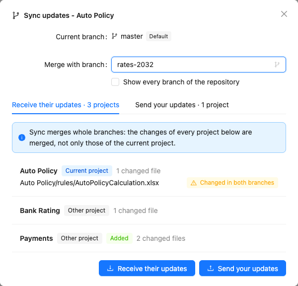

    *What each option of Sync brings in*

    If the updates received in the editor remove the module that is open, the page of the project opens with a
    message that the module is no longer in the project.

    A merge of a large project can take minutes. The dialog waits for it to end, however long it takes, even when
    a proxy stands between the browser and OpenL Studio. Meanwhile the project stays open in the editor, where it can
    be read, run and tested, and the dialog opens it again with the merged changes once the merge has ended. While the
    merge runs, the project cannot be changed — edited, saved, switched to another branch or closed — and another
    merge cannot be started.

    To stop a merge that is running, click **Cancel** next to the merge buttons: while the merge runs, the dialog cannot
    be closed otherwise. The merge stops within seconds and leaves both branches as they were, and the dialog reports
    that the merge was cancelled. A merge that has already started to save its result finishes.

    Once the merge is saved, the **Merge Summary** shows what it changed in the branch it merged into, project by
    project, the current project first. Each file is named by its path from the root of the repository, after the
    icon that marks it added, modified or deleted, as in the file tree of a project. A path too long for the dialog is
    shortened in the middle, keeping the file name, and shows whole when pointed at. A workbook both branches changed
    and Sync merged by itself lists each sheet either branch changed: **taken from** the branch that changed it, or
    **combined from both branches** when both changed it. **Compare** at the end of the row of a modified file of a
    project opens it before and after the merge, so you see what the merge brought in: a workbook is compared element
    by element in the window described in [Comparing Excel Files](rules-editor.md#comparing-excel-files), which opens
    on the comparison itself, with no files to pick, and a text file line by line. A file that is neither, such as a
    library, has nothing to be compared by, and the window says so. A file outside the projects has no **Compare**.
    Projects you cannot read are only counted. The same summary appears after conflicts are resolved with **Save and
    Resolve**. If Sync cannot tell what the merge changed, the dialog closes with a message that the merge succeeded.

    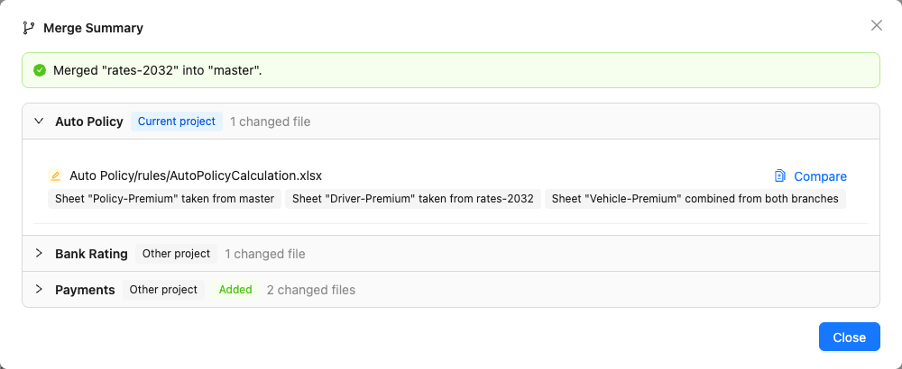

    *What the merge changed, with the sheets of a workbook Sync merged by itself*

    Sync merges the changes of both branches by itself where they do not overlap: a text file line by line, and a
    module workbook sheet by sheet. A sheet both branches changed is merged table by table: a table added, removed,
    changed or moved in one branch only takes the change of that branch. A table both branches changed is merged row
    by row, the way lines of a text file are: rows inserted, deleted or changed in one branch are taken from it, and
    so are columns when a branch inserted or deleted columns of the table. A table that grew or moved in one branch
    keeps the changes the other branch made in it. Each cell changed in one branch takes the change of that branch.
    The value, the style and the comment of a cell are merged separately, so one branch can change the text of a
    cell and the other its style. Such a sheet stays a conflict in the following cases:

    -   Both branches change the value, the style or the comment of the same cell, the height or the visibility of
        the same row, the width or the visibility of the same column, the default column width or row height, the
        merged cells of the same table or the pictures of the sheet differently.
    -   Both branches insert different rows at the same place of a table, one branch inserts a row next to a row
        the other branch deletes, or one branch deletes a row the other branch changes. Columns follow the same
        rule.
    -   One branch inserts or deletes rows of a table and the other branch inserts or deletes columns of it.
    -   Both branches move the same table to different places, or one branch removes a table the other changes.
    -   A row or a column one branch inserts or deletes crosses merged cells the other branch keeps.
    -   Tables of the two branches would touch each other and be read as one: OpenL ends a table at an empty row
        or column.
    -   A branch merges cells over a value the other branch wrote.
    -   Content that moves is referred to by a formula, a defined name, a data validation, a conditional formatting
        or a hyperlink, which would refer to other cells after the merge, or lies under a picture, a chart, an Excel
        table or an autofilter, which would stay where it was.
    -   A branch changes the height or the visibility of a row, or the width or the visibility of a column, where
        content moves.
    -   The branch whose changes are merged in changes the data validation, the conditional formatting, the
        hyperlinks or the frozen panes of the sheet. It is the selected branch for **Receive their updates** and the
        current branch for **Send your updates**.
    -   Both branches add a sheet with the same name and different content, or one branch removes a sheet the other
        changes.

    If Sync finds such a conflict, or both branches changed the same place of any other file, the **Resolve
    Conflicts** dialog appears.

    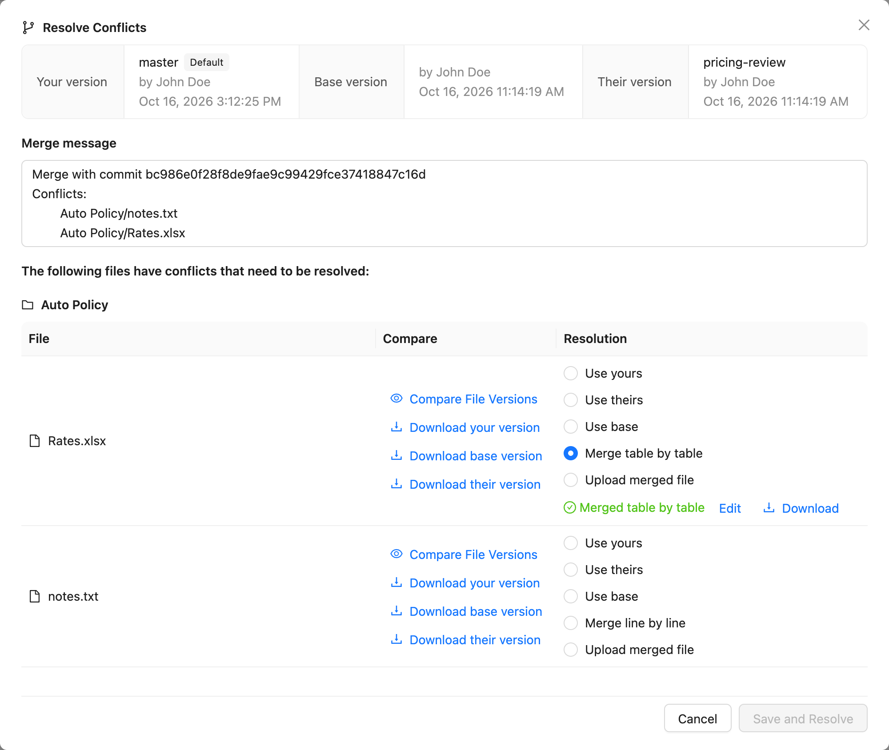

    *Resolving conflicts on merging branches*

    Conflicts can be resolved by selecting one of the following options:

    -   **Use yours** — changes in the currently active branch are applied on merge. The changes applied by another
        user are lost.
    -   **Use theirs** — changes in the selected branch are applied on merge. The changes made by you are lost.
    -   **Use base** — the common base version of the file is applied on merge. Changes from both branches are
        discarded.
    -   **Merge line by line** — the changes of both branches are combined, and you decide only the lines both
        branches changed, as described below. The option is offered for a text file written in UTF-8 that both your
        version and their version hold, and not for an Excel file or another binary file.
    -   **Merge table by table** — the changes of both branches are merged the way Sync merges them, and you decide
        only the tables and the sheets both branches changed in ways Sync cannot combine, as described below. The
        option is offered for an Excel file that your version, their version and the base version hold.
    -   **Upload merged file** — depending on the selected merging options, changes in the manually updated and
        uploaded file override changes in the branch.

    **Merge line by line** opens the file in a window of its own, laid out in three columns as Git merge tools lay
    it out: **Your Version** on the left, the **Result** in the middle and **Their Version** on the right. The file is
    shown part by part, each part at the same height in all three columns, its lines numbered as in the version of
    the column. Lines no branch changed read alike in every column; a long run of them shows its first and last
    lines, and the link between them shows the rest. Lines only one branch changed, or both changed alike, are
    merged the way Sync merges them, and the note above the result says which version they were taken from.

    Each place both branches changed is a conflict, headed by its number and by whether it is resolved. Each version
    shows every line its branch has in that place, even the lines both versions start or end with, and until the
    conflict is resolved the result shows the base lines, the ones both branches started from. A conflict is
    resolved with the buttons above its lines, or in its result:

    -   **Take Yours** or **Take Theirs** takes the lines of one version into the result.
    -   **Add Yours** or **Add Theirs**, offered once the other version is taken, adds the lines of this version after
        it, so the result holds both versions whole: for example, the modules both branches added to `rules.xml`.
    -   **Discard Changes** keeps the base lines, without the changes of either branch.
    -   Lines typed in the result take the place of the conflict, which is then marked **Edited**.

    **Apply** is available once every conflict is resolved. It closes the window, and the dialog marks the file
    **Merged line by line**; **Edit** next to the mark opens the window again with the conflicts resolved as you left
    them. The merged file keeps the line breaks the file is written with, and **Save and Resolve** saves it as it
    saves an uploaded file.

    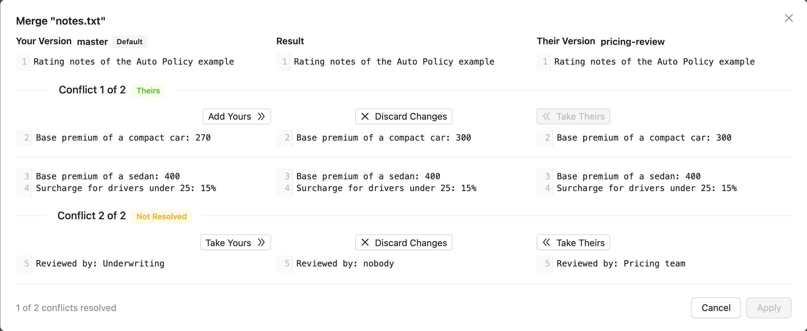

    *Merging a conflicting text file line by line*

    **Merge table by table** opens the workbook in a window of its own, laid out the same way: **Your Version** on
    the left, the **Result** in the middle and **Their Version** on the right. Each sheet with conflicts has a tab,
    which tells how many of its conflicts are left. A sheet Sync merges by itself, taken from the one branch that
    changed it or combined from both, has nothing to resolve and no tab; the summary of the merge lists it.

    A conflicting sheet lists its conflicting tables, each headed by its number, its name and whether it is resolved,
    with the reason Sync cannot merge it, such as both branches changing the same cells. The cells both branches
    changed differently are listed under the reason, each with what your and their version hold in it, and framed in
    red in every version. Each version shows the table as its branch has it, in its own formatting: the other cells
    whose value, formula, comment or merging the branch changed are framed in orange, the rows and the columns it
    inserted included. A change of formatting alone, such as another font, frames the whole table with a dashed
    line, marked **Formatting Changed**, and when both branches changed the formatting of the table the reason says
    so. A new default font of the workbook changes the font of every cell written in it. A change both branches made
    alike, such as the formatting a save gives every table, is not marked. The line above the tables explains the
    frames. Until the table is resolved the result shows the table of the base version.

    A table with such cells shows only the rows around them, the same rows in every version, when that leaves out at
    least five rows; **Show Whole Table** shows every row and **Show Conflict Rows** goes back. A version of a table
    longer than 200 rows shows its first 200 rows, and a sheet with more than five conflicting tables shows them five
    at a time, with the pages under them.
    A table is resolved as a whole:

    -   **Take Yours** or **Take Theirs** takes the table from one version, with every change that branch made to it.
        The changes the other branch made to the table are left out.
    -   **Discard Changes** keeps the table of the base version, without the changes of either branch.

    A table one branch moved, or pushed down with rows it inserted above it, stays at its new place whichever version
    is taken. Tables their branch added next to a table your branch added at the same place are one conflict.

    **Whole Sheet** above the tables takes the whole sheet from your version, from their version or from the base
    version, which resolves all its tables at once; **Table by Table** leaves them to be resolved one by one again. A
    sheet whose conflict lies outside its tables, such as a sheet one branch removed and the other one changed, or
    the height of a row both branches changed differently, is resolved only as a whole: the window tells why, and
    which versions have the sheet. So is a sheet whose tables would move content a formula refers to, whichever
    version they are taken from. **Compare Versions** next to the reason opens the workbook in the window described
    in [Comparing Excel Files](rules-editor.md#comparing-excel-files), with what each branch changed in it. A sheet
    taken from a version that does not have it is removed. An .xls workbook whose colour palette both branches
    changed differently shows the palette above the sheets, taken with **Take Yours** or **Take Theirs**.

    **Apply** is available once every conflict is resolved. OpenL Studio merges the workbook, and the dialog marks the
    file **Merged table by table**; **Edit** next to the mark opens the window again with the decisions made, and
    **Download** saves the merged workbook. **Save and Resolve** saves it as it saves an uploaded file. If the tables,
    as resolved, would touch each other or move content a formula or another cell refers to, the window says so; take
    the whole sheet from one version then. To combine the changes of both branches inside one table, take one version
    and edit the table in the editor after the merge, or download the merged workbook, edit it in Excel and upload it
    with **Upload merged file**.

    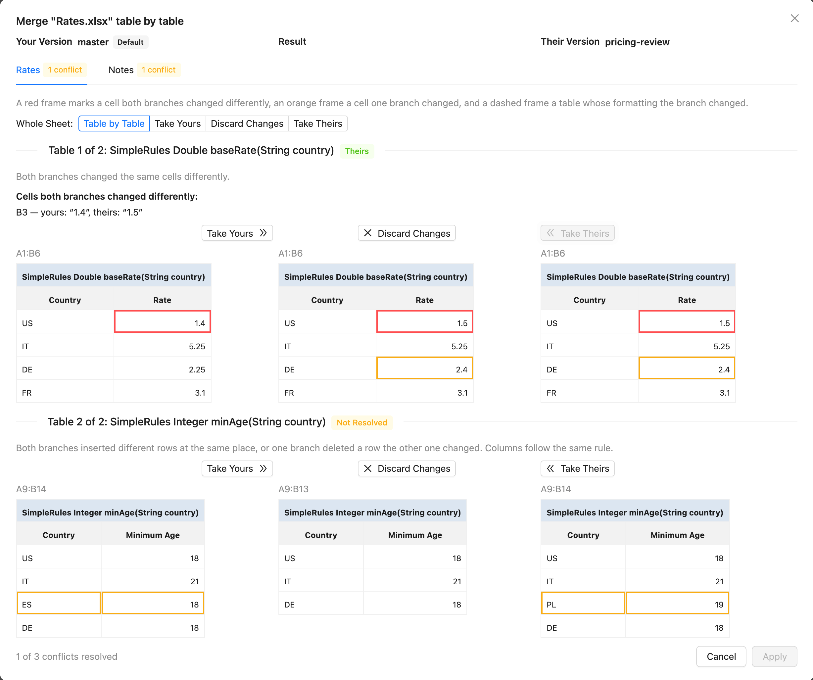

    *Merging a conflicting workbook table by table*

1.  To view the changes made by another user, compare them to your changes, or view the base version of the file, select a corresponding option in the **Compare** column.

    **Compare File Versions** opens a window that shows what the branches changed in the file. The window names
    the file, says whether the merge modified or deleted it, and offers three views of it:

    -   **Your Changes** compares the base version, the one both branches started from, with the version of the
        current branch.
    -   **Their Changes** compares the base version with the version being merged in. It shows what the other branch
        changed. The window opens on this view.
    -   **Both Versions** compares the version of the current branch with the version being merged in.

    The versions stand as merge tools lay them out: your version on the left, their version on the right and the
    base version between them, so **Your Changes** shows your version left of the base. A view is available only
    when both versions it compares hold the file, and the other views are dimmed: a file both branches added has no
    base version, so only **Both Versions** is available, and a file one branch deleted is compared only with the
    base version, as the other branch changed it. An Excel file is compared element by element, as described in
    [Comparing Excel Files](rules-editor.md#comparing-excel-files), with the **Show equal elements** and **Show
    equal rows** check boxes heading the list of elements. A text file is compared line by line: a line only the base
    version has is marked `-` and a line only the branch version has is marked `+`, and in **Both Versions** a line
    only your version has is marked `-` and a line only their version has is marked `+`. A text file not written in
    UTF-8, such as a properties file in ISO-8859-1, is read as Western European text (Windows-1252). A file no view
    can be offered for has nothing to be compared with, and neither has a file that is neither text nor an Excel
    file, such as a library; the window says so.

    Download links are available only for versions in which the conflicted file exists. The **Compare** column marks
    a deleted file as **Deleted in your version**, **Deleted in their version**, or **Deleted in base version** instead
    of offering a download.

    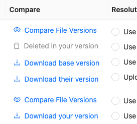

    *A deleted version is shown as a status instead of a download action*

### Resolving Conflicts

If the same version of the project is edited by several users, saving combines their changes the way Sync does:
changes in other lines of a text file and in other cells of a workbook sheet are merged without a question. When the
users changed the same place, upon submitting their changes using different clients, the **Resolve Conflicts** dialog
appears, listing the conflicting files and the resolution options for each one.

The dialog also appears when a project is renamed and saved, then an earlier revision is opened and renamed again.
The project remains available to the dialog under the identifier issued after the first rename.

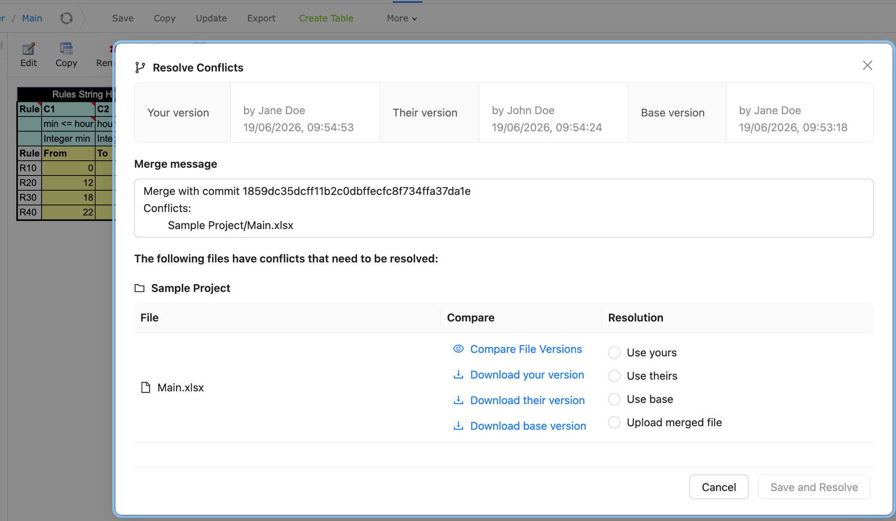

*Resolving conflicts upon saving concurrent changes*

The dialog contains the **Compare File Versions** link that opens, in a window of its own, what the other user
changed against the version both users started from, what you changed, or the two conflicting versions side by side,
as for a merge. As in a merge, **Merge line by line** in the **Resolution** column of the dialog resolves a
conflicting text file in place, and **Merge table by table** a conflicting workbook.

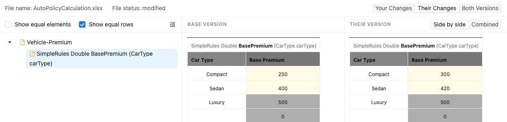

*Comparing conflicting versions*

### Using Protected Branches

OpenL Tablets allows defining a list of protected branches for Git design repository to avoid pushing erroneous changes into main or release branches.

If a branch is marked as protected, all actions that can impact Git history, such as deleting a project or synchronizing to a protected branch, are forbidden. In this case, separate branches are modified and then merged into the protected branch only via the Git CI process.

An action refused this way, such as creating a project in a protected branch, is reported in the dialog where it was started, with the name of the protected branch.

Branches can be defined as protected using the following property:

```
repository.design.protected-branches
```

Branches must be separated by comma.

Wildcards can be used to specify a group of branches, such as release-\*, so all branches that start with release- keyword are protected.

By default, branches are not protected.

Branches can also be defined as protected in the OpenL Studio administration navigation menu as described in [Setting Up a Connection to a Git Repository](administration/01-repository-settings/02-git-repository-settings.md#setting-up-a-connection-to-a-git-repository).
