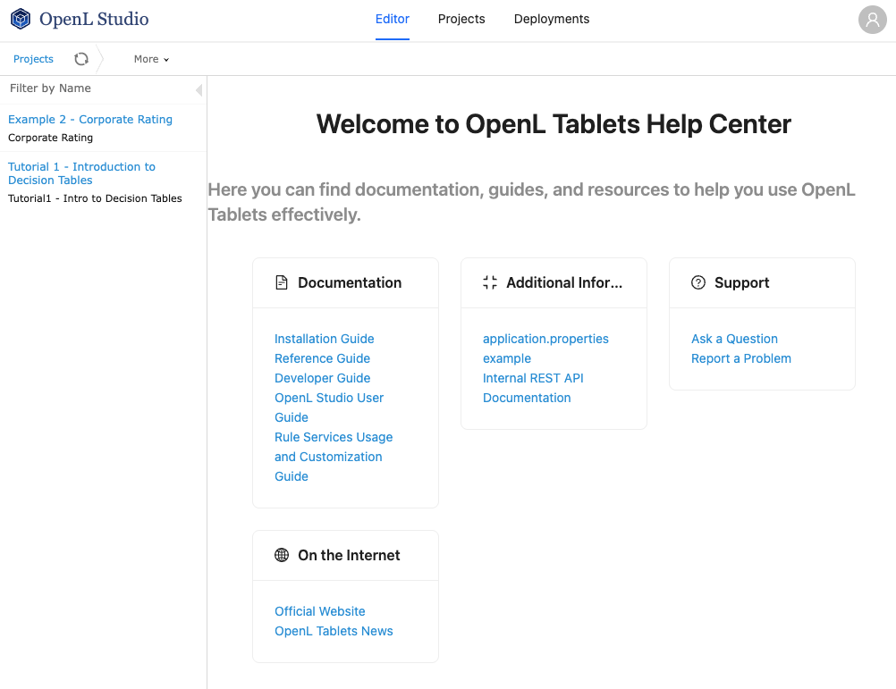

### Tutorials and Examples

OpenL Tablets provides a number of preconfigured projects developed for new users who want to learn working with OpenL Tablets quickly.

These projects are organized into following groups:

-   [Tutorials](#tutorials)
-   [Examples](#examples)

#### Tutorials

OpenL Tablets provides a set of the tutorial projects demonstrating basic OpenL Tablets features starting from very simple and following with more advanced projects. Files in the tutorial projects contain detailed comments allowing new users to grasp basic concepts quickly. For the list of tutorials, see [Getting Started > Tutorials](../../getting-started/tutorials.md).

To create a tutorial project, in OpenL Studio, create a project from template and select a tutorial in the **Tutorials** category as described in [OpenL Studio Guide > Creating a Project from Template](../../openl-studio/repository-editor.md#creating-a-project-from-template).

To view the rules of the project, click the name of a module on the **Overview** tab of the project page. It is highly recommended to start from reading Excel files for examples and tutorials which provide clear explanations for every step involved.

*Tutorial project in OpenL Studio*

#### Examples

In addition to tutorials, OpenL Tablets provides several example projects that demonstrate how OpenL Tablets can be used in various business domains. For the list of examples, see [Getting Started > Tutorials](../../getting-started/tutorials.md#example-1---bank-rating).

**Example-4-Reference-Guide** follows the chapters of this guide. It holds an example of every table type this guide describes, of the BEX language syntax, and of every built-in function, each with a test table, so running its tests shows the result of every example. For the list of its workbooks, see [Getting Started > Tutorials](../../getting-started/tutorials.md#example-4-reference-guide).

To create an example project, follow the steps described in [Tutorials](#tutorials) but select the **Examples** category instead of **Tutorials**. When completed, the example appears in the OpenL Studio Editor.
