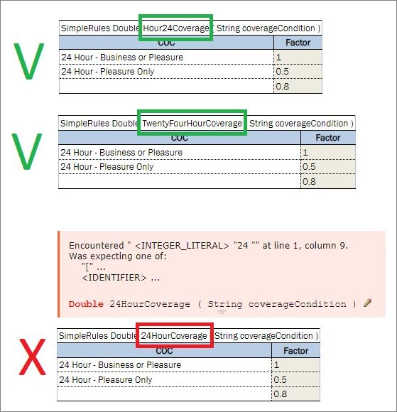

### Naming Conventions

The following conventions apply to the rule, field, and function names:

-   The name follows the rules of a Java identifier, as `Character.isJavaIdentifierStart` and
    `Character.isJavaIdentifierPart` define them.
-   The first character is a letter of any script, such as `A`, `é`, `я`, `名` or `면`, a currency sign such as `$`, or
    a connecting character such as `_`.
-   The other characters are these characters, digits of any script, and combining marks.
-   A name cannot start with a digit, and it contains no spaces, operators or other punctuation.

For example, `Hour24Coverage`, `_rate`, `Größe` and `면간거리` are correct names, and `24HourCoverage` and
`Rate-A` are not.

*Examples of correct and incorrect rule table names*
