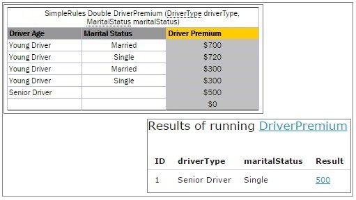

##### Decision Table Interpretation

Rules inside decision tables are processed one by one in the order they are placed in the table. A rule is executed only when all its conditions are true. If at least one condition returns false, all other conditions in the same row are ignored.

Blank parameter value cell of the condition is interpreted as a true condition and this condition is ignored for a particular rule row or column. If the condition column has several parameters, the condition with all its parameter cells blank is interpreted as a true condition.

A condition whose expression does not return a Boolean value holds when the value of the expression equals the value of its cell or, for a cell of several values, one of them. The expression can have a wider type than the column, such as `map.get("key")`, `list[0]` or `map.get(key)` with the key taken from another column, which are of type `Object`. The type of its value is then checked when the rules run:

- a value of the column type is compared as it is;
- a value that OpenL Tablets converts to the column type when passing it to a rule is converted, so `1` equals the value `1.0` of a `Double` column;
- an empty value equals no value of the column;
- any other value, such as the text `"true"` for a `Boolean` column, stops the call with an error such as `Condition 'C1' of table 'byFlag' expects a value of type 'Boolean', but got 'true' of type 'String'.`

When every rule still in question leaves the condition blank, the expression of the condition is not calculated, so the rules it calls are not run. When some of these rules have a value in the condition, the expression can be calculated once for the whole table, even for a rule whose cell is blank.

**Note:** As OpenL Tablets returns the first true condition, it is a good practice to list all possible non-blank parameters and their combinations in case of multiple conditioning first, and then list the blank parameters.

Blank parameter value cell of the return/action column is ignored, the system does not calculate the return/action expression of the current rule and starts processing the next rule. If the return/action column has several parameters, all parameters cells need to be blank to ignore the rule.

If the empty return value is calculated by the expression, the system starts processing the next rule searching for a non-empty result.

The following example contains empty case interpretation. For **Senior Driver**, the marital status of the driver does not matter. Although there is no combination of **Senior Driver** and **Single** mode, the result value is 500 as for an empty marital status value.

*Empty case interpretation in the Decision table*
