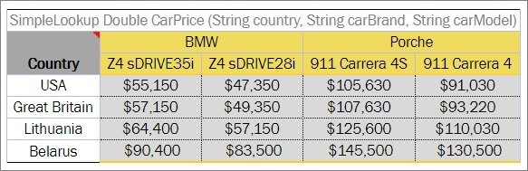

##### Simple and Smart Lookup Tables

This section introduces lookup tables and includes the following topics:

-   [Understanding Lookup Tables](#understanding-lookup-tables)
-   [Merged Horizontal Condition Values](#merged-horizontal-condition-values)
-   [Lookup Tables Implementation Details](#lookup-tables-implementation-details)
-   [Simple Lookup Table](09-simple-lookup-tables.md#simple-lookup-table)
-   [Smart Lookup Table](10-smart-lookup-tables.md#smart-lookup-table)

###### Understanding Lookup Tables

A **lookup table** is a special modification of the decision table which simultaneously contains vertical and horizontal conditions and returns value on crossroads of matching condition values.

That means condition values can appear either on the left of the lookup table or on the top of it. The values on the left are called **vertical** and values on the top are called **horizontal**. Any lookup table must have at least one vertical and at least one horizontal value.

*A lookup table example*

###### Merged Horizontal Condition Values

Values of horizontal conditions can be merged instead of being repeated:

-   A value merged across several columns applies to each of these columns.
-   A value merged down over several rows makes its horizontal condition take all these rows, as long as every other value in these rows is merged down the same way. A column empty in all these rows does not count. A simple or smart lookup table counts its horizontal conditions by the values down its last column, so merge the values of every column the same way. In a rules table, rows whose values are merged differently are horizontal conditions of their own, and the merged value applies to each of them.
-   If the table returns an array, does not use the `Collect` keyword, and its return takes one column, a value merged across several columns returns the values of all these columns as one array, from left to right. In a rules table, the RET column decides: it returns the array when its parameter is declared as an array, such as `Double[] rates`, or when it has neither a parameter nor an expression and the table returns an array. A RET column with any other parameter, or with an expression and no parameter, keeps a rule for each column. Empty cells at the end of the array are dropped, so values merged over a different number of columns return arrays of different sizes. Each of these columns holds one element of the array: a list written with commas in one of their cells is not split, so a list of numbers is reported as an error and a text keeps its commas. A value over one column is still read as a list.

For example, in the smart lookup table `SmartLookup Double Deductible(String coverage, String region, String tier)`, each region value is merged down over two rows, and the tier values are written in the third row. The title `Coverage` of the first column is merged over all three rows.

In the smart lookup table `SmartLookup Double[] DeductibleOptions(String coverage, String region, String tier)`, the region value `North` is merged down over two rows and across four columns, and the tier value `Basic` under it is merged across three of these columns. For the `Collision` coverage in the `North` region, the table returns the three values under `Basic`, `[250, 500, 1000]`, and the one value under `Premium`, `[100]`.

###### Lookup Tables Implementation Details

This section describes internal OpenL Tablets logic.

At first, the table goes through parsing and validation.

-   On parsing, all parts of the table, such as header, columns headers, vertical conditions, horizontal conditions, return column, and their values, are extracted.
-   On validation, OpenL checks if the table structure is proper.

Then OpenL Tablets transforms a lookup table into a regular decision table internally and processes it as a regular decision table.
