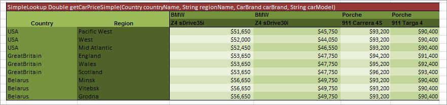

###### Simple Lookup Table

A lookup decision table with simple conditions that check equality of an input parameter and a condition value and a simple return can be easily represented as **simple lookup table**. This table is similar to simple rules table but has horizontal conditions. The first column title cell is merged on all rows that hold horizontal condition values. Each horizontal condition takes one of these rows, or several rows when its values are merged down, as described in [Merged Horizontal Condition Values](08-lookup-tables-overview.md#merged-horizontal-condition-values).

The simple lookup table header format is as follows:

`SimpleLookup <Return type> RuleName(<Parameter type 1> parameterName1, (<Parameter type 2> parameterName2,….)`

The following is an example of a simple lookup table.

*Simple lookup table example*
