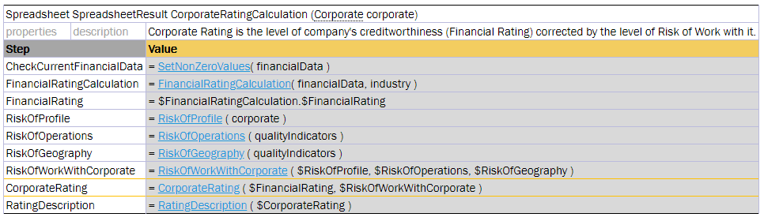

##### Accessing Spreadsheet Result Cells

A value of the SpreadsheetResult type means that this is actually a table, or matrix, of values which can be of different types. A cell is defined by its table column and row. Therefore, a value of a particular spreadsheet cell can be accessed by cell’s column and row names as follows:

```
<spreadsheet result variable>.$<column name>$<row name>
```

or

`$<column name>$<row name>(<spreadsheet result variable>)`

If a spreadsheet has one column only, besides the column holding step names, spreadsheet cells can be referenced by row names. If there is one row and multiple columns, a cell can be referenced by the column name.



*Referencing a cell by a row name*

The same functionality is available in test tables as described in [Testing Spreadsheet Result](07-testing-spreadsheet-result.md#testing-spreadsheet-result).

In a spreadsheet formula, `this.$<cell name>` refers to a cell of the spreadsheet table containing the formula.
`current.$<cell name>` has the same meaning when no variable named `current` is in scope. Both qualifiers use the
current column or row in a spreadsheet with multiple columns or rows. If `current` is also an input parameter,
references through it use the parameter. Inside an
[array index operator](../../../03-functions-and-data-types/04-working-with-arrays.md#array-index-operators-and-arrays-of-the-spreadsheetresult-type),
an unqualified `$<cell name>` refers to the array element. OpenL warns inside an array index operator when
`current.$<cell name>` uses an input parameter and that cell also exists in the spreadsheet. Use `this` for the
spreadsheet cell. A one-row or one-column spreadsheet also supports the simplified column or row name.

The spreadsheet cell can also be accessed using the `getFieldValue(String <cell name>) `function, for instance, `(Double) $FinancialRatingCalculation.getFieldValue ("$Value$FinancialRating")`. This is a more complicated option.

**Note:** If the cell name in columns or rows contains forbidden symbols, such as space or percentage, the cell cannot be accessed. For more information on symbols that are not allowed, see Java method documentation.
