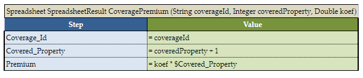
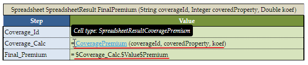
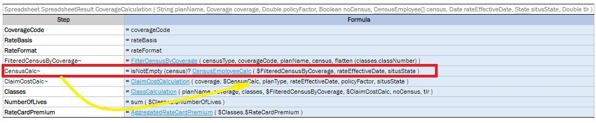
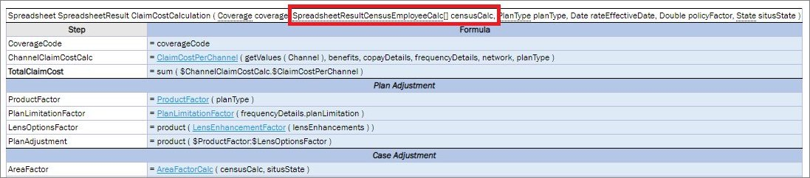
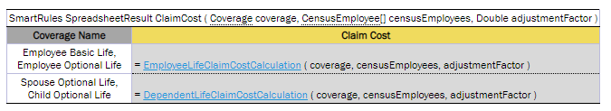

##### Custom Spreadsheet Result

Usage of spreadsheet tables that return the SpreadsheetResult type is improved by having a separate type for each such spreadsheet table, that is, custom SpreadsheetResult data type, which is determined as follows:

```
SpreadsheetResult<Spreadsheet table name>
```

Custom SpreadsheetResult data type is automatically generated by a system and substitutes common SpreadsheetResult type. This provides the following advantages:

-   The system understands the structure of the spreadsheet result, that is, knows names of columns and rows, and data types of cell values.

    In other words, there is no need to indicate a data type when accessing the cell.

-   Test spreadsheet cell can be of any complex type.

    For more information on test spreadsheet result, see [Testing Spreadsheet Result](07-testing-spreadsheet-result.md#testing-spreadsheet-result).

To understand how this works, consider the following spreadsheet.



*An example of a spreadsheet*

The return type is **SpreadsheetResult**, but it becomes **SpreadsheetResultCoveragePremium** data type. Now it is possible to access any calculated cell in a very simplified way without indicating its data type, for example, as displayed in the following figure.



*Calling Spreadsheet cell*

In this example, the spreadsheet table cell is accessed from the returned custom spreadsheet result.

There is no need to specify a custom SpreadsheetResult data type in the header of the spreadsheet table itself. The return data type is still SpreadsheetResult. Only when passing such spreadsheet as input to another table, the full name must be declared. For example, if the CensusEmployeeCalc spreadsheet is an input parameter for the ClaimCostCalculation spreadsheet, (SpreadsheetResultCensusEmployeeCalc censusCalc) must be included in the list of inputs.



*Example of calling a spreadsheet to be used as input*



*Using a custom spreadsheet as an input parameter*

##### United Spreadsheet Result

The combined SpreadsheetResult type is used when the rules table returns different SpreadsheetResults to prevent the cell type loss. The united SpreadsheetResult is returned in the following cases:

-   A rule returns SpreadsheetResult.
-   Different spreadsheets are called in a ternary operation.

    For more information on ternary operations, see [Ternary Operator](../../../03-functions-and-data-types/03-working-with-functions.md#ternary-operator).

-   The array of SpreadsheetResult is created by united spreadsheet cells (\$Step1:\$Step10).



*Example of a rule returning a united spreadsheet result*

A united spreadsheet result can be used as an input parameter.

-   If the united spreadsheet result is generated as a result of the rule returning spreadsheet results, the input parameter has the (SpreadsheetResultSpreadsheetName inputValueName) format. **Example:** SpreadsheetResultClaimCost claimCostCalc.
-   If the united spreadsheet result is generated as a result of the ternary operation of by uniting spreadsheet cells, the input parameter has the (SRSpr1 & SRSpr2 ruleName) format.

An example is as follows:

```
Rate = coverage.fundingType == "FullyInsured" ? RateCalculation ( rateBasis, $TotalVolume, $NumberOfLives, $MonthlyPremiumPreliminary) : ASORate (calculatedClass.$TotalNetClaimCost, TLR, $NumberOfLives, coverage)
```

If passing results of the Rate step to another rule, the type of the spreadsheet defined in this step is a united spreadsheet SRASORate & SRRateCalculation.
Its steps are those of `ASORate`, then those of `RateCalculation`: the spreadsheets come in the order of their names,
whatever their order in the ternary operation.

A rule returning a united spreadsheet result can call itself:

-   Each version of the rule can call the rule, and the call is dispatched again.
-   A Spreadsheet table of the same name has the same united spreadsheet result, so it can call the rule, and the rule
    can call it.
-   The call returns the united spreadsheet result and adds no steps to it.
-   The steps the results of the rule bring cannot be read in the rule or in any of its versions, since they are added
    only when all versions are compiled: the rule passes on or returns the result of the call as it is. The steps of
    a Spreadsheet table of the same name can be read.
-   The steps of the rule and its versions come first, then those of the Spreadsheet tables of the same name, each in
    the order of the tables in the module.
-   Two rules returning united spreadsheet results that call each other are not compiled, even through the id of a
    rule, since the steps of each depend on the other: the
    `Type 'SpreadsheetResult<rule name>' compilation failed with circular reference issue.` error is reported.

When fields in a united spreadsheet result receive numeric suffixes to keep their generated names unique, OpenL
preserves the suffixes after applying a property naming strategy. For example, `Code` and `code` become `code` and
`code1` with the lower camel case strategy.
