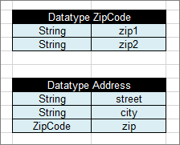
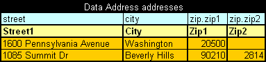
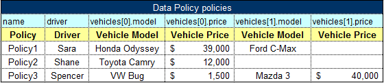
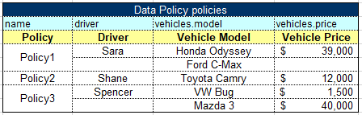

##### Specifying Data for Aggregated Objects

Assume that the data, which values are to be specified and stored in a data table, is an object of a complex structure with an attribute that is another complex object. The object that includes another object is called an **aggregated object**. To specify an attribute of an aggregated object in a data table, the following name chain format must be used in the row containing data table attribute names:

`<attribute name of aggregated object>.<attribute name of object>`

To illustrate this approach, assume there are two data types, `ZipCode` and `Address,` defined:

*Complex data types defined by Datatype tables*

In the data type structure, the `Address` data type contains a reference to the `ZipCode` data type as its attribute `zip`. An example of a data table that specifies values for both data types at the same time is as follows.

*Specifying values for aggregated objects*

In the preceding example, columns **Zip1** and **Zip2** contain values for the `ZipCode` data type referenced by the `Address` aggregated data type.

**Note:** The attribute name chain can be of any arbitrary depth, for example, `account.person.address.street`.

If a data table must store information for an array of objects, OpenL Tablets allows defining attribute values for each element of an array.

**The first option** is to use the following format in the row of data table attribute names:

`<attribute name of aggregated object>[i].<attribute name of object>`

where `i` – sequence number of an element, starts from 0.

The following example illustrates this approach.

*Specifying values for an array of aggregated objects using the flatten structure*

The first policy, **Policy1**, contains two vehicles: **Honda Odyssey** and **Ford C-Max**; the second policy, **Policy2**, contains the only vehicle **Toyota Camry**; the third policy, **Policy3**, contains two vehicles: **VW Bug** and **Mazda 3**.

**Note:** The approach is valid for simple cases with an array of simple data type values, and for complex cases with a nested array of an array, for example, `policy.vehicles[0].coverages[2].limit`.

An element of a multidimensional array takes one index per dimension, for example, `grid.cells[0][1]` for the second element of the first row of `Integer[][] cells`. Test tables accept the same syntax for parameters and results, for example, `param[1][0]` and `_res_[0][0]`.

**The second option** is to leave the format as is, omitting the [] syntax in column definition
`<attribute name of aggregated object>.<attribute name of object>, `and define elements of an array in several rows, or in several columns in case of a transposed table.

*Specifying values for an array of aggregated objects using the matrix structure*

The following rules and limitations apply:

-   The cells of the first column, or aggregated object or test case keys, must be merged with all lines of the same aggregated object or test case.

    A primary key column can be defined if data columns cannot be used for this purpose, for example, for complicated cases with duplicates.

-   The cells of the first column holding array of objects data, or array element keys, must be merged to all lines related to the same element, or have the same value in all lines of the element, or have the first value provided and other left blank thus indicating duplication of the previous value.

    A primary key column can be defined, for example, `policy.vehicles._PK_,` if data columns cannot be used for this purpose. Thus, the primary key cannot be left empty.

-   Lines that have no values for an array element, nor for the objects nested in it, and come before the first element of the array, belong to the first element. A reference to another table counts as a value.

    For example, the vehicles of a policy can start one line below the line of the policy.

-   In non-keys columns where only one value is expected to be entered, the value is retrieved from the first line of the test case and all other lines are ignored.

    Even if these following lines are filled with values, no equality verification is performed.

-   A cell of an array column merged over several lines of the same object gives one value, on the line the cell starts.

    For example, the two cells of the `messages` array, each merged over the two lines of an object, give that object two messages, as the same cells unmerged with the second line left blank do.

-   When an object takes one line, a column of a scalar field of the array elements whose title is merged over several cells holds one element in each cell.

    For example, the title `classes[0].bands.band` merged over three columns gives each object three bands, one in each column. In a transposed table, the same title merged over three rows gives three bands, one in each row.

    The list belongs to the object or to an element given by its index, such as `classes[0]`. Cells of the same value or of the same primary key give separate elements, and a column of references to another table gives one element in each cell too, a blank cell giving none. A value cell merged over several of these cells tells no element apart, so the line is read as one value: a cell merged over the whole title gives one element, and a merged cell beside another value is an error. A field that is an array, such as `bands.tags` of `String[] tags`, takes all the cells of the line as the values of one element. An object that takes several lines gives the elements line by line, as described above.

-   Primary key columns must be put right before the corresponding object data.

    In particular, all primary keys cannot be defined in the very beginning of the table.

**Note:** All mentioned formats of specifying data for aggregated objects are applicable to the input values definition in the Test and Run tables. An expected result gives each element of an array by its index, such as `_res_.vehicles[1].make`.
