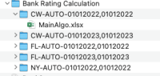

#### Properties Defined in the Folder Name

To organize a big number of files with different versions of rules, versioning by folder can be used.

A naming pattern must be added to the `rules.xml` file, same as for the file name pattern setup or configured via OpenL Studio. The name of the folder where the files with versioned rules are stored must match the pattern.

**Examples of folder naming:**

```
<properties-file-name-pattern>/%state%-%lob%-%startRequestDate,effectiveDate%/MainAlgo.xlsx</properties-file-name-pattern> - for versioning a specific file
<properties-file-name-pattern>/%state%-%lob%-%startRequestDate,effectiveDate%/*.*</properties-file-name-pattern> - for versioning all files in the folder
```




*Defining module level properties in a folder name*

The following Ant and file patterns are supported:

| Pattern           | Description                                         |
|-------------------|-----------------------------------------------------|
| /path/to/file.ext | Absolute path.                                      |
| /\*/              | Any folder.                                         |
| /\*\*/            | Any number of nested folders, including no folders. |
| \*                | Any character of the file name.                     |
| .                 | Separator of the file extension.                    |
| ?                 | Any one symbol of the file name.                    |

Files of one name in different folders are modules of their own. A module is named after its file, and when another
module has that name too, the last folders of its path are added in brackets, as few as tell the modules apart. For
example, the `rules/FL/MainAlgo.xlsx` and `rules/NY/MainAlgo.xlsx` files are the `MainAlgo (FL)` and `MainAlgo (NY)`
modules. To use all versions in another module, add them to its **Environment** table with the asterisk, as
`MainAlgo*`; see
[Defining Dependencies between Modules in the Configuration Table](../03-table-types/09-configuration-table/02-defining-dependencies-between-modules-in-the-configuration-table.md#defining-dependencies-between-modules-in-the-configuration-table).

The name of a module declared in `rules.xml` for one file or folder is kept as written. A name declared for a path
with `*` or `?` is not given to the modules it matches: they are named after their files. Two modules declared under
one name are an error of the project, which every module reports.
