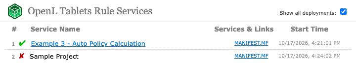
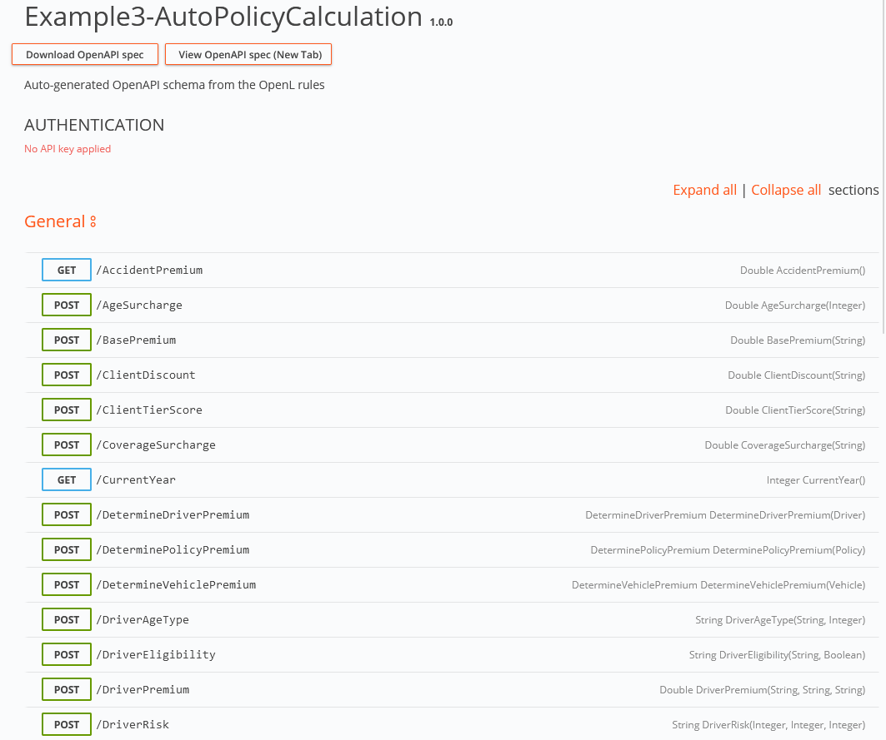
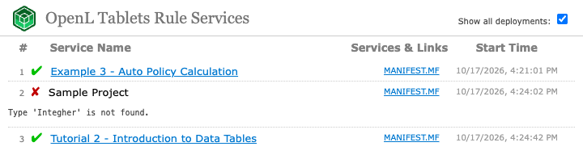

## Appendix B: Projects on the OpenL Rule Services Launch

When the main page of OpenL Rule Services is opened at `<context path>/`, the system displays a list of deployed projects.

*List of projects displayed upon OpenL Rule Services launch*

The successfully deployed projects appear with the green check mark. Click the project name to open the list of available methods for the project in the Swagger UI.

*Expanding project methods*

Projects deployed with errors are marked with the red cross mark that is clickable and displays the error message.

*Viewing error message for a project*
