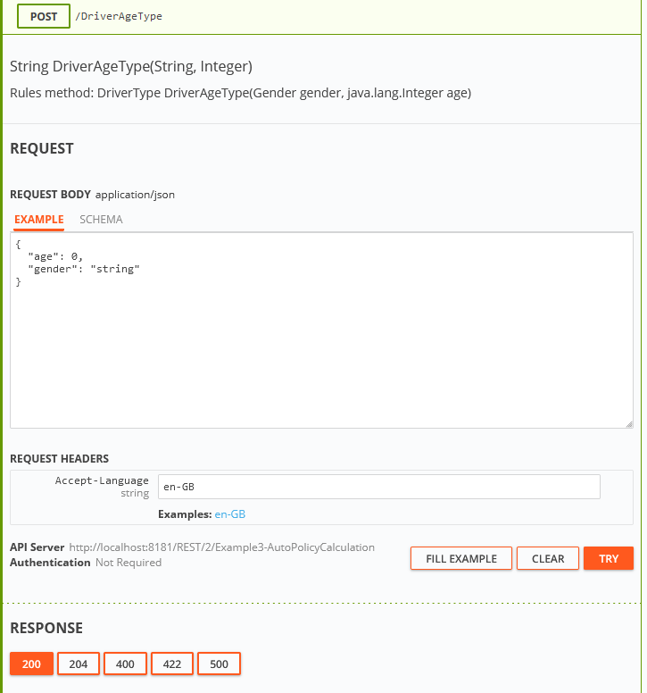

## Appendix D: OpenAPI Support

**Swagger** is an open-source software framework backed by a large ecosystem of tools that helps developers design, build, document, and consume RESTful web services. While most users identify Swagger by the Swagger UI tool, the Swagger toolset includes support for automated documentation, code generation, and test-case generation. For more information on Swagger, see <https://swagger.io/docs/>.

In OpenL, Swagger v3 (OpenAPI) is used. It allows directly accessing project methods, data types, and methods, and enables simple, convenient, and quick running or testing of rules deployed as services.

To use Swagger, on the OpenL Rule Services main page, click the project name, select the required rule, enter input parameters, and click **TRY**.



*Using Swagger UI*

### Datatypes with Children

A field, a parameter, or a result of a datatype that other datatypes extend may hold a value of any of them. The OpenAPI schema tells it as follows:

- **With the type property**, the default — the schema of the datatype has a discriminator: the type property of a value, `@class` unless `jackson.typingPropertyName` names another one, tells its datatype.
- **With the datatype deduced from the fields**, when `jackson.jsonTypeInfoId` is `DEDUCTION` — every place that refers to the datatype lists it and all its children through `anyOf`, the datatype first, then its children by name.
- **Without the type property**, when `jackson.defaultTypingMode` is `DISABLED` — a value sent is read as the declared datatype, and the fields of a child are not read. So a request body, a parameter and a field of a datatype that only requests hold refer to the declared datatype. A result and a field of a datatype that a result holds list the datatype and all its children through `anyOf`, as a value of a child may be returned.

A value of a child matches the schema of its parent too, so the list is `anyOf`, not `oneOf`.

```json
"myField": {
  "anyOf": [
    { "$ref": "#/components/schemas/MyDatatype" },
    { "$ref": "#/components/schemas/MyCustomDatatype" }
  ]
}
```

In both cases, the schema of a child extends the schema of its parent through `allOf`.
